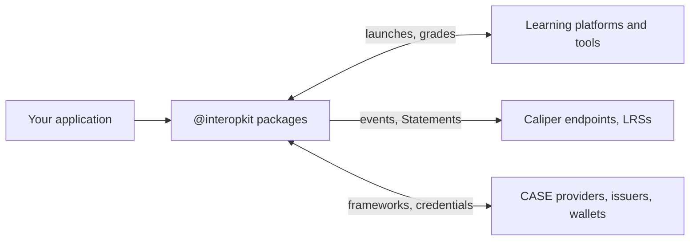

# interopkit

Learning standards for JavaScript and TypeScript: LTI 1.3, Caliper 1.2, xAPI 2.0, cmi5, CASE 1.1, Open Badges 3.0, CLR 2.0 and
the ecdsa-sd-2023 cryptosuite.

| Package | What it is |
| --- | --- |
| [`@interopkit/tool-integration`](https://interopkit.dev/_interopkit/tool-integration/) | LTI 1.3, in the tool and the platform role |
| [`@interopkit/learning-analytics`](https://interopkit.dev/_interopkit/learning-analytics/) | Caliper Analytics 1.2 events, a sensor and an endpoint |
| [`@interopkit/competency-frameworks`](https://interopkit.dev/_interopkit/competency-frameworks/) | CASE 1.1 and 1.0 frameworks, a client and a provider |
| [`@interopkit/learning-records`](https://interopkit.dev/_interopkit/learning-records/) | xAPI 2.0 and 1.0.3 Statements, an LRS client and handler, xAPI Profiles 1.0 |
| [`@interopkit/achievement-credentials`](https://interopkit.dev/_interopkit/achievement-credentials/) | Open Badges 3.0 and CLR 2.0 credentials, their proofs, status and verification |
| [`@interopkit/selective-disclosure`](https://interopkit.dev/_interopkit/selective-disclosure/) | The ecdsa-sd-2023 cryptosuite |
| [`@interopkit/course-launch`](https://interopkit.dev/_interopkit/course-launch/) | cmi5 course structures, packages, the LMS role and the assignable unit runtime |
| [`@interopkit/core`](https://interopkit.dev/_interopkit/core/) | The shared foundation of the packages |

The guides, the evidence of each package and the API are at [interopkit.dev](https://interopkit.dev/). Two sibling families
build on the same rules: [assesskit](https://assesskit.dev/) for QTI 3.0 assessment, and [measurekit](https://measurekit.dev/)
for psychometrics and knowledge tracing.

LTI® is a trademark of 1EdTech® Consortium, Inc. (1edtech.org).
Caliper Analytics® is a trademark of 1EdTech® Consortium, Inc. (1edtech.org).
CASE® is a trademark of 1EdTech® Consortium, Inc. (1edtech.org).
CLR Standard® is a trademark of 1EdTech® Consortium, Inc. (1edtech.org).
QTI® is a trademark of 1EdTech® Consortium, Inc. (1edtech.org).
W3C® is a trademark of the World Wide Web Consortium.
IEEE is a trademark of the Institute of Electrical and Electronics Engineers, Inc.
interopkit is not affiliated with, endorsed by or approved by 1EdTech Consortium, Inc., W3C, IEEE or ADL.
