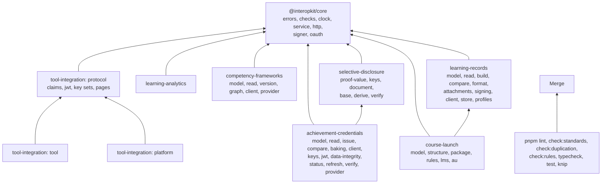

# AGENTS.md

Conventions for people and coding agents working in this repository. Read this before changing anything. Most rules are
enforced by `pnpm lint` (Biome and cspell), `pnpm check:standards`, `pnpm check:duplication`, `pnpm check:rules`, `pnpm typecheck`,
`pnpm knip` and `pnpm docs:api`; the rest are checked in review.

interopkit is a toolkit for learning standards, and the W3C credential standards beneath them that no trusted library
implements, in JavaScript and TypeScript, in one repository:
`@interopkit/core` is the shared foundation, `@interopkit/tool-integration` implements LTI 1.3 in both roles, and
`@interopkit/learning-analytics` implements Caliper Analytics 1.2 and reads 1.1, `@interopkit/competency-frameworks` implements the
CASE model, its readers, what a consumer asks of a framework, and a client and a provider of the REST binding,
`@interopkit/learning-records` implements the xAPI Statement of 2.0 and 1.0.3 and its readers, the message of its Attachments, its signature, a client of an LRS, the handler of its requests, and xAPI Profiles 1.0 with the validation of Statements against them,
`@interopkit/selective-disclosure` implements the `ecdsa-sd-2023` cryptosuite, and `@interopkit/achievement-credentials`
implements the model and the readers of Open Badges 3.0 and CLR 2.0, its builders and comparisons, baking in images, the client and the provider of the Open Badges and CLR APIs, the keys that verify them, their JWT and Data Integrity proofs, their status lists, their refresh and their verification, and it reads and verifies Open Badges 2.0.
`@interopkit/course-launch` implements cmi5: its vocabularies, the course structure with its reader, validator and writer,
course packages in ZIP or XML, the rules of the statements of a session with the readers of what a launch gives, the LMS
role over the LRS of `learning-records`, and the runtime of an assignable unit.

## Terms

Use these words with these meanings in code, comments and docs.

| Term             | Meaning                                                                                                                                                                                                 |
| ---------------- | ------------------------------------------------------------------------------------------------------------------------------------------------------------------------------------------------------- |
| platform         | The system that launches tools and keeps the grades: a learning management system. In code, the platform role                                                                                           |
| tool             | The system that a platform launches. In code, the tool role                                                                                                                                             |
| launch           | One start of a tool by a platform: a login request, an authentication response and an `id_token` with the claims of the message                                                                         |
| registration     | What a platform and a tool know of each other: issuer, client id, deployment and the addresses of their endpoints                                                                                       |
| message          | What a launch carries: a `MessageInput` that the host gives the platform role, which keeps it in the host's `LaunchStore` until the tool's authentication request                                       |
| line item        | A column of the gradebook of a context; a tool posts scores to it                                                                                                                                       |
| score            | The grade of one user for one line item, with its progress and a timestamp                                                                                                                              |
| port             | An interface that a package defines for what it needs from a host: a store, a lookup, a `fetch`, a `Clock`                                                                                              |
| host             | The application that uses the packages and supplies the ports                                                                                                                                           |
| event            | A Caliper event: an actor, an action on an object, and the time                                                                                                                                         |
| sensor           | The part of a system that builds events and sends them in an envelope to an endpoint                                                                                                                    |
| endpoint         | The service that receives the envelopes                                                                                                                                                                 |
| deadline         | The time a call to a service may take, `timeoutMs`                                                                                                                                                      |
| framework        | A CASE competency framework, held as a package: one document with its items, associations, definitions and rubrics                                                                                      |
| finding          | An `Issue` of `core/checks` that a reader or a validator lists: where, which rule, what is wrong, and its severity                                                                                      |
| Statement        | An xAPI Statement, with a capital S: an Actor, a verb and an Object, with a result and a context when there are any                                                                                     |
| LRS              | The Learning Record Store: the service that receives Statements and shall reject those that break the rules                                                                                             |
| LRP              | A Learning Record Provider: the system that makes Statements and sends them to an LRS                                                                                                                   |
| credential       | An Open Badges or CLR verifiable credential, held as a value of the model: an achievement, an endorsement or a CLR; an Open Badges 2.0 assertion with its BadgeClass and issuer is a `BadgeAssertionV2` |
| provider         | The server side of a 1EdTech REST binding: `handleCaseRequest` over a `FrameworkStore` for CASE, `handleCredentialsRequest` over a `CredentialStore` and a `ProfileStore` for Open Badges and CLR       |
| base proof       | The proof an issuer gives a holder: an HMAC key, the public key of the proof and a signature for each statement to hide                                                                                 |
| disclosure       | A document with only the parts a holder reveals and a derived proof, the signatures of the statements that stay                                                                                         |
| statement        | One canonical N-Quad of a document. A mandatory statement is always revealed; the key of the proof signs each of the others                                                                             |
| course structure | The `cmi5.xml` of cmi5: a course, its objectives, and its assignable units in blocks, held as a `CourseStructure`                                                                                       |
| assignable unit  | The content of cmi5 that an LMS launches, an `au` of the course structure; AU in prose that already says cmi5                                                                                           |
| course package   | A course structure in a ZIP archive with its files, or its XML alone                                                                                                                                    |

## Layout

| Path                                      | Holds                                                                                                                                                                                                                                                                                                                                                                                                                                   |
| ----------------------------------------- | --------------------------------------------------------------------------------------------------------------------------------------------------------------------------------------------------------------------------------------------------------------------------------------------------------------------------------------------------------------------------------------------------------------------------------------- |
| `packages/core/`                          | The shared foundation                                                                                                                                                                                                                                                                                                                                                                                                                   |
| `packages/core/src/errors.ts`             | `InteropkitError`, `DataError`, `LimitError`, `ServiceError`                                                                                                                                                                                                                                                                                                                                                                            |
| `packages/core/src/checks.ts`             | Checks of one value and the valibot side, `buildIssues` and `parseJsonText`, which `@interopkit/core/checks` exports                                                                                                                                                                                                                                                                                                                    |
| `packages/core/src/formats.ts`            | `isDate`, `isDateTime`, `findInstant`, `findIsoInstant`, `isUuid`, `isAbsoluteUri` and their schemas; `checks.ts` exports them, and `parseDateTime`, which throws where `findInstant` returns `undefined`                                                                                                                                                                                                                               |
| `packages/core/src/json.ts`               | `JsonValue`, `copyJson`, `isSameJson`, `MAX_JSON_DEPTH`, the counts of depth and tokens, `endOfJsonString`; `checks.ts` exports them                                                                                                                                                                                                                                                                                                    |
| `packages/core/src/findings.ts`           | `Finding`, `Issue`, `IssueSink`, `createIssueSink`, `safeParseBounded`, `DEFAULT_MAX_FINDINGS`; `checks.ts` exports them                                                                                                                                                                                                                                                                                                                |
| `packages/core/src/clock.ts`              | `Clock`, `SYSTEM_CLOCK`, `readClock`, `checkClock`                                                                                                                                                                                                                                                                                                                                                                                      |
| `packages/core/src/call-options.ts`       | `CallOptions`, the `signal` of every call that waits on I/O                                                                                                                                                                                                                                                                                                                                                                             |
| `packages/core/src/service.ts`            | `Fetch`, `ServiceCall`, `requestService`, `callService`, `requestWithCredential`, `clientOptionsEntries`, `DEFAULT_TIMEOUT_MS`                                                                                                                                                                                                                                                                                                          |
| `packages/core/src/answer-headers.ts`     | `hasNextPage`, `readRetryAfterSeconds`, `findLinkTarget`: the paging and retry headers of an answer                                                                                                                                                                                                                                                                                                                                     |
| `packages/core/src/answer.ts`             | `readAnswerJson`, `readAnswer`, `readStatusInfo`: the JSON, the data and the status of the answer of a service, for a client                                                                                                                                                                                                                                                                                                            |
| `packages/core/src/http/`                 | The request and answer types and their helpers, which `@interopkit/core/http` exports                                                                                                                                                                                                                                                                                                                                                   |
| `packages/core/src/signer/`               | `Signer`, `createCryptoKeySigner`, `signCompactJws`                                                                                                                                                                                                                                                                                                                                                                                     |
| `packages/core/src/random.ts`             | `Random`, `SYSTEM_RANDOM`                                                                                                                                                                                                                                                                                                                                                                                                               |
| `packages/core/src/oauth/`                | The OAuth 2.0 clients and the token cache, which `@interopkit/core/oauth` exports                                                                                                                                                                                                                                                                                                                                                       |
| `packages/core/src/race-abort.ts`         | `raceAbort`, which ends a wait when a signal aborts                                                                                                                                                                                                                                                                                                                                                                                     |
| `packages/core/src/keyed-cache.ts`        | `createKeyedCache`: values by key with a lifetime, whose loads are shared work                                                                                                                                                                                                                                                                                                                                                          |
| `packages/core/src/call-port.ts`          | `callPort`, which turns the failure of a port into a value for a handler                                                                                                                                                                                                                                                                                                                                                                |
| `packages/tool-integration/`              | LTI 1.3: `errors.ts`, `protocol/` (`claims/`, `message/`, one folder for each service body), `tool/`, `platform/`                                                                                                                                                                                                                                                                                                                       |
| `packages/learning-analytics/`            | Caliper 1.2, and 1.1 read: `model/`, `v1p1/`, `read/`, `validate/`, `build/`, `send/`, `endpoint/`                                                                                                                                                                                                                                                                                                                                      |
| `packages/competency-frameworks/`         | CASE 1.1 and 1.0: `model/`, `read/`, `version/`, `graph/`, `client/`, `provider/`                                                                                                                                                                                                                                                                                                                                                       |
| `packages/learning-records/`              | xAPI 2.0 and 1.0.3: `model/`, `read/`, `build/`, `compare/`, `format/`, `attachments/`, `signing/`, `client/`, `store/`; xAPI Profiles 1.0: `profiles/` (the model, the reader and the rules of a profile, the JSONPath of its rules, and the matching of Statements against its templates and Patterns)                                                                                                                                |
| `packages/selective-disclosure/`          | `ecdsa-sd-2023`: `proof-value/`, `keys/`, `document/`, `base/`, `derive/`, `verify/`                                                                                                                                                                                                                                                                                                                                                    |
| `packages/achievement-credentials/`       | Open Badges 3.0 and CLR 2.0, and the reading and verification of Open Badges 2.0: `model/`, `read/`, `issue/`, `compare/`, `baking/`, `client/`, `keys/`, `jwt/`, `data-integrity/`, `status/`, `refresh/`, `verify/`, `provider/`                                                                                                                                                                                                      |
| `packages/course-launch/`                 | cmi5: `model/`, `structure/` (the course structure, its schema enforced by the reader), `package/` (ZIP and XML packages through zip.js), `rules/` (the launch URL, the launch data, the preferences and the rules of a session), `lms/` (registrations, launches, the fetch URL, the rules of cmi5 on the host's LRS, satisfaction, abandoned sessions and waivers), `au/` (the runtime of an assignable unit)                         |
| `packages/<name>/test/`                   | `<module>.test.ts` per module; `.fuzz`, `.corpus`, `.spec` or `.browser` before `.test.ts`; `*.bench.ts`                                                                                                                                                                                                                                                                                                                                |
| `docs/<package>/`                         | The guides of each package, one per module, with its `supported.md`, `evidence.md`, `choosing.md`, `comparators.md`, `spec-gaps.md` and `performance.md`; TypeDoc publishes them with the API reference                                                                                                                                                                                                                                 |
| `docs/typedoc-seo.ts`, `docs/favicon.svg` | The plugin of TypeDoc that makes the docs site from `scripts/family.ts`, and the icon of the site; `.github/workflows/docs.yml` deploys the site to GitHub Pages and stays disabled until the repository is public                                                                                                                                                                                                                      |
| `examples/<package>/`                     | Runnable examples, each a package of its own; the `test/` of an example runs it                                                                                                                                                                                                                                                                                                                                                         |
| `compat/`                                 | The scenarios of the examples on each runtime                                                                                                                                                                                                                                                                                                                                                                                           |
| `scripts/family.ts`                       | The identity of the family, which the standards check, the docs site and `llms.txt` read                                                                                                                                                                                                                                                                                                                                                |
| `scripts/`                                | The standards, duplication and mutation checks (`scripts/rules/<package>.ts` holds the rules of each package), the harness of the peak-memory tests, pinned downloads, and the oracle and generators that tests share                                                                                                                                                                                                                   |
| `validation/`                             | Python scripts that write fixtures, the containers of counterparties (`validation/opensalt/`, `validation/sql-lrs/`, `validation/1edtech-validator/`), the ADL suite (`validation/adl-lrs/`), the W3C suites (`validation/w3c-suites/`), PyLTI1p3 (`validation/pylti1p3/`), Moodle (`validation/moodle/`), CATAPULT (`validation/catapult/`), and what the runners of the counterparties in containers share (`validation/containers/`) |
| `biome/`                                  | Biome GritQL plugins                                                                                                                                                                                                                                                                                                                                                                                                                    |

## Commands

| Command                                                                    | Does                                                                                                                                                                                                                                                                                                                                                                                                                                                                                                                                                                                                                                                                                                                                                                                                                                                                                                                                                  |
| -------------------------------------------------------------------------- | ----------------------------------------------------------------------------------------------------------------------------------------------------------------------------------------------------------------------------------------------------------------------------------------------------------------------------------------------------------------------------------------------------------------------------------------------------------------------------------------------------------------------------------------------------------------------------------------------------------------------------------------------------------------------------------------------------------------------------------------------------------------------------------------------------------------------------------------------------------------------------------------------------------------------------------------------------- |
| `pnpm install`                                                             | Installs the dependencies and the git hooks                                                                                                                                                                                                                                                                                                                                                                                                                                                                                                                                                                                                                                                                                                                                                                                                                                                                                                           |
| `pnpm lint`                                                                | Biome and cspell; `pnpm format` fixes formatting                                                                                                                                                                                                                                                                                                                                                                                                                                                                                                                                                                                                                                                                                                                                                                                                                                                                                                      |
| `pnpm check:standards`                                                     | The rules of the engineering standards that a tool can check; `node scripts/check-standards.ts <path>...` reports only the files below the paths                                                                                                                                                                                                                                                                                                                                                                                                                                                                                                                                                                                                                                                                                                                                                                                                      |
| `pnpm check:duplication`                                                   | jscpd over `packages/*/src` against the table "Repeats left on purpose" below: a clone that no row lists fails, and so does a file in a row that repeats nothing now                                                                                                                                                                                                                                                                                                                                                                                                                                                                                                                                                                                                                                                                                                                                                                                  |
| `pnpm check:rules`                                                         | Removes each rule of `scripts/rules/<package>.ts` (the runner is `scripts/check-rules.ts`) from a scratch copy and runs its test, which must fail; a run that times out is `TIMED OUT`, never guarded or unguarded, and ends with exit code 2 where 1 means an unguarded rule; a rule with `browser: true` runs its test in Chromium (`BROWSERS=chromium` limits any browser run to one engine); `node scripts/check-rules.ts <path>...` runs only the rules of the files below the paths                                                                                                                                                                                                                                                                                                                                                                                                                                                             |
| `pnpm typecheck`                                                           | `tsc` over every package and the tooling, from the sources: it needs no build                                                                                                                                                                                                                                                                                                                                                                                                                                                                                                                                                                                                                                                                                                                                                                                                                                                                         |
| `pnpm test`                                                                | Vitest, offline, from the sources; `pnpm test:coverage` adds the coverage floor of each module, a folder of a package's `src` or a file beside them, held on its own for statements, functions and lines, and of each package for its branches                                                                                                                                                                                                                                                                                                                                                                                                                                                                                                                                                                                                                                                                                                        |
| `pnpm test:references`                                                     | The libraries of other authors that play the tool against the platform role of `tool-integration` (`@lti-tool/core`, `lti-core`), in the process of the tests; `pnpm test` leaves them out                                                                                                                                                                                                                                                                                                                                                                                                                                                                                                                                                                                                                                                                                                                                                            |
| `pnpm test:browser`                                                        | The browser tests in Chromium, Firefox and WebKit; run `pnpm exec playwright install` first. The Firefox of Playwright does not start on some macOS versions (it did not on macOS 27): run the suite in the container `mcr.microsoft.com/playwright` of the pinned Playwright release, with `--cpus=2` and `--ipc=host`, from a copy of the repository (`pnpm install` installs the git hooks only in a git clone, and skips them in a copy)                                                                                                                                                                                                                                                                                                                                                                                                                                                                                                          |
| `pnpm bench`                                                               | Builds, then times the hot paths of each package one at a time with `vitest bench` against the budgets of its `test/budgets.ts`, each against its reference, in turns where a reference does the same work (`scripts/bench-rounds.ts`); fails above a budget. The references of each package and their ratios are in `docs/<package>/performance.md`                                                                                                                                                                                                                                                                                                                                                                                                                                                                                                                                                                                                  |
| `node scripts/peak-memory.ts <package> [name...]`                          | Prints, for each reading of `packages/<package>/test/peak-memory-readings.ts` or the ones named, the least heap in which it ends on the Node.js that runs it, in steps of 8 MiB, with the rise of the peak and the outcome; run it on Node.js 22 and 24 to choose the heap of a case (`pnpm test` runs the cases)                                                                                                                                                                                                                                                                                                                                                                                                                                                                                                                                                                                                                                     |
| `pnpm opensalt`                                                            | Starts OpenSALT in containers of a project with the name of the run (Docker with Compose; the images are linux/amd64, so an arm64 host emulates them), waits for the database's health for at most 360 s, runs the flows of `examples/competency-frameworks` against it, and removes the containers and their data whatever happens                                                                                                                                                                                                                                                                                                                                                                                                                                                                                                                                                                                                                   |
| `pnpm adl-lrs`                                                             | Runs the ADL conformance suites of xAPI 2.0 and 1.0.3 at their pinned commits against the example LRS, which it starts for each on the loopback address with random credentials; it builds the packages first, and fails on a failed test or on a suite of another size                                                                                                                                                                                                                                                                                                                                                                                                                                                                                                                                                                                                                                                                               |
| `pnpm sql-lrs`                                                             | Starts SQL LRS in a container with the name of the run, 2 CPUs and random credentials, runs the verdicts of the rules and the flows of the example against it, and stops, waits for and removes that container whatever happens                                                                                                                                                                                                                                                                                                                                                                                                                                                                                                                                                                                                                                                                                                                       |
| `pnpm pylti1p3`                                                            | Starts a tool built on PyLTI1p3 2.0.0 in a container with the name of the run and 2 CPUs, runs the launch, services and Deep Linking of the platform role against it over `https` with a certificate authority of the run, and stops, waits for and removes that container whatever happens; it needs Docker and `openssl`                                                                                                                                                                                                                                                                                                                                                                                                                                                                                                                                                                                                                            |
| `pnpm moodle`                                                              | Starts Moodle 5.3 and its database in containers of a project with the name of the run (2 CPUs each, the web server on loopback), installs it, runs both roles of `tool-integration` against it (a tool that Moodle launches, a platform that launches Moodle) with a certificate authority of the run, and removes the project and its volumes whatever happens; it needs Docker, `git` and `openssl`                                                                                                                                                                                                                                                                                                                                                                                                                                                                                                                                                |
| `pnpm w3c-suites`                                                          | Runs the W3C suites of Data Integrity, the EdDSA and ECDSA cryptosuites, Bitstring Status List and the Data Model 2.0 at their pinned commits against the VC-API service of `examples/achievement-credentials`, which it starts with a certificate of the run; it builds the packages first and needs `pnpm schemas`, and fails on a test that fails and is not listed in `suites.lock.json`, on a listed test that passes, and on a suite of another size; the table of its README gives each suite's commit, the date of the count and the sizes, and `scripts/test/w3c-suites.test.ts` compares it with the lock                                                                                                                                                                                                                                                                                                                                   |
| `pnpm validator`                                                           | Builds the public validator of 1EdTech from its pinned commit, starts it in a container with the name of the run and 2 CPUs, validates the credentials of `examples/achievement-credentials` with it, and stops, waits for and removes that container whatever happens; it needs Docker and `pnpm schemas` first                                                                                                                                                                                                                                                                                                                                                                                                                                                                                                                                                                                                                                      |
| `pnpm catapult-lms`                                                        | Runs CATAPULT's LMS suite at its pinned commit in the Chromium of Playwright against the example LMS of `course-launch`, which it starts over https on the loopback address with a certificate and credentials of the run; it builds the packages first and needs `pnpm exec playwright install chromium`, and fails on a test that fails or a suite of another size                                                                                                                                                                                                                                                                                                                                                                                                                                                                                                                                                                                  |
| `pnpm catapult-content`                                                    | Builds the images of CATAPULT's content suite and player from the pinned sources, starts them with Compose in a project of the run (`COMPOSE_PROJECT_NAME`), plays every unit of the course examples with the runtime of `course-launch`, and removes the project and its volumes whatever happens; it builds the packages first and needs Docker                                                                                                                                                                                                                                                                                                                                                                                                                                                                                                                                                                                                     |
| `pnpm knip`                                                                | Unused files, exports and dependencies                                                                                                                                                                                                                                                                                                                                                                                                                                                                                                                                                                                                                                                                                                                                                                                                                                                                                                                |
| `pnpm build`                                                               | `tsc -b` after deleting `dist/`, so that no stale output ships                                                                                                                                                                                                                                                                                                                                                                                                                                                                                                                                                                                                                                                                                                                                                                                                                                                                                        |
| `pnpm check:packages`                                                      | Builds, then publint and Are the Types Wrong on the packed packages                                                                                                                                                                                                                                                                                                                                                                                                                                                                                                                                                                                                                                                                                                                                                                                                                                                                                   |
| `pnpm check:release`                                                       | Every package of a changeset is published (not private, with `publishConfig.access`), and a package at 0.0.0 takes `major`, so that its first release is 1.0.0, with notes that tell no change against an earlier state                                                                                                                                                                                                                                                                                                                                                                                                                                                                                                                                                                                                                                                                                                                               |
| `pnpm check:tarballs`                                                      | Builds, packs every package, installs the tarballs into a scratch project, imports every subpath in Node.js and type-checks them with `bundler` and `node16` resolution                                                                                                                                                                                                                                                                                                                                                                                                                                                                                                                                                                                                                                                                                                                                                                               |
| `pnpm check:licenses`                                                      | Every production dependency has an allowed license                                                                                                                                                                                                                                                                                                                                                                                                                                                                                                                                                                                                                                                                                                                                                                                                                                                                                                    |
| `pnpm check:audit`                                                         | `pnpm audit --prod` at any severity and `pnpm audit` at high severity                                                                                                                                                                                                                                                                                                                                                                                                                                                                                                                                                                                                                                                                                                                                                                                                                                                                                 |
| `pnpm compat:runtimes`                                                     | The scenarios of the examples on Node.js, Deno, Bun and workerd, the Data Integrity libraries bundled as their Node.js build for the first three and as their browser build for workerd; it builds the packages first, fails when a file of a package that is not in its `dist` enters a bundle, and needs Deno and Bun installed or the runtimes named: `pnpm compat:runtimes node workerd`                                                                                                                                                                                                                                                                                                                                                                                                                                                                                                                                                          |
| `pnpm docs:api`                                                            | Builds, then TypeDoc into `docs/api`, which reads the packages through their `dist` and fails on undocumented exports. The plugin `docs/typedoc-seo.ts` makes the site of `SITE` (the `structure-dir` router): each page titled `<heading> · <package> (<standard>)` with a description from its own text and a canonical URL, the sitemap of those URLs, a Markdown copy beside each README and guide, `llms.txt` by `scripts/llms.ts`, `robots.txt`, `CNAME`, `404.html` and the lines of the marks in the footer                                                                                                                                                                                                                                                                                                                                                                                                                                   |
| `pnpm check:site`                                                          | After `pnpm docs:api`, the test of the built site (`scripts/check-site.ts`): a title of its own, a description other than TypeDoc's and one canonical URL, listed by the sitemap, on every page; the Markdown copy of every README and guide; the parts of `llms.txt`; every link to the site from the READMEs, the copies and `llms.txt` reaching a file of it; no two addresses of the site differing only by case                                                                                                                                                                                                                                                                                                                                                                                                                                                                                                                                  |
| `pnpm corpus`, `pnpm schemas`, `pnpm spec-examples`, `pnpm caliper-tables` | Download the pinned repositories, files, specification examples and the tables of the Caliper pages that tests read into `.cache/`, through `scripts/download.ts`, which aborts a download that brings no byte for 30 s and tries one that fails or stalls three times in all, and keep what holds its pinned hash, so that CI caches each by the hash of its lock (a page of a living site, such as the open portal of 1EdTech, names an `extract` in `schemas.lock.json`: its hash is that of the text of its specification, with the navigation, the scripts and the attributes of its tags taken off, and that text is the file the tests read); `pnpm corpus:pin`, `pnpm schemas:pin`, `pnpm spec-examples:pin` and `pnpm caliper-tables:pin` write new hashes. `pnpm test:corpus` runs after `pnpm schemas`, `pnpm corpus` and `pnpm caliper-tables`, and `pnpm test:spec` after `pnpm spec-examples`, `pnpm caliper-tables` and `pnpm schemas` |

Run all of them before finishing a change. CI runs each job of `.github/workflows/ci.yml` on a fresh clone with nothing but
`pnpm install`, so a gate can pass on a working copy that holds a `dist/` or a `.cache/` that an earlier gate left, and fail in
CI. Run each job that the change touches in a fresh clone of the commit (`git clone . ../fresh`, then `pnpm install
--frozen-lockfile` there), with the steps of the job in its order. A gate that needs a build or a download gets the step for it
in its job.

A job runs only when what it reads changed since the last green run of main: its packages, what they use, the lockfile, the
root configuration, the shared scripts or `ci.yml`; `changes` in `ci.yml` computes it and `check` always runs. A script that the
tests of one package alone read, such as `scripts/cmi5-requirements.ts`, is that package's (`MEMBER_SCRIPTS`). A newer push to
the same ref cancels the run in progress, and a cancelled run is not a failure. Every job of every workflow has a
`timeout-minutes` of about three times its last green time, so a hung job stops.

`rules` is not a job of `ci.yml`: `rules.yml` runs it each Monday, on `workflow_dispatch` and from `release.yml`, which publishes
only when it passes, so that per-push CI stays short as Actions minutes are limited. A builder runs the rules of its package
before a merge (`pnpm check:rules packages/<package>`).

`browsers`, `catapult-lms` and `rules` run in the image of the Playwright that the lock file pins, which holds the browsers,
so that no job installs them: a bump of Playwright changes the tag in both workflows, which `scripts/test/versions.test.ts`
holds to the lock file.

Development needs Node.js 22.18+ and pnpm 12. The scripts in `scripts/` are TypeScript that Node runs directly, so their
relative imports end in `.ts`. On a shared machine run Vitest with `--maxWorkers=2` and containers with `--cpus=2`. The runners of the counterparties in containers (`opensalt`, `sql-lrs`, `pylti1p3`, `moodle`, `validator`) name their containers with `CONTAINER_NAME`, or `COMPOSE_PROJECT_NAME`, and else `interopkit-<counterparty>-<8 hex digits>` (`runName` of `validation/containers/host.ts`, which also holds their other shared helpers).

## Releases

- Changesets version and publish the packages, each on its own version. A release has one changeset per package in
  `.changeset/`; a change made before the release extends it, so that its notes state what the release is. Changesets, docs
  and TSDoc describe current behavior only. A package's changeset is written last, from the API table of its README.
- A package at 0.0.0 takes `major` in its first changeset, so that it is released as 1.0.0. `pnpm check:release` fails on a
  `minor` or a `patch` for it, on notes of it that tell of an earlier state, which the reader of 1.0.0 never had ("(was `",
  "no longer", "is gone", "in place of", "renamed"), and on a package of a changeset that is private or lacks
  `publishConfig.access`.
- A pull request from a `changeset-release/` branch runs `pnpm changeset version`, which bumps the versions, writes
  `CHANGELOG.md` and consumes the changesets; after it merges, the maintainer runs the Release workflow by hand from the public
  repository: it runs `rules.yml` and, when it passes, `pnpm release`, which builds and publishes the versions not yet on npm
  with provenance, the first version of each package with the short-lived token of the secret `NPM_TOKEN` and later ones
  through each package's trusted publisher; then `scripts/github-release.ts` creates one GitHub release named by the date with
  the versions published and their changelog entries (`node scripts/github-release.ts --dry-run` prints it and creates
  nothing). No workflow opens pull requests, and Dependabot version updates are off.
- At the public release the owner sets what a repository file cannot: the repository's description (the family's sentence of
  `scripts/family.ts`), topics and homepage, the social preview (`.github/social-preview.png`, drawn from
  `.github/social-preview.svg`), the organization's profile (`.github/profile/README.md`, copied into the organization's
  `.github` repository), the domain of `SITE` with Pages and `docs.yml`, and Zenodo, which reads `CITATION.cff`. Context7 reads
  `context7.json`, whose description and rules `pnpm check:standards` holds to the family's sentence and `FACTS`.

## Boundaries

- interopkit owns the messages between a platform and a tool, the gradebook protocol, the Caliper event model, sensor and
  endpoint, the CASE model with its readers, the questions a consumer asks of a framework, the client of its REST binding,
  the handlers of a CASE provider, the xAPI Statement of 2.0 and 1.0.3 with its readers, the message of its Attachments, its signature, the client of an LRS and the handler of its requests, and xAPI Profiles with the matching of Statements against their templates and Patterns. It does not own what a launched tool shows, what a
  score means, which delivery event becomes which Caliper or xAPI event, QTI content, or databases, servers, sessions and accounts. Those belong to the tool, to
  assesskit and measurekit, to the adapter of each product and to the host.
- `achievement-credentials` owns the model of Open Badges 3.0 and CLR 2.0 with its readers, its builders, the comparison of
  credentials, baking in PNG and SVG images, the client and the provider of the Open Badges and CLR APIs, the keys that verify credentials with
  their binding to the issuer, the JWT and Data Integrity proofs with the loader of contexts and their pins, the status lists
  and the refresh, the verification of a credential with its endorsements and the credentials of a CLR, and the model, the
  reader and the verification of Open Badges 2.0, with its baked images. It does not own JSON-LD processing and the
  cryptosuites (the Interop Alliance libraries do them), an authorization server, the OAuth 2.0 clients (those of
  `core/oauth`), the issuing, signing and baking of Open Badges 2.0 (Open Badges 3.0 supersedes it), nor wallets, issuing
  platforms and storage. It reaches the network only through a `Fetch` that the caller passes.
- `selective-disclosure` owns the `ecdsa-sd-2023` cryptosuite in its three roles. It does not own JSON-LD processing and
  canonicalization (the primitives of `@digitalbazaar/di-sd-primitives` do them), the resolution and binding of keys, the
  loader of contexts and their pins, other suites, or a verifiable credential data model: the caller passes a key and a loader.
- Packages of different families never import each other. interopkit defines ports (a store, a lookup, a `Fetch`, a `Clock`)
  or speaks an open standard, and an adapter to another family lives in the examples of that family or in the host. Names of
  QTI (`ItemKey`, `LtiLink`) never appear in interopkit.
- The packages use no platform API outside web standards: no `node:*`, no `process`, no DOM, and `fetch` appears only as an
  option that the caller passes. They run in Node.js, browsers, Deno, Bun and Cloudflare Workers. The `lib` of every
  `tsconfig` is `ES2023` and `WebWorker`, and `types` is empty, so `tsc` fails on a platform API. The primitives of
  `selective-disclosure` import `node:crypto` on Node.js and Web Crypto where a bundler applies the `browser` field of their
  package; the code of the package uses Web Crypto only.

## Dependencies

- A package imports only what its row in the diagram above allows, and a module only what its row below allows; imports never
  form cycles. Biome enforces the rows (`noRestrictedImports` in `biome.json`):

| Package                   | Module                                                                                                                                         | Imports                                                                        | Never imports                                                                                   | Note                                                                                                           |
| ------------------------- | ---------------------------------------------------------------------------------------------------------------------------------------------- | ------------------------------------------------------------------------------ | ----------------------------------------------------------------------------------------------- | -------------------------------------------------------------------------------------------------------------- |
| `tool-integration`        | `protocol/`                                                                                                                                    | `core`                                                                         | `tool/`, `platform/`                                                                            |                                                                                                                |
|                           | `protocol/claims/`                                                                                                                             | nothing else of the package                                                    | every other folder                                                                              |                                                                                                                |
|                           | `protocol/message/` and each service folder: `grades/`, `roster/`, `groups/`, `content-items/`, `registration/`, `proctoring/`, `preferences/` | `claims/`                                                                      | each other                                                                                      |                                                                                                                |
|                           | `tool/`, `platform/`                                                                                                                           | `protocol/`                                                                    | each other                                                                                      |                                                                                                                |
| `competency-frameworks`   | `model/`                                                                                                                                       | no other module                                                                |                                                                                                 |                                                                                                                |
|                           | `read/`, `version/`, `graph/`                                                                                                                  | `model/`                                                                       | each other                                                                                      |                                                                                                                |
|                           | `client/`                                                                                                                                      | `read/`                                                                        | `provider/`                                                                                     |                                                                                                                |
|                           | `provider/`                                                                                                                                    | `read/`, `version/`                                                            | `client/`                                                                                       |                                                                                                                |
| `selective-disclosure`    | `proof-value/`, `keys/`, `document/`                                                                                                           | none of the other folders                                                      |                                                                                                 |                                                                                                                |
|                           | `base/`, `derive/`, `verify/`                                                                                                                  | those three                                                                    | each other                                                                                      |                                                                                                                |
| `achievement-credentials` | `model/`                                                                                                                                       | no other module                                                                |                                                                                                 |                                                                                                                |
|                           | `read/`, `keys/`                                                                                                                               | `model/` only                                                                  |                                                                                                 |                                                                                                                |
|                           | `issue/`, `compare/`, `baking/`, `client/`                                                                                                     | `model/`, `read/`                                                              | each other                                                                                      |                                                                                                                |
|                           | `jwt/`, `data-integrity/`                                                                                                                      | `model/`, `read/`, `keys/`                                                     | each other                                                                                      |                                                                                                                |
|                           | `status/`                                                                                                                                      | `model/`, `read/`, `keys/`, `jwt/`                                             |                                                                                                 | `data-integrity/` only dynamically: a test keeps a verifier of JWTs free of JSON-LD                            |
|                           | `refresh/`                                                                                                                                     | `model/` and `core` only                                                       |                                                                                                 |                                                                                                                |
|                           | `verify/`                                                                                                                                      | every folder but `baking/` and `client/`                                       |                                                                                                 | `data-integrity/` only dynamically; no other module imports `verify/`                                          |
|                           | `provider/`                                                                                                                                    | `model/`, `read/`, `jwt/`, the `internal.ts` of `verify/`                      |                                                                                                 | The `index.ts` of `verify/` only dynamically, so that a provider that does not verify never loads the verifier |
| `learning-records`        | `model/`                                                                                                                                       | no other module                                                                |                                                                                                 |                                                                                                                |
|                           | `read/`                                                                                                                                        | `model/` only                                                                  |                                                                                                 |                                                                                                                |
|                           | `build/`, `compare/`, `format/`                                                                                                                | `model/`, `read/`                                                              | each other                                                                                      |                                                                                                                |
|                           | `attachments/`                                                                                                                                 | `model/`, `read/`                                                              |                                                                                                 |                                                                                                                |
|                           | `signing/`                                                                                                                                     | `model/`, `read/`, `compare/`, `attachments/`                                  |                                                                                                 |                                                                                                                |
|                           | `client/`                                                                                                                                      | `model/`, `read/`, `compare/`, `attachments/`                                  |                                                                                                 |                                                                                                                |
|                           | `store/`                                                                                                                                       | every folder but `build/` and `client/`                                        |                                                                                                 |                                                                                                                |
|                           | `profiles/`                                                                                                                                    | `model/`, `read/`                                                              | every other folder                                                                              | A host that judges Statements against a profile loads no client, LRS or signature                              |
| `learning-analytics`      | `model/`                                                                                                                                       | no other module                                                                |                                                                                                 |                                                                                                                |
|                           | `v1p1/`                                                                                                                                        | `model/` alone                                                                 |                                                                                                 |                                                                                                                |
|                           | `read/`                                                                                                                                        | `model/`, `v1p1/`                                                              |                                                                                                 |                                                                                                                |
|                           | `validate/`                                                                                                                                    | `model/`, `v1p1/`, `read/`                                                     |                                                                                                 |                                                                                                                |
|                           | `build/`                                                                                                                                       | `model/`, `read/`, `validate/`                                                 | `v1p1/`: 1.1 is read and never written                                                          |                                                                                                                |
|                           | `send/`                                                                                                                                        | `model/`, `build/`                                                             | `endpoint/`, `v1p1/`                                                                            |                                                                                                                |
|                           | `endpoint/`                                                                                                                                    | `model/`, `v1p1/`, `read/`, `validate/`                                        | `send/`                                                                                         |                                                                                                                |
| `course-launch`           | `model/`                                                                                                                                       | no other module                                                                |                                                                                                 |                                                                                                                |
|                           | `structure/`                                                                                                                                   | `model/` alone                                                                 | zip.js, so that a host that reads a structure from elsewhere never loads the ZIP code; `rules/` |                                                                                                                |
|                           | `package/`                                                                                                                                     | `model/`, `structure/`                                                         | any rule                                                                                        |                                                                                                                |
|                           | `rules/`                                                                                                                                       | `model/`, `learning-records` alone                                             | `structure/`                                                                                    |                                                                                                                |
|                           | `lms/`                                                                                                                                         | `model/`, `structure/`, `rules/`, the client and the LRS of `learning-records` | `package/`, `au/`                                                                               |                                                                                                                |
|                           | `au/`                                                                                                                                          | `model/`, `rules/`, the client of `learning-records` alone                     | `lms/`                                                                                          |                                                                                                                |

- A module imports another module of its package only through that module's `index.ts` (its public API) or its `internal.ts`
  (what the package's other modules and its tests share and the package does not export), never by a deep file path. A file
  directly in `src/`, such as `errors.ts` and `checks.ts`, is not in a module. `pnpm check:standards` enforces it.
- `internal.ts` cannot cross packages, so everything the packages share is a public export of `core`, covered by SemVer.
- Runtime dependencies are listed in the `package.json` of the package that loads them, pinned to an exact version at least
  3 days old, and recorded in `SECURITY.md` with their reason and license. `pnpm-workspace.yaml` sets
  `minimumReleaseAge` so that an install cannot pick a younger version. Development dependencies are exact too, and
  `scripts/test/versions.test.ts` fails on a range in any `package.json` of the workspace. `@types/node` stays on the oldest
  supported Node.js major, and Dependabot ignores its major versions.
- Generic concerns use mature libraries: `jose` for JOSE, `@interop/did-method-key`, `@interop/did-web-resolver` and the Multikey
  packages and the Data Integrity packages of the Interop Alliance (`@interop/jsonld-signatures`, `data-integrity-proof`,
  `ed25519-signature`, `ecdsa-signature`, `jsonld`) for DIDs, Multikeys and the cryptosuites, `valibot` for schemas, `uuid` for name-based UUIDs, `@noble/hashes` for the hashes of an identity and of an address, `oauth4webapi` for
  OAuth 2.0 clients,
  `@remix-run/multipart-parser` for `multipart/mixed` messages, `saxes` for the XML of an SVG and of a course structure,
  `@zip.js/zip.js` for ZIP archives, through `lib/zip-core-native.js` and never with workers. Hand-written
  code is for domain logic that no library does correctly, with the reason in the guide of the module; the scan of `learning-records`
  for a property given twice is such code, since a parser that sees one builds a tree at seventeen times the time of `JSON.parse`.
- Candidates that were compared and not adopted may be development dependencies, as counterparties in tests: Digital Bazaar's
  `ecdsa-sd-2023` suite with `@digitalbazaar/data-integrity`, `jsonld-signatures` and `@digitalbazaar/ecdsa-multikey`, which
  sign, derive and verify beside `selective-disclosure`, and `jsonld`, whose default loader the loader test makes fail. For
  `tool-integration`: `@lti-tool/core` and `lti-core`, tools of other authors that launch from its platform role. For
  `achievement-credentials`: `@digitalbazaar/vc` with its `eddsa-rdfc-2022` suite and its `did:key` driver, `@interop/verifier-core`,
  `@digitalcredentials/verifier-core` and `did-jwt-vc` with `did-jwt`, which verify what the package signs and sign what it
  verifies, and are timed against its proofs, its JWTs and `verifyCredential`, Digital Bazaar's `ecdsa-sd-2023` suite, timed
  against `verifyProof` of a disclosure, and `@interop/vc-bitstring-status-list`, timed against the status lists; `pnpm-workspace.yaml` overrides the `zod` of `@interop/verifier-core`, which
  asks for a version that has a known vulnerability and no repair.
  `esbuild` is a development dependency of the repository, for `scripts/entry-size.ts` and `scripts/peak-memory.ts`, and of `compat`, which bundles the scenarios.
  `jscpd` is a development dependency of the repository, for `scripts/check-duplication.ts`: the scan for repeated code.
  `libxml2-wasm` is a development dependency of the repository, for `scripts/xsd-oracle.ts`: libxml2, the validator that the
  tests run a published XML schema through, as the oracle of a reader that enforces the schema itself.
  `@cfworker/json-schema` is a development dependency of the repository, for `scripts/schema-oracle.ts`: the validator that
  tests run the published JSON schemas of a standard through, and a dependency of `achievement-credentials` for the schemas that a
  credential names beyond those of 1EdTech. `oidc-provider` is a development dependency of `core` and of
  `achievement-credentials`: the authorization server that their OAuth tests run against. For `course-launch`: `@xapi/cmi5`, a
  development dependency of `examples/course-launch` and a unit of other authors that plays sessions against the example LMS;
  `pnpm-workspace.yaml` leaves out the axios and `@xapi/xapi` that it declares, which its build carries.
- `pnpm check:audit` lets four advisories below high pass, all of development dependencies that read no untrusted input
  (2026-11-06): minimatch 10.2.6 (GHSA-g3hv-75wg-m249), which TypeDoc runs on the entry points of `typedoc.json`, and whose
  repair, minimatch 11, makes private the `matchOne` that TypeDoc calls; `@stablelib/ed25519` 1.0.3 (GHSA-x3ff-w252-2g7j),
  which `@digitalcredentials/verifier-core` loads to verify the credentials of the tests, and whose repair is a major
  version that its loader does not take; and uuid 9.0.1 (GHSA-w5hq-g745-h8pq) and deepmerge 4.3.1 (GHSA-gcqx-w48m-w2h4, with
  no repair), which `@xapi/cmi5`, the counterparty of the cmi5 example, carries. `pnpm-workspace.yaml` overrides fast-uri with
  the release that repairs its four advisories.

## Deviations from the standards

Where the code departs from a rule of the family, with the reason.

| Rule                                                                         | What the repository does                                                                                                                      | Reason                                                                                                                                                                                                                                                                                                                                                                                                                                               |
| ---------------------------------------------------------------------------- | --------------------------------------------------------------------------------------------------------------------------------------------- | ---------------------------------------------------------------------------------------------------------------------------------------------------------------------------------------------------------------------------------------------------------------------------------------------------------------------------------------------------------------------------------------------------------------------------------------------------- |
| Each type is exported by the entry that owns it, never re-exported by a root | The root of a package re-exports the types of the packages it depends on that its API names, such as `Clock`, `Signer` and `Issue` of `core`  | A user installs one package, and pnpm does not let a program import a dependency of a dependency, so a type of `core` in a signature must come from the package a user installed; these names have two entries, the dependency's and the root's, `scripts/test/root-types.test.ts` holds each root to exactly the names its declarations use, and `InteropkitError`, the base class of `LtiError`, is exported as a value so that `instanceof` holds |
| Clocks and randomness come only through injected sources                     | The randomness of `state`, `nonce`, `jti` and hints, and of the fetch codes and tokens of `course-launch`, is not injected                    | A source that a host or a test could replace could make secrets predictable; tests observe the values in the store instead                                                                                                                                                                                                                                                                                                                           |
| Signing takes a `Signer` of `@interopkit/core`, never a key ([Code](#code))  | The platform role of `tool-integration` seals its hints and tokens with an HMAC `CryptoKey` through `jose`, not a `Signer`                    | A sealed token is the platform's own, which only the platform opens; a `Signer` cannot verify, and the `id_token`s are signed by the `Signer` of `config.keys`                                                                                                                                                                                                                                                                                       |
| `prepare<X>` sets up a launch and returns its URL                            | `prepareToolLaunch` returns the URL with what the page that frames the tool needs, and not its URL alone                                      | One preparation has one function: a page needs the storage page, the names of the two frames and the `allow` list with the URL, and a host that wants only the URL reads `.url`; ruled by the lead, 2026-11-05                                                                                                                                                                                                                                       |
| A refused action is a value in the result                                    | `handleLaunch` throws an `LtiError` for a refused launch, and returns a page or a launch                                                      | A refusal needs a reason and an HTTP status for the route; tell the results apart with `"status" in result`                                                                                                                                                                                                                                                                                                                                          |
| Entry points validate deeply                                                 | `convertCaseVersion` reads the structure that it converts and not every property that it copies                                               | `readPackage` and `readEntity` check the properties; the conversion reports the forms that 1.0 refuses, and it cannot tell the kind of a lone entity                                                                                                                                                                                                                                                                                                 |
| Every user-facing string comes from a message catalog                        | The strings of the three small pages are in English and not in a catalog                                                                      | A person sees them only when the login fails; a host that needs another language builds its own page from the same script                                                                                                                                                                                                                                                                                                                            |
| Clocks and randomness come only through injected sources                     | The HMAC key and the key of a proof are not injected                                                                                          | A source that a host or a test could replace could make predictable what binds a base proof; the vectors reach fixed ones through `base/internal.ts`                                                                                                                                                                                                                                                                                                 |
| The code runs in every Node.js LTS                                           | `achievement-credentials` needs Node.js 24 or later (`engines`), the other packages 22                                                        | Every `@interop` package that it adopts declares `node >=24`, Node 24 is LTS, and Node 22 ends about when the package ships; approved 2026-11-01. Its tests still run on Node.js 22 in CI with those of the other packages (the `test`, `spec` and `bench` jobs), where they pass: 53 files and 1,167 tests on 2026-11-04. A dependency that began to need 24 would fail there before `engines` said so                                              |
| A runtime dependency has an allowed license (MIT, Apache-2.0, BSD, ISC)      | `achievement-credentials` loads `did-context`, JSON-LD data files under the W3C Software and Document License, and `lru-cache`, BlueOak-1.0.0 | Both come with the adopted DID libraries, the files are data and both licenses are permissive; approved 2026-11-01; `scripts/check-licenses.ts` names them                                                                                                                                                                                                                                                                                           |

## Naming

- Files: kebab-case. One concept per file, named after it. Group files in folders by module. No `utils`, `helpers` or `misc`.
- Values and functions: camelCase. Module-level constant data: SCREAMING_SNAKE. Types: PascalCase. Type parameters: `T` or `T`
  plus a name.
- No package, folder or brand name holds a specification name: the packages are `tool-integration`, `learning-analytics`,
  `competency-frameworks`, `selective-disclosure`, `achievement-credentials`, `learning-records` and `course-launch`, and
  `pnpm check:standards` fails on `lti`, `caliper` or `cmi5` in one. Modules and functions use the names descriptively (`handleLaunch`, `CaliperEvent`).
- A function that acts opens with its verb, one verb for one meaning: `read` and `write` for a form that
  a standard defines, `parse` and `format` for the text of one datatype, `build`, `create`, `derive`, `handle`, `prepare`, `find`,
  `list` and `is`. A `parse` function throws `DataError`, and an `is` predicate beside it tells beforehand.
- Function options are `<Name>Options`, and optional parameters come in that one object. Labels are string unions in kebab-case
  (`"key-unknown"`).
- An error has a `reason` where a caller must branch on it, a kebab-case union that the package exports (`LtiErrorReason`), and a
  `status` where it maps to HTTP. A refusal that is a value is `{ reason, message }`, with the code of its binding where a
  specification names it (`invalid_filter_field`).
- The names of the properties of a specification (`CFItems`, `imsx_codeMajor`) are kept as it writes them: the folders and
  files that define them are listed in the `useNamingConvention` override of `biome.json`.
- A vocabulary is a `const` tuple, its type is derived from it and its schema is `v.picklist` of it.
- A finding is a `Finding` of `core` (`path`, `rule`, `message`), and a validator lists an `Issue` of `core`, a finding with its
  `severity`. The `message` reads
  after the path and does not hold it; the rules are those that `buildIssues` names and those that a table of the guide lists.
- A reader and a validator that list findings take `maxFindings` (default 1,000, `DEFAULT_MAX_FINDINGS`): they parse with
  `safeParseBounded`, never `v.safeParse`, and fill a `createIssueSink` of `core/checks`, whose last finding says that the list
  stopped; a reader counts errors alone. The checks that follow the schema yield their findings one at a time, so that a full
  list stops them, and a finding names a bounded part of the value. A text of JSON is counted with `hasMoreTokensThan` before
  `JSON.parse`, or with `findExceededJsonLimit` where its levels are bounded too, which reads it once for both, and a client has a
  `maxTokens` option beside `maxBytes`.

## Code

- TypeScript strict, ESM, named exports only, `.js` extensions in relative imports of `src/`, `import type` for types.
- No `as` casts except where untyped data enters and is validated next. No non-null assertions.
- Entry points validate their input deeply and throw `DataError` with a full sentence that says what is wrong and what is
  expected, e.g. `The option timeoutMs must be a positive integer, found 0.` Input may come from plain JavaScript or JSON, so
  every argument is checked once, where the public function reads it, with a check of `@interopkit/core/checks`. An option's
  label is `The option <name>`. The options of a public function are one `strictRecord` that names each option it takes, so that an
  option it does not take is refused whatever its type. Inner functions trust their callers. JSON and objects that a host passes in are read with a
  valibot schema named `<name>Schema` and `parseWith`, which names the path of the first issue.
- A class of a JSON-LD specification that anyone may extend is read with `openRecord` of `core/checks`, a closed one with
  `strictRecord`; a list that the compacted form writes as its only member is read into a list with `many`, so that the model
  has one form.
- Expected outcomes that a caller must handle are values in the result. Invalid input and broken invariants throw `DataError`.
  A failed call to a service is a `ServiceError` with its `status`, `headers` and `body`. Input over a limit of a reader or a
  handler, a `max*` option or a fixed limit, throws the `LimitError` of `core`, a `DataError` with `limit`, the name of the
  option or of the fixed limit, and `maximum`, its value, so that a host answers 413 from one check; a handler answers 413 for
  it, unless its specification names another answer. `SECURITY.md` names every limit: `pnpm check:standards` fails on the
  `limit` of a `LimitError`, a key of an exported `*_LIMITS` object or a property of an exported `*Limits` interface that it
  does not name. Every error class takes `options?: ErrorOptions` last, and an error that
  reports another, caught or wrapped, passes `{ cause }`.
- Anything that waits on I/O is async and takes `signal` of `CallOptions`, which ends that caller's wait. Work that several
  callers share, such as a key set fetch, runs to its own timeout and takes no caller's signal. Every port receives the
  signal.
- Every call to a service goes through `requestService`, or `callService`, which decodes its text: `redirect` is `"manual"`,
  any 3xx is an error, an answer has at most `maxBytes`, 65,536 by default, and every wait is raced against the deadline. A
  client whose requests carry the host's credential makes them through `requestWithCredential`, takes `clientOptionsEntries` in
  the schema of its options, checks its base address with `checkBaseUrl` and the options of each call with `readCallOptions`, which refuses a property but `signal` and those that the call names,
  and adds only its own headers. A
  client reads the JSON of an answer with `readAnswerJson`, its data with `readAnswer`, a refusal with `readStatusInfo` and the
  paging of a list with `hasNextPage`. Times are written with `formatDateTime` and read with `parseDateTime` of `core/checks`.
- A URL that a message or a document gives, which a server fetches or sends a token to, passes `checkRemoteUrl` of `core/checks`
  in `tool-integration`, or an origin that the host lists; a URL that the host configures passes `checkHttpsUrl`.
- A handler takes an `HttpRequest` and returns an `HttpResponse` of `@interopkit/core/http`, checks the request with
  `checkHttpRequest` at its entry, reads the body with `readText`, `readJson` or `readForm`, and the path it is mounted at with
  `basePathSchema`. No package defines its own
  request or answer type. It answers with the status codes and bodies of its specification, answers 500 with nothing of the
  cause when a port rejects, throws `DataError` only for a port that breaks its contract, and rejects with the reason of the
  `signal` when it aborts.
- Signing takes a `Signer` of `@interopkit/core`, never a key, so that a key in a KMS or an HSM works. A pick at random takes a
  `Random`.
- Never use `Math.random`, read a clock, or reach for `fetch`. Take a `Clock`, a random source or a `Fetch` from the caller. An option
  `clock` is optional and is `SYSTEM_CLOCK` when it is left out; a random source is an object with `uniform()`.
  `pnpm lint` fails on `Math.random` and clock reads in `packages/*/src`; only `core/src/clock.ts` reads the system time.
- Never spread an array whose length the input sets into the arguments of a call (`push`, `unshift`, `append`, `prepend`,
  `replaceChildren`, `Math.max`, `Math.min`): above about 100,000 values that throws a `RangeError`. Loop over the values, or
  spread into an array literal. `pnpm lint` fails on it in `packages/*/src` (`biome/no-spread-arguments.grit`).
- A number with a meaning is a named constant with its unit and source.
- No speculative options, abstractions or modules. Add a method only when a real use needs it, with its validation.
- No dead code, no compatibility paths, no workarounds. Before 1.0 there is no backward compatibility.

## Repeats left on purpose

`pnpm check:duplication` runs jscpd over `packages/*/src` with `--min-tokens 40 --min-lines 4`, the settings of the three
repositories, and compares the clones with the table below: it fails on a clone whose files no one row holds together, and on
a file of a row that no longer repeats anything. A new clone is merged into a helper of the module that owns the concept, or
listed here with its reason. A file is written `<package>/<path below src>`, and `{a,b}` stands for several files of a folder.

| Repeat                                                                    | Where                                                                                                                                                                                                                                                                                          | Why it stays                                                                                                                                                                                                                                                                                                                                                                                                                              |
| ------------------------------------------------------------------------- | ---------------------------------------------------------------------------------------------------------------------------------------------------------------------------------------------------------------------------------------------------------------------------------------------- | ----------------------------------------------------------------------------------------------------------------------------------------------------------------------------------------------------------------------------------------------------------------------------------------------------------------------------------------------------------------------------------------------------------------------------------------- |
| The properties of a credential in 3.0, in 1.1 and in a CLR, as interfaces | `achievement-credentials/model/{clr,credentials-v1p1,credentials}.ts`                                                                                                                                                                                                                          | The model has one interface for each class of each version, laid out as the tables of the specification, so that each is read against its table; a base interface would tie one version to the properties of another                                                                                                                                                                                                                      |
| The same properties as schemas                                            | `achievement-credentials/read/{clr-schemas,credential-schemas,open-badges-v2-schemas,v1p1-schemas}.ts`                                                                                                                                                                                         | One schema for each class of each version, as the interface it parses into; `awardedDate`, `validUntil` and `endorsement` are entries of each table of the specification                                                                                                                                                                                                                                                                  |
| `uid` of the classes of Open Badges 2.0                                   | `achievement-credentials/model/open-badges-v2.ts`                                                                                                                                                                                                                                              | The three classes of 2.0 that have a `uid` each declare it, as their tables list it                                                                                                                                                                                                                                                                                                                                                       |
| Lists of names to export                                                  | `achievement-credentials/model/index.ts`, `achievement-credentials/read/credential-schemas.ts`, `learning-analytics/model/events/{event-map,index}.ts`, `tool-integration/protocol/content-items/index.ts`, `tool-integration/protocol/index.ts`, `tool-integration/protocol/message/index.ts` | No logic: the index of a module names what it exports, and the module above it names it again                                                                                                                                                                                                                                                                                                                                             |
| Reading a property as a list                                              | `achievement-credentials/read/rules.ts`, `achievement-credentials/status/verify-credential-status.ts`                                                                                                                                                                                          | Four lines in two modules that never import each other                                                                                                                                                                                                                                                                                                                                                                                    |
| The client of CASE and the store port of its provider                     | `competency-frameworks/client/client.ts`, `competency-frameworks/provider/store.ts`                                                                                                                                                                                                            | The provider serves what the client asks: the port lists the operations of the REST binding with the names of the client's interface, as the two sides of one binding                                                                                                                                                                                                                                                                     |
| The head of the handler of a provider, and the imports of its store       | `achievement-credentials/provider/{handle-request,store}.ts`, `competency-frameworks/provider/{handle-request,store}.ts`                                                                                                                                                                       | Five lines of call sequence (check the request, read the options, route) and an import list; each provider routes with its own table and options                                                                                                                                                                                                                                                                                          |
| The settings of a client, and its call to `requestWithCredential`         | `achievement-credentials/client/config.ts`, `competency-frameworks/client/{client,config}.ts`, `learning-records/client/request.ts`                                                                                                                                                            | `settingsOf` ends by filling the deadline and the limits of an answer with the defaults of the standard (Open Badges 1,000,000 tokens, CASE 2,000,000), and `get` and `send` hand the settings to `requestWithCredential` with the `authorization` only when there is one, since `exactOptionalPropertyTypes` keeps an absent one out of the options; a helper in `core` would take the defaults as arguments and be as long as the lines |
| The constructors of an error and a warning                                | `learning-analytics/validate/finding.ts`, `learning-records/read/finding.ts`                                                                                                                                                                                                                   | Two one-line functions in two packages that do not import each other                                                                                                                                                                                                                                                                                                                                                                      |
| The steps that read a package and an entity                               | `competency-frameworks/read/inspect.ts`                                                                                                                                                                                                                                                        | The two readers run the same steps (parse, form, rules) with their own schemas and rules                                                                                                                                                                                                                                                                                                                                                  |
| Two small schema helpers                                                  | `competency-frameworks/read/schemas.ts`, `learning-records/read/schemas.ts`                                                                                                                                                                                                                    | `integer` and `nonEmpty` are one line each, in two packages that do not import each other                                                                                                                                                                                                                                                                                                                                                 |
| The walk over `isChildOf` associations                                    | `competency-frameworks/graph/tree.ts`, `competency-frameworks/read/integrity.ts`                                                                                                                                                                                                               | `graph/` and `read/` never import each other, and each keeps what it needs of the association                                                                                                                                                                                                                                                                                                                                             |
| The entry of each OAuth grant                                             | `core/oauth/{authorization-code,client-credentials,refresh,revocation}.ts`                                                                                                                                                                                                                     | Each grant opens with the same imports and checks and differs in its parameters (RFC 6749 sections 4.1, 4.4 and 6; RFC 7009)                                                                                                                                                                                                                                                                                                              |
| The fields and the lookups of the operations of the LMS                   | `course-launch/au/options.ts`, `course-launch/lms/{import-course,prepare-launch,waive-au}.ts`, `course-launch/rules/validate-session-statements.ts`                                                                                                                                            | The registration, the unit and the base address are the same fields in the inputs of several operations, each strict about its own, and two operations find the registration, the course and the unit the same way                                                                                                                                                                                                                        |
| The write of a registration after a change of a session                   | `course-launch/lms/{abandon-session,prepare-launch}.ts`                                                                                                                                                                                                                                        | Both put the registration with its revision raised, and change different fields of it                                                                                                                                                                                                                                                                                                                                                     |
| The two kinds of member of a course structure                             | `course-launch/structure/write-course-structure.ts`                                                                                                                                                                                                                                            | A block and an assignable unit write their title, description, objectives and extensions alike, in the order of the schema                                                                                                                                                                                                                                                                                                                |
| The rows of the Caliper tables                                            | `learning-analytics/read/event-schemas.ts`, `learning-analytics/validate/{certification-rows,specification-rows}.ts`                                                                                                                                                                           | Data: lists of actions and objects, written as the table of the specification and the table of the certification suite print them                                                                                                                                                                                                                                                                                                         |
| The two answers for a Statement                                           | `learning-records/store/statements/answer.ts`                                                                                                                                                                                                                                                  | Both format the Statement and check the consistency of the store in these two steps, and differ in what follows                                                                                                                                                                                                                                                                                                                           |
| The start of a message read by the platform role                          | `tool-integration/platform/deep-linking/response.ts`, `tool-integration/platform/proctoring/start-assessment.ts`                                                                                                                                                                               | The two readers of a tool's message open with the same calls and differ in the message type and the claims they read                                                                                                                                                                                                                                                                                                                      |
| The start of a launch read by the tool role                               | `tool-integration/tool/deep-linking.ts`, `tool-integration/tool/proctoring/start-assessment.ts`                                                                                                                                                                                                | The two launches check the same members of the message and differ in the message type                                                                                                                                                                                                                                                                                                                                                     |
| The input of a message and its model                                      | `tool-integration/platform/messages/input.ts`, `tool-integration/protocol/message/model.ts`                                                                                                                                                                                                    | The input that a host gives the platform role and the model of a message read from a token list the same members, each documented for its reader                                                                                                                                                                                                                                                                                          |
| The queries of the groups and of the group sets                           | `tool-integration/platform/services/groups.ts`                                                                                                                                                                                                                                                 | They read the query, ask the store and page the answer alike, and differ in the store method and in the container they write                                                                                                                                                                                                                                                                                                              |
| The catch of `readForm`                                                   | `tool-integration/platform/{token,tool-message}.ts`                                                                                                                                                                                                                                            | Seven lines in two files of `platform/`                                                                                                                                                                                                                                                                                                                                                                                                   |
| The members of a content item                                             | `tool-integration/protocol/content-items/write.ts`                                                                                                                                                                                                                                             | Each type of item writes the members the specification lists for it, in the order of its table                                                                                                                                                                                                                                                                                                                                            |
| The identity claims of a user, with and without the subject               | `tool-integration/protocol/message/parts.ts`                                                                                                                                                                                                                                                   | Both read the same OpenID members; one adds `sub`                                                                                                                                                                                                                                                                                                                                                                                         |
| The checks that open the writing of a message                             | `tool-integration/protocol/message/write.ts`                                                                                                                                                                                                                                                   | The message of a platform and the message of a tool open with the same checks of the version and the deployment                                                                                                                                                                                                                                                                                                                           |
| The checks of an issuer, an origin and a signal in a registration         | `tool-integration/protocol/registration/read.ts`, `tool-integration/tool/registration-flow/options.ts`, `tool-integration/tool/registration.ts`                                                                                                                                                | `protocol/` cannot import `tool/`; `originSchema` is written in both `registration.ts` and `registration-flow/options.ts`                                                                                                                                                                                                                                                                                                                 |
| The requests to the registration endpoint                                 | `tool-integration/tool/services/registration.ts`                                                                                                                                                                                                                                               | The read and the update share the lookup of the endpoint, the headers and the reading of the answer, and differ in the method and the body                                                                                                                                                                                                                                                                                                |

## Comments and docs

- Every export has a TSDoc comment that starts with one sentence: a noun phrase for a type or a constant, a third-person
  verb phrase for a function ("Returns ...", "Builds ..."), a short phrase for a property. A function adds `@param`,
  `@returns` and `@throws`, an option adds `@defaultValue`, a longer explanation goes under `@remarks`, and a specification
  is cited with `@see {@link url | name}`. A comment carries no history, no section sign and no code of a review or a
  ticket.
- The main function of each subpath of a package, as its `exports` lists them, has an `@example`: a short use that runs, with
  a fenced `ts` block that follows the rules of the samples below, taken from the guide of the module where the guide has a
  sample. A host, a key or a file that it needs is in memory, generated or a fixture. `runTsdocExamples` and
  `typecheckTsdocExamples` of `scripts/guide-samples.ts` run and compile the examples of a package in its `guides.test.ts`, and
  `pnpm check:standards` fails on a subpath whose entry exports no function with an `@example`, through its re-exports.
- `//` comments only explain why something non-obvious is done: an ambiguity of a specification, a trap, an invariant. No
  commented-out code.
- US English. Docs state facts in short sentences; prefer a table or list to prose. Code samples are complete: they show their
  imports and hold no TypeScript syntax, so that they run as they are. A guide gives the result of a sample as
  `// => result`, and `runGuideSamples` of `scripts/guide-samples.ts` runs the samples of the README and the guides in a test
  of the package and fails on a result that differs; `typecheckGuideSamples` compiles them under `strict`. What a call throws
  goes into a table of errors, not into a sample. No marketing language, emojis or filler.
- Visualization comes first, then tables, then short prose. Every README, `CONTRIBUTING.md` and guide has a Mermaid
  diagram of the architecture, the flow or the states that it describes (`pnpm check:standards` fails without one): a guide
  and `CONTRIBUTING.md` open with it, and the README of a package gives it under `## Architecture`, after the quick start,
  since npm shows a diagram as its source. GitHub
  renders the diagrams, and the Mermaid plugin of TypeDoc renders them on the docs site (`typedoc.json` pins the version of
  Mermaid that the site loads).
- Each guide has the diagram, a quick start that runs, the options with their defaults, the limits with their values, the
  errors with what to do about them, what is not included and why, and the differences from the references. The guide of a
  module has the sections `## Quick start`, `## Errors`, `## Not included` and `## Differences from the references`, with
  "None" and the reason where there is nothing to say, and every page writes what it leaves out as a table that opens with
  `| Not included | Why |`; `pnpm check:standards` fails on a guide without them. The README of a package opens with its
  description as its first sentence and the install line, and has the sections `## Quick start`, `## Architecture`, `## API`,
  `## Supported`, `## Documentation` and `## License`; the root README opens with the family's sentence and has
  `## Which package`, with each package's description, `## Documentation`, `## Development`, `## Layout` and `## License`, in
  that order. The root README and the README of each package link absolutely: a guide or a package at its page on the docs
  site, any other file at its address in the repository. Speed, size and memory are in
  `docs/<package>/performance.md`, and what shows that a package is right is in `evidence.md`.
- Every package has `supported.md`, `evidence.md` and `choosing.md` (`pnpm check:standards` fails without one). A number on them
  is a count that a file of the repository holds (a lock, a fixture, a test, a suite's README) and states with its commit and
  date; a number with no such file is left out. `choosing.md` takes what each comparator has that the package lacks from the
  rows of `comparators.md` that are Partly or Excluded, with the comparator's version and the date it was read.
- Every guide's `#` heading names its subject ("The client of an LRS", not "Client"), since the site titles the page with it,
  and every entry point of a package is a `@module` named by its import path, so that its pages sit apart from the guides.
  `llms.txt` and the Markdown copies are generated by `pnpm docs:api` and never written by hand.
- `scripts/family.ts` holds the identity of the family: `SITE`, the base of the docs site (`https://interopkit.wakan.dev/`, the
  owner's domain), the family's sentence, each package's description, keywords and label,
  and the marks of others with their holders. A package's `description`, `keywords`, `homepage` and `author` and the first
  sentence of its README come from its row, and `scripts/check-identity.ts` holds them to it in `pnpm check:standards`;
  change a sentence in `family.ts` first. The plugin `docs/typedoc-seo.ts` reads the same file.
- Marks of others are named nominatively: the plain name and version, never in a package
  name, and no claim word (compliant, conformant, certified, official, approved, endorsed) in a README, a NOTICE, a guide or a
  description; a test result is a dated count with its suite, commit and date, and a quotation of a specification stays in
  quotation marks. Every README and NOTICE carries, each on a line of its own, the line of each mark it names, the line of each
  body whose standard it names and the line that interopkit is not affiliated with them, as `linesFor` of
  `scripts/identity.ts` writes them; the symbol of a mark appears only inside those lines, and the footer of the docs site carries all of
  them. `pnpm check:standards` names any line that is missing or not needed.
- Each document has one purpose: `README.md` for users, `docs/<package>/` for guides, `CONTRIBUTING.md` for the contribution
  process, `AGENTS.md` for conventions, `SECURITY.md` for deployment security.

## Evidence and tests

- A test reads a fixture with a typed loader (`IDS` of `learning-analytics/test/fixture.ts`; a browser test reads the file with
  `commands.readFile` of `vitest/browser`) and never imports a JSON file: the type checker builds a type for every element
  of it. `pnpm lint` fails on the import in `packages/*/test`, and `resolveJsonModule` is off in `tsconfig.base.json`.
- A test title is a plain sentence about behavior, such as `it("refuses a redirect that the call does not follow")`. It
  carries no identifier of a row, a unit or a clause.
- `scripts/test/root-types.test.ts` emits the declarations of each package that depends on another of the family, follows every type
  that a public declaration names, and holds the root of the package to exactly the names of those packages that it finds: a type
  that enters a signature is exported from the root, and nothing else of them is.
- Completeness comes from the specifications, not from a list that the repository keeps: tests derive what to cover from the
  published examples, schemas and tables, and fail when something is missing.
- One verb, one meaning: `read<X>(value, options?)` takes untrusted data into the model and throws `DataError` on invalid input;
  `validate<X>(value, options?)` judges a value and returns its findings, with their severity, as data; `check<X>` in `core`
  asserts one value and throws. Nothing named `check*` returns findings; a step of verification is `verify<X>`. A package keeps
  `read<X>` and `validate<X>` in one module, `read/`.
- A reader of data that has published JSON schemas is compared with them in a `*.corpus.test.ts` through
  `scripts/schema-oracle.ts` and `scripts/schema-arbitrary.ts`: its classes and properties are derived from the schemas, and
  generated values and values with one change get the verdict of the schemas. Each difference is in `spec-gaps.md` and pinned
  by a test.
- The classes, properties and vocabularies of a standard whose pages print them as tables are compared with those tables in a
  `*.spec.test.ts` (`scripts/caliper-tables.ts` reads the pages and pins the tables, not the bytes of the page). Where the JSON schemas
  are looser than the tables, the generator of a `*.corpus.test.ts` narrows the schema by the tables, and each difference is in
  `spec-gaps.md`.
- A reader of XML whose schema a specification publishes enforces the schema itself and is compared with libxml2 through
  `scripts/xsd-oracle.ts`: the examples and the schema are files of `scripts/corpus.lock.json`, and generated documents with one
  change each get the verdict of libxml2 in a `*.corpus.test.ts`, or a stricter one that a rule of the specification gives. Each
  difference is in `spec-gaps.md`.
- The requirements of cmi5 that CATAPULT lists are mapped in `scripts/cmi5-requirements.ts`, one row for each with its ids and
  the test files that prove it, and `requirements.spec.test.ts` fails on an id without a row.
- The examples that a specification prints are read in a `*.spec.test.ts` with `readSpecPage`, from a page or, when the address
  ends in `.md`, from the fenced blocks of a Markdown file; one that is not conformant is pinned with its findings and
  recorded in `spec-gaps.md`.
- The rules of a standard that has no JSON schema are a table in `scripts/` (`scripts/xapi-rules.ts`, `scripts/xapi-v1-rules.ts`, `scripts/open-badges-v2-rules.ts`, `scripts/xapi-profile-rules.ts`): one entry for each
  sentence of the standard, a value that breaks it, and what a reader of each role finds. A test runs the table against the
  readers, and the table is written from the standard and not from the code.
- The test vectors of a cryptosuite are reproduced byte for byte in a `*.spec.test.ts`: a base proof from the fixed secrets of the
  specification through the `internal.ts` of its module, which the package does not export, so a host cannot import it by name, and a
  derived proof from that base proof. A counterparty suite signs, derives and verifies beside the package in every order, in a
  `*.corpus.test.ts`. The contexts they need are files of `scripts/schemas.lock.json`.
- The vectors of the Data Integrity cryptosuites and of `did:key` run through the functions of `achievement-credentials` in
  `vectors.spec.test.ts`, each page with its address and the date it was read: byte for byte where the suite is deterministic,
  by verification where it is not, and a vector that the functions refuse is pinned as a refusal and listed in the guide.
- Expected values come from an oracle, never from the code under test: the specification's own statements and worked
  examples, an independent implementation, or a script in `validation/`. Typed by hand only for edge cases small enough to
  derive exactly.
- A failure path of a port or a store is a test, written before the code it guards: it fails, it hangs, it is called again,
  and what it may call back.
- A rule that keeps a request from being forged, replayed or redirected has an entry in `scripts/rules/<package>.ts`. Replacing
  `find` with `replace` in `file` must make its test fail; `pnpm check:rules` proves it on a scratch copy, and a test checks
  that every entry still matches its file. So does each behavior of a reader or a converter that refuses or changes a value,
  guarded by a test that is not a corpus test, because the scratch copy has no download.
- Every public function has a test of input of other types, as JavaScript or JSON pass it: `null` options and arguments, a
  string for a number, an object for an array. Pass such input with `JSON.parse`, not a cast.
- Verification is tested with forged credentials: a good signature by a key that the issuer does not publish, for a credential,
  an endorsement, a credential of a CLR and a status list, each `verified: false` with its check `failed`, and the order of the
  work is a test of the requests that a credential whose proof fails causes (none).
- Properties that hold for any input are tested with fast-check, with a fixed seed and a bounded number of runs. Every parser
  and decoder is fuzzed.
- Tests wait for events, never for time: a deadline test uses a short `timeoutMs` and waits for the rejection. No retries, no
  sleeps, no loosened assertions.
- Each module of a package has the statements, functions and lines floor of its package in `vitest.config.ts`, held on its own and not in the average of the package, and the package holds its branches (V8 counts `a[i] ?? 0` as a branch no test can take); a file `*.browser.test.ts` runs in the browsers, a file
  `*.corpus.test.ts` reads the downloaded schemas and repositories, and a file `*.spec.test.ts` the downloaded examples.
- `pnpm test` needs no download: a test that reads one, or imports a helper that does, is a `*.corpus.test.ts` or a
  `*.spec.test.ts` (`pnpm check:standards` fails on any other). The fuzz of `fc.anything` is in `pnpm test`; the fuzz of the
  values of a schema is a `*.fuzz.corpus.test.ts` that shares its properties with an offline one.
- Fixtures are never typed by hand when an oracle can write them, and a downloaded specification file is never committed.
- Frameworks that public providers publish are pinned by hash in `scripts/schemas.lock.json` and read by a `*.corpus.test.ts`
  that compares the reader with the official schema; a difference of a provider is pinned by the test and listed in the evidence
  guide.
- An interoperability suite of a standards body runs at a pinned commit, by the hash of its archive, against a service of an example
  (`validation/w3c-suites/`), started by its own command and never by `pnpm test`. A test that does not apply is listed in the lock
  with its reason, the run fails when one of them passes or when the suite has another size, and a failure that the package could
  cause is fixed in the package, with a test.
- A counterparty application runs in containers from images pinned by digest (`validation/<name>/`), started by its own command
  and never by `pnpm test`. Its flows are a `*.corpus.test.ts` in a project named `*-<name>`, which the test scripts leave out;
  the secrets of a run are random, the containers bind to loopback and with at most 2 CPUs, and `docker compose down
  --volumes` always runs. What it does differently from the references is pinned by the flows. A counterparty that calls the machine, as PyLTI1p3 calls the platform role, reaches the process of the tests through `host.docker.internal` over `https` on all interfaces for the run (on Linux the bridge is not the loopback address), with a certificate of an authority that the run makes and gives the container.
- A reader of untrusted input has a reading in the `test/peak-memory-readings.ts` of its package and a case in its `test/peak-memory.test.ts`
  (title, heap, outcome). A reading is its worst input within the limits and the call that reads it: `input` makes what is plain data,
  text or bytes in a process of its own, and `read` builds what depends on the process (keys, clocks, fakes) and returns what the call
  returned or threw. `scripts/peak-memory.ts` runs each reading in a Node.js process whose heap is bounded: what the reading keeps alive
  at once must fit, whenever V8 collects, so a regression fails and the load of the machine cannot; the rise of the peak, which depends on
  when V8 collects, is only reported. The heap of a case is twice the least in which the reading ends on Node.js 22 and 24, rounded up to
  16 MiB, and `node scripts/peak-memory.ts <package> [name...]` prints the least. The fakes of the tests assert with the `expect` of
  Vitest, which the process of a reading replaces by a plain one (`scripts/peak-memory-expect.ts`).
- Baked images are written by `validation/baked_images.py` (`struct` and `zlib` for the PNG chunks, string edits for the SVG, ElementTree to
  parse every SVG), and `test/baking.test.ts` compares the bytes and the text with the fixture. A reader of images has a test of the
  worst input of each limit.
- The `test/size.test.ts` of a package bundles each entry point of its `exports` alone with `scripts/entry-size.ts` (esbuild,
  minified, every dependency inside, and a chunk of its own for what a dynamic `import()` loads, which the entry does not count)
  and fails when one is above its budget after gzip, 1.25 times the size measured rounded up to the next 500 bytes, or holds a
  module of the package or a dependency that its budget does not list.
- A benchmark is a `*.bench.ts` in a project named `*-bench` (`pnpm bench`, which runs one package at a time so that none times
  another's load); its budgets are in `test/budgets.ts`. A time is five times the fastest sample of the runner of CI, rounded up to
  one significant digit. A ratio to a reference in the same run is twice the highest ratio measured on the runner (12 runs of the `bench` job on 2026-11-04 and 2026-11-05), rounded up to one significant digit, with no exception for a validator that
  does the same work, and it holds on any machine except against the hash of `node:crypto`, which a laptop whose CPU hashes in hardware makes faster, so that `hashAttachment` and `writeMultipart` of `learning-records` may exceed their budget there while the runner stays within it; timed in turns with the reference by `alternate` of `scripts/bench-rounds.ts` in `achievement-credentials`,
  `core`, `course-launch` and `tool-integration`. A budget changes only with the samples that justify it in the commit that
  changes it. A benchmark imports its package by name: `tsc` reads the name as the source through the `paths` of the
  `tsconfig.json`, which has an entry for each subpath the benchmark imports, and the project aliases it to `dist/`, so that the
  timing is of the build that ships.

## Where things go

- A construct of a specification: its test, and a line of the `supported.md` of the package when what is supported changes.
- A service of LTI in `tool-integration`: a file in `tool/services/` and one in `platform/services/`, a line in `tool/services/parts.ts`
  (its client in `ServiceClient`) and in `platform/services/routes.ts` (its `Service`: store, scopes, claim, routes, each method of a route with the method of the store that it `uses`), its port in
  `platform/ports.ts` and `PlatformServices`, the schema of the port in `platform/options.ts`, and its part of `MessageServicesInput`.
- A module of a package: a folder in `src/` with `index.ts`, `internal.ts` where other modules or the tests need more, a
  subpath in `package.json` `exports` with its budget in `test/size.test.ts`, `typedoc.json` and `knip.json` when the host imports it, the same subpath in the
  `paths` of the `tsconfig` of each package or example that imports it, a test file, a guide in `docs/`, import rules in
  `biome.json`, and a row in the API table of the README of the package.
- A check shared by packages: `packages/core/src/checks.ts`, or a file that it re-exports. Code that two packages need goes in
  `core`; code used once stays where it is used.
- A place where the specifications contradict themselves or are silent: the resolution in the `spec-gaps.md` of the package,
  a test, and a mention in the guide of the module.
- A finding rule of a reader: a check in `read/`, a row of the rules table of the model guide, and a test; a rule that keeps a
  value from being returned also has an entry in `scripts/rules/<package>.ts`.
- A pinned file: an entry in `scripts/schemas.lock.json`, or in `scripts/corpus.lock.json` for a repository, with its hash; a page of a living site names the `extract` that takes the text of its specification out of its markup. A
  file name is unique in the lock and need not end the address, since the contexts of different standards end in `v1`.
