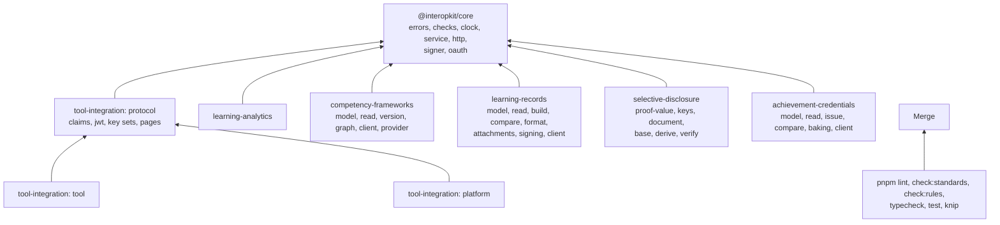

# AGENTS.md

Conventions for people and coding agents working in this repository. Read this before changing anything. Most rules are
enforced by `pnpm lint` (Biome and cspell), `pnpm check:standards`, `pnpm check:rules`, `pnpm typecheck`, `pnpm knip` and
`pnpm docs:api`; the rest are checked in review.

interopkit is a toolkit for learning-platform interoperability in JavaScript and TypeScript, in one repository:
`@interopkit/core` is the shared foundation, `@interopkit/tool-integration` implements LTI 1.3 in both roles, and
`@interopkit/learning-analytics` implements Caliper Analytics 1.2, `@interopkit/competency-frameworks` implements the
CASE model, its readers, what a consumer asks of a framework, and a client and a provider of the REST binding,
`@interopkit/learning-records` implements the xAPI Statement and its readers, the message of its Attachments, its signature and a client of an LRS,
`@interopkit/selective-disclosure` implements the `ecdsa-sd-2023` cryptosuite, and `@interopkit/achievement-credentials`
implements the model and the readers of Open Badges 3.0 and CLR 2.0, its builders and comparisons, baking in images, and the client of the Open Badges and CLR APIs.

## Terms

Use these words with these meanings in code, comments and docs.

| Term         | Meaning                                                                                                                         |
| ------------ | ------------------------------------------------------------------------------------------------------------------------------- |
| platform     | The system that launches tools and keeps the grades: a learning management system. In code, the platform role                   |
| tool         | The system that a platform launches. In code, the tool role                                                                     |
| launch       | One start of a tool by a platform: a login request, an authentication response and an `id_token` with the claims of the message |
| registration | What a platform and a tool know of each other: issuer, client id, deployment and the addresses of their endpoints               |
| resource     | What a launch is for, in the host's terms: a string that is signed into the hint and handed back with a score                   |
| line item    | A column of the gradebook of a context; a tool posts scores to it                                                               |
| score        | The grade of one user for one line item, with its progress and a timestamp                                                      |
| port         | An interface that a package defines for what it needs from a host: a store, a lookup, a `fetch`, a `Clock`                      |
| host         | The application that uses the packages and supplies the ports                                                                   |
| event        | A Caliper event: an actor, an action on an object, and the time                                                                 |
| sensor       | The part of a system that builds events and sends them in an envelope to an endpoint                                            |
| endpoint     | The service that receives the envelopes                                                                                         |
| deadline     | The time a call to a service may take, `timeoutMs`                                                                              |
| framework    | A CASE competency framework, held as a package: one document with its items, associations, definitions and rubrics              |
| finding      | A `CaseIssue`, `CredentialIssue` or `StatementIssue` of a reader: where, which rule, what is wrong, and its severity
| Statement    | An xAPI Statement, with a capital S: an Actor, a verb and an Object, with a result and a context when there are any
| LRS          | The Learning Record Store: the service that receives Statements and shall reject those that break the rules
| LRP          | A Learning Record Provider: the system that makes Statements and sends them to an LRS
| credential   | An Open Badges or CLR verifiable credential, held as a value of the model: an achievement, an endorsement or a CLR              |
| provider     | The service that publishes frameworks to consumers over the CASE REST binding: `handleCaseRequest` over a `FrameworkStore`      |
| base proof   | The proof an issuer gives a holder: an HMAC key, the public key of the proof and a signature for each statement to hide         |
| disclosure   | A document with only the parts a holder reveals and a derived proof, the signatures of the statements that stay                 |
| statement    | One canonical N-Quad of a document. A mandatory statement is always revealed; the key of the proof signs each of the others     |

## Layout

| Path                                 | Holds                                                                                               |
| ------------------------------------ | --------------------------------------------------------------------------------------------------- |
| `packages/core/`                     | The shared foundation                                                                               |
| `packages/core/src/errors.ts`        | `InteropkitError`, `DataError`, `ServiceError`                                                      |
| `packages/core/src/checks.ts`        | Checks of one value and the valibot side, which `@interopkit/core/checks` exports                   |
| `packages/core/src/formats.ts`       | `isDate`, `parseDateTime`, `isUuid`, `isAbsoluteUri` and their schemas; `checks.ts` exports them    |
| `packages/core/src/json.ts`          | `JsonValue`, `copyJson`, `MAX_JSON_DEPTH`; `checks.ts` exports them                                 |
| `packages/core/src/clock.ts`         | `Clock`, `SYSTEM_CLOCK`, `readClock`, `checkClock`                                                  |
| `packages/core/src/call-options.ts`  | `CallOptions`, the `signal` of every call that waits on I/O                                         |
| `packages/core/src/service.ts`       | `Fetch`, `ServiceCall`, `requestService`, `callService`, `DEFAULT_TIMEOUT_MS`                       |
| `packages/core/src/answer-headers.ts` | `totalCountOf`, `hasNextLink`, `retryAfterSeconds`: the paging and retry headers of an answer      |
| `packages/core/src/http/`            | The request and answer types and their helpers, which `@interopkit/core/http` exports               |
| `packages/core/src/signer/`          | `Signer`, `signerFromCryptoKey`, `signCompactJws`                                                   |
| `packages/core/src/random.ts`        | `Random`, `SYSTEM_RANDOM`                                                                           |
| `packages/core/src/oauth/`           | The OAuth 2.0 clients and the token cache, which `@interopkit/core/oauth` exports                   |
| `packages/core/src/until-aborted.ts` | `untilAborted`, which ends a wait when a signal aborts                                              |
| `packages/tool-integration/`         | LTI 1.3: `errors.ts`, `protocol/`, `tool/`, `platform/`                                             |
| `packages/learning-analytics/`       | Caliper 1.2: `model/`, `build/`, `send/`                                                            |
| `packages/competency-frameworks/`    | CASE 1.1 and 1.0: `model/`, `read/`, `version/`, `graph/`, `client/`, `provider/`                   |
| `packages/learning-records/`         | xAPI 2.0: `model/`, `read/`, `build/`, `compare/`, `format/`, `attachments/`, `signing/`, `client/` |
| `packages/selective-disclosure/`     | `ecdsa-sd-2023`: `proof-value/`, `keys/`, `document/`, `base/`, `derive/`, `verify/`                |
| `packages/achievement-credentials/`  | Open Badges 3.0 and CLR 2.0: `model/`, `read/`, `issue/`, `compare/`, `baking/`, `client/`         |
| `packages/<name>/test/`              | `<module>.test.ts` per module; `.fuzz`, `.corpus`, `.spec` or `.browser` before `.test.ts`; `*.bench.ts` |
| `docs/<package>/`                    | The guides of each package, one per module; TypeDoc publishes them with the API reference           |
| `examples/<package>/`                | Runnable examples, each a package of its own; the `test/` of an example runs it                     |
| `compat/`                            | The scenarios of the examples on each runtime                                                       |
| `scripts/`                           | The standards and mutation checks, pinned downloads, and the oracle and generators that tests share |
| `validation/`                        | Python scripts that write fixtures, and the containers of counterparties (`validation/opensalt/`)   |
| `biome/`                             | Biome GritQL plugins                                                                                |

## Commands

| Command                                             | Does                                                                                                                                                                                                                                                                                                                                                                                                                                         |
| --------------------------------------------------- | -------------------------------------------------------------------------------------------------------------------------------------------------------------------------------------------------------------------------------------------------------------------------------------------------------------------------------------------------------------------------------------------------------------------------------------------- |
| `pnpm install`                                      | Installs the dependencies and the git hooks                                                                                                                                                                                                                                                                                                                                                                                                  |
| `pnpm lint`                                         | Biome and cspell; `pnpm format` fixes formatting                                                                                                                                                                                                                                                                                                                                                                                             |
| `pnpm check:standards`                              | The rules of the engineering standards that a tool can check; `node scripts/check-standards.ts <path>...` reports only the files below the paths                                                                                                                                                                                                                                                                                             |
| `pnpm check:rules`                                  | Removes each rule of `scripts/check-rules.ts` from a scratch copy and runs its test, which must fail; a rule with `browser: true` runs its test in Chromium (`BROWSERS=chromium` limits any browser run to one engine); `node scripts/check-rules.ts <path>...` runs only the rules of the files below the paths                                                                                                                             |
| `pnpm typecheck`                                    | `tsc` over every package and the tooling, from the sources: it needs no build                                                                                                                                                                                                                                                                                                                                                                |
| `pnpm test`                                         | Vitest, offline, from the sources; `pnpm test:coverage` adds the coverage floor of each package                                                                                                                                                                                                                                                                                                                                              |
| `pnpm test:browser`                                 | The browser tests in Chromium, Firefox and WebKit; run `pnpm exec playwright install` first. The Firefox of Playwright does not start on some macOS versions (it did not on macOS 27): run the suite in the container `mcr.microsoft.com/playwright` of the pinned Playwright release, with `--cpus=2` and `--ipc=host`, from a copy of the repository (`pnpm install` installs the git hooks only in a git clone, and skips them in a copy) |
| `pnpm bench`                                        | Builds, then times the hot paths of `competency-frameworks` with `vitest bench` against the budgets of `test/budgets.ts`; fails above a budget                                                                                                                                                                                                                                                                                              |
| `pnpm opensalt`                                     | Starts OpenSALT in containers (Docker with Compose; the images are linux/amd64, so an arm64 host emulates them), runs the flows of `examples/competency-frameworks` against it, and removes the containers and their data whatever happens                                                                                                                                                                                                  |
| `pnpm knip`                                         | Unused files, exports and dependencies                                                                                                                                                                                                                                                                                                                                                                                                       |
| `pnpm build`                                        | `tsc -b` after deleting `dist/`, so that no stale output ships                                                                                                                                                                                                                                                                                                                                                                               |
| `pnpm check:packages`                               | Builds, then publint and Are the Types Wrong on the packed packages                                                                                                                                                                                                                                                                                                                                                                          |
| `pnpm check:licenses`                               | Every production dependency has an allowed license                                                                                                                                                                                                                                                                                                                                                                                           |
| `pnpm check:audit`                                  | `pnpm audit` at high severity                                                                                                                                                                                                                                                                                                                                                                                                                |
| `pnpm compat`                                       | The scenarios of the examples on Node.js, Deno, Bun and workerd; run `pnpm build` first, and install Deno and Bun or name the runtimes: `pnpm compat node workerd`                                                                                                                                                                                                                                                                           |
| `pnpm docs:api`                                     | Builds, then TypeDoc into `docs/api`, which reads the packages through their `dist`; fails on undocumented exports                                                                                                                                                                                                                                                                                                                           |
| `pnpm corpus`, `pnpm schemas`, `pnpm spec-examples` | Download the pinned repositories, files and specification examples that tests read into `.cache/`; `pnpm corpus:pin`, `pnpm schemas:pin` and `pnpm spec-examples:pin` write new hashes. `pnpm test:corpus` runs after `pnpm schemas`, and `pnpm test:spec` after `pnpm spec-examples` and `pnpm schemas`                                                                                                                                     |

Run all of them before finishing a change. CI runs each job of `.github/workflows/ci.yml` on a fresh clone with nothing but
`pnpm install`, so a gate can pass on a working copy that holds a `dist/` or a `.cache/` that an earlier gate left, and fail in
CI. Run each job that the change touches in a fresh clone of the commit (`git clone . ../fresh`, then `pnpm install
--frozen-lockfile` there), with the steps of the job in its order. A gate that needs a build or a download gets the step for it
in its job.

Development needs Node.js 22.18+ and pnpm 12. The scripts in `scripts/` are TypeScript that Node runs directly, so their
relative imports end in `.ts`. On a shared machine run Vitest with `--maxWorkers=2` and containers with `--cpus=2`.

## Releases

Changesets version and publish the packages, each on its own version. A release has one changeset per package in
`.changeset/`; changes made before the release extend it. To release, a pull request from a `changeset-release/` branch
runs `pnpm changeset version`, which bumps the versions, writes `CHANGELOG.md` and consumes the changesets. After it is
merged, the maintainer runs the Release workflow by hand: it builds and publishes the versions not yet on npm with
provenance. No workflow opens pull requests, and Dependabot version updates are off. Changesets, docs and TSDoc describe
current behavior only, and never how it came to be. A package's changeset is written last, from the API table of its README.

## Boundaries

- interopkit owns the messages between a platform and a tool, the gradebook protocol, the Caliper event model, sensor and
  endpoint, the CASE model with its readers, the questions a consumer asks of a framework, the client of its REST binding,
  the handlers of a CASE provider, and the xAPI Statement with its readers, the message of its Attachments, its signature and the client of an LRS. It does not own what a launched tool shows, what a
  score means, which delivery event becomes which Caliper or xAPI event, QTI content, or databases, servers, sessions and accounts. Those belong to the tool, to
  assesskit and measurekit, to the adapter of each product and to the host.
- `achievement-credentials` owns the model of Open Badges 3.0 and CLR 2.0 with its readers, its builders, the comparison of credentials, baking in PNG and SVG images and the client of the Open Badges and CLR APIs. It does not own keys, proofs,
  status lists, verification, the provider of the APIs, the OAuth 2.0 clients (those of `core/oauth`) or Open Badges 2.0 (those arrive in later modules), nor wallets, issuing
  platforms and storage.
- `selective-disclosure` owns the `ecdsa-sd-2023` cryptosuite in its three roles. It does not own JSON-LD processing and
  canonicalization (the primitives of `@digitalbazaar/di-sd-primitives` do them), the resolution and binding of keys, the
  loader of contexts and their pins, other suites, or a verifiable credential data model: the caller passes a key and a loader.
- Packages of different families never import each other. interopkit defines ports (a store, a lookup, a `Fetch`, a `Clock`)
  or speaks an open standard, and an adapter to another family lives in the examples of that family or in the host. Names of
  QTI (`ItemKey`, `LtiLink`) never appear in interopkit.
- The packages use no platform API outside web standards: no `node:*`, no `process`, no DOM, and `fetch` appears only as an
  option that the caller passes. They run in Node.js, browsers, Deno, Bun and Cloudflare Workers. The `lib` of every
  `tsconfig` is `ES2023` and `WebWorker`, and `types` is empty, so `tsc` fails on a platform API. The primitives of
  `selective-disclosure` import `node:crypto` on Node.js and Web Crypto where a bundler applies the `browser` field of their
  package; the code of the package uses Web Crypto only.

## Dependencies

- A package imports only what its row in the diagram above allows. Biome enforces the rows for `core`, and for the
  folders of `tool-integration`: `protocol/` imports neither `tool/` nor `platform/`, and `tool/` and `platform/` never
  import each other. In `competency-frameworks`, `model/` imports no other module, and `read/`, `version/` and `graph/`
  never import each other; `client/` builds on `read/`, `provider/` on `read/` and `version/`, and none of them imports
  either. In `selective-disclosure`, `proof-value/`, `keys/` and `document/` import none of the other folders, and
  `base/`, `derive/` and `verify/` import those three and never each other. In `achievement-credentials`, `model/`
  imports no other module, `read/` builds on `model/` only, and `issue/`, `compare/`, `baking/` and `client/` build on `model/` and `read/`
  and never import each other. In `learning-records`, `model/` imports no other module,
  `read/` imports only `model/`, and `build/`, `compare/` and `format/` import `model/` and `read/` and never each other;
  `attachments/` imports `model/` and `read/`, `signing/` imports those, `compare/` and `attachments/`, and `client/` imports
  `model/`, `read/` and `attachments/`. Imports never form cycles.
- A module imports another module of its package only through that module's `index.ts` (its public API) or its `internal.ts`
  (what the package's other modules and its tests share and the package does not export), never by a deep file path. A file
  directly in `src/`, such as `errors.ts` and `checks.ts`, is not in a module. `pnpm check:standards` enforces it.
- `internal.ts` cannot cross packages, so everything the packages share is a public export of `core`, covered by SemVer.
- Runtime dependencies are listed in the `package.json` of the package that loads them, pinned to an exact version at least
  two weeks old, and recorded in `SECURITY.md` with their reason and license. `pnpm-workspace.yaml` sets
  `minimumReleaseAge` so that an install cannot pick a younger version.
- Generic concerns use mature libraries: `jose` for JOSE, `valibot` for schemas, `uuid` for name-based UUIDs, `@noble/hashes` for the hashes of an identity and of an address, `oauth4webapi` for
  OAuth 2.0 clients, `momoa` for the syntax tree of JSON where a property given twice must be seen,
  `@remix-run/multipart-parser` for `multipart/mixed` messages, `saxes` for the XML of an SVG. Hand-written
  code is for domain logic that no library does correctly, with the reason in the guide of the module.
- Candidates that were compared and not adopted may be development dependencies, as counterparties in tests: Digital Bazaar's
  `ecdsa-sd-2023` suite with `@digitalbazaar/data-integrity`, `jsonld-signatures` and `@digitalbazaar/ecdsa-multikey`, which
  sign, derive and verify beside `selective-disclosure`, and `jsonld`, whose default loader the loader test makes fail.
  `@cfworker/json-schema` is a development dependency of the repository, for `scripts/schema-oracle.ts`: the validator that
  tests run the published JSON schemas of a standard through. `oidc-provider` is a development dependency of `core` and of
  `achievement-credentials`: the authorization server that their OAuth tests run against.

## Deviations from the standards

Where the code departs from `STANDARDS.md`, with the reason.

| Deviation                                                                                  | Why                                                                                                                                                  |
| ------------------------------------------------------------------------------------------ | ---------------------------------------------------------------------------------------------------------------------------------------------------- |
| The randomness of `state`, `nonce`, `jti` and hints is not injected                        | A source that a host or a test could replace could make secrets predictable; tests observe the values in the store instead                           |
| `custom` is a `Map` in the tool role and a record in the platform role                     | The tool role reads claim names from a token, `__proto__` among them, and the platform role writes what its host gave it                             |
| `tool-integration` signs with a `CryptoKey` through `jose`, not a `Signer`                 | Its registrations hold `CryptoKey`s; a `Signer` replaces them when its token calls move onto `core/oauth`                                            |
| Some functions are named for what they serve, such as `platformJwks` and `agsScores`       | They are the handlers of an endpoint, and the specifications name the endpoint; a verb would not say which one                                       |
| `ltiLaunch` throws an `LtiError` for a refused launch, and returns a page or a launch      | A refusal needs a reason and an HTTP status for the route; tell the results apart with `"status" in result`                                          |
| `toCaseVersion` reads the structure that it converts and not every property that it copies | `readPackage` and `readEntity` check the properties; the conversion reports the forms that 1.0 refuses, and it cannot tell the kind of a lone entity |
| The strings of the three small pages are in English and not in a catalog                   | A person sees them only when the login fails; a host that needs another language builds its own page from the same script                            |
| The HMAC key and the key of a proof are not injected                                       | A source that a host or a test could replace could make predictable what binds a base proof; the vectors reach fixed ones through `base/internal.ts` |

## Naming

- Files: kebab-case. One concept per file, named after it. Group files in folders by module. No `utils`, `helpers` or `misc`.
- Values and functions: camelCase. Module-level constant data: SCREAMING_SNAKE. Types: PascalCase. Type parameters: `T` or `T`
  plus a name.
- No package, folder or brand name holds a specification name: the packages are `tool-integration`, `learning-analytics`,
  `competency-frameworks`, `selective-disclosure`, `achievement-credentials` and `learning-records`, and `pnpm check:standards` fails on `lti` or
  `caliper` in one. Modules and functions use the names descriptively (`ltiLaunch`, `CaliperEvent`).
- Function options are `<Name>Options`. Labels are string unions in kebab-case (`"key-unknown"`).
- An error has a kebab-case `reason` where a caller must branch on it, and a `status` where it maps to HTTP.
- The names of the properties of a specification (`CFItems`, `imsx_codeMajor`) are kept as it writes them: the folders and
  files that define them are listed in the `useNamingConvention` override of `biome.json`.
- A vocabulary is a `const` tuple, its type is derived from it and its schema is `v.picklist` of it.
- A finding is a `Finding` of `core` (`path`, `rule`, `message`), extended by a package for its own fields. The `message` reads
  after the path and does not hold it; the rules are those that `findingsOf` names and those that a table of the guide lists.
- A reader and a validator that list findings take `maxFindings` (default 1,000, `DEFAULT_MAX_FINDINGS`): they parse with
  `safeParseBounded`, never `v.safeParse`, and fill a `createFindingSink` of `core/checks`, whose last finding says that the list
  stopped; a reader counts errors alone. A text of JSON is counted with `hasMoreTokensThan` before `JSON.parse`, and a client
  has a `maxTokens` option beside `maxBytes`.

## Code

- TypeScript strict, ESM, named exports only, `.js` extensions in relative imports of `src/`, `import type` for types.
- No `as` casts except where untyped data enters and is validated next. No non-null assertions.
- Entry points validate their input deeply and throw `DataError` with a full sentence that says what is wrong and what is
  expected, e.g. `The option timeoutMs must be a positive integer, found 0.` Input may come from plain JavaScript or JSON, so
  every argument is checked once, where the public function reads it, with a check of `@interopkit/core/checks`. An option's
  label is `The option <name>`. Inner functions trust their callers. JSON and objects that a host passes in are read with a
  valibot schema named `<name>Schema` and `parseWith`, which names the path of the first issue.
- A class of a JSON-LD specification that anyone may extend is read with `openRecord` of `core/checks`, a closed one with
  `strictRecord`; a list that the compacted form writes as its only member is read into a list with `many`, so that the model
  has one form.
- Expected outcomes that a caller must handle are values in the result. Invalid input and broken invariants throw `DataError`.
  A failed call to a service is a `ServiceError` with its `status`, `headers` and `body`.
- Anything that waits on I/O is async and takes `signal` of `CallOptions`, which ends that caller's wait. Work that several
  callers share, such as a key set fetch, runs to its own timeout and takes no caller's signal. Every port receives the
  signal.
- Every call to a service goes through `requestService`, or `callService`, which decodes its text: `redirect` is `"manual"`,
  any 3xx is an error, an answer has at most `maxBytes`, 65,536 by default, and every wait is raced against the deadline.
- A handler takes an `HttpRequest` and returns an `HttpResponse` of `@interopkit/core/http`, checks the request with
  `checkHttpRequest` at its entry, and reads the body with `readText`, `readJson` or `readForm`. No package defines its own
  request or answer type. It answers with the status codes and bodies of its specification, answers 500 with nothing of the
  cause when a port rejects, throws `DataError` only for a port that breaks its contract, and rejects with the reason of the
  `signal` when it aborts.
- Signing takes a `Signer` of `@interopkit/core`, never a key, so that a key in a KMS or an HSM works. A pick at random takes a
  `Random`.
- Never use `Math.random`, read a clock, or reach for `fetch`. Take a `Clock`, a random source or a `Fetch` from the caller.
  `pnpm lint` fails on `Math.random` and clock reads in `packages/*/src`; only `core/src/clock.ts` reads the system time.
- A number with a meaning is a named constant with its unit and source.
- No speculative options, abstractions or modules. Add a method only when a real use needs it, with its validation.
- No dead code, no compatibility paths, no workarounds. Before 1.0 there is no backward compatibility.

## Comments and docs

- Every export has a TSDoc comment that starts with one sentence: a noun phrase for a type or a constant, a third-person
  verb phrase for a function ("Returns ...", "Builds ..."), a short phrase for a property. A function adds `@param`,
  `@returns` and `@throws`, an option adds `@defaultValue`, a longer explanation goes under `@remarks`, and a specification
  is cited with `@see {@link url | name}`. A comment carries no history, no section sign and no code of a review or a
  ticket.
- `//` comments only explain why something non-obvious is done: an ambiguity of a specification, a trap, an invariant. No
  commented-out code.
- US English. Docs state facts in short sentences; prefer a table or list to prose. Code samples are complete: they show their
  imports and hold no TypeScript syntax, so that they run as they are. A guide gives the result of a sample as
  `// => result`, and `runGuideSamples` of `scripts/guide-samples.ts` runs the samples of the README and the guides in a test
  of the package and fails on a result that differs; `typecheckGuideSamples` compiles them under `strict`. What a call throws
  goes into a table of errors, not into a sample. No marketing language, emojis or filler.
- Visualization comes first, then tables, then short prose. Every README, `CONTRIBUTING.md` and guide opens with a Mermaid
  diagram of the architecture, the flow or the states that it describes (`pnpm check:standards` fails without one). GitHub
  renders the diagrams, and the Mermaid plugin of TypeDoc renders them on the docs site (`typedoc.json` pins the version of
  Mermaid that the site loads).
- Each guide has the diagram, a quick start that runs, the options with their defaults, the limits with their values, the
  errors with what to do about them, what is not included and why, and the differences from the references.
- Each document has one purpose: `README.md` for users, `docs/<package>/` for guides, `CONTRIBUTING.md` for the contribution
  process, `AGENTS.md` for conventions, `SECURITY.md` for deployment security.

## Evidence and tests

- A test title is a plain sentence about behavior, such as `it("refuses a redirect that the call does not follow")`. It
  carries no identifier of a row, a unit or a clause.
- Completeness comes from the specifications, not from a list that the repository keeps: tests derive what to cover from the
  published examples, schemas and tables, and fail when something is missing.
- One verb, one meaning: `read<X>(value, options?)` takes untrusted data into the model and throws `DataError` on invalid input;
  `validate<X>(value, options?)` judges a value and returns its findings, with their severity, as data; `check<X>` in `core`
  asserts one value and throws. Nothing named `check*` returns findings; a step of verification is `verify<X>`. A package keeps
  `read<X>` and `validate<X>` in one module, `read/`.
- A reader of data that has published JSON schemas is compared with them in a `*.corpus.test.ts` through
  `scripts/schema-oracle.ts` and `scripts/schema-arbitrary.ts`: its classes and properties are derived from the schemas, and
  generated values and values with one change get the verdict of the schemas. Each difference is in `spec-gaps.md` and pinned
  by a test.
- The examples that a specification prints are read in a `*.spec.test.ts` with `readSpecPage`, from a page or, when the address
  ends in `.md`, from the fenced blocks of a Markdown file; one that is not conformant is pinned with its findings and
  recorded in `spec-gaps.md`.
- The rules of a standard that has no JSON schema are a table in `scripts/` (`scripts/xapi-rules.ts`): one entry for each
  sentence of the standard, a value that breaks it, and what a reader of each role finds. A test runs the table against the
  readers, and the table is written from the standard and not from the code.
- The test vectors of a cryptosuite are reproduced byte for byte in a `*.spec.test.ts`: a base proof from the fixed secrets of the
  specification through the `internal.ts` of its module, which the package does not export and a host cannot reach, and a
  derived proof from that base proof. A counterparty suite signs, derives and verifies beside the package in every order, in a
  `*.corpus.test.ts`. The contexts they need are files of `scripts/schemas.lock.json`.
- Expected values come from an oracle, never from the code under test: the specification's own statements and worked
  examples, an independent implementation, or a script in `validation/`. Typed by hand only for edge cases small enough to
  derive exactly.
- A failure path of a port or a store is a test, written before the code it guards: it fails, it hangs, it is called again,
  and what it may call back.
- A rule that keeps a request from being forged, replayed or redirected has an entry in `scripts/check-rules.ts`. Replacing
  `find` with `replace` in `file` must make its test fail; `pnpm check:rules` proves it on a scratch copy, and a test checks
  that every entry still matches its file. So does each behavior of a reader or a converter that refuses or changes a value,
  guarded by a test that is not a corpus test, because the scratch copy has no download.
- Every public function has a test of input of other types, as JavaScript or JSON pass it: `null` options and arguments, a
  string for a number, an object for an array. Pass such input with `JSON.parse`, not a cast.
- Properties that hold for any input are tested with fast-check, with a fixed seed and a bounded number of runs. Every parser
  and decoder is fuzzed.
- Tests wait for events, never for time: a deadline test uses a short `timeoutMs` and waits for the rejection. No retries, no
  sleeps, no loosened assertions.
- Each package has a coverage floor in `vitest.config.ts`; a file `*.browser.test.ts` runs in the browsers, a file
  `*.corpus.test.ts` reads the downloaded schemas and repositories, and a file `*.spec.test.ts` the downloaded examples.
- `pnpm test` needs no download: a test that reads one, or imports a helper that does, is a `*.corpus.test.ts` or a
  `*.spec.test.ts` (`pnpm check:standards` fails on any other). The fuzz of `fc.anything` is in `pnpm test`; the fuzz of the
  values of a schema is a `*.fuzz.corpus.test.ts` that shares its properties with an offline one.
- Fixtures are never typed by hand when an oracle can write them, and a downloaded specification file is never committed.
- Frameworks that public providers publish are pinned by hash in `scripts/schemas.lock.json` and read by a `*.corpus.test.ts`
  that compares the reader with the official schema; a difference of a provider is pinned by the test and listed in the evidence
  guide.
- A counterparty application runs in containers from images pinned by digest (`validation/<name>/`), started by its own command
  and never by `pnpm test`. Its flows are a `*.corpus.test.ts` in a project named `*-<name>`, which the test scripts leave out;
  the secrets of a run are random, the containers bind to loopback and with at most 2 CPUs, and `docker compose down
  --volumes` always runs. What it does differently from the references is pinned by the flows.
- Baked images are written by `validation/baked_images.py` (`struct` and `zlib` for the PNG chunks, string edits for the SVG, ElementTree to
  parse every SVG), and `test/baking.test.ts` compares the bytes and the text with the fixture. A reader of images has a test of the
  worst input of each limit.
- A benchmark is a `*.bench.ts` in a project named `*-bench` (`pnpm bench`); its budgets are in `test/budgets.ts`: five times the
  fastest sample, rounded up to one significant digit, and a ratio to a reference in the same run where one exists. It imports
  its package by name: `tsc` reads the name as the source through the `paths` of the `tsconfig.json`, which has an entry for
  each subpath the benchmark imports, and the project aliases it to `dist/`, so that the timing is of the build that ships.

## Where things go

- A construct of a specification: its test, and a line of the `supported.md` of the package when what is supported changes.
- A module of a package: a folder in `src/` with `index.ts`, `internal.ts` where other modules or the tests need more, a
  subpath in `package.json` `exports`, `typedoc.json` and `knip.json` when the host imports it, the same subpath in the
  `paths` of the `tsconfig` of each package or example that imports it, a test file, a guide in `docs/`, import rules in
  `biome.json`, and a row in the API table of the README of the package.
- A check shared by packages: `packages/core/src/checks.ts`, or a file that it re-exports. Code that two packages need goes in
  `core`; code used once stays where it is used.
- A place where the specifications contradict themselves or are silent: the resolution in the `spec-gaps.md` of the package,
  a test, and a mention in the guide of the module.
- A finding rule of a reader: a check in `read/`, a row of the rules table of the model guide, and a test; a rule that keeps a
  value from being returned also has an entry in `scripts/check-rules.ts`.
- A pinned file: an entry in `scripts/schemas.lock.json`, or in `scripts/corpus.lock.json` for a repository, with its hash.
