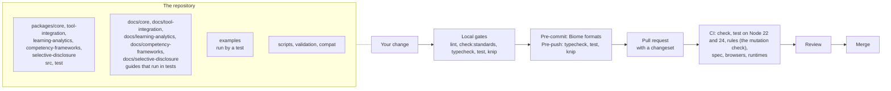

# Contributing

Contributions in English or Bahasa Indonesia are welcome. Everyone taking part is expected to follow the
[Code of Conduct](CODE_OF_CONDUCT.md).



## Setup

Node.js 22.18+ and pnpm 12 are required. One command sets the repository up, and in a git clone it also installs the Lefthook git hooks (`scripts/prepare.ts`, which runs the same on Windows and on POSIX):

```bash
pnpm install
```

[AGENTS.md](AGENTS.md) lists the commands and the conventions for layout, naming, code, docs and tests.

## Issues

| Kind            | What to give                                                                                                       |
| --------------- | ------------------------------------------------------------------------------------------------------------------ |
| Bug report      | The smallest code that runs as pasted, and the section of the specification that defines the behavior you expected |
| Feature request | Only for something that belongs to a section of a specification the packages implement; name that section          |
| Vulnerability   | A private report, as [SECURITY.md](SECURITY.md) describes                                                          |

## Evidence

A change to a rule of a specification cites its section in the pull request and adds or updates its test.

| Rule                        | What it means                                                                                                                                                                                                                                                                                      |
| --------------------------- | -------------------------------------------------------------------------------------------------------------------------------------------------------------------------------------------------------------------------------------------------------------------------------------------------- |
| Test titles                 | A plain sentence about behavior, with no identifier of a row, a unit or a clause                                                                                                                                                                                                                   |
| Fixtures                    | They come from oracles, never typed by hand except for edge cases derivable exactly: tokens signed by another implementation, published examples, or output of a script in `validation/`. Specification files are never committed; `pnpm corpus` and `pnpm schemas` download them at pinned hashes |
| Security rules              | A rule that keeps a request from being forged, replayed or redirected has an entry in `scripts/check-rules.ts`: the text that implements it, what stands in its place without it, and the test that must fail. `pnpm check:rules` proves that it does                                              |
| A gap in the specifications | A place where they contradict themselves or are silent gets a resolution in the `spec-gaps.md` of the package and a test                                                                                                                                                                           |

## Before opening a pull request

| Run                                                                             | When                                                                                                                           |
| ------------------------------------------------------------------------------- | ------------------------------------------------------------------------------------------------------------------------------ |
| `pnpm lint`, `pnpm check:standards`, `pnpm typecheck`, `pnpm test`, `pnpm knip` | Always                                                                                                                         |
| `pnpm build`, `pnpm check:packages`, `pnpm docs:api`                            | Always                                                                                                                         |
| `pnpm check:rules`                                                              | A change to code that an entry of `scripts/check-rules.ts` names, or to a security rule                                        |
| `pnpm test:browser`                                                             | A change to the pages of the client-side login, or to code that must run in a browser; it needs `pnpm exec playwright install` |
| `pnpm compat`                                                                   | A change that could differ between runtimes: a use of Web Crypto, `fetch`, `URL` or `AbortSignal`; run `pnpm build` first      |
| `pnpm check:licenses`, `pnpm check:audit`                                       | A change to a dependency                                                                                                       |
| `pnpm corpus`, `pnpm schemas`, `pnpm spec-examples`, `pnpm test:spec`           | A change to what the downloaded files are read for                                                                             |

- A change to a package goes into the pending release's changeset in `.changeset/`, or a new one made with `pnpm changeset`
  when none is pending ([AGENTS.md](AGENTS.md#releases)).
- A change to behavior also changes the TSDoc of what it touches and the guide of the module in `docs/`. A change to what is
  supported also changes the `supported.md` of the package.
- The pre-commit hook formats staged code, JSON and YAML with Biome; the pre-push hook runs the type check, the tests and
  Knip.

## License of contributions

interopkit is licensed under the [Apache License 2.0](LICENSE). As its section 5 states, a contribution you submit for
inclusion is licensed under the same terms, unless you state otherwise. There is no contributor license agreement; you keep the
copyright in your contributions. Do not contribute files you do not have the right to license: the repository contains no
1EdTech specification file, schema or test suite.
