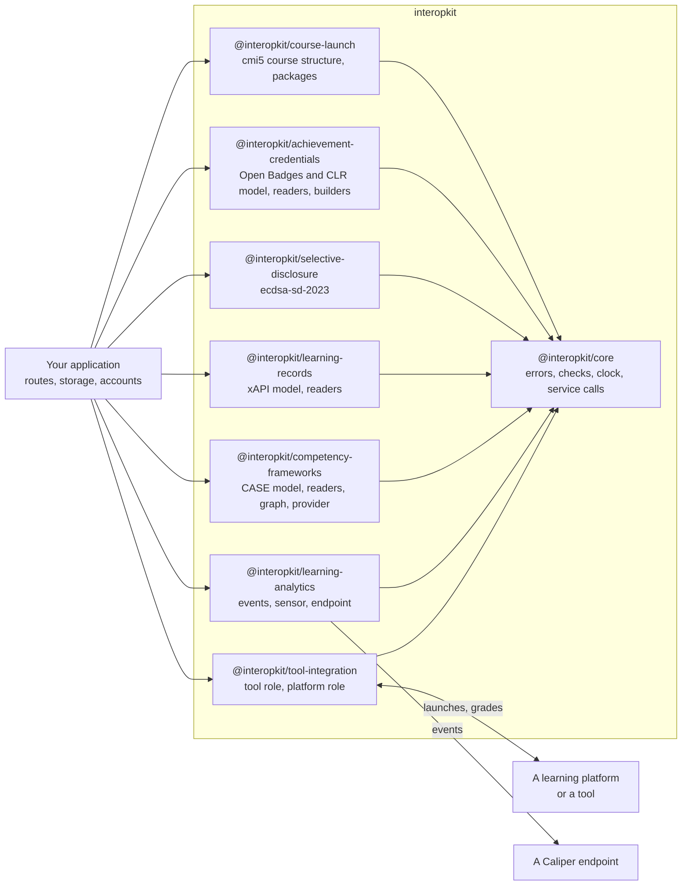

# interopkit

Learning standards for JavaScript and TypeScript: LTI 1.3, Caliper 1.2, xAPI 2.0, cmi5, CASE 1.1, Open Badges 3.0, CLR 2.0 and
the ecdsa-sd-2023 cryptosuite.

Each package implements one standard, as [Which package](#which-package) lists. The packages know nothing of QTI or of any
product: a host passes in its storage, its `fetch` and its clock.



## Which package

| Package                                                                                                    | What it is                                                                                                                                                                                                                                                                                  |
| ---------------------------------------------------------------------------------------------------------- | ------------------------------------------------------------------------------------------------------------------------------------------------------------------------------------------------------------------------------------------------------------------------------------------- |
| [`@interopkit/tool-integration`](https://interopkit.wakan.dev/_interopkit/tool-integration/)               | LTI 1.3 for JavaScript and TypeScript, in the tool and the platform role: launches, Deep Linking, Assignment and Grade Services, Names and Role Provisioning, Context Groups, Proctoring and Dynamic Registration.                                                                          |
| [`@interopkit/learning-analytics`](https://interopkit.wakan.dev/_interopkit/learning-analytics/)           | Caliper Analytics 1.2 for JavaScript and TypeScript: the event and entity model, a sensor that sends events, and the endpoint that receives and checks them; reads Caliper 1.1.                                                                                                             |
| [`@interopkit/competency-frameworks`](https://interopkit.wakan.dev/_interopkit/competency-frameworks/)     | CASE 1.1 and 1.0 for JavaScript and TypeScript: the model of a competency framework, readers checked against the published CASE JSON schemas, crosswalks, changes, and a client and a provider of the CASE REST API.                                                                        |
| [`@interopkit/learning-records`](https://interopkit.wakan.dev/_interopkit/learning-records/)               | xAPI 2.0 (IEEE 9274.1.1) and 1.0.3 for JavaScript and TypeScript: the Statement model, validators for the rules of an LRS and a provider, builders, signatures, an LRS client, an LRS request handler, and xAPI Profiles 1.0 with Statements matched to a profile's templates and patterns. |
| [`@interopkit/achievement-credentials`](https://interopkit.wakan.dev/_interopkit/achievement-credentials/) | Open Badges 3.0 and CLR 2.0 for JavaScript and TypeScript: the credential model, readers, issuing, Data Integrity and JWT proofs, status lists, verification, and the Open Badges and CLR APIs; reads and verifies Open Badges 2.0.                                                         |
| [`@interopkit/selective-disclosure`](https://interopkit.wakan.dev/_interopkit/selective-disclosure/)       | The W3C ecdsa-sd-2023 Data Integrity cryptosuite for JavaScript and TypeScript: base proofs for issuers, derived proofs for holders and their verification, for any verifiable credential.                                                                                                  |
| [`@interopkit/course-launch`](https://interopkit.wakan.dev/_interopkit/course-launch/)                     | cmi5 for JavaScript and TypeScript: the course structure with its reader, validator and writer, course packages, the LMS role over an xAPI LRS, and the assignable unit runtime.                                                                                                            |
| [`@interopkit/core`](https://interopkit.wakan.dev/_interopkit/core/)                                       | The shared foundation of the interopkit packages: errors, argument checks, bounded HTTP service calls, plain request and response types, a signing port and OAuth 2.0 clients.                                                                                                              |

To launch tools from your platform, or to be launched by one, use `tool-integration`. To report learning events, use
`learning-analytics`. Neither needs the other.

Each package has a Supported page that lists what it includes and what it leaves out, an Evidence page that gives each suite,
reference and counterparty with its commit, count and date, and a Choosing page that says when another library fits better.

A host that delivers QTI tests with assesskit connects the two in its own code, through the ports that the player defines.
interopkit imports nothing from assesskit or measurekit, and they import nothing from it.

## Documentation

Each package has a folder `docs/<package>/`, and its README is its page on npm.

| Page of `docs/<package>/`        | Holds                                                                                                                                                              |
| -------------------------------- | ------------------------------------------------------------------------------------------------------------------------------------------------------------------ |
| One guide for each module        | A diagram, a quick start that runs, the options with their defaults, the limits, the errors, what is not included and why, and the differences from the references |
| `supported.md`, `comparators.md` | What of the standard the package covers and what it leaves out, and what other implementations do against it                                                       |
| `spec-gaps.md`                   | Where the specifications contradict themselves or are silent, with the reading taken                                                                               |
| `evidence.md`                    | What shows that the package does what it says: the oracles, the suites and the counterparties, with their counts                                                   |
| `performance.md`                 | The speed of each hot path against its reference, the size of each entry point and the peak memory of each reader                                                  |

[AGENTS.md](https://github.com/interopkit/interopkit/blob/main/AGENTS.md) states the conventions, [CONTRIBUTING.md](https://github.com/interopkit/interopkit/blob/main/CONTRIBUTING.md) the process and
[SECURITY.md](https://github.com/interopkit/interopkit/blob/main/SECURITY.md) how to report a vulnerability and how to deploy safely.

## Development

Node.js 22.18+ and pnpm 12 are required. One command sets the repository up and, in a git clone, installs the git hooks:

```bash
pnpm install
```

[AGENTS.md](https://github.com/interopkit/interopkit/blob/main/AGENTS.md) lists every command with the gate it runs and the
conventions, [CONTRIBUTING.md](https://github.com/interopkit/interopkit/blob/main/CONTRIBUTING.md) the process and
[SECURITY.md](https://github.com/interopkit/interopkit/blob/main/SECURITY.md) how to report a vulnerability and how to deploy
safely. The counterparties that the evidence pages name run from [`validation/`](https://github.com/interopkit/interopkit/tree/main/validation),
each with a README of its own.

## Layout

| Folder                                                                           | Holds                                                                                            |
| -------------------------------------------------------------------------------- | ------------------------------------------------------------------------------------------------ |
| `packages/core/`                                                                 | The shared foundation                                                                            |
| `packages/tool-integration/`                                                     | LTI 1.3, tool and platform roles                                                                 |
| `packages/learning-analytics/`                                                   | Caliper 1.2                                                                                      |
| `packages/competency-frameworks/`                                                | CASE 1.1 and 1.0                                                                                 |
| `packages/learning-records/`                                                     | xAPI 2.0 and 1.0.3, xAPI Profiles 1.0                                                            |
| `packages/achievement-credentials/`                                              | Open Badges 3.0 and CLR 2.0                                                                      |
| `packages/selective-disclosure/`                                                 | `ecdsa-sd-2023`: base proof, derived proof, verification                                         |
| `packages/course-launch/`                                                        | cmi5: course structure, course packages, the LMS role, the runtime of a unit                     |
| `docs/<package>/`                                                                | Guides, supported features, evidence and performance of each package                             |
| `examples/`                                                                      | Runnable examples, each a package of its own, run by a test                                      |
| [`compat/`](https://github.com/interopkit/interopkit/blob/main/compat/README.md) | The scenarios of the examples on each runtime                                                    |
| `scripts/`                                                                       | The standards check, the mutation check of the security rules, and the downloads of pinned files |
| [`validation/`](https://github.com/interopkit/interopkit/tree/main/validation)   | Python scripts that write fixtures, the counterparties in containers, and the W3C suites         |
| `biome/`                                                                         | GritQL lint rules                                                                                |

## License

[Apache License 2.0](https://github.com/interopkit/interopkit/blob/main/LICENSE). Each package has its own NOTICE.

LTI® is a trademark of 1EdTech® Consortium, Inc. (1edtech.org).
Caliper Analytics® is a trademark of 1EdTech® Consortium, Inc. (1edtech.org).
CASE® is a trademark of 1EdTech® Consortium, Inc. (1edtech.org).
CLR Standard® is a trademark of 1EdTech® Consortium, Inc. (1edtech.org).
QTI® is a trademark of 1EdTech® Consortium, Inc. (1edtech.org).
W3C® is a trademark of the World Wide Web Consortium.
IEEE is a trademark of the Institute of Electrical and Electronics Engineers, Inc.
interopkit is not affiliated with, endorsed by or approved by 1EdTech Consortium, Inc., W3C, IEEE or ADL.
