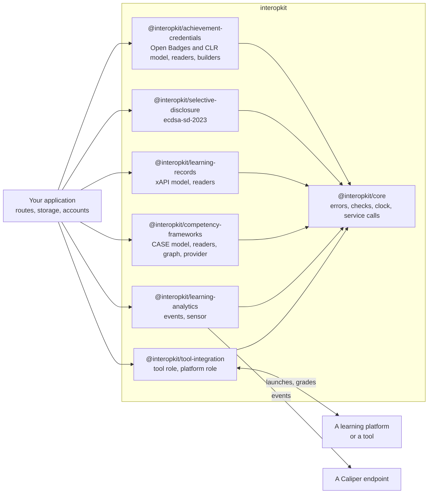

# interopkit

TypeScript packages for learning-platform interoperability: the launches, grades and other messages that pass between a
learning platform and a tool (LTI 1.3), the learning analytics events that a system reports (Caliper Analytics 1.2), the
competency frameworks that a provider publishes (CASE 1.1), the learning records that a system keeps (xAPI 2.0 and 1.0.3), the achievement credentials that an issuer awards (Open Badges
3.0 and CLR 2.0), and the credentials that a holder shows in part (the `ecdsa-sd-2023` cryptosuite). The packages know
nothing of QTI or of any product. A host passes in its storage, its `fetch`
and its clock.

Version 0.1 is not the whole of LTI Advantage: both roles have the launch, access tokens and the score service of Assignment and Grade Services, the tool role also has Deep Linking, and neither role has Names and Role Provisioning or Dynamic Registration ([what is supported](docs/tool-integration/supported.md)).

| Package                                                                             | What it is                                                                                                                                                                |
| ----------------------------------------------------------------------------------- | ------------------------------------------------------------------------------------------------------------------------------------------------------------------------- |
| [`@interopkit/core`](packages/core/README.md)                                       | The errors, the checks of arguments, the clock and the service call that the other packages share                                                                         |
| [`@interopkit/tool-integration`](packages/tool-integration/README.md)               | LTI 1.3: a tool that a platform launches, and a platform that launches tools. Version 0.1; its README says what it contains                                               |
| [`@interopkit/learning-analytics`](packages/learning-analytics/README.md)           | Caliper Analytics 1.2 events and a sensor that sends them to an endpoint. Version 0.1; its README says what it contains                                                   |
| [`@interopkit/competency-frameworks`](packages/competency-frameworks/README.md)     | CASE 1.1 and 1.0: the model of a framework package, its readers, its tree and changes, and the conversion to 1.0                                                          |
| [`@interopkit/learning-records`](packages/learning-records/README.md)               | xAPI 2.0 and 1.0.3: the model of a Statement, readers that check it against the rules of an LRS and of a provider, the message and signature of Attachments, a client of an LRS, and the handler of its requests |
| [`@interopkit/achievement-credentials`](packages/achievement-credentials/README.md) | Open Badges 3.0 and CLR 2.0: the model of an achievement credential and of the APIs, and readers that check them, builders, identity hashes, comparison, baking in images, a client of the Open Badges and CLR APIs, keys, proofs, status lists, refresh and verification |
| [`@interopkit/selective-disclosure`](packages/selective-disclosure/README.md)       | The `ecdsa-sd-2023` cryptosuite: a base proof for the issuer, a derived proof for the holder and its verification                                                         |

To launch tools from your platform, or to be launched by one, use `tool-integration`. To report learning events, use
`learning-analytics`. Neither needs the other.

The scope of 0.1 is the LTI 1.3 launch, access tokens and score service in both roles, Deep Linking in the tool role, and Caliper 1.2 events that a sensor builds and sends. [Supported](docs/tool-integration/supported.md) lists what
`tool-integration` includes and what it does not, and the README of `learning-analytics` does the same for events. interopkit
implements these specifications and is not certified by 1EdTech.

A host that delivers QTI tests with assesskit connects the two in its own code, through the ports that the player defines.
interopkit imports nothing from assesskit or measurekit, and they import nothing from it.

## Development

Node.js 22.18+ and pnpm 12 are required. One command sets the repository up: `pnpm install`.

| Command                | Does                                                                                                                                                                  |
| ---------------------- | --------------------------------------------------------------------------------------------------------------------------------------------------------------------- |
| `pnpm lint`            | Biome and cspell                                                                                                                                                      |
| `pnpm check:standards` | The rules of the engineering standards that a tool can check                                                                                                          |
| `pnpm check:rules`     | Removes each security rule from a copy of the code and fails when its test still passes (a rule of a browser page runs in Chromium)                                   |
| `pnpm typecheck`       | Every package, and the tooling at the root                                                                                                                            |
| `pnpm test`            | Vitest, offline                                                                                                                                                       |
| `pnpm test:coverage`   | The tests with the coverage floor of each package                                                                                                                     |
| `pnpm test:browser`    | The tests of the client-side login in Chromium, Firefox and WebKit; run `pnpm exec playwright install` first                                                          |
| `pnpm knip`            | Unused files, exports and dependencies                                                                                                                                |
| `pnpm build`           | The built packages                                                                                                                                                    |
| `pnpm check:packages`  | publint and Are the Types Wrong on the packed packages                                                                                                                |
| `pnpm check:licenses`  | Every production dependency has an allowed license                                                                                                                    |
| `pnpm check:audit`     | `pnpm audit` for vulnerabilities of high severity or above                                                                                                            |
| `pnpm compat`          | Runs the scenarios of the three examples, built as the packages ship, on Node.js, Deno, Bun and workerd; it needs Deno and Bun installed ([compat](compat/README.md)) |
| `pnpm bench`           | Times reading and walking a framework of 10,000 items and checking 1,000 Statements against budgets ([CASE](docs/competency-frameworks/evidence.md), [xAPI](docs/learning-records/evidence.md))                                  |
| `pnpm opensalt`        | Starts OpenSALT in containers and runs the CASE client and provider of the example against it ([validation/opensalt](validation/opensalt/README.md))                  |
| `pnpm adl-lrs`         | Runs the ADL conformance suites of xAPI 2.0 and 1.0.3 against the example LRS ([validation/adl-lrs](validation/adl-lrs/README.md)); build first                                  |
| `pnpm sql-lrs`         | Starts SQL LRS in a container and checks the rules and the client of the example against it ([validation/sql-lrs](validation/sql-lrs/README.md))                      |
| `pnpm docs:api`        | TypeDoc into `docs/api`; fails on undocumented exports                                                                                                                |
| `pnpm corpus`          | Downloads the pinned repositories that tests read                                                                                                                     |
| `pnpm schemas`         | Downloads the pinned specification files that tests read                                                                                                              |
| `pnpm spec-examples`   | Downloads the JSON examples of the specifications at pinned hashes; `pnpm test:spec` runs the tests that read them                                                    |

[AGENTS.md](AGENTS.md) states the conventions, [CONTRIBUTING.md](CONTRIBUTING.md) the process and
[SECURITY.md](SECURITY.md) how to report a vulnerability and how to deploy safely.

## Layout

| Folder                                                                                                                                                           | Holds                                                                                            |
| ---------------------------------------------------------------------------------------------------------------------------------------------------------------- | ------------------------------------------------------------------------------------------------ |
| `packages/core/`                                                                                                                                                 | The shared foundation                                                                            |
| `packages/tool-integration/`                                                                                                                                     | LTI 1.3, tool and platform roles                                                                 |
| `packages/learning-analytics/`                                                                                                                                   | Caliper 1.2                                                                                      |
| `packages/competency-frameworks/`                                                                                                                                | CASE 1.1 and 1.0                                                                                 |
| `packages/learning-records/`                                                                                                                                     | xAPI 2.0 and 1.0.3                                                                               |
| `packages/achievement-credentials/`                                                                                                                              | Open Badges 3.0 and CLR 2.0                                                                      |
| `packages/selective-disclosure/`                                                                                                                                 | `ecdsa-sd-2023`: base proof, derived proof, verification                                         |
| `docs/core/`, `docs/tool-integration/`, `docs/learning-analytics/`, `docs/competency-frameworks/`, `docs/achievement-credentials/`, `docs/selective-disclosure/` | Guides of each package                                                                           |
| `docs/learning-records/`                                                                                                                                         | Guides of learning-records                                                                       |
| `examples/`                                                                                                                                                      | Runnable examples, each a package of its own, run by a test                                      |
| `compat/`                                                                                                                                                        | The scenarios of the examples on each runtime                                                    |
| `scripts/`                                                                                                                                                       | The standards check, the mutation check of the security rules, and the downloads of pinned files |
| `validation/`                                                                                                                                                    | Python scripts that write fixtures, and the containers of OpenSALT                               |
| `biome/`                                                                                                                                                         | GritQL lint rules                                                                                |

## License

[Apache License 2.0](LICENSE). LTI, Learning Tools Interoperability, LTI Advantage, Caliper Analytics, Sensor API and 1EdTech
are trademarks of 1EdTech Consortium, Inc.; xAPI names the standard IEEE 9274.1.1 of the Institute of Electrical and Electronics
Engineers, Inc.; see the NOTICE of each package.
