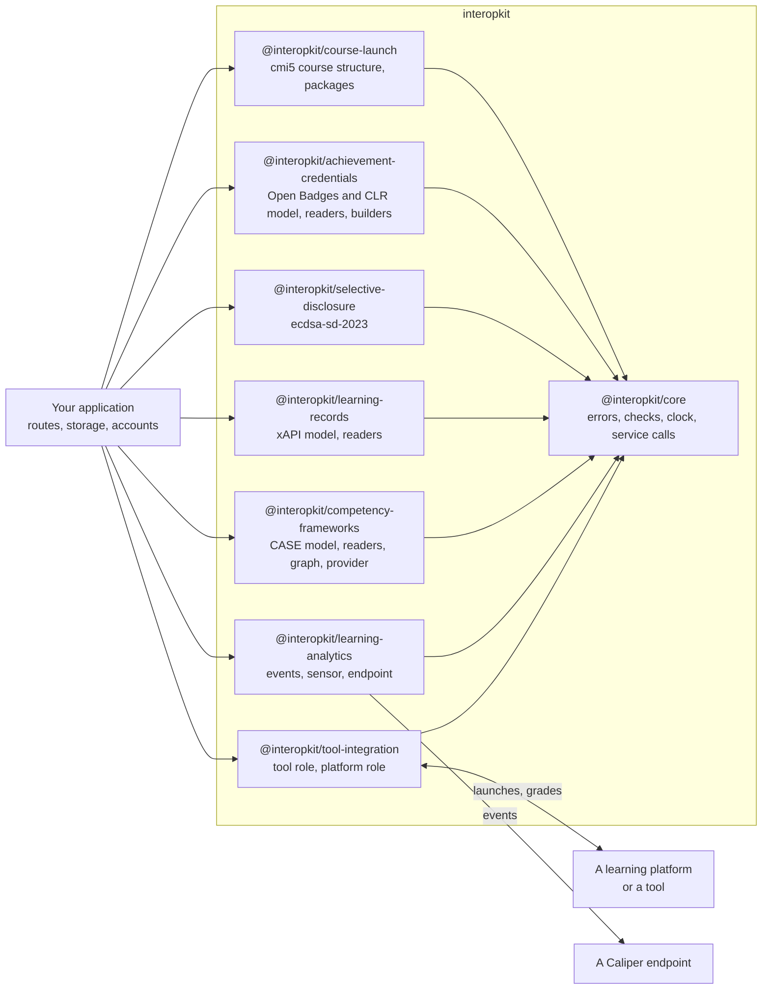

# interopkit

Learning standards for JavaScript and TypeScript: LTI 1.3, Caliper 1.2, xAPI 2.0, cmi5, CASE 1.1, Open Badges 3.0, CLR 2.0 and
the ecdsa-sd-2023 cryptosuite.

The packages cover the launches, grades and other messages that pass between a learning platform and a tool (LTI 1.3), the
learning analytics events that a system reports (Caliper Analytics 1.2), the competency frameworks that a provider publishes
(CASE 1.1), the learning records that a system keeps (xAPI 2.0 and 1.0.3, with xAPI Profiles 1.0), the achievement credentials
that an issuer awards (Open Badges 3.0 and CLR 2.0), the credentials that a holder shows in part (the `ecdsa-sd-2023`
cryptosuite, a W3C credential standard that no trusted library implements), and the courses that a learning platform imports
and launches (cmi5). The packages know nothing of QTI or of any product. A host passes in its storage, its `fetch` and its
clock.

Both roles of `@interopkit/tool-integration` have the launch of every message type, access tokens, the Assignment and Grade Services, Names and Role Provisioning, Context Groups, the AfA PNP Connector, Deep Linking, Proctoring Services and Dynamic Registration ([what is supported](https://interopkit.dev/_interopkit/tool-integration/supported/)).

## Which package

| Package | What it is |
| --- | --- |
| [`@interopkit/tool-integration`](https://interopkit.dev/_interopkit/tool-integration/) | LTI 1.3 for JavaScript and TypeScript, in the tool and the platform role: launches, Deep Linking, Assignment and Grade Services, Names and Role Provisioning, Context Groups, Proctoring and Dynamic Registration. |
| [`@interopkit/learning-analytics`](https://interopkit.dev/_interopkit/learning-analytics/) | Caliper Analytics 1.2 for JavaScript and TypeScript: the event and entity model, a sensor that sends events, and the endpoint that receives and checks them; reads Caliper 1.1. |
| [`@interopkit/competency-frameworks`](https://interopkit.dev/_interopkit/competency-frameworks/) | CASE 1.1 and 1.0 for JavaScript and TypeScript: the model of a competency framework, readers checked against the published CASE JSON schemas, crosswalks, changes, and a client and a provider of the CASE REST API. |
| [`@interopkit/learning-records`](https://interopkit.dev/_interopkit/learning-records/) | xAPI 2.0 (IEEE 9274.1.1) and 1.0.3 for JavaScript and TypeScript: the Statement model, validators for the rules of an LRS and a provider, builders, signatures, an LRS client, an LRS request handler, and xAPI Profiles 1.0 with Statements matched to a profile's templates and patterns. |
| [`@interopkit/achievement-credentials`](https://interopkit.dev/_interopkit/achievement-credentials/) | Open Badges 3.0 and CLR 2.0 for JavaScript and TypeScript: the credential model, readers, issuing, Data Integrity and JWT proofs, status lists, verification, and the Open Badges and CLR APIs; reads and verifies Open Badges 2.0. |
| [`@interopkit/selective-disclosure`](https://interopkit.dev/_interopkit/selective-disclosure/) | The W3C ecdsa-sd-2023 Data Integrity cryptosuite for JavaScript and TypeScript: base proofs for issuers, derived proofs for holders and their verification, for any verifiable credential. |
| [`@interopkit/course-launch`](https://interopkit.dev/_interopkit/course-launch/) | cmi5 for JavaScript and TypeScript: the course structure with its reader, validator and writer, course packages, the LMS role over an xAPI LRS, and the assignable unit runtime. |
| [`@interopkit/core`](https://interopkit.dev/_interopkit/core/) | The shared foundation of the interopkit packages: errors, argument checks, bounded HTTP service calls, plain request and response types, a signing port and OAuth 2.0 clients. |

To launch tools from your platform, or to be launched by one, use `tool-integration`. To report learning events, use
`learning-analytics`. Neither needs the other.

A host that delivers QTI tests with assesskit connects the two in its own code, through the ports that the player defines.
interopkit imports nothing from assesskit or measurekit, and they import nothing from it.

## Documentation

Each package has a folder `docs/<package>/`, and its README is its page on npm.

| Page of `docs/<package>/`                | Holds                                                                                                                              |
| ---------------------------------------- | ---------------------------------------------------------------------------------------------------------------------------------- |
| One guide for each module                | A diagram, a quick start that runs, the options with their defaults, the limits, the errors, what is not included and why, and the differences from the references |
| `supported.md`, `comparators.md`         | What of the standard the package covers and what it leaves out, and what other implementations do against it                       |
| `spec-gaps.md`                           | Where the specifications contradict themselves or are silent, with the reading taken                                               |
| `evidence.md`                            | What shows that the package does what it says: the oracles, the suites and the counterparties, with their counts                    |
| `performance.md`                         | The speed of each hot path against its reference, the size of each entry point and the peak memory of each reader                   |

[AGENTS.md](https://github.com/interopkit/interopkit/blob/main/AGENTS.md) states the conventions, [CONTRIBUTING.md](https://github.com/interopkit/interopkit/blob/main/CONTRIBUTING.md) the process and
[SECURITY.md](https://github.com/interopkit/interopkit/blob/main/SECURITY.md) how to report a vulnerability and how to deploy safely.

## Development

Node.js 22.18+ and pnpm 12 are required. One command sets the repository up: `pnpm install`.

| Command                | Does                                                                                                                                                                  |
| ---------------------- | --------------------------------------------------------------------------------------------------------------------------------------------------------------------- |
| `pnpm lint`            | Biome and cspell                                                                                                                                                      |
| `pnpm check:standards` | The rules of the engineering standards that a tool can check                                                                                                          |
| `pnpm check:duplication` | Fails on a piece of repeated code in `packages/*/src` that AGENTS.md does not list with its reason (jscpd) |
| `pnpm check:rules`     | Removes each security rule from a copy of the code and fails when its test still passes (a rule of a browser page runs in Chromium)                                   |
| `pnpm typecheck`       | Every package, and the tooling at the root                                                                                                                            |
| `pnpm test`            | Vitest, offline                                                                                                                                                       |
| `pnpm test:coverage`   | The tests with the coverage floor of each package                                                                                                                     |
| `pnpm test:references` | The libraries of other authors that play the tool against the platform role of tool-integration, in the process of the tests ([evidence](https://interopkit.dev/_interopkit/tool-integration/evidence/)) |
| `pnpm test:browser`    | The tests of the client-side login in Chromium, Firefox and WebKit; run `pnpm exec playwright install` first                                                          |
| `pnpm knip`            | Unused files, exports and dependencies                                                                                                                                |
| `pnpm build`           | The built packages                                                                                                                                                    |
| `pnpm check:packages`  | publint and Are the Types Wrong on the packed packages                                                                                                                |
| `pnpm check:release`   | Every package of a changeset is published, and a package at 0.0.0 takes `major`, so that its first release is 1.0.0 |
| `pnpm check:tarballs`  | Packs the packages, installs them into a scratch project, imports every subpath in Node.js and type-checks them with `bundler` and `node16` resolution |
| `pnpm check:licenses`  | Every production dependency has an allowed license                                                                                                                    |
| `pnpm check:audit`     | `pnpm audit` of the production dependencies at any severity, and of all of them at high severity or above                                                                                                            |
| `pnpm compat:runtimes` | Runs the scenarios of the six examples, built as the packages ship, on Node.js, Deno, Bun and workerd; it needs Deno and Bun installed ([compat](https://github.com/interopkit/interopkit/blob/main/compat/README.md)) |
| `pnpm bench`           | Times reading and walking a framework of 10,000 items, checking 1,000 Statements, reading an envelope of 1,000 Caliper events, verifying a credential, and the launch, the authorization and the pages of the services of LTI against budgets ([CASE](https://interopkit.dev/_interopkit/competency-frameworks/performance/), [xAPI](https://interopkit.dev/_interopkit/learning-records/performance/), [Caliper](https://interopkit.dev/_interopkit/learning-analytics/performance/), [credentials](https://interopkit.dev/_interopkit/achievement-credentials/performance/), [LTI](https://interopkit.dev/_interopkit/tool-integration/performance/))                                  |
| `pnpm opensalt`        | Starts OpenSALT in containers and runs the CASE client and provider of the example against it ([validation/opensalt](https://github.com/interopkit/interopkit/blob/main/validation/opensalt/README.md))                  |
| `pnpm adl-lrs`         | Runs the ADL conformance suites of xAPI 2.0 and 1.0.3 against the example LRS ([validation/adl-lrs](https://github.com/interopkit/interopkit/blob/main/validation/adl-lrs/README.md))                               |
| `pnpm sql-lrs`         | Starts SQL LRS in a container and checks the rules and the client of the example against it ([validation/sql-lrs](https://github.com/interopkit/interopkit/blob/main/validation/sql-lrs/README.md))                      |
| `pnpm pylti1p3`        | Starts a tool built on PyLTI1p3 in a container and runs the platform role of tool-integration against it ([validation/pylti1p3](https://github.com/interopkit/interopkit/blob/main/validation/pylti1p3/README.md)); it needs Docker and `openssl` |
| `pnpm moodle`          | Starts Moodle in containers and runs both roles of tool-integration against it ([validation/moodle](https://github.com/interopkit/interopkit/blob/main/validation/moodle/README.md)); it needs Docker, `git` and `openssl` |
| `pnpm w3c-suites`      | Runs the W3C suites of Data Integrity, its EdDSA and ECDSA cryptosuites, Bitstring Status List and the Data Model 2.0 against the VC-API service of the credentials example ([validation/w3c-suites](https://github.com/interopkit/interopkit/blob/main/validation/w3c-suites/README.md)); `pnpm schemas` first |
| `pnpm validator`       | Builds the public validator of 1EdTech in a container and validates the credentials of the example with it ([validation/1edtech-validator](https://github.com/interopkit/interopkit/blob/main/validation/1edtech-validator/README.md)); `pnpm schemas` first |
| `pnpm docs:api`        | TypeDoc into `docs/api`; fails on undocumented exports                                                                                                                |
| `pnpm corpus`          | Downloads the pinned repositories that tests read                                                                                                                     |
| `pnpm schemas`         | Downloads the pinned specification files that tests read                                                                                                              |
| `pnpm spec-examples`   | Downloads the JSON examples of the specifications at pinned hashes; `pnpm test:spec` runs the tests that read them                                                    |

## Layout

| Folder                                                                                                                                                           | Holds                                                                                            |
| ---------------------------------------------------------------------------------------------------------------------------------------------------------------- | ------------------------------------------------------------------------------------------------ |
| `packages/core/`                                                                                                                                                 | The shared foundation                                                                            |
| `packages/tool-integration/`                                                                                                                                     | LTI 1.3, tool and platform roles                                                                 |
| `packages/learning-analytics/`                                                                                                                                   | Caliper 1.2                                                                                      |
| `packages/competency-frameworks/`                                                                                                                                | CASE 1.1 and 1.0                                                                                 |
| `packages/learning-records/`                                                                                                                                     | xAPI 2.0 and 1.0.3                                                                               |
| `packages/achievement-credentials/`                                                                                                                              | Open Badges 3.0 and CLR 2.0                                                                      |
| `packages/selective-disclosure/`                                                                                                                                 | `ecdsa-sd-2023`: base proof, derived proof, verification                                         |
| `packages/course-launch/`                                                                                                                                        | cmi5: course structure, course packages                                                          |
| `docs/<package>/`                                                                                                                                                | Guides, supported features, evidence and performance of each package                             |
| `examples/`                                                                                                                                                      | Runnable examples, each a package of its own, run by a test                                      |
| `compat/`                                                                                                                                                        | The scenarios of the examples on each runtime                                                    |
| `scripts/`                                                                                                                                                       | The standards check, the mutation check of the security rules, and the downloads of pinned files |
| `validation/`                                                                                                                                                    | Python scripts that write fixtures, the counterparties in containers, and the W3C suites         |
| `biome/`                                                                                                                                                         | GritQL lint rules                                                                                |

## License

[Apache License 2.0](https://github.com/interopkit/interopkit/blob/main/LICENSE). Each package has its own NOTICE.

LTI® is a trademark of 1EdTech® Consortium, Inc. (1edtech.org).
Caliper Analytics® is a trademark of 1EdTech® Consortium, Inc. (1edtech.org).
CASE® is a trademark of 1EdTech® Consortium, Inc. (1edtech.org).
CLR Standard® is a trademark of 1EdTech® Consortium, Inc. (1edtech.org).
AccessForAll® is a trademark of 1EdTech® Consortium, Inc. (1edtech.org).
QTI® is a trademark of 1EdTech® Consortium, Inc. (1edtech.org).
W3C® is a trademark of the World Wide Web Consortium.
IEEE is a trademark of the Institute of Electrical and Electronics Engineers, Inc.
interopkit is not affiliated with, endorsed by or approved by 1EdTech Consortium, Inc., W3C, IEEE or ADL.
