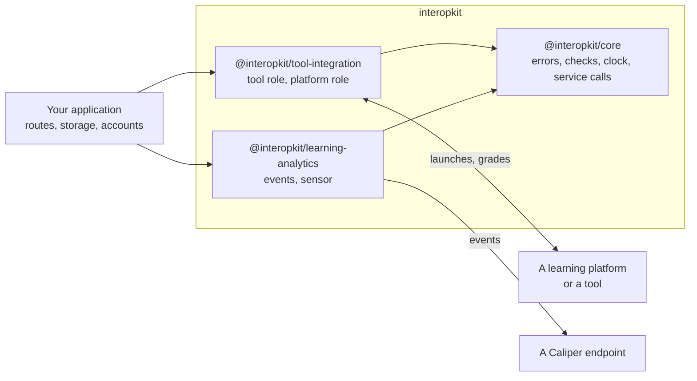

# interopkit

TypeScript packages for learning-platform interoperability: the launches, grades and other messages that pass between a
learning platform and a tool (LTI 1.3), and the learning analytics events that a system reports (Caliper Analytics 1.2).
The packages know nothing of QTI or of any product. A host passes in its storage, its `fetch` and its clock.

| Package                                                                                                                   | What it is                                                                                                                                                                              |
| ------------------------------------------------------------------------------------------------------------------------- | --------------------------------------------------------------------------------------------------------------------------------------------------------------------------------------- |
| [`@interopkit/core`](packages/core/README.md)                                                                             | The errors, the checks of arguments, the clock and the service call that the other packages share                                                                                       |
| [`@interopkit/tool-integration`](https://github.com/interopkit/interopkit/tree/main/packages/tool-integration#readme)     | LTI 1.3 for both roles: a tool that a platform launches, and a platform that launches tools. Under development and not yet published; its README says what the current version contains |
| [`@interopkit/learning-analytics`](https://github.com/interopkit/interopkit/tree/main/packages/learning-analytics#readme) | Caliper Analytics 1.2 events and a sensor that sends them to an endpoint. Under development and not yet published; its README says what the current version contains                    |

To launch tools from your platform, or to be launched by one, use `tool-integration`. To report learning events, use
`learning-analytics`. Neither needs the other.

The scope of this version is today's LTI and Caliper features. [Supported](https://github.com/interopkit/interopkit/blob/main/docs/tool-integration/supported.md) lists what
`tool-integration` includes and what it does not, and the README of `learning-analytics` does the same for events. interopkit
implements these specifications and is not certified by 1EdTech.

A host that delivers QTI tests with assesskit connects the two in its own code, through the ports that the player defines.
interopkit imports nothing from assesskit or measurekit, and they import nothing from it.

## Development

Node.js 22.18+ and pnpm 12 are required. One command sets the repository up: `pnpm install`.

| Command                | Does                                                                                    |
| ---------------------- | --------------------------------------------------------------------------------------- |
| `pnpm lint`            | Biome and cspell                                                                        |
| `pnpm check:standards` | The rules of the engineering standards that a tool can check                            |
| `pnpm check:rules`     | Removes each security rule from a copy of the code and fails when its test still passes |
| `pnpm typecheck`       | Every package, and the tooling at the root                                              |
| `pnpm test`            | Vitest, offline                                                                         |
| `pnpm test:coverage`   | The tests with the coverage floor of each package                                       |
| `pnpm knip`            | Unused files, exports and dependencies                                                  |
| `pnpm build`           | The built packages                                                                      |
| `pnpm check:packages`  | publint and Are the Types Wrong on the packed packages                                  |
| `pnpm check:licenses`  | Every production dependency has an allowed license                                      |
| `pnpm check:audit`     | `pnpm audit` for vulnerabilities of high severity or above                              |
| `pnpm docs:api`        | TypeDoc into `docs/api`; fails on undocumented exports                                  |
| `pnpm corpus`          | Downloads the pinned repositories that tests read                                       |
| `pnpm schemas`         | Downloads the pinned specification files that tests read                                |

[AGENTS.md](AGENTS.md) states the conventions, [CONTRIBUTING.md](CONTRIBUTING.md) the process and
[SECURITY.md](SECURITY.md) how to report a vulnerability and how to deploy safely.

## Layout

| Folder                                                             | Holds                                                                                            |
| ------------------------------------------------------------------ | ------------------------------------------------------------------------------------------------ |
| `packages/core/`                                                   | The shared foundation                                                                            |
| `packages/tool-integration/`                                       | LTI 1.3, tool and platform roles                                                                 |
| `packages/learning-analytics/`                                     | Caliper 1.2                                                                                      |
| `docs/core/`, `docs/tool-integration/`, `docs/learning-analytics/` | Guides of each package                                                                           |
| `examples/`                                                        | Runnable examples, each a package of its own, run by a test                                      |
| `compat/`                                                          | The scenarios of the examples on each runtime                                                    |
| `scripts/`                                                         | The standards check, the mutation check of the security rules, and the downloads of pinned files |
| `validation/`                                                      | Python scripts that write fixtures                                                               |
| `biome/`                                                           | GritQL lint rules                                                                                |

## License

[Apache License 2.0](LICENSE). LTI, Learning Tools Interoperability, LTI Advantage, Caliper Analytics, Sensor API and 1EdTech
are trademarks of 1EdTech Consortium, Inc.; see the NOTICE of each package.
