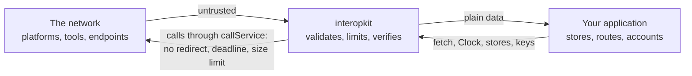

# Security

Report vulnerabilities privately through the repository's security advisory form rather than a public issue. Include the
version, the sequence of calls or the message that shows the problem, and what it lets an attacker do.

Every input is untrusted: launch messages, tokens, key sets, answers of services, events and what a host's callbacks and
stores return. The sections below state the controls of each package and what a deployment adds.

## Points to be aware of when deploying

- **No side channels.** The packages write no log, read no environment variable, make no network request except through the
  `fetch` that the caller passes, and send no telemetry. A library that fails throws; it does not print.
- **No code execution.** The packages run no code they are given and load none: `eval` fails lint, and a plug-in is a function
  that the caller passes.
- **Untrusted input.** Entry points validate their input and throw `DataError` on malformed data, so data from users, from
  the network or from files can be passed in directly. Structures are read with valibot schemas, and each limit below has a
  default.
- **Randomness and time.** The packages never use `Math.random` or read a clock themselves: identifiers and secrets that must
  be unpredictable come from `crypto.getRandomValues`, and the time from the `Clock` the caller passes. `SYSTEM_CLOCK` is the
  one place that reads the system time.
- **Secrets.** Private keys, client secrets and tokens are the host's to keep. The packages take them as arguments, never
  write them to a message, and never return them in an error. A `ServiceError` holds the text of the answer in `body`: do
  not show it to a user, because a service may put data of its own in it.
- **Personal data.** The packages store nothing. Launch claims, the names and emails of a roster, and the actors of events
  pass through them to the host; each guide has a table that says which data flows where, so that a host can meet its
  privacy duties.

## Service calls

Every call to a service goes through `requestService`, or `callService`, which decodes its text ([service calls](docs/core/service.md)).

| Threat                                                                                         | Control                                                                                                                                                                                                                                                                                                                                                                                                                                                          |
| ---------------------------------------------------------------------------------------------- | ---------------------------------------------------------------------------------------------------------------------------------------------------------------------------------------------------------------------------------------------------------------------------------------------------------------------------------------------------------------------------------------------------------------------------------------------------------------- |
| A service redirects from HTTPS to another scheme, or to an address the caller did not choose   | `redirect` is `"manual"`, and any 3xx answer or opaque redirect is a `ServiceError`; no redirect is followed                                                                                                                                                                                                                                                                                                                                                     |
| A service that never answers holds a caller                                                    | `timeoutMs` bounds the request and the whole body; every wait is raced against the deadline, so a `fetch` that ignores its signal cannot hold the call                                                                                                                                                                                                                                                                                                           |
| A service that sends a huge body exhausts memory                                               | The body is read in chunks and counted; more than `maxBytes`, 65,536 by default, is a `ServiceError` and the reader is cancelled. Measured, an answer without end read to a limit of 1 MiB raises the peak by 10 to 12 MiB |
| A value that is wrong in a million places makes a million findings, a kilobyte each            | `readPackage`, `readCredential`, `readStatement` and the validators stop at `maxFindings`, 1,000 by default: the check ends at the first finding beyond the limit and the list ends with a `findings-stopped` finding. A reader counts errors alone, and refuses when they stopped the check                                                                                                                                                                     |
| A text of JSON that takes much more memory to parse than it has bytes                          | `readJson` and the clients count the tokens of a text before `JSON.parse`, and refuse a text above `maxTokens`: 1,000,000 by default, 2,000,000 for the CASE client, whose packages are larger. Measured, a body at the limits of the most empty objects raises the peak of `readJson` by 43 to 55 MiB |
| A form whose plus signs a parser joins into a rope, a node for each                             | `readForm` turns each `+` into a space on the bytes before `URLSearchParams` reads them. Measured, a form of 10 MiB of plus signs raises the peak by 20 MiB, where `URLSearchParams` alone took 368 to 467 MiB |
| A late answer keeps a connection open                                                          | The body of an answer that arrives after the call gave up is cancelled                                                                                                                                                                                                                                                                                                                                                                                           |
| A caller that leaves keeps a request running                                                   | `signal` ends the wait with its `reason`; the request in flight may have reached the service, and the docs say how to resend safely                                                                                                                                                                                                                                                                                                                              |
| A registered platform or tool names an internal address as a URL (server-side request forgery) | Only `https`, no redirect and a size limit bound the reach; the packages cannot tell a private address from a public one. A multi-tenant host passes a `fetch` that refuses private and link-local addresses, checked on the address that the connection resolves to and not on the host name, because a name that is public when it is checked can be private when the connection is made (DNS rebinding); it also treats `ServiceError.body` as untrusted text |
| A URL that is not `https`                                                                      | `checkHttpsUrl` and `httpsUrlSchema` refuse it where the standards require `https`                                                                                                                                                                                                                                                                                                                                                                               |
| A message or a document names an internal host as a URL that a server fetches                  | `checkRemoteUrl` and `remoteUrlSchema` refuse an IP address in any spelling, a single label such as `localhost`, the names under `localhost`, `local`, `home.arpa` and `internal`, and user information. They see only the URL, so the host's `fetch` above still refuses the addresses that a public name resolves to                                                                                                                                        |
| A paging link sends a bearer token to another server                                           | `linkTarget` returns the address of a link only when it is `https` on the origin of the request and has no user information                                                                                                                                                                                                                                                                                                                                     |
| A global `fetch` that breaks when called as a method                                           | `fetch` is called as a bare function                                                                                                                                                                                                                                                                                                                                                                                                                             |

## Signing and OAuth clients

Every signing function takes a `Signer`, so that a private key stays where the host keeps it, and `@interopkit/core/oauth`
authenticates and calls authorization servers ([signing](docs/core/signer.md), [OAuth clients](docs/core/oauth.md)). Its
requests go through `requestService`, so the controls of the section above apply.

| Threat                                                         | Control                                                                                                                                                                                                             |
| -------------------------------------------------------------- | ------------------------------------------------------------------------------------------------------------------------------------------------------------------------------------------------------------------- |
| A client assertion is captured and replayed                    | Each request gets an assertion with a new random `jti` and an `exp` after `assertionLifetimeSeconds`, 300 seconds unless the client says otherwise; the server must refuse a `jti` it has seen (RFC 7523 section 3) |
| An assertion is used at another service                        | `aud` is the token endpoint, or the `audience` that the host names for the server                                                                                                                                   |
| The claims of a client replace a claim of the assertion         | `claims` of `private_key_jwt` may not name `iss`, `sub`, `aud`, `exp`, `nbf`, `iat` or `jti`                                                                                                                        |
| A private key leaves the process                               | The packages never see it: they call `Signer.sign`. `signCompactJws` refuses a header whose `jwk` holds the private part (`d`). A key in a KMS or an HSM stays there                                                |
| A signature of the wrong form reaches a verifier               | `signCompactJws` refuses an ECDSA signature that is not the fixed-length R and S, and a header that names another algorithm or key than the signer's                                                                |
| `none` or an HMAC algorithm signs an assertion                 | A signer names the algorithm of a private key only; `none` and the HMAC algorithms are refused                                                                                                                      |
| A login is forged, or its response comes from another server   | `state` is random and new for each request, and `exchangeCode` refuses another or no `state` before any request. With `issuer` set, a callback whose `iss` differs is refused (RFC 9207)                            |
| An authorization code is stolen and exchanged by another party | PKCE with S256: the verifier is random and goes only with the token request of the same flow                                                                                                                        |
| A token or a secret appears in an error or a log               | The messages of the errors name the endpoint, the status and the OAuth `error`, never a token, a secret or an assertion; `ServiceError.body` is the server's text, untrusted                                        |
| A token without an expiry is cached for ever                   | `createTokenCache` serves only a token that has an `expiresAt` and is not within the skew of it                                                                                                                     |
| A random pick is predictable                                   | `SYSTEM_RANDOM` draws from `crypto.getRandomValues`; the `state`, `nonce`, `jti` and verifier of the protocols are drawn from `crypto` inside the packages and take no replaceable source                           |

- Keep `PendingAuthorization` in a server-side session: its code verifier is a secret until the token request.
- Store the secret of a `RegisteredClient` as a secret: the server shows it once.
- Give a `Signer` that calls a KMS its own deadline, and convert a DER signature to the fixed-length R and S before it returns.

## Learning analytics

`sendCaliper` sends events about learners and a bearer token to a Caliper endpoint that the host configures
([sending events](docs/learning-analytics/send.md)). It goes through `callService`, so the controls of the section
above apply.

| Threat                                                | Control                                                                                                                                                                                 |
| ----------------------------------------------------- | --------------------------------------------------------------------------------------------------------------------------------------------------------------------------------------- |
| The token travels in the clear                        | `checkHttpsUrl` refuses an endpoint that is not `https`, before any request                                                                                                             |
| The token carries a line break or a header of its own | The token must match the `b64token` form of RFC 6750 section 2.1, which has no space or control character; anything else is a `DataError`                                               |
| A redirect carries the token to another address       | `callService` follows none: any 3xx is a `ServiceError`                                                                                                                                 |
| The token appears in an error or a log                | The token goes only in the `Authorization` header. The messages of the errors name the endpoint and the status, never the token                                                         |
| An envelope carries what Caliper does not define      | The envelope has `sensor`, `sendTime`, `dataVersion` and `data`, and no other property                                                                                                  |
| An event with a malformed identifier, entity or time  | `buildEvent` reads its input with a schema: the identifier is a UUID URN, every entity `id` an absolute IRI, every time in the form of Caliper, a property it does not build is refused |
| Two events get one identifier                         | `mintUrn` names the JSON text of its parts, so parts that a plain join would confuse give different names; a number that is not finite is refused                                       |
| A resend is mistaken for a new event                  | The identifiers of the events do not change between sends; Caliper defines no deduplication, so an endpoint may hold both copies                                                        |
| A hostile entity or event exhausts the stack or the memory | `readEntity` and `readEvent` copy their input with `copyJson`, which refuses a value that nests more than 64 levels or is not JSON, before the recursive schemas read it, and it stops at the first fault: a list of a million wrong values costs the memory of the list. Bound a text with `readJson` before parsing it |
| An entity or an event carries what its class does not define | Every class is a closed schema: a property it does not have is refused, and the sender's own go in `extensions`, a JSON object that is copied and not read                           |
| An entity is another class than the property allows   | A property takes the classes that the tables name for it, chosen by the `type` of the object, and refuses any other; an event allows the actions of its class and no other             |
| A value that nobody wrote for a validator exhausts the stack or the memory | `validateEvent` and `validateEntity` never throw for a value: one that is not JSON or nests more than 64 levels is one finding and nothing of it is read, and the findings stop at `maxFindings` (1,000), so a value that is wrong in a million places costs the memory of the limit. A finding of the shape can quote the value it found: treat it as untrusted text |
| A value is judged by the profile that the sender chose | The tables of the profiles are fixed in the package; a `profile` that is none of Caliper's is a finding of the shape, and no table is read from the input |
| A sender picks the version that reads its document    | The endpoint reads the version that the `dataVersion` names only if the host's `versions` lists it, and answers 422 before any item is read otherwise. Each item is then read by the schemas of that version, which refuse the classes, properties, actions and contexts that the version does not define; the limits and the memory of a reading are those of 1.2 |

`handleCaliperRequest` receives what sensors send, as the endpoint of the host ([receiving events](docs/learning-analytics/endpoint.md)).

| Threat                                                      | Control                                                                                                                                                                                                  |
| ----------------------------------------------------------- | -------------------------------------------------------------------------------------------------------------------------------------------------------------------------------------------------------- |
| A caller that is not authorized makes the endpoint parse    | `authorize` is asked before the media type, the size and the JSON are looked at: the body of a refused request is never read. A mutation rule moves the check and a test fails                          |
| A sensor passes itself off as another                       | The envelope has the `principal` that `authorize` named, and `sensor` is kept as what the sender says; a host that keys what it stores by `sensor` is not protected by this library                      |
| A body of any size or depth exhausts the memory or the stack | The body is refused above `maxPayloadBytes` (1,048,576) with 413 before it is read, then bounded by `readJson` in levels (64) and in tokens (`maxTokens`, 1,000,000) before it is parsed. The host caps the read of the request first |
| An envelope with a million wrong values costs a gigabyte    | Every item is read with `copyJson` and a bounded parse, and the findings stop at `maxFindings` (1,000); two tests measure the peak memory of 1 MiB of events and of a million wrong values                |
| A token appears in an answer or a log                       | The token goes to `authorize` and nowhere else: no answer, error or message of the endpoint holds it                                                                                                     |
| A failure of a port tells the sender how the host is built  | A rejection of `authorize` or `accept` answers 500 with a problem detail that has no `detail`; the cause stays with the host                                                                            |
| An answer reflects a large piece of what the sender wrote   | A `detail` is cut at 500 characters, and is `application/problem+json`, which no browser renders as a page                                                                                               |
| The endpoint is made to fetch an address                    | It never dereferences an IRI or a context: terms are fixed strings                                                                                                                                       |
| A sender sends again and the endpoint holds both copies     | Caliper defines no deduplication, and the identifiers of the events do not change between sends; a host that wants one copy keeps an event once by its `id`                                              |

- Give the endpoint a `signal` that ends with the server, and cap the read of the request before building the `HttpRequest`.
- Events may carry personal data: say in the privacy notice of the host what its endpoint keeps, and keep each event only as long
  as the purpose needs.

- Give an opaque identifier as the `actor` of an event, such as `urn:uuid:` and a UUID that the host keeps in its own records,
  never an email address, a name or an identifier that another service knows. The library cannot tell the two apart.
- The identifiers of events are UUIDs of the parts that the host gives. Do not put a secret or a personal value in the parts.
- Events hold times, IRIs and scores. A host that sends a response or an answer key builds that event itself and decides
  whether the endpoint may know it.
- A `ServiceError` carries the endpoint's answer as `body`: log it as untrusted text.

## Competency frameworks

`readPackage`, `readEntity`, `validatePackage`, `validateEntity` and `toCaseVersion` take frameworks that a provider or a file gives
([model guide](docs/competency-frameworks/model.md)). The functions of `@interopkit/competency-frameworks/graph` work on packages
that are already read ([graph guide](docs/competency-frameworks/graph.md)). They make no request, keep nothing and write nothing.
The client and the provider have a section each below.

| Threat                                                                       | Control                                                                                                                                               |
| ---------------------------------------------------------------------------- | ----------------------------------------------------------------------------------------------------------------------------------------------------- |
| A package with a property, a type or a form that CASE refuses                | Every property is read with a schema of its class and version; an unknown property is refused, and a finding names its path and rule                  |
| A value in `extensions` that is not data, or nests without end               | The value must be JSON, is copied, and nests at most 64 levels; a member named `__proto__` stays a member and never changes the prototype of the copy |
| Two entities with one identifier                                             | `duplicate-identifier` is an error, so that a lookup by identifier is never ambiguous                                                                 |
| A tree that loops, or a chain of any length                                  | `child-of-cycle` is an error; the walk keeps its own stack and cannot overflow the stack of the host                                                  |
| A package built so that its findings outgrow it, such as one loop closed by thousands of associations | Every walk is linear in the items and associations; the finding of a loop names at most five of its nodes; the check stops at `maxFindings`. Measured: 9.3 MB of 10,000 items in a loop closed 15,000 times takes 100 MB and 134 ms to refuse |
| Markdown or LaTeX in `fullStatement`, `description` and `notes`              | The package carries the text and never renders it. A consumer renders it through a sanitizing renderer and never inserts it into a page as HTML       |
| A result that shares an object with its input                                | A reader returns a copy, and `toCaseVersion` returns a new value; an input is never changed                                                           |
| A package that loops or gives an item several parents, to make a walk run on | `frameworkTree` places each item once and keeps its own queue, so the work is linear in the items and associations                                    |
| An identifier or a base that changes the path of an address                  | `caseEntityUri` refuses `.` and `..`, percent-encodes the identifier, and refuses a base with credentials, a query or a fragment                      |

### The client

`createCaseClient` reads frameworks from a provider ([client guide](docs/competency-frameworks/client.md)). It makes GET requests
through the `fetch` of the host and keeps nothing between calls. A framework carries no personal data.

| Threat                                                      | Control                                                                                                                                              |
| ----------------------------------------------------------- | ---------------------------------------------------------------------------------------------------------------------------------------------------- |
| A provider reached over plain HTTP, or redirected elsewhere | `baseUrl` must be `https` without credentials, query or fragment; every request goes through `requestService`, which follows no redirect             |
| A provider that answers without end, or with too much       | `timeoutMs` ends a request, `maxBytes` stops the read of the body, and the iteration of the documents ends when a page repeats or no page follows    |
| A credential that leaks or splits a header                  | The host's `authorization` function returns the header value; one with a line break is refused, and the value is in no error and is never logged     |
| An identifier or a filter that changes a request            | An identifier is percent-encoded into one path segment and `.` and `..` are refused; the filter, the sort and the fields are checked and encoded     |
| An address in a `Link` header that leads elsewhere          | The client reads `rel="next"` as a signal and builds every request from `baseUrl`; it never requests an address that a provider gives                |
| An answer that is not CASE, or that has a hostile shape     | Every answer is read with `readEntity` or `readPackage` and refused with a `DataError` that names the provider; a status body is read, never trusted |
| An answer built to exhaust memory                           | The answer is read up to `maxBytes` (16 MiB) and its tokens counted against `maxTokens` (2,000,000) before it is parsed; the readers' checks are linear and stop at `maxFindings`. Measured with the defaults: a framework of 16 MiB raises the peak by 76 to 185 MiB, and the worst answer, 16 MiB of `extensions` with 499,000 distinct keys, by 233 to 275 MiB. Lower both limits for a provider you do not trust |

### The provider

`handleCaseRequest` answers requests from consumers of a framework over the REST binding ([provider guide](docs/competency-frameworks/provider.md)).
It reads a query and no body, keeps nothing between requests and makes no request.

| Threat                                                           | Control                                                                                                                                                                   |
| ---------------------------------------------------------------- | ------------------------------------------------------------------------------------------------------------------------------------------------------------------------- |
| A consumer reads what it may not                                 | `authorize` receives the request and decides before any lookup or query is read; a refusal is 401 or 403 and the store is not asked. The host's `authorize` checks tokens |
| A consumer cannot learn how to authenticate                      | The discovery file is the one answer that skips `authorize`; the host puts nothing secret in it                                                                           |
| An identifier that is not a UUID reaches the store               | It is refused with 404 `Invalid UUID` before the store is asked, so a store never sees a path, a query or a pattern in place of an identifier                             |
| A filter that makes the parser or the evaluator work without end | The filter has at most 2,048 characters and one logical operator; the parser reads it once, left to right, with no backtracking pattern                                   |
| A fields list that the reader splits into a name for each comma | The list has at most 2,048 characters; a longer one is refused before it is split, where a list of 10 MiB took 629 MiB                                                 |
| A filter or a sort that reads what an object inherits            | A path reads own properties only, so `constructor`, `__proto__` and a polluted prototype give no value                                                                    |
| A page of any size                                               | `limit` is at most `maxPageSize` (1,000 by default), `offset` is a safe integer, and a store that answers more documents than the limit is refused                        |
| A failure of the store or of `authorize` shows its cause         | The answer is 500 with a fixed sentence; the message of the failure is never in the answer                                                                                |
| A wait for the store that never ends                             | Every call of a port is raced against the `signal`; an abort rejects the request at once                                                                                  |
| A localized discovery file that points elsewhere                 | `localizeOpenApi` sets `servers` to one address that ends with the root of the API, and returns a copy of JSON within 64 levels                                           |
| The URL that builds the `Link` header                            | It is the URL of the request; behind a proxy the host builds the request from its public address and not from a header that a consumer controls                           |

- A host that serves frameworks to anyone leaves `authorize` out. A host that serves some frameworks to some consumers
  decides in `authorize` from the request, or filters in its store: the provider has no notion of an owner.
- Limit the rate of requests: count them in the host, and refuse the request over the limit in `authorize` with 429 and
  `retryAfterSeconds`, which the provider answers as `server_busy` with `Retry-After`.

## Achievement credentials

`readCredential`, `readEntity`, `validateCredential` and `validateEntity` take credentials that an issuer, a wallet or a file
gives ([model guide](docs/achievement-credentials/model.md)), the builders write credentials from the parts that an issuer
gives ([builders guide](docs/achievement-credentials/issue.md)), and `bakePng`, `readPng`, `bakeSvg` and `readSvg` of
`/baking` write a credential into an image and read it out ([baking guide](docs/achievement-credentials/baking.md)). They make no request, keep nothing and read no clock. They
check the shape of a credential and the rules of its subject; they do not check a proof, a key, a status or an issuer, and a
result of theirs is not evidence that a credential is genuine.

| Threat                                                                            | Control                                                                                                                                                                                                                                                                                                                                                                                                                                                                                                                         |
| --------------------------------------------------------------------------------- | ------------------------------------------------------------------------------------------------------------------------------------------------------------------------------------------------------------------------------------------------------------------------------------------------------------------------------------------------------------------------------------------------------------------------------------------------------------------------------------------------------------------------------- |
| A credential with a property, a type or a form that the specifications refuse     | Every property is read with a schema of its class; a closed class refuses an unknown property, and a finding names its path and rule                                                                                                                                                                                                                                                                                                                                                                                            |
| A chain of `parentOrg`, `endorsement` or `issuer` of any depth                    | The value is JSON that nests at most 64 levels, checked before the schemas read it, so the recursion of the schemas is bounded                                                                                                                                                                                                                                                                                                                                                                                                  |
| A property that no class lists, of any content                                    | It must be JSON and is copied; a member named `__proto__`, `constructor` or `prototype` of an open class is not carried, and elsewhere it stays data and never changes a prototype                                                                                                                                                                                                                                                                                                                                              |
| A claim that nothing ties to a person                                             | `subject-unidentified` is an error: a subject without an `id` and an `identifier` is refused                                                                                                                                                                                                                                                                                                                                                                                                                                    |
| An identity that is said to be hashed and is not                                  | `identity-hash-form` is a warning; the plain value of a person is personal data, and the guide tells hosts to hash it                                                                                                                                                                                                                                                                                                                                                                                                           |
| A text with markup or a link in `narrative`, `description` and `name`             | The package carries the text and never renders it. A consumer shows it as text, and never inserts it into a page as HTML                                                                                                                                                                                                                                                                                                                                                                                                        |
| A result that shares an object with its input                                     | A reader and a builder return a copy, and an input is never changed                                                                                                                                                                                                                                                                                                                                                                                                                                                             |
| An input of a builder with a property it does not know, or with a fault           | The builder refuses it with a `DataError` that names every fault, and checks what it wrote with the schemas and rules of the readers                                                                                                                                                                                                                                                                                                                                                                                            |
| A credential whose address is not one                                             | A builder refuses an `id` that is not an absolute URI, so that `sameCredential`, which compares ids after unescaping them, has an address to compare                                                                                                                                                                                                                                                                                                                                                                            |
| The hash of an identity as a weak secret                                          | The hash is a SHA-256 of the identifier and a salt that the host chooses; `matchesIdentifier` also reads `md5$`, which Open Badges names                                                                                                                                                                                                                                                                                                                                                                                        |
| An image built to exhaust memory when it is read | `readPng` and `readSvg` refuse an image above `maxBytes` before they read any of it. A PNG is walked chunk by chunk without copying, and a chunk that claims more than the image holds is refused. An SVG is parsed in pieces by `saxes`, which resolves no entity but the five of XML and reads no DTD, and the scan refuses an SVG that nests more than 256 elements or gives one element more than 256 attributes as the parser meets them, and a credential of more than `maxTokens` (1,000,000) tokens of JSON before it is parsed; its text is bounded by the bytes of the image. Measured, a credential element of 10 MiB of empty arrays is refused in 0.2 s and 20 MiB above the image, and under a heap of 96 MiB; a PNG of 10 MiB raises the peak by 10 MiB, an SVG of 10 MiB whose credential is one string by 28 to 35 MiB within a tested 64 MiB, and a credential of the most empty objects that `maxTokens` leaves by 13 to 22 MiB within a tested 128 MiB |
| A credential chunk that is compressed                                             | It is refused, so no text from an image is ever inflated                                                                                                                                                                                                                                                                                                                                                                                                                                                                        |
| A damaged chunk, or a chunk that two readers read differently                     | The CRC-32 of the credential chunk is checked; the first chunk with the keyword is the one, as the specifications say, and `bakePng` refuses an image that holds one unless `replace` says to replace it                                                                                                                                                                                                                                                                                                                        |
| An SVG that holds markup in the credential                                        | The credential element holds text only, in a CDATA section whose end marker is split; the baker writes the two characters XML forbids as `\u` escapes. A reader refuses an element inside the credential element                                                                                                                                                                                                                                                                                                                |
| An image taken for proof that a credential is genuine                             | `readPng` and `readSvg` return what the image holds, unchecked; `verifyCredential` verifies it                                                                                                                                                                                                                                                                                                                                                                                                                                  |
| A server that answers a request of the client with a page built to exhaust memory | The answer is read up to `maxBytes`, its JSON must nest at most 64 levels and have at most `maxTokens` (1,000,000) tokens, both checked before it is parsed. A page may hold at most the `pageSize` credentials that the request asked for, and the readers stop at `maxFindings`. Measured, 16 MiB of empty objects costs 84 MB and is refused; lower `maxBytes` for a server you do not trust |
| A server that ignores `offset` or repeats a page                                  | The iteration stops at a page that holds only credentials already seen, so it cannot be held in a loop; a host that wants a bound on a server that never ends stops reading                                                                                                                                                                                                                                                                                                                                                     |
| A token or an address that smuggles a header or leads elsewhere                   | The access token must be printable characters without a space or a line break, or no request is made. The client builds every URL from `baseUrl`, which must be an `https` URL without credentials, query or fragment, never from a `Link` header, and follows no redirect. Every address in a service description must be `https`                                                                                                                                                                                              |
| A service description that points the OAuth clients at another server             | The description is data from the server being registered with: `discoverService` returns its addresses and the host decides, as it decides which authorization server to trust. Pass a `fetch` that checks the address the connection resolves to when the base URL is not the host's own                                                                                                                                                                                                                                       |

`createKeyResolver`, `verifyIssuerKey`, `signCredentialJwt` and `readCredentialJwt` ([keys guide](docs/achievement-credentials/keys.md),
[JWT guide](docs/achievement-credentials/jwt.md)) verify a credential's proof and fetch the documents that name its keys.
A fetch goes through the host's `fetch`, over HTTPS only, without redirects, within a deadline and a size limit, and the
documents are cached with a bound. They read no clock but the one they are given, and keep nothing but that cache. A host
whose addresses come from a counterparty passes a `fetch` that refuses loopback, private and link-local addresses, checked on
the address that the connection resolves to.

| Threat                                                                         | Control                                                                                                                                                                                |
| ------------------------------------------------------------------------------ | -------------------------------------------------------------------------------------------------------------------------------------------------------------------------------------- |
| A good signature by a key that is not the issuer's, on a credential that names any issuer | A key counts only when the issuer publishes it under `assertionMethod`, in its document or in the key set of its host, by thumbprint; `controller` and `iss` must name the issuer. `readCredentialJwt` refuses an unbound key unless `allowUnboundKeys` is set, and a mutation rule removes each part of the check |
| A self-describing method, or a document of another address that names the issuer as controller | Neither binds: only the keys that the issuer itself publishes count, and a document that lists methods must name the address it was fetched from                    |
| `alg: none`, an HMAC with the public key as secret, an algorithm the verifier did not offer | The algorithm must be in `algorithms`, which never holds `none` or an HMAC algorithm; a key with an `alg` verifies that algorithm only                                                   |
| A header that names its key twice, an extension in `crit`, a `jku`, `x5u` or `x5c`           | Exactly one of `kid` and `jwk`; `crit` is refused; the other sources of keys are not followed                                                                             |
| A JWS or a document of any size or depth                                      | The size of a JWS is checked before it is decoded, its shape before its parts are decoded, and the tokens and the depth of each part are counted from its text before a parser builds anything; a document is limited in bytes, tokens, depth and keys |
| One signature with many spellings                                             | The parts of a JWS must be the canonical base64url of their bytes                                                                                                                       |
| A key set or a document that lists a private key, a key for encryption, or an RSA key of any size | Such a key is left out; an RSA modulus is limited to 8,192 bits before any signature is verified with it                                                                   |
| A claim of the JWT that differs from the credential                           | `iss`, `jti`, `nbf`, `exp` and `sub` must equal what the credential says                                                                                                                 |
| An expired token                                                              | `exp` and `nbf` are compared with the clock of the host within `clockSkewSeconds`                                                                                                        |
| An issuer or a `kid` chosen to make the verifier fetch                        | HTTPS only, no redirects, a deadline and a size limit; a document is fetched again for a missing key once a minute at most, and the cache holds 1,000 documents                         |
| A private key in the header of a token, or a signature that a verifier would refuse | `signCredentialJwt` refuses a `jwk` with a private member and a signature of the wrong length (DER from a KMS) before it returns                                                       |
| A key set member of a shared platform used for another issuer                 | A member's `iss` must be the issuer; a member with none binds every issuer of its host, so a platform writes the `iss` of each                                                            |
| A context named by a credential, to make the verifier fetch or trust a document | A processor of JSON-LD loads a context through the loader of the package and no other; an address with no pin is refused before any read or fetch; a document that differs from its pin is refused always; a test fails if a processor reaches the default loader of the library or the network |
| A credential built to exhaust the JSON-LD processors: a list of alike items, a clique of blank nodes, many values of one property | The work factor of the library bounds nothing here: it allows a run of Hash N-Degree Quads for each alike blank node, and a list of 5,000 items took 1.7 s and 900 MiB, 11.5 s at 10,000, and 35 s for 60,000 values of one property. Before any processor reads a credential, `maxInputBytes` characters and `maxJsonLdTokens` (20,000) tokens are checked, and the canonicalization of the cryptosuites is replaced by one that stops after 1,000 runs (`selective-disclosure` does the same). Each is a limit told as the reason of the `proof` check, not a signature that fails. Tests pin the three suites, a graph that the library's allowance lets pass, and the peak of memory (under 256 MiB) |
| Many proofs on one credential, each canonicalizing and fetching a key again | The first four are checked and the rest are not looked at; the credential is canonicalized once for all of them. 5,000 values of one property with 300 proofs took 95 s before |
| An `ecdsa-sd-2023` base proof given to a verifier, which holds the key of the proof and every signature | `verifyProof` refuses it and says to derive a disclosure first; the guide says that disclosures of one credential can be linked |
| A proof for a purpose other than assertion, an expired proof, a legacy proof | Only `assertionMethod` counts, `expires` is compared with the clock within the skew, and `Ed25519Signature2020` needs `legacyProofs` |
| A proof that names a `previousProof`, which Data Integrity verifies only with the proofs that it names | It is checked over the credential with the proofs that it names, and counts only when each of them is valid; a name the credential lacks, a cycle and a chain longer than the four proofs that are checked are not valid |
| A valid proof of another party put first, to hide the issuer's proof or to pass in its place | The first valid proof whose key the issuer publishes counts; a valid proof whose key is not the issuer's does not end the search, and alone it fails the `issuer` check |
| A signer that signs another algorithm than the cryptosuite names, or names no key | `addProof` refuses it with a `DataError` before it signs |
| A status list credential that inflates to gigabytes (a gzip bomb within the fetch limit)   | The list is inflated through a `DecompressionStream` that is cancelled at 16,777,216 bytes; the library's decoder, which inflates with no limit, is never called; a test inflates a bomb of 20 MiB from under 100 KB, and another measures a bomb of 256 MiB within 64 MiB of peak (27 MiB measured). A list is inflated once for every credential that names it |
| A status list credential published by another party for a credential's status               | The list credential's proof is verified and its key is bound to its issuer, who must be the credential's issuer or one of `statusIssuers`; a purpose that differs from the entry's fails |
| A status read wrongly: an entry of the `message` purpose, or of more than one bit           | Such an entry is `skipped` with a detail and the list is never read as one bit; a list of fewer than 131,072 entries or an index outside it fails |
| Indexes that betray the order of issue                                                       | `allocateStatusIndex` draws a free index at random from the `Random` the host passes (`SYSTEM_RANDOM` in production) |
| A verifier of JWTs that loads a processor of JSON-LD through the status module               | `status` loads `data-integrity` only for a Data Integrity proof; a test checks that no static import of `jwt`, `keys`, `status` or `refresh`, or of their dependencies, reaches a processor of JSON-LD |
| A refresh service that answers with a huge or hostile document                               | HTTPS only, no redirects, time and size limits and a count of tokens and levels before parsing; the answer is a candidate that the caller verifies like any credential; a failed refresh is not a reason to refuse the credential |

`verifyCredential` ([verification guide](docs/achievement-credentials/verify.md)) joins the checks of a credential, its endorsements
and the credentials of a CLR. It fetches only through the host's `fetch`, and only for a credential whose proof is valid: the
keys and the contexts of the proof first, then the refresh, the schema and the status list that the credential names. It keeps
nothing across calls but the caches that the host passes. A host passes a `signal` with a deadline: a call has none of its own, and it ends the wait for a `KeyResolver`, a loader of contexts or a suite of the host that ignores it.

| Threat                                                                                     | Control                                                                                                                                                                                                  |
| ------------------------------------------------------------------------------------------ | -------------------------------------------------------------------------------------------------------------------------------------------------------------------------------------------------------- |
| A forged credential that names an address, to make the verifier call it                    | The proof and the issuer's hold on the key are checked first, and a credential that fails either causes no request to an address that it names (status list, refresh service, schema); a test records the requests |
| A forged issuer: a good signature by a key that the issuer does not publish                | `issuer` `failed`, the credential is withheld from the result and `verified` is false. The same rule binds the key of an endorsement, of each credential of a CLR and of a status list, each with its own issuer |
| A proof or an issuer that cannot be checked, accepted because the host accepts unavailable checks | `unavailable: "warn"` applies to `schema`, `refresh` and `status`; a proof that cannot be checked, and a key that cannot be tied to the issuer because the issuer's documents cannot be read, always fail the verification, so a forger cannot pass by naming an issuer whose server fails |
| An input of any size or depth, and endorsements or credentials in any number               | The characters, tokens and levels of the input are checked before any reader parses it; a credential has at most `maxEndorsements` (32) endorsements and a CLR at most `maxNestedCredentials` (1,000) credentials, counted before any of them is verified |
| A schema written to hang or exhaust the verifier                                           | A credential has at most 4 schemas fetched other than 1EdTech's, each over HTTPS within `maxBytes`, `maxTokens` and `maxDepth`, once for a call. One that runs a regular expression (`pattern`, `patternProperties`, and `format`, which the validator checks with one; that of `url` backtracks) is `unavailable` and never run. The validator reads the schema and the credential through a meter that ends a judgment after 10,000,000 values, about a second, so that a keyword applied to each item of a long list, `uniqueItems` over a long list, and definitions that refer to each other many times cost no more |
| A refresh that swaps one credential for another, or chains refreshes                       | The refreshed credential is verified in its turn, its key tied to its issuer, and must be the same credential (its id and its issuer); otherwise the refresh is `unavailable` and the original is verified. A refresh is followed once  |
| A CLR whose every credential names a refresh service that answers a large credential      | One call refreshes at most 16 credentials and verifies the rest as they are, so the verifier fetches and keeps no more than 16 answers of `maxBytes`: 600 such credentials that answer 600,000 characters each raise the peak by 174 to 264 MiB without the bound and by 47 to 89 MiB with it on Node.js 22 and 24, within a tested 128 MiB, the signing of the services included |
| A status list of another party, or whose key is not its issuer's                           | The list credential is verified as the credential is: its proof, its key bound to its issuer, who must be the credential's issuer or in `statusIssuers`; `allowUnboundKeys` applies to it as to the credential |
| A revocation list of 1EdTech that clears a revoked credential                               | The list is not signed: it is fetched over HTTPS from the address that the credential's issuer wrote, and a list that names other issuers than the credential's or `statusIssuers` fails |
| A result mistaken for trust in what it carries                                             | `credential` is what the proof secures and is set only when the proof is valid and the issuer check did not fail; a revoked or expired credential is still returned, and `verified` says it is not accepted |
| A call that never ends: a CLR of 1,000 credentials, each naming a list, a service, a schema | No deadline of its own: the host passes a `signal` such as `AbortSignal.timeout(...)`, which ends the call with its reason                                                                                  |

### The provider of the APIs

`handleCredentialsRequest` answers the Open Badges API or the CLR Standard API as the resource server
([provider guide](docs/achievement-credentials/provider.md)). It keeps nothing between requests and makes no request of its own:
with `verify` set, `verifyCredential` makes the requests that the verification needs, under its own rules above.

| Threat                                                                     | Control                                                                                                                                                                                                                   |
| -------------------------------------------------------------------------- | ------------------------------------------------------------------------------------------------------------------------------------------------------------------------------------------------------------------------- |
| A client reaches the credentials or the profile of another user            | `authorize` receives the request and the scope of the operation, and names the owner; the stores are asked only for that owner, and not at all when `authorize` refuses                                                  |
| A token of one operation used for another                                  | Each operation asks for its own scope of OB 6.2.1 or CLR 5.2.1, and a provider of one API never for a scope of the other; a 403 names the scope that the token lacks (RFC 6750)                                          |
| A forged credential stored and served as genuine                           | With `verify`, a credential is verified before it is stored, its key bound to its issuer, and refused with 422 when it does not verify; without it, the store holds what a user uploaded, and the host verifies before it shows it to anyone else |
| A credential that makes the server call an address of the uploader's choice | The provider fetches nothing. The verifier fetches no address that a credential names until its proof and its issuer's hold on the key pass, only over HTTPS, and never the refresh service: the provider sets `refresh: false`. The host's `fetch` refuses private addresses |
| A body built to exhaust memory                                             | At most `maxBodyBytes` (1,048,576), refused with 413 before it is read; its tokens (`maxTokens`, 1,000,000) and levels (64) counted before it is parsed, and so are those of the payload of a JWS. Measured, the worst body within the limits raises the peak by about 120 MiB |
| A credential of another kind stored as a badge                             | The body is read as the credential of the API (`AchievementCredential` or `ClrCredential`); an endorsement or a credential of the other API is refused with 422                                                          |
| A failure of a port shows its cause                                        | The answer is 500 with a fixed sentence; the message of the failure is never in the answer                                                                                                                                |
| A wait for a port or the verifier that never ends                          | Every call of a port, and the verification, is raced against the `signal`; an abort rejects the request at once                                                                                                         |
| The URL that builds the `Link` header                                      | It is the URL of the request; behind a proxy the host builds the request from its public address. The client of the package never follows the address of a `Link`                                                       |
| A service description that sends clients elsewhere                         | It is the host's own document: the provider serves it unprotected, as OB 6.3 asks, and checks that its addresses are `https` and that its flow offers every scope of the API                                                |

- Limit the rate of requests: count them in the host, and refuse the request over the limit in `authorize` with 429 and
  `retryAfterSeconds`, which the provider answers as `server_busy` with `Retry-After`.
- A store compares credentials with `sameCredential` and `newerCredential` and keeps them for their owner only; the profile that a
  user replaces is read whole and holds no more than the model of a `Profile`.

### Open Badges 2.0

`readCredential` and `validateCredential` read Open Badges 2.0 assertions with their BadgeClass and issuer
([guide](docs/achievement-credentials/open-badges-2.md)). They make no request and read the documents as the compacted form of
the context of Open Badges 2.0, from a fixed table of its terms and aliases. A badge that they read is not verified.
`verifyCredential` verifies one ([verification guide](docs/achievement-credentials/verify.md#open-badges-20)): it fetches the
documents of the badge from the addresses that the badge names, which are the source of truth, through the host's `fetch`.

| Threat                                                                                  | Control                                                                                                                                                                                                                                       |
| --------------------------------------------------------------------------------------- | --------------------------------------------------------------------------------------------------------------------------------------------------------------------------------------------------------------------------------------------- |
| A document whose context gives the terms other meanings than the reader knows           | A value is read as 2.0 only when its contexts hold `https://w3id.org/openbadges/v2`, and a document embedded in it names such contexts or none; an inline context that redefines a term of 2.0 after it is refused, every name that the context of 2.0 does not define is a warning and is kept as JSON, and an object with contexts of its own is kept as it is and never read as a class |
| A second verification smuggled in under an alias                                        | An object that holds both `verify` and `verification` is refused with `duplicate-term`                                                                                                                                                        |
| A badge that makes the reader fetch its BadgeClass or its issuer                        | Reading makes no request: a document named by its address is `not-embedded`. Verification fetches it from its HTTPS `id`                                                                                                                      |
| A badge that names an internal address, to make the verifier call it (server-side request forgery) | Only HTTPS to a host named by a public name (`checkRemoteUrl`: no IP address, single label or name of a private network), no redirect, `timeoutMs` and `maxBytes`, and the tokens and levels counted before parsing. One badge fetches at most its assertion, its BadgeClass, its issuer, 8 keys and a revocation list. A public name can still resolve to a private address: a host that verifies badges from anyone passes a `fetch` that refuses loopback, private and link-local addresses, checked on the address that the connection resolves to |
| A forged signed badge that names addresses                                              | Its BadgeClass, its issuer and its key are fetched before the signature, since they hold the key; the revocation list only once the signature verifies and the issuer lists and owns the key; a test records the requests |
| A key that the issuer does not back                                                     | The issuer must list the key in `publicKey`, a key that names an `owner` must name the issuer, and an issuer that is not at an HTTPS address fails the `issuer` check, since whoever writes the badge writes such an issuer |
| A hosted assertion that the input rewrites, or that its issuer does not host            | The input only names the address: the assertion, its BadgeClass and its issuer are the documents at their HTTPS `id`s, and one that declares another `id` fails. The `id` must start with one of `startsWith` and be on one of `allowedOrigins`, by default the host of the issuer's `id` |
| A revoked badge taken for a valid one                                                   | A 410 Gone or `revoked: true` is read before the rest of the document; a revocation list that cannot be read is `unavailable`, which fails the verification unless the host passes `unavailable: "warn"` |
| A key or a header built to make a verification slow                                     | An RSA key over 8,192 bits is refused before any signature is checked, the header of the JWS has at most 16,384 characters, and the parts of the JWS must be canonical base64url |
| A BadgeAssertionV2 whose documents do not belong together                               | Each document must have the `id` that names it, and a document is embedded or given apart, never both: `unlinked-document`                                                                                                                    |
| A document built to exhaust memory                                                      | It nests at most 64 levels, checked before the schemas read it, and the findings stop at `maxFindings`. Measured, a list of a million wrong values is read in 90 MiB, where an unbounded list of findings took 1 GB                             |
| The payload of a JWS built to exhaust memory, which a verifier reads before the signature | The payload must be canonical base64url, and its tokens and levels are counted before it is parsed. Measured, a JWS of 15 MiB that holds four million empty arrays is refused in 18 to 31 MiB, where parsing it took 354 MiB; a JWS at the limit of 1 MiB raises the peak of its verification by 13 to 46 MiB with the most numbers and 56 to 90 MiB with the most empty objects, within tested budgets of 96 and 128 MiB |
| An image that holds a 2.0 badge, read as the credential that a 3.0 baker wrote          | A 2.0 assertion has the kind `badge-v2`; a legacy `tEXt` chunk is read only for an HTTP or HTTPS address and after its CRC-32; a 2.0 assertion is never baked, and a baker writes its own credential before a 2.0 one, so a reader finds it first |
| A recipient hashed with MD5                                                             | `matchesIdentifier` reads `md5$`, which Open Badges 2.0 and 3.0 name, to match a recipient; nothing writes it                                                                                                                                  |
| A badge that was read, taken for one that was verified                                  | Reading checks the shape and the rules; it does not check a signature, a revocation, an expiry against the clock or the scope of a hosted assertion                                                                                         |

## Selective disclosure

`addBaseProof`, `deriveProof` and `selectiveDisclosureSuite.verify` sign, reveal part of, and check a credential with
`ecdsa-sd-2023` ([proofs guide](docs/selective-disclosure/proofs.md)). They keep nothing, write nothing and make no request: a
context is read only through the `contexts` function that the caller passes.

| Threat                                                                         | Control                                                                                                                                                                                                                                                                                                                      |
| ------------------------------------------------------------------------------ | ---------------------------------------------------------------------------------------------------------------------------------------------------------------------------------------------------------------------------------------------------------------------------------------------------------------------------- |
| Someone who holds a base proof replaces the statements that a holder may hide  | The key of the HMAC comes from `crypto.getRandomValues` and the key of the proof from Web Crypto, which does not let its private key be exported, and no option replaces them. The issuer's signature covers the hash of the proof options, the public key of the proof and the hash of the mandatory statements, and a verifier counts one signature for each statement that is not mandatory |
| A weak random source leaks the key of a proof through the nonce of a signature | The key of a proof and the nonces of its signatures come from the random source of the platform, which Web Crypto and the signers of the platform rely on, as Digital Bazaar's suite does. The key serves one proof and never leaves Web Crypto                                                                              |
| A base proof reaches a verifier                                                | It holds the key of the HMAC and the signature of every statement. `verify` answers `false` for it, and `isBaseProof` tells a caller to ask the holder for a derived proof. Give a verifier the output of `deriveProof` only                                                                                                 |
| A verifier, or two, link the disclosures of one credential                     | Every disclosure carries the issuer's signature and the public key of the proof, so disclosures are linkable (Data Integrity ECDSA Cryptosuites, section 5.1). Unlinkable disclosure needs another suite, which this package does not implement                                                                              |
| A verifier learns when a credential was signed, whatever the holder hides        | A `created` is signed with the proof options, so it shows in every disclosure. `addBaseProof` writes one only when the issuer gives it, and the guide says why an issuer may leave it out |
| A pointer reveals more than the holder meant                                   | A pointer must be a JSON pointer that points at something in the document. Text without a leading `/` is refused, because the primitives read it as the empty pointer, which selects the whole document; so is a name that they would read as an array index                                                                 |
| A pointer of millions of characters, to exhaust the stack                       | A pointer is read once, character by character, and never by a pattern with a quantified group, so any text that is no pointer is a `DataError` |
| A credential names a context that is fetched from the network                  | The processors get the loader of the caller and no other. A test makes the default loader of `jsonld` and `fetch` fail, and runs the three roles. The caller's loader enforces pins and size limits                                                                                                                          |
| A document built to exhaust the JSON-LD processors: many values of one property, a list of alike items, a clique of blank nodes | `maxTokens`, 20,000 by default, is counted before any processing, and the canonicalization stops after 1,000 deep iterations: more is a `DataError`, and `false` from `verify`. Without them a document of 1 MiB takes minutes, and one of 40 KB exhausts 2 GB |
| A document, a proof value or a context of any size or depth                    | The document with its proof is at most `maxBytes` and `maxTokens` and nests at most 64 levels, before any processing. The CBOR of a proof value refuses indefinite lengths, tags other than 64, integers beyond 2^53 and repeated keys                                                                                                       |
| A derived proof that was forged from another                                   | `verify` checks the issuer's signature over the proof options, the proof key and the mandatory statements, and the signature of every other statement; the mandatory positions must ascend and name statements                                                                                                               |
| A failure of the caller's loader or signer, or an abort, taken for a verdict   | A failure of the loader or the signer reaches the caller as it was, and an abort ends the wait with its `reason`. `verify` answers `false` only for a fault of the document or the proof                                                                                                                                     |
| A private key passed as the key of the issuer                                  | A JWK with `d` is a `DataError`                                                                                                                                                                                                                                                                                              |
| A result that shares an object with its input                                  | The functions copy what they read, and leave the document and the options as they were                                                                                                                                                                                                                                       |

## Learning records

`readStatementJson`, `readStatement`, `validateStatement` and `validateStatements` take Statements that a client or a file gives
([model guide](docs/learning-records/model.md)), `readMultipart` takes a message with their Attachments
([attachments guide](docs/learning-records/attachments.md)), and `verifyStatementSignature` takes a signature
([signing guide](docs/learning-records/signing.md)). The client makes requests only with the `fetch` that the host passes
([client guide](docs/learning-records/client.md)), and `handleLrsRequest` answers requests through the ports that the host passes
([LRS handler guide](docs/learning-records/store.md)). None of them keeps anything or writes anything.

| Threat                                                                                         | Control                                                                                                                                                                                                                                                                                         |
| ---------------------------------------------------------------------------------------------- | ----------------------------------------------------------------------------------------------------------------------------------------------------------------------------------------------------------------------------------------------------------------------------------------------- |
| A Statement with a property, a type or a form that xAPI refuses                                | Every property is read with a schema; an unknown property, a `null` outside extensions, a wrong type and an IRI without a scheme are errors, and a finding names its path and rule                                                                                                              |
| A property given twice, which `JSON.parse` keeps the last of                                   | `readStatementJson` scans the text that `JSON.parse` took for the names of each open object, and refuses the first object that names a property twice, whatever the escapes in its names |
| A text that is large, or that nests without end                                                | `readStatementJson` checks the size in bytes, the depth and the number of tokens before it parses; the defaults are 10,485,760 bytes, 64 levels and 1,000,000 tokens, and a host that reads from many clients passes less                                                                       |
| A text that takes much more memory to parse than it has bytes                                  | The parse and the scan take memory for each token and not for each byte, so `maxTokens` bounds them: 1,000,000 tokens of distinct names raise the peak by 58 to 65 MiB within a tested 128 MiB, and a text of 10 MiB of tokens is refused before the parse; a host with less memory passes a smaller `maxTokens` |
| A key such as `__proto__` in a map                                                             | A language map and an extensions map are copied key by key; `__proto__`, `constructor` and `prototype` are refused as keys, and no prototype changes                                                                                                                                            |
| A value in `extensions` that is not data, or nests without end                                 | The value must be JSON, is copied, and nests at most 64 levels; a deeper value is an `invalid-value`                                                                                                                                                                                            |
| A result that shares an object with its input                                                  | A reader returns a copy, and an input is never changed                                                                                                                                                                                                                                          |
| A Statement that claims to be about someone it should not                                      | The package judges form and never identity: a host decides which `authority` and which Actors a client may write                                                                                                                                                                                |
| A resend that makes a second Statement                                                         | `deriveStatementId` names the event, so the same event gives the same id, and an LRS keeps the first copy; `buildStatement` requires an id                                                                                                                                                      |
| A builder that writes what the LRS sets                                                        | `stored`, `authority` and `version` are refused as input, and the time is written in UTC from the offset that was given                                                                                                                                                                         |
| A hash that hides an address                                                                   | `mboxSha1sum` is SHA-1 because the standard asks for it, and anyone who can guess an address can compute it: it is a pseudonym and not a secret                                                                                                                                                 |
| A signature made by a key that the signer does not own, or a payload that is not the Statement | `verifyStatementSignature` verifies the JWS against the key the caller gave, or else the leaf of its `x5c`, with RS256, RS384 or RS512 only, and then requires the payload to be the same Statement as the one received; a key in a `jwk` header is never used, and a key under 2,048 bits is refused |
| A certificate chain taken for trust                                                            | The signature is checked against the leaf and `certified` is `true` only when the caller's `trustCertificate` says so, a chain never takes the place of the caller's `key`, and in the handler a chain that `trustCertificate` does not trust refuses the request; roots, revocation and validity are the host's decision                                                                                                                   |
| The data of an Attachment that were changed, or a part that claims another hash                | `readMultipart` hashes the data of each part with the SHA-2 that the length of the declared hash names, and refuses data that do not have it; parts are matched to Attachments by hash only                                                                                                     |
| A message of many parts, or of parts of any size                                               | `readMultipart` stops at `maxParts` (100), `maxPartBytes` and `maxTotalBytes` (10,485,760 each) and at 8,192 bytes of headers per part, before it holds more than the limit in memory; the first part is read within the limits of `readStatementJson`                                          |
| A media type or a hash that breaks out of a header                                             | `writeMultipart` writes only a `contentType` that is a media type (no line end) and a hash of hexadecimal digits that the data have, and its boundary comes from the hash of the content, so that no part can contain it                                                                        |
| A Statement signed twice, or with a key that signs another algorithm                           | `signStatement` refuses a Statement that has a signature and a signer that does not sign with RS256, RS384 or RS512, before any call to the signer; a failure of the signer is returned to the caller and nothing is half signed                                                                |
| A credential sent to another host than the LRS                                                 | The endpoint is HTTPS and ends in a slash; a redirect is an error; `more` is followed on the origin of the LRS only, with no credentials in the address, so that the `Authorization` header never leaves it                                                                                     |
| A credential that starts another header                                                        | `authorization` must return a non-empty value without a carriage return, a line feed or NUL; an entity tag of a precondition has the same check                                                                                                                                                 |
| An LRS that answers without end, with too much, or in a loop of pages                          | `timeoutMs` and `maxBytes` bound each request through `requestService`, a multipart answer has at most 10,000 parts, an address of a page that was fetched already is an error, and the caller decides how many pages to read                                                                   |
| A write over a document that the caller has not seen                                           | The client refuses, before any request, a write without the precondition that the version of xAPI requires, so that it replaces only the version that it read, or creates a document that does not exist                                                                                        |
| An answer that breaks the model, or that repeats a property                                    | Statements are read with the rules of an LRS, Persons, Activities and About with schemas, and every JSON answer without a property given twice; a Statement or an Activity fetched by its id must have that id; a failure is a `DataError` that names the LRS and the path |
| A request that forges what the LRS sets                                                        | `handleLrsRequest` overwrites `stored`, and the `authority` from `access` unless `keepSubmittedAuthority` is set, and makes the `id` and `timestamp` that are missing; a `version` is kept, since the standard asks for it                                                                      |
| A request that is not from who it says, or is not allowed                                      | `access` is asked about every request that names a resource and a method, before the body is read; it answers 401, 403 or 429, and a request for an action that the credentials do not list is 403                                                                                              |
| A body, a batch or a message of too much                                                       | `maxBodyBytes`, `maxBatch`, `maxParts`, `maxPartBytes` and `maxTokens` refuse with 413 before the store is called, and `maxDepth` and `maxFindings` refuse with 400 |
| A Statement that changes after it is stored, or two writers of one id                          | `insert` leaves a held id unchanged and returns it; the handler answers 204 for the same Statement by `sameStatement` and 409 for another; a voided Statement is returned only by `voidedStatementId`                                                                                           |
| A refusal that quotes the request into a page                                                  | A refusal is plain text, JSON or HTML by `Accept`; HTML escapes `& < > " '`, and the text of a refusal never holds a port's message                                                                                                                                                             |
| A port that fails and tells the sender about it                                                | A port that rejects is 500 with a sentence that says nothing of the cause; a port that breaks its contract is a `DataError` for the host, never an answer                                                                                                                                       |
| A signature on a Statement that is not the Statement                                           | The signature of a received Statement is checked against the leaf of its `x5c`, with the equivalence of the payload; a signature with no certificate is only checked for form, since the LRS holds no key                                                                                       |
| One signature that many Statements name, so that the LRS reads it once for each                | The payload of a signature is read within `maxDepth` and `maxTokens`, a signature that a Statement names twice is verified once, and the bytes of the signatures, counted once for each Statement that names them, are at most `maxBodyBytes`: 413 above it, before any is read |
| A cursor or a parameter that is not the LRS's                                                  | A parameter of another name is 400, `cursor` is the store's and is checked by it, and the address of the next page is relative to the base path                                                                                                                                                 |
| A document that two writers change at once, or that a writer overwrites without seeing         | Every write is a compare-and-set in the store on the ETag that the handler read, atomic across processes; `If-Match` and `If-None-Match` are judged against it, a PUT with neither over an existing document is 409, and a lost race is judged again, up to `mergeRetries`                      |
| A document that grows or nests without end through merges                                      | A document and the result of a merge are at most `maxDocumentBytes`, and a merge reads JSON within `maxDepth` and `maxTokens`; the handler never merges into a document that is not a JSON object                                                                                               |
| A form of the alternate request syntax that costs memory, or forges a request                  | A form is read only on the route of 1.0.3: `maxBodyBytes` refuses it with 413 and 32 parameters with 400 before it is read, a query parameter other than `method` is 400, the JSON of its `content` and `agent` is read within `maxDepth`, `maxTokens` and `maxFindings`, and `access` sees the request it carries |
| A page of another site that posts a form to the LRS                                            | A form needs no preflight in a browser, so a host whose `access` trusts a cookie or another credential that a browser adds is open to it on the route of 1.0.3: such a host answers from the header it set, or serves `versions: ["2.0.0"]` |
| A State document that a writer of 1.0.3 replaces without seeing it                             | 1.0.3 lets a State PUT go without a precondition, and the store gets `{ unconditional: true }`; a profile still needs one, and a host that wants every write judged serves `versions: ["2.0.0"]`    |
| A Statement of 2.0 that the route of 1.0.3 shows in part                                       | `toStatementVersion` leaves out what 1.0.3 does not have, so a reader of that route does not see `contextAgents` or `contextGroups`; the Statement held does not change, and `verifyStatementSignature` with `version: "1.0.3"` compares the same form |
| Another Agent's documents reached through a variation of the Agent                             | A document is keyed by `objectType` and the one identifier of the Agent only, in a fixed order, and a registration in lower case; the credentials decide with `state.*` and `profiles.*` which requests are allowed                                                                             |

- An Actor may be an email address in `mbox`. Give an `account` with a pseudonym when a Statement leaves the host that knows the
  learner, and treat `mbox_sha1sum` as personal data: it identifies an address for anyone who can guess it.
- A finding names the path of a fault and a sentence, and never repeats the value that was refused beyond the short forms that a
  sentence needs; a host that logs findings still logs paths of personal data.

## Course launch

`readCourseStructure` and `validateCourseStructure` take the `cmi5.xml` of a course package
([structure guide](docs/course-launch/structure.md)), and `readCoursePackage` takes the package that an LMS imports, a ZIP archive
or the XML alone ([package guide](docs/course-launch/package.md)). Neither keeps anything, and neither extracts or serves the files
of a package: the host does, from the `paths` that the reader returns.

| Threat                                                                                       | Control                                                                                                                                                                                                                                                                       |
| -------------------------------------------------------------------------------------------- | ----------------------------------------------------------------------------------------------------------------------------------------------------------------------------------------------------------------------------------------------------------------------------- |
| An entity or a DTD in a course structure                                                     | Any DOCTYPE refuses the structure; `saxes` reads no DTD and expands no entity but the five of XML                                                                                                                                                                             |
| A structure that is large, deep or wide                                                      | `maxBytes` (16,777,216) before it is parsed, and `maxDepth` (64) and `maxElements` (1,000,000 elements and attributes together) as the parser meets each tag, before the model grows; at the limit of elements the model of a million texts raises the peak by about 140 MiB |
| A structure that injects elements through an extension that the writer writes                | `writeCourseStructure` parses the `xml` of each extension as one element of its namespace and name, refuses an element of no namespace in it, and reads the whole structure again before it returns it                                                                        |
| A package that sends a learner's launch elsewhere                                            | The URL of an assignable unit has a scheme of `launchSchemes` (`https`, `http`) followed by `//`, so `javascript://%0a...` fails; it holds the characters of RFC 1738 alone; a relative one stays below the root of its package; and its query names none of `endpoint`, `fetch`, `actor`, `registration` and `activityId`, compared decoded and in any case, so that a package cannot point the token of a learner at its own endpoint |
| A ZIP archive that writes outside its folder, or that another extractor reads differently    | zip.js refuses names with `../`, an absolute path, a drive or a backslash, and headers that lie about sizes; the reader refuses symbolic links, encrypted entries, two names that fold to one, and every warning of zip.js but a count of entries that wrapped, among them data before or after the archive and a duplicate name |
| A ZIP archive built to exhaust memory                                                        | `maxEntries` (100,000) as the entries are listed, `maxDirectoryBytes` (67,108,864) before the central directory is read, and `maxBytes` for the size that the header of `cmi5.xml` gives, which zip.js holds the data to as it inflates; no other entry is inflated, and a `Blob` is read in place. 100,000 entries raise the peak by about 250 MiB, and a central directory at its limit by about 310 MiB: a host that takes packages from many publishers passes less |
| A corrupt archive                                                                            | zip.js checks the CRC-32 of `cmi5.xml`, and any failure of zip.js is a `DataError` that says the archive is not a valid ZIP archive                                                                                                                                           |
| A launch URL that points an assignable unit at another LMS, or costs memory                 | `readLaunchUrl` takes at most 65,536 characters, an `endpoint` and a `fetch` URL that are https, and an actor of at most 1,000 tokens of JSON read by the rules of xAPI; each parameter once                                                                                  |
| A statement that claims another learner, session or activity, or breaks the order of a session | The rules of a session judge the actor, the registration, the session id and every value of the context template of each statement, its object, its place between initialized and terminated by its timestamp, and the verbs that the session and the registration allow; `validateSessionStatements` lists at most `maxFindings` |

| A token stolen from a launch URL                                                             | The launch URL carries a fetch code of one use that expires after `fetchLifetimeSeconds` (600), never the token; codes and tokens are 32 random bytes of Web Crypto, kept as SHA-256 and compared in a time that does not depend on where they differ; the fetch URL answers with `Cache-Control: no-store`; the host serves the page of a unit with `Referrer-Policy: no-referrer` so that the code and the actor do not leak through `Referer` |
| A token used beyond its session                                                              | 401 before the fetch, from the moment terminated is stored, after abandoned and after `maxSessionSeconds` (86,400); two POSTs of one code at once get one token, by a conditional write of the session |
| A unit that reads or changes what is not its own                                             | Its token reads the Statements of its registration and learner and none by id; the State, Agent Profile and Agents of its learner in its registration; it never changes `LMS.LaunchData` of any activity, removes every State document of an activity, removes the preferences or writes them other than as a valid document of at most 4,096 bytes, and never voids |
| A statement judged against another session, or two requests that both take a verb          | `access` binds a request to the session of its token as its principal, and `accept` reads the session from it, never from the body; a verb is reserved in the session and the registration by conditional writes before the store holds it; the wrapped insert acts only on statement ids that `accept` reserved |

| A launch URL that sends a unit's learner to another LMS                                      | `readLaunchUrl` takes an https `endpoint` and `fetch` alone; `trustedOrigins` restricts both to the origins of the LMSs that the content trusts; `terminate` returns a return URL only when it is http or https, so a launch cannot make the page run `javascript:` |
| An answer of an LMS built to exhaust a unit                                                  | The fetch URL at most 65,536 bytes and 1,000 tokens of JSON, an answer of the LRS at most 1 MiB, the preferences at most 4,096 bytes, and every request within `timeoutMs` |

The LMS role keeps what the host's `Cmi5Store` holds: the learner and the registration of each launch, their sessions, and the
hashes of codes and tokens. The launch URL holds the actor of the learner, so a host gives an opaque account name (8.1.3).

- A course structure holds no personal data. A package holds what its publisher put in it, which the host serves as it decides.

## The tool role

A learning platform launches the tool through the browser of the user, so the launch is untrusted until `ltiLaunch` has
checked it ([tool role](docs/tool-integration/tool.md)). The checks bind a launch to the browser that logged in, to the
platform's key, to the tool's client and deployment, and to one use.

- Serve the login URL and the launch URL over HTTPS, and limit the size of a request body before building the request. The
  handlers measure what they are given before they decode it: a launch form has at most `maxFormBytes`, 65,536 bytes by
  default (`form-too-large`), and a login initiation form 65,536 bytes.
- **Binding to the login.** The login keeps the initiation's `target_link_uri` and `lti_deployment_id`, and a launch that carries
  another target (`target-mismatch`) or another deployment (`deployment-mismatch`) is refused (LTI 1.3 Core sections 4.1.2 and
  5.3.4), so a token issued for one placement cannot complete the login of another.
- **Authentication errors.** A platform's error response (`error` in place of an `id_token`) is refused as `platform-error`, and
  its text reaches the host only in the message of the error: escape it before showing it.
- `LtiStore.delete` must be atomic, and expired logins deleted. A login completes once because only one caller's `delete`
  returns `true`.
- **Login CSRF** (Security Framework 1.1 section 7.4.1). A launch is tied to the browser that logged in: by the
  `__Host-lti_state_<state>` cookie, which every login sets, or, when the browser did not keep it and the platform named a
  storage frame, by the platform's storage, and the tool accepts the second post of that path only from the origin of its own
  launch URL, which its verification page sends under `Referrer-Policy: same-origin`. Pass the `cookie` and `origin` headers of
  the request to `ltiLaunch`.
- The two pages of the storage path carry a content security policy that allows their one script by hash, and encode every
  value. A host that adds headers must not weaken them. Before the storage messages they ask the window that framed them for
  its capabilities, to the wildcard origin as Client Side postMessages 0.1 section 4.1.2 asks: the request carries only a random
  id, and only the answer to that id names a frame. Whichever frame it names, the `state` and the `nonce` go only to the origin
  of the platform's authentication endpoint.
- **Open redirect.** `targetLinkUri` is the signed claim of the launch, returned to the host. Check it against the host's own
  routes before redirecting to it.
- The platform's key set is fetched from the URL of a registration, over HTTPS, through `callService`. A token cannot choose the
  URL, and only the six algorithms of Security Framework 7.2 verify, each with a key of its kind: RSA of 2,048 bits or more, or EC on P-256, P-384 or P-521. Past `ttlSeconds` a failed fetch fails the launch, and a
  stale key is never used.
- **Audiences and payloads.** A token's `aud` holds the tool and nothing else unless the registration's `trustedAudiences` name the
  other member, and a token with several audiences names its authorized party in `azp`. A registration's `algorithms` narrow the
  six that verify. The payload of a token is counted in JSON tokens, at most
  1,000,000, before it is parsed, so a small hostile payload cannot cost the memory of its syntax tree.
- **Server-side requests.** The key set and the token endpoint come from a registration, and the line item URL from a claim of a
  registered platform. Each must be `https`, and a redirect is refused. The bearer token goes to a line item only on the
  registration's `serviceOrigins`, or, without them, on a URL that `checkRemoteUrl` accepts: no IP address in any spelling, no
  single label such as `localhost`, no name under `localhost`, `local`, `home.arpa` or `internal`, and no user information
  (`service-origin-refused`). A public name may still resolve to an internal host: in a multi-tenant tool a platform
  administrator could point the tool's server, with a bearer token, at one. Pass a `fetch` that
  refuses private and link-local addresses, and treat `ServiceError.body` as untrusted text, since it returns the answer. Check
  the address that the connection resolves to, and not the host name: a name that is public when it is checked can be private
  when the connection is made (DNS rebinding), so resolve it once, refuse a loopback, private or link-local address (the cloud
  metadata address `169.254.169.254` among them, and an IPv4 address written as IPv6), and connect to that address. In Node.js
  that is a `lookup` function in the options of the connection, which the connection then uses. Where the runtime has no such
  hook, block those ranges in the network that the server sends its requests through.
- **Login initiation is open.** `ltiLogin` answers before anything is proven and writes one record per request, which lives 600
  seconds. Limit the rate of requests to the login URL and the size of the store.
- The tool's private key is the host's to keep, behind the `Signer` of each registration, in the process or in a KMS or an HSM. It
  signs client assertions and Deep Linking responses, which expire after five minutes. `serveToolJwks` publishes the public keys
  and refuses a key with a private member, a `kid` used twice and a signer whose key is not published. Rotate by adding the new
  public key one `max-age` before the signer uses it, and remove the old one a `max-age` after its last token expired (Security
  Framework section 6.4).
- **Deep Linking responses.** `createDeepLinkResponse` returns a page that posts the signed response to the `deep_link_return_url`
  of the verified request, and nowhere else: its policy allows one script by hash and a form to that origin alone, it is not cached,
  and every value is HTML-encoded. The items are checked against the request's settings before they are signed.
- **Start Assessment messages.** `createStartAssessmentPage` posts the signed message to the `start_assessment_url` of the
  verified Start Proctoring message, and nowhere else, as a Deep Linking response is posted. It returns the session data
  unchanged, and a claim that the tool says it verified must be one that the platform sent, with the same value; a `picture` must
  be one that the tool took. The control requests of `control` are read back against Proctoring Services 5.1 before the token goes
  with them, to the same origins as every service token.
- **Dynamic Registration.** The initiation route is public by nature: put it behind the session of the tool's administrator, or
  anyone can make the tool register with a platform of their choosing. `discoverPlatform` refuses an `openid_configuration` that names
  no public host before it fetches it, sends the registration token only there and to the registration endpoint, and accepts the
  configuration only below its issuer: the same origin after parsing, so a look-alike such as `platform.example.com.evil.io` or a
  user part is not the issuer's, a path equal to the issuer's or below it at a slash, and no fragment. Every endpoint of the
  configuration must name a public host. `registerTool` sends the token only to a registration endpoint on the issuer's origin or on
  one of `registrationOrigins`, and refuses an answer whose `registration_client_uri` is elsewhere. The host activates the platform's
  record only after its own review.
- **LTI 1.1 secrets.** `legacySecret` gives the secret of a consumer key for one HMAC of the migration claim; the package keeps it
  nowhere. Trust the 1.1 identifiers of a launch only when `migration.verified` is `true`.
- **Service tokens.** `createServiceClient` keeps one access token for each scope in memory until it is about to expire, asks for
  the narrowest scope that a call needs, and sends the token only to a URL on the registration's `serviceOrigins`, or, without
  them, an `https` URL that names a public host; a `next` or `differences` link of another origin ends the pages. A 401 drops the
  token. The record of the AfA PNP Connector is asked of the `hostUrl` of the launch's claim and of no other host.
- **A shared token store.** With `tokens`, the clients put bearer tokens in the host's `TokenStore`, each until its `expiresAt`,
  and never one without an expiry. Keep the store as a store of secrets: only the tool's processes read it, and it drops a token
  at its expiry. A client uses a stored token only while its expiry, less `refreshSkewSeconds`, is later than its clock, and only
  under the key of its own platform, client, deployment and scope.
- A score is not idempotent: AGS requires a strictly later `timestamp` for each update of a line item and user, and a platform
  may drop an equal or earlier one. After a timeout the first attempt is in doubt, and the resend takes a later time.
- Launch claims (the `sub`, roles and custom properties) pass through the package to the host; it stores nothing.

## The platform role

The platform launches tools through the browser of the user, so a tool's requests are untrusted until the handler has checked
them ([platform role](docs/tool-integration/platform.md)).

- **Three kinds of origin.** The platform's handler, the page that frames the tool and the reserved origins must differ, because
  the tool's frame has `allow-same-origin`. `handlePlatformRequest` answers only at its own origin, and a login refuses a tool or
  a target on any of them.
- **The launch is kept, not carried.** `ltiPlatformLogin` keeps the message in the host's `LaunchStore` for 300 seconds, under a
  random identifier of 160 bits, and the hints name only that identifier, the tool, the deployment and the user. The store is
  shared by every process and `take` is atomic, so a launch is answered once. The message holds personal data: the store keeps it
  no longer than the 300 seconds, and the host need keep it nowhere else.
- **Hints bind the request to a launch.** The authentication request is a navigation, often a cross-site POST in a frame where
  the host's cookie may be withheld, so it relies on the sealed `lti_message_hint` and not on a cookie: sealed by this platform,
  unexpired, for this tool, named by `login_hint`, passing `checkLaunch`, and taken once. The host's check runs before the
  message is taken, so a refused check spends nothing.
- **A refusal goes back to the tool.** Once the tool and its redirect URI are known, a refusal is the authentication error
  response, posted only to a redirect URI of the tool; before that it is answered to the browser, so the handler never redirects
  to an address that the request alone names.
- **Sealed tokens.** Hints, access tokens, the session data of a proctored attempt and the data of a Deep Linking request are
  compact JWS with HMAC-SHA-256 under the hint key. The `typ` header binds a token to its use (RFC 8725 section 3.11), only `HS256`
  verifies, the spelling must be canonical, and Web Crypto compares the MAC in constant time. They are signed and not encrypted:
  the tool reads them, so the host's Deep Linking `data` holds no secret and no personal data.
- **Server-side requests.** The platform fetches the key set of a tool from the `jwksUrl` of its registration. It must be `https`,
  and a redirect is refused, yet in a multi-tenant platform a tool's administrator could name an internal host. Pass a `fetch` that
  refuses loopback, private and link-local addresses, checked on the address that the connection resolves to and not on the host
  name, because of DNS rebinding (see the tool role). Give a tool its public keys in the registration, which needs no fetch.
- **Client assertions.** A `client_id` of the request names the issuer of the assertion; an algorithm of the tool's registration among the six approved ones, refused before any key is fetched
  for `none`, HMAC and every other; the key type fits the algorithm; the audience is the token endpoint, beside which only the
  platform's issuer may stand; no `message_type`, so a message of the tool never passes as an assertion; a lifetime of at most
  3,600 seconds; the deployment, when named, the tool's; and a `jti` accepted once and remembered through the clock-skew leeway
  after the assertion's expiry. A `once` that rejects fails closed.
- **Messages of a tool.** `readDeepLinkingResponse` reads the form that a tool posts to the host's return URL. It measures the form
  before it decodes it (`maxFormBytes`), counts the JSON tokens before it parses them (`maxTokens`) and the items before it reads
  one (`maxContentItems`), and verifies the token as a client assertion is verified: an algorithm of the tool's registration, a key
  of its key set, the platform's issuer as the audience and as the authorized party when one is named, `iat`, `exp` and `nonce`
  present, an expiry within 3,600 seconds. The `nonce` is accepted once through `once` and remembered through the leeway, and is
  spent only by a message of the type that the route reads. The `data` claim must be the data this platform sealed into the
  request, for that tool and deployment and unexpired, and the items are held to the settings sealed in it and not to anything the
  tool says. The sealed data binds the user of the request and is its anti-CSRF token: the host places the items only when its own
  session of the browser is of the `subject` that the reader returns. The platform renders nothing of an item: the host fetches the `url` of a file through its guarded `fetch` and
  sanitizes `html`. `readStartAssessment` reads a Start Assessment message the same way, within its own `maxFormBytes` of 65,536
  bytes; its `session_data` must be the data this platform sealed into the Start Proctoring message, for that tool, deployment,
  resource link and attempt and unexpired. The session data is the anti-CSRF token of Proctoring Services: the host starts an
  attempt only when its own session of the browser is of the `subject` that the reader returns.
- **Assessment Control Service.** `/assessment-control` exists only with `services.control`, and takes a token of `control.all`
  that the registration still grants. A request for a user of another issuer is 404 without asking the store, and the store
  decides whether the attempt is one that the calling tool proctors, so that a tool cannot pause another tool's attempt.
- **Dynamic Registration.** The routes exist only with `services.registrations`. A registration needs the token of
  `createRegistrationInitiation`: sealed under the hint key with its own `typ`, valid for `ttlSeconds` (3,600), and spent through
  `once` before the body is read, so it allows one registration and a refused or repeated request starts again from the initiation.
  `openRegistration` lets anyone register: the store then caps the registrations that wait for review. Before the store sees a
  configuration, every address in it names a public host (`checkRemoteUrl`) on none of the platform's own or reserved origins, so the
  platform never fetches a tool's key set from an internal host or launches a tool on its own origins; a public name may still
  resolve to an internal address, so the `fetch` of `jwks` refuses private addresses after resolution. The scopes are narrowed to
  those the platform offers, and a tool is active only when the host gives `toToolRegistration` of it to its lookup. The answer
  carries no `registration_access_token`: `/registration/{client}` takes an access token of an `lti-reg` scope whose client is the
  one of the path. The texts and the logo of a configuration are data for the administrator's page, which escapes them.
- **Access tokens are stateless.** A token holds the client, the deployment, the granted scopes and the expiry, sealed with the
  hint key, and grants only the scopes that the request asks for, the registration grants and a service of the platform offers.
- **Keys.** The `id_token`s are signed through the `Signer` of `config.keys`, so the private key may stay in a KMS or an HSM; the
  key set publishes the public keys of a rotation. `previousHintKeys` opens what an earlier hint key sealed, so a rotation of the
  hint key breaks nothing in flight; remove an old key once the longest of what it sealed has expired.
- **Services.** A service is offered, in its claim, at the token endpoint and in its routes, only when the host gives its store. A
  request to a route needs a token of this platform that has not expired, and the platform looks the tool up again on every
  request: a removed tool or deployment is 401 at once, and a scope that the registration no longer grants is 403. Every store
  receives the caller, and answers `undefined` for a context that is not the caller's, which is 404, so that existence does not
  leak. The bodies are measured before they are parsed, and the store orders the scores (AGS 3.4.9).
- **The roster services share personal data.** A member carries names, email and roles, a group enrollment says who is with whom, and
  a record of needs and preferences can disclose a disability. The platform gives the tool what the request asked for and nothing
  more: the group enrollments only with `groups=true`, the message of a resource link only with `rlid`, and the members of a
  record only as `fields` names them, whatever the store gave. The store decides which users, contexts and activities a tool may
  see, from the caller; the library never lists or counts what the store did not give. A member that left (`Deleted`) is for a read
  of the differences alone, and the `differences` link carries a token of the store and no cursor. The claim of the connector is
  not offered to a tool whose registration grants none of its scope.
- **LTI 1.1 secrets.** `migrationSecret` gives the secret of a consumer key for one HMAC of the migration claim at authorization;
  no message or store of the package ever holds it.

## Default limits

A limit that has an option in its row can be replaced per call with that option, and a limit left out keeps its default. A row
that says "not replaceable" is fixed. Each package adds its rows when it adds the control.

| Package                   | Limit                                                                    | Default                           | Unit                   | Applies to                                                                                                                                                |
| ------------------------- | ------------------------------------------------------------------------ | --------------------------------- | ---------------------- | --------------------------------------------------------------------------------------------------------------------------------------------------------- |
| `core`                    | `timeoutMs`                                                              | 10,000                            | milliseconds           | One call to a service: the request and its whole body (`DEFAULT_TIMEOUT_MS`)                                                                              |
| `core`                    | most bytes of an answer                                                  | 65,536                            | bytes                  | The body of the answer of a service; `maxBytes` of a call replaces it (`DEFAULT_MAX_BYTES`)                                                               |
| `core`                    | `redirect`                                                               | `"manual"`                        |                        | Every call to a service; a 3xx answer is refused, and this is not replaceable                                                                             |
| `core`                    | `maxBytes` of `readJson`                                                 | 1,048,576                         | bytes                  | The body of a request that a handler reads as JSON; `DataError` above it                                                                                  |
| `core`                    | `maxDepth` of `readJson`                                                 | 64                                | levels                 | Arrays and objects nested in each other, checked before the body is parsed; `DataError` above it                                                          |
| `core`                    | `maxTokens` of `readJson`                                                | 1,000,000                         | tokens                 | The brackets, braces, colons, commas, strings, numbers and literals of the body, checked before it is parsed; `DataError` above it                        |
| `core`                    | `maxBytes` of `readForm`                                                 | none                              | bytes                  | The body of a request that a handler reads as a form, measured before it is decoded; `DataError` above it                                                 |
| `core`                    | `maxFindings` of the readers and validators of every package             | 1,000                             | findings               | The findings of a call; the check stops at the first one beyond it, and the list ends with a `findings-stopped` finding                                   |
| `core`                    | `assertionLifetimeSeconds` of `private_key_jwt`                          | 300                               | seconds                | `exp` after `iat` of a client assertion                                                                                                                   |
| `core`                    | `refreshSkewSeconds` of `createTokenCache`                               | 60                                | seconds                | How long before its expiry a cached token counts as expired                                                                                               |
| `core`                    | `ttlSeconds` of `createJwksCache`                                        | 3,600                             | seconds                | How long a key set stays cached                                                                                                                           |
| `core`                    | `refreshSeconds` of `createJwksCache`                                    | 60                                | seconds                | The least time between two fetches of a key set that answers; a set that fails is fetched on every request that needs it                                  |
| `core`                    | `timeoutMs` of `createJwksCache`                                         | 10,000                            | milliseconds           | One fetch of a key set; its answer has at most 65,536 bytes                                                                                               |
| `core`                    | Key sets that `createJwksCache` keeps                                    | 1,000                             | key sets               | The one fetched first goes first; not replaceable                                                                                                         |
| `core`                    | Keys of a key set that `createJwksCache` reads                           | 100                               | keys                   | `DataError` above it, before jose copies the keys; not replaceable                                                                                        |
| `competency-frameworks`   | Levels that the value of an extension nests                              | 64                                | levels                 | The `extensions` of any entity of CASE; a deeper value is an `invalid-value`; not replaceable                                                             |
| `competency-frameworks`   | `pageSize` and `maxPageSize` of the provider                             | 100 and 1,000                     | documents              | A page of `/CFDocuments`; a larger `limit` is lowered to `maxPageSize`                                                                                    |
| `competency-frameworks`   | Characters of a `filter`                                                 | 2,048                             | characters             | The `filter` of a request for the list; a longer one is 400 `invalid_filter_field`; not replaceable                                                       |
| `competency-frameworks`   | Logical operators in a `filter`                                          | 1                                 | operators              | One `AND` or `OR`; a second is 400 `invalid_filter_field`; not replaceable                                                                                |
| `competency-frameworks`   | Characters of a `fields` list                                            | 2,048                             | characters             | The `fields` of a request for the list; a longer one is 400 `invalid_selection_field`; not replaceable                                                    |
| `competency-frameworks`   | Levels that the discovery document nests                                 | 64                                | levels                 | The OpenAPI document of `localizeOpenApi`; a deeper one is a `DataError`; not replaceable                                                                 |
| `competency-frameworks`   | `timeoutMs` of the client                                                | 10,000                            | milliseconds           | One request to a provider: the request and its whole body                                                                                                 |
| `competency-frameworks`   | `maxBytes` of the client                                                 | 16,777,216                        | bytes                  | One answer of a provider, a package included; a `ServiceError` above it                                                                                   |
| `competency-frameworks`   | `maxTokens` of the client                                                | 2,000,000                         | tokens                 | One answer of a provider, counted before it is parsed; a `DataError` above it                                                                             |
| `competency-frameworks`   | `pageSize` of the client                                                 | 100                               | documents              | One request for the list of documents; the provider may cap it                                                                                            |
| `competency-frameworks`   | Logical operators in a filter that the client writes                     | 1                                 | operators              | One `AND` or `OR`; more is a `DataError` before any request                                                                                               |
| `learning-records`        | `maxBytes` of `readStatementJson`                                        | 10,485,760                        | bytes                  | The text of a request, counted as UTF-8; `DataError` above it                                                                                             |
| `learning-records`        | `maxDepth` of `readStatementJson`                                        | 64                                | levels                 | Arrays and objects nested in each other, checked before the text is parsed; `DataError` above it                                                          |
| `learning-records`        | `maxTokens` of `readStatementJson`                                       | 1,000,000                         | tokens                 | The brackets, braces, colons, commas, strings, numbers and literals of the text, checked before the text is parsed; `DataError` above it                  |
| `learning-records`        | `maxParts` of `readMultipart`                                            | 100                               | parts                  | The parts of a message, the Statements included; `DataError` above it                                                                                     |
| `learning-records`        | `maxPartBytes` of `readMultipart`                                        | 10,485,760                        | bytes                  | The content of one part, the Statements included; `DataError` above it                                                                                    |
| `learning-records`        | `maxTotalBytes` of `readMultipart`                                       | 10,485,760                        | bytes                  | The content of all parts together; `DataError` above it                                                                                                   |
| `learning-records`        | Header of a part of a message                                            | 8,192                             | bytes                  | Fixed by the parser; `DataError` above it; not replaceable                                                                                                |
| `learning-records`        | `timeoutMs` of the client                                                | 10,000                            | ms                     | One request, from the request to the last byte; a `ServiceError` with status 0                                                                            |
| `learning-records`        | `maxBytes` of the client                                                 | 10,485,760                        | bytes                  | One answer; a `ServiceError` above it                                                                                                                     |
| `learning-records`        | `maxTokens` of the client                                                | 1,000,000                         | tokens                 | One answer, counted before it is parsed; a `DataError` above it                                                                                           |
| `learning-records`        | Parts of a multipart answer of the client                                | 10,000                            | parts                  | One page of a query with Attachments; `DataError` above it; not replaceable                                                                               |
| `learning-records`        | `maxBodyBytes` of `handleLrsRequest`                                     | 10,485,760                        | bytes                  | The body of a request, and the bytes of the signatures counted once for each Statement that names them; 413 above it, before any store is called |
| `learning-records`        | `maxBatch` of `handleLrsRequest`                                         | 1,000                             | Statements             | The Statements of one request; 413 above it                                                                                                               |
| `learning-records`        | `maxParts`, `maxPartBytes` of `handleLrsRequest`                         | 100; 10,485,760                   | parts; bytes           | A multipart request; 413 above them                                                                                                                       |
| `learning-records`        | `maxDepth` of `handleLrsRequest`                                         | 64                                | levels                 | The JSON of a request; 400 above it                                                                                                                       |
| `learning-records`        | `maxTokens` of `handleLrsRequest`                                        | 1,000,000                         | tokens                 | The JSON of a request, of a document or of the payload of a signature, counted before it is parsed; 413 above it, and the payload is a malformed signature (400) |
| `learning-records`        | `maxFindings` of `handleLrsRequest`                                      | 1,000                             | findings               | The errors counted in the Statements of a request; the request is refused at the first beyond it, with 400                                                |
| `learning-records`        | `maxDocumentBytes` of `handleLrsRequest`                                 | 1,048,576                         | bytes                  | A State or profile document, and the result of a merge; 413 above it, before the store is asked                                                           |
| `learning-records`        | `mergeRetries` of `handleLrsRequest`                                     | 3                                 | tries                  | A write or removal of a document that loses a race against another writer; 409 after the last                                                             |
| `learning-records`        | `pageSize`, `maxPageSize` of `handleLrsRequest`                          | 100; 1,000                        | Statements             | The page of a query; a larger `limit` is lowered, not refused                                                                                             |
| `learning-records`        | Levels that the value of an extension nests                              | 64                                | levels                 | The `extensions` of a definition, a Result and a Context; a deeper value is an `invalid-value`; not replaceable                                           |
| `achievement-credentials` | Levels that a value nests                                                | 64                                | levels                 | The value that `readCredential`, `readEntity`, the validators and the builders read; a deeper one is an `invalid-value` or a `DataError`; not replaceable |
| `achievement-credentials` | `maxBytes` of `bakePng`, `readPng`, `bakeSvg` and `readSvg`              | 10,485,760                        | bytes                  | The image, and the baked image; a `DataError` above it, before any of the image is read                                                                   |
| `achievement-credentials` | `maxTokens` of `readPng`, `readSvg`, `bakePng` and `bakeSvg`             | 1,000,000                         | tokens       | The JSON of the credential in an image, counted before it is parsed; a `DataError` |
| `achievement-credentials` | Elements open at once in an SVG, and attributes of one element           | 256 and 256                       | elements               | Checked as the parser meets the tag, before it builds anything for it; a `DataError`; not replaceable                                                     |
| `achievement-credentials` | `timeoutMs`, `maxBytes` and `pageSize` of the client                     | 10,000, 16,777,216 and 100        | ms, bytes, credentials | One request; one answer; one page. A `ServiceError` for the first two and a `DataError` for a larger page                                                 |
| `achievement-credentials` | `maxTokens` of the client                                                | 1,000,000                         | tokens                 | One answer, counted before it is parsed; a `DataError` above it                                                                                           |
| `achievement-credentials` | Bytes of a service description                                           | 1,048,576                         | bytes                  | A `ServiceError` above it; not replaceable                                                                                                                |
| `achievement-credentials` | `maxInputBytes` of `readCredentialJwt`                                   | 1,048,576                         | characters   | The compact JWS, checked before anything is decoded; the proof is not valid |
| `achievement-credentials` | `maxDepth` of `readCredentialJwt`                                        | 64                                | levels       | The header and the payload of a JWS, counted from their text before they are parsed; the proof is not valid |
| `achievement-credentials` | `maxTokens` of `readCredentialJwt`                                       | 1,000,000                         | tokens       | The JSON of the header and of the payload, counted before it is parsed; the proof is not valid |
| `achievement-credentials` | Characters of the header of a JWS                                        | 16,384                            | characters   | Not replaceable; the proof is not valid |
| `achievement-credentials` | `clockSkewSeconds` of `readCredentialJwt`                                | 60                                | seconds      | The difference of `exp` and `nbf` from the clock that is not held against a token |
| `achievement-credentials` | `maxBytes` of `createKeyResolver`                                        | 65,536                            | bytes        | One document of a key or an issuer; a `ServiceError` |
| `achievement-credentials` | `timeoutMs` of `createKeyResolver`                                       | 10,000                            | milliseconds | One fetch of a document; a `ServiceError` |
| `achievement-credentials` | `ttlSeconds` of `createKeyResolver`                                      | 3,600                             | seconds      | How long a document stays in the cache |
| `achievement-credentials` | Documents in the cache of a key resolver                                 | 1,000                             | documents    | The oldest goes first; not replaceable |
| `achievement-credentials` | Time between two fetches of a document for a key that it lacks           | 60                                | seconds      | The cached answer; not replaceable |
| `achievement-credentials` | Levels that a document of keys nests                                     | 16                                | levels       | The document holds nothing; not replaceable |
| `achievement-credentials` | Keys that a document lists                                               | 100                               | keys         | The document publishes nothing; not replaceable |
| `achievement-credentials` | Bits of an RSA modulus of a key                                          | 8,192                             | bits         | The key is left out; not replaceable |
| `achievement-credentials` | `maxTokens` of `createKeyResolver`                                       | 1,000,000                         | tokens       | The JSON of a document of keys, counted before it is parsed; the document holds nothing |
| `achievement-credentials` | Bytes that a status list inflates to                                     | 16,777,216                        | bytes        | The inflation stops; the status is `failed`; not replaceable |
| `achievement-credentials` | Entries of a status list when it is created, and the least accepted      | 131,072                           | entries      | `DataError` when creating; `STATUS_LIST_LENGTH_ERROR` when verifying; not replaceable |
| `achievement-credentials` | `maxBytes` of `verifyCredentialStatus`                                   | 1,048,576                         | bytes        | The status list credential; the status is `unavailable` |
| `achievement-credentials` | `maxTokens` of `verifyCredentialStatus`                                  | 1,000,000                         | tokens       | The JSON of the status list credential, counted before it is parsed; the status is `failed` |
| `achievement-credentials` | `timeoutMs` of `verifyCredentialStatus` and `refreshCredential`          | 10,000                            | milliseconds | One fetch; `unavailable` for a status, a `ServiceError` for a refresh |
| `achievement-credentials` | `maxBytes` of `refreshCredential`                                        | 1,048,576                         | bytes        | The refreshed credential; a `ServiceError` |
| `achievement-credentials` | `maxTokens` of `refreshCredential`                                       | 1,000,000                         | tokens       | The JSON of the refreshed credential, counted before it is parsed; a `DataError` |
| `achievement-credentials` | List credentials in the cache of a status check                          | 1,000                             | credentials  | The oldest goes first |
| `achievement-credentials` | `ttl` of a list credential that gives none                               | 300,000                           | milliseconds | How long the cache keeps it; not replaceable |
| `achievement-credentials` | `maxInputBytes` of `verifyProof`                                         | 1,048,576                         | characters   | The credential as JSON, checked before it is read; the proof is not valid |
| `achievement-credentials` | `maxDepth` of `verifyProof`                                              | 64                                | levels       | The credential, counted from its text before it is read; the proof is not valid |
| `achievement-credentials` | `maxTokens` of `verifyProof`                                             | 1,000,000                         | tokens       | The credential as JSON, counted before it is read; the proof is not valid |
| `achievement-credentials` | `maxBytes` of `createContextLoader`                                      | 262,144                           | bytes        | One context; a `ServiceError` |
| `achievement-credentials` | `timeoutMs` of `createContextLoader`                                     | 10,000                            | milliseconds | One fetch of a context; a `ServiceError` |
| `achievement-credentials` | `maxTokens` of `createContextLoader`                                     | 1,000,000                         | tokens       | The JSON of a context, counted before it is parsed; a `DataError` |
| `achievement-credentials` | Levels that a context nests                                              | 64                                | levels       | A fetched context; a `DataError`; not replaceable |
| `achievement-credentials` | Contexts kept in memory by a loader                                      | 100                               | contexts     | The oldest goes first; not replaceable |
| `achievement-credentials` | Findings of `validateJsonLd`                                             | 100                               | findings     | The rest are not reported; not replaceable |
| `achievement-credentials` | `maxJsonLdTokens` of `addProof`, `deriveDisclosure`, `verifyProof`, `validateJsonLd` and `verifyCredential` | 20,000          | tokens                 | Tokens of the credential that a JSON-LD processor reads, counted before it does; a `DataError` when signing, deriving and validating, `proof` `failed` when verifying |
| `achievement-credentials` | Runs of Hash N-Degree Quads in one canonicalization                      | 1,000                             | runs                   | Fixed; the same bound as `selective-disclosure` |
| `achievement-credentials` | Proofs of one credential that `verifyProof` checks                       | 4                                 | proofs                 | Fixed; the rest are not looked at, and the reason says so |
| `achievement-credentials` | `maxInputBytes` of `verifyCredential`                                    | 1,048,576                         | characters             | Of the input and of each JWS in it; `format` `failed` |
| `achievement-credentials` | `maxDepth` and `maxTokens` of `verifyCredential`                         | 64 and 1,000,000                  | levels and tokens      | Counted before the input is parsed; also of a schema that a credential names and of each document of a 2.0 badge |
| `achievement-credentials` | `maxEndorsements` of `verifyCredential`                                  | 32                                | endorsements           | For one credential; `format` `failed` |
| `achievement-credentials` | `maxNestedCredentials` of `verifyCredential`                             | 1,000                             | credentials            | For one CLR; `format` `failed` |
| `achievement-credentials` | `timeoutMs` and `maxBytes` of `verifyCredential`                         | 10,000 and 1,048,576              | milliseconds, bytes    | Of each fetch of a schema, a status list, a refresh and a document of a 2.0 badge; `unavailable` |
| `achievement-credentials` | Keys of an issuer that a 2.0 badge without a `creator` is tried against  | 8                                 | keys                   | Each a fetch; the others are not tried; not replaceable |
| `achievement-credentials` | Bits of an RSA key of a 2.0 badge                                        | 8,192                             | bits                   | `proof` `failed` before the signature is checked; not replaceable |
| `achievement-credentials` | `clockSkewSeconds` of `verifyCredential`                                 | 60                                | seconds                | Of a time claim, a validity period, a proof's expiry and a list credential |
| `achievement-credentials` | `maxBodyBytes` of `handleCredentialsRequest`                             | 1,048,576                         | bytes                  | The body of an upsert or of a profile; 413 |
| `achievement-credentials` | `maxTokens` of `handleCredentialsRequest`                                | 1,000,000                         | tokens                 | The JSON of a body, or the payload of a JWS, counted before it is parsed; 400 or 422 |
| `achievement-credentials` | `pageSize` and `maxPageSize` of `handleCredentialsRequest`               | 100 and 1,000                     | credentials            | A larger `limit` is lowered to `maxPageSize` |
| `selective-disclosure`    | `maxBytes` of `addBaseProof`, `deriveProof` and `verify`                 | 1,048,576                         | bytes                  | The document with its proof, as JSON; a `DataError` above it, and `false` from `verify`                                                                   |
| `selective-disclosure`    | `maxTokens` of `addBaseProof`, `deriveProof` and `verify`                | 20,000                            | tokens                 | The document with its proof, as JSON, counted before any processing; a `DataError` above it, and `false` from `verify`                                   |
| `selective-disclosure`    | Levels that a document, a proof or a context nests                       | 64                                | levels                 | Checked before any processing; a `DataError`, and `false` from `verify`; not replaceable                                                                  |
| `selective-disclosure`    | Deep iterations of RDF canonicalization                                  | 1,000                             | runs                   | `maxDeepIterations` of the canonicalization; a `DataError`, and `false` from `verify`; not replaceable                                                    |
| `learning-analytics`      | `timeoutMs`                                                              | 10,000                            | milliseconds           | One call of `sendCaliper` (`DEFAULT_CALIPER_TIMEOUT_MS`)                                                                                                  |
| `learning-analytics`      | Bytes of the answer to a ping                                            | 65,536                            | bytes                  | `ServiceError` above it; not replaceable. The JSON nests at most 64 levels: a `DataError` |
| `learning-analytics`      | `maxPayloadBytes` of `handleCaliperRequest`                              | 1,048,576                         | bytes                  | The body of a POST; 413, before it is read. Announced in kilobytes, so at least 1,024 |
| `learning-analytics`      | `maxTokens` of `handleCaliperRequest`                                    | 1,000,000                         | tokens                 | The JSON of a body, counted before it is parsed; 400 |
| `learning-analytics`      | `maxFindings` of `validateEvent`, `validateEntity` and the endpoint      | 1,000                             | findings               | The list stops, and its last finding says so |
| `learning-analytics`      | Characters of a `detail` of an answer of the endpoint                    | 500                               | characters             | Cut; not replaceable |
| `learning-analytics`      | latest time                                                              | 9999-12-31T23:59:59.999Z          |                        | The latest time that `caliperTime` writes, after 1970-01-01T00:00:00.000Z; not replaceable                                                                |
| `learning-analytics`      | Levels that an entity or an event nests                                              | 64                                | levels                 | Checked by `readEntity` and `readEvent` before they read; a `DataError`; not replaceable                                                                                   |
| `tool-integration`        | `timeoutMs` of `createServiceClient`                                     | 10,000                            | milliseconds           | One call to the platform                                                                                                                                  |
| `tool-integration`        | `maxBytes` of `createServiceClient`                                      | 1,048,576                         | bytes                  | An answer of a service of the platform; `ServiceError` above it                                                                                          |
| `tool-integration`        | `maxTokens` of `createServiceClient`                                     | 1,000,000                         | tokens                 | The JSON of an answer of a service, counted before it is parsed; `DataError` above it                                                                    |
| `tool-integration`        | `pageLimit` of `createServiceClient`                                     | 100                               | items                  | The `limit` of a request for a container that names none                                                                                                 |
| `tool-integration`        | `refreshSkewSeconds` of `createServiceClient`                            | 60                                | seconds                | How long before its expiry a cached access token is replaced                                                                                             |
| `tool-integration`        | `pageSize` and `maxPageSize` of `handlePlatformRequest`                  | 100 and 1,000                     | items                  | A page of a service of the platform: without a `limit`, and at most                                                                                      |
| `tool-integration`        | `maxFormBytes` of `ltiLaunch`                                            | 65,536                            | bytes                  | The form that the platform posts, measured before it is decoded; `form-too-large` above it                                                               |
| `tool-integration`        | `maxFormBytes` of `readDeepLinkingResponse`                              | 1,048,576                         | bytes                  | The form that a tool posts, measured before it is decoded; `form-too-large` above it                                                                     |
| `tool-integration`        | `maxFormBytes` of `readStartAssessment`                                  | 65,536                            | bytes                  | The form that a proctoring tool posts, measured before it is decoded; `form-too-large` above it                                                          |
| `tool-integration`        | `ttlSeconds` of `createRegistrationInitiation`                           | 3,600                             | seconds                | The registration token, which is used once                                                                                                                |
| `tool-integration`        | `timeoutMs` of `discoverPlatform` and `registerTool`                     | 10,000                            | milliseconds           | One call to the platform                                                                                                                                  |
| `tool-integration`        | `maxBytes` of `discoverPlatform` and `registerTool`                      | 65,536                            | bytes                  | The configuration or the registration that the platform answers; `ServiceError` above it                                                                 |
| `tool-integration`        | `maxTokens` of `discoverPlatform` and `registerTool`                     | 1,000,000                         | tokens                 | The JSON of an answer, counted before it is parsed; `DataError` above it                                                                                  |
| `tool-integration`        | `maxTokens` of `readDeepLinkingResponse`                                 | 1,000,000                         | tokens                 | The JSON of the tool's message, counted before it is parsed; `token-malformed` above it                                                                  |
| `tool-integration`        | `maxContentItems` of `readDeepLinkingResponse`                           | 100                               | items                  | The items of a response, counted before one is read; `content-items-limit` above it                                                                      |
| `tool-integration`        | Most bytes of a login initiation form                                    | 65,536                            | bytes                  | A POST to the login URL; `DataError` above it; not replaceable                                                                                           |
| `tool-integration`        | `maxAgeSeconds` of `serveToolJwks`                                       | 3,600                             | seconds                | The `max-age` of the tool's key set                                                                                                                      |
| `tool-integration`        | Wait for the answer to `lti.capabilities`                                | 100                               | milliseconds           | The pages of the storage path; then `lti_storage_target`; not replaceable                                                                                |
| `tool-integration`        | Lifetime of a login                                                      | 600                               | seconds                | The time in which a launch must answer a login; not replaceable                                                                                           |
| `tool-integration`        | Lifetime of a client assertion, a Deep Linking response and a Start Assessment message | 300                 | seconds                | `exp` after `iat`; not replaceable                                                                                                                        |
| `tool-integration`        | Leeway for clock skew                                                    | 60                                | seconds                | `exp`, `nbf` and `iat` of an `id_token` and of a client assertion; not replaceable                                                                        |
| `tool-integration`        | Lifetime of a kept launch, a hint and an `id_token`                      | 300                               | seconds                | `put` of the `LaunchStore`, and `exp` after `iat`; not replaceable                                                                                       |
| `tool-integration`        | `maxBodyBytes` of `handlePlatformRequest`                                | 65,536                            | bytes                  | The body of a request to the platform, measured before it is parsed: 413 at `/authorize`, `invalid_request` at `/token`                                 |
| `tool-integration`        | `sessionDataLifetimeSeconds` of `handlePlatformRequest`                  | 3,600                             | seconds                | The sealed session data of a Start Proctoring message                                                                                                     |
| `tool-integration`        | `deepLinkingLifetimeSeconds` of `handlePlatformRequest`                  | 86,400                            | seconds                | The sealed data of a Deep Linking request                                                                                                                 |
| `tool-integration`        | Cache lifetime of the platform's key set                                 | 3,600                             | seconds                | The `max-age` of `/jwks`; not replaceable                                                                                                                 |
| `tool-integration`        | `toolFrame` of `handlePlatformRequest`                                   | `"lti-tool"`                      |                        | The frame that the storage page answers                                                                                                                   |
| `tool-integration`        | Longest accepted lifetime of a client assertion and of a message of a tool | 3,600                             | seconds                | `exp` after `iat`; not replaceable                                                                                                                        |
| `tool-integration`        | Lifetime of an access token                                              | 3,600                             | seconds                | Not replaceable                                                                                                                                           |
| `tool-integration`        | Smallest key                                                             | 2,048 bits (RSA), P-256 (EC), 256 bits (HMAC) |            | The keys of a platform, a tool and a registration; not replaceable                                                                                        |
| `tool-integration`        | `storageTarget` of the login                                             | `"lti-storage"`                   |                        | The frame that shows the storage page                                                                                                                     |
| `tool-integration`        | Storage of a tool                                                        | 4,096 bytes and 500 keys          |                        | One origin, in the storage page; not replaceable                                                                                                          |
| `course-launch`           | `maxBytes` of the readers of a course structure and of a package         | 16,777,216                        | bytes                  | The text of a structure, counted as UTF-8 for a string, an XML package, and the size of `cmi5.xml` in a ZIP package; `DataError` above it                 |
| `course-launch`           | `maxDepth` of the readers of a course structure                          | 64                                | levels                 | Elements nested in each other, checked as the parser meets each; `DataError` above it                                                                     |
| `course-launch`           | `maxElements` of the readers of a course structure                       | 1,000,000                         | elements and attributes | Counted together, namespace declarations included, as the parser meets each; `DataError` above it                                                       |
| `course-launch`           | `maxFindings` of `validateCourseStructure`                               | 1,000                             | findings               | The list stops and its last finding says so; `readCourseStructure` counts errors alone                                                                    |
| `course-launch`           | `maxEntries` of `readCoursePackage`                                      | 100,000                           | entries                | A ZIP package, directories included, counted as zip.js lists them; `DataError` above it                                                                   |
| `course-launch`           | `maxDirectoryBytes` of `readCoursePackage`                               | 67,108,864                        | bytes                  | The central directory of a ZIP package, refused before it is read; `DataError` above it                                                                    |
| `course-launch`           | Levels of blocks that `writeCourseStructure` takes                       | 64                                | levels                 | Checked before the model is read; `DataError` above it; not replaceable                                                                                    |
| `course-launch`           | Launch URL that `readLaunchUrl` reads                                    | 65,536                            | characters             | `DataError` above it; not replaceable                                                                                                                      |
| `course-launch`           | The actor of a launch URL                                                | 1,000                             | tokens of JSON         | Counted before it is parsed; `DataError` above it; not replaceable                                                                                         |
| `course-launch`           | `maxFindings` of `validateSessionStatements`                             | 1,000                             | findings               | The list stops and its last finding says so                                                                                                                |
| `course-launch`           | `fetchLifetimeSeconds` of the LMS                                        | 600                               | seconds                | The fetch URL answers error code 1 after it                                                                                                                |
| `course-launch`           | `maxSessionSeconds` of the LMS                                           | 86,400                            | seconds                | The token of a session is refused with 401 after it                                                                                                        |
| `course-launch`           | The preferences document that a unit writes                              | 4,096                             | bytes                  | Refused with 403, unread beyond the limit; not replaceable                                                                                                 |
| `course-launch`           | The `agent` of a request of a unit                                       | 1,000                             | tokens of JSON         | Counted before it is parsed; a larger one is left to the handler, which reads it by the rules of xAPI; not replaceable                                     |
| `course-launch`           | `conflictRetries` of the LMS                                             | 3                                 | tries                  | 500 from the handlers and `InteropkitError` from the functions after the last                                                                              |
| `course-launch`           | The answer of the fetch URL that a unit reads                            | 65,536                            | bytes                  | And 1,000 tokens of JSON, counted before it is parsed; `ServiceError` above either; not replaceable                                                        |
| `course-launch`           | An answer of the LRS that a unit reads, the launch data among them       | 1,048,576                         | bytes                  | `ServiceError` above it; not replaceable                                                                                                                   |
| `course-launch`           | The preferences that a unit reads                                        | 4,096                             | bytes                  | `ServiceError` above it; not replaceable                                                                                                                   |
| `course-launch`           | `timeoutMs` of a unit                                                    | 10,000                            | milliseconds           | Each request; `ServiceError` with status 0 after it                                                                                                        |

## Runtime dependencies

The packages that the libraries load at run time are pinned to exact versions at least two weeks old:

| Package                           | Version | License      | Used by                                                                                                                                                                                                                                                                                                                                                                                                                                 |
| --------------------------------- | ------- | ------------ | --------------------------------------------------------------------------------------------------------------------------------------------------------------------------------------------------------------------------------------------------------------------------------------------------------------------------------------------------------------------------------------------------------------------------------------- |
| `jose`                            | 6.2.12  | MIT          | `core`: picks the key of a token from a JWK Set that `createJwksCache` fetched; `tool-integration`: signs and verifies the JWS and JWT of LTI messages, assertions and hints (algorithm allowlist, `crit`, `iss`, `aud`, `sub`, `exp`); `learning-records`: verifies the compact JWS of a signed Statement, with the leaf of its `x5c`; `achievement-credentials`: verifies the JWS of a credential, imports its key and computes the thumbprint of a key. Web Crypto only                      |
| `oauth4webapi`                    | 3.8.8   | MIT          | `core`: the requests and the validation of the responses of the OAuth 2.0 clients (client credentials, authorization code with PKCE, refresh, revocation, registration), through the `fetch` of `requestService`. It has no dependency and uses Web Crypto only                                                                                                                                                                         |
| `valibot`                         | 1.5.0   | MIT          | `core`, `competency-frameworks`, `achievement-credentials`, `learning-analytics`, `learning-records`, `course-launch` and `tool-integration`: the schemas that read untrusted JSON, and `parseWith`, which turns the first issue into a `DataError` that names its path. It has no dependency                                                                                                                                                            |
| `@noble/hashes`                   | 2.4.0   | MIT          | `achievement-credentials` and `learning-records`: the SHA-256 and MD5 of the identity hash of a recipient, and the SHA-1 of `mbox_sha1sum`, each in one synchronous call. It has no dependency                                                                                                                                                                                                                                          |
| `saxes`                           | 6.0.0   | ISC          | `achievement-credentials` (`/baking`): the namespace-aware parser of the SVG that holds a credential; `course-launch`: the parser of a course structure. It rejects a document that is not well-formed, expands no entity but the five of XML and reads no DTD. It has not changed since 2021, which is why it passes the rule of a release in the last year by exception: it is stable, small and the one XML parser of the three families. Its only dependency is `xmlchars` 2.2.0 (MIT) |
| `@zip.js/zip.js`                  | 2.24.0  | BSD-3-Clause | `course-launch` (`/package`): reads and writes the ZIP archives of course packages, of 32 and 64 bits, through `lib/zip-core-native.js`, which inflates with the `DecompressionStream` of the runtime and starts no worker. It refuses names that leave the archive and headers that lie about sizes, and reports the archives that other readers could read differently, which the reader refuses. It has no dependency |
| `@cfworker/json-schema`           | 4.1.1   | MIT          | `achievement-credentials` (`/verify`): judges a credential by a schema other than 1EdTech's that it names (`1EdTechJsonSchemaValidator2019`). It has no dependency, makes no request and generates no code; the package refuses a schema that runs a regular expression before it reaches the validator. The newest version that is at least two weeks old on 2026-11-01 |
| `uuid`                            | 14.0.3  | MIT          | `learning-analytics`, `learning-records` and `course-launch` (`/lms`): the name-based UUID of version 5 (RFC 9562) of the identifiers of events and of the ids that an LMS makes for a course. It has no dependency                                                                                                                                                                                                                                                                                             |
| `@remix-run/multipart-parser`     | 1.0.0   | MIT          | `learning-records`: splits the `multipart/mixed` message of Statements and Attachments within limits of parts, bytes and header size. Its one dependency is `@remix-run/headers` 1.0.0 (MIT), which reads the boundary of the content type. Web standards only                                                                                                                                                                          |
| `@digitalbazaar/di-sd-primitives` | 3.3.0   | BSD-3-Clause | `selective-disclosure`: the primitives of `ecdsa-sd-2023` (skolemization, canonicalization with HMAC labels, selection by JSON pointers, grouping of statements), with `jsonld` 9.0.0 and `rdf-canonize` 5.0.0 beneath it. On Node.js it loads `node:crypto`; its `browser` field swaps in Web Crypto for bundlers                                                                                                                      |
| `cborg`                           | 6.1.3   | Apache-2.0   | `selective-disclosure`: reads and writes the CBOR of proof values. It has no dependency. The newest version that is at least two weeks old                                                                                                                                                                                                                                                                                              |
| `@noble/curves`                   | 2.4.0   | MIT          | `selective-disclosure`: compresses the public key of a proof and decompresses the key of a derived proof, points of P-256 that Web Crypto reads and writes only uncompressed                                                                                                                                                                                                                               |
| `@scure/base`                     | 2.4.0   | MIT          | `selective-disclosure`: base64url without padding for proof values, and base58 for the keys of the tests. It has no dependency                                                                                                                                                                                                                                                                                                          |
| `@interop/did-method-key`         | 7.5.1   | BSD-3-Clause | `achievement-credentials`: reads a `did:key` to its DID document. The Interop Alliance maintains it; it needs Node.js 24 or later |
| `@interop/did-web-resolver`       | 6.5.0   | MIT          | `achievement-credentials`: derives the address of a `did:web` document and checks that the document names the DID. The fetch is the host's, passed in, and its logger says nothing |
| `@interop/ed25519-verification-key` | 8.2.2 | BSD-3-Clause | `achievement-credentials`: reads an Ed25519 Multikey into a JWK |
| `@interop/ecdsa-multikey`         | 2.4.2   | BSD-3-Clause | `achievement-credentials`: reads a P-256 or P-384 Multikey (compressed point) into a JWK |
| `@interop/jsonld`                 | 9.0.3   | BSD-3-Clause | `achievement-credentials`: expands a credential in safe mode for `validateJsonLd`, and processes it for the proofs. Every call gets the loader of the package. Node.js 18 or later |
| `@interop/jsonld-signatures`      | 11.9.0  | BSD-3-Clause | `achievement-credentials`: `sign` and the proof purpose of `addProof` |
| `@interop/data-integrity-proof`   | 3.4.8   | MIT          | `achievement-credentials`: the data to sign and the check of the signature of a Data Integrity proof. Node.js 24 or later |
| `@interop/ed25519-signature`      | 7.2.5   | BSD-3-Clause | `achievement-credentials`: the cryptosuite `eddsa-rdfc-2022` and the legacy `Ed25519Signature2020` |
| `@interop/ecdsa-signature`        | 2.0.10  | BSD-3-Clause | `achievement-credentials`: the cryptosuite `ecdsa-rdfc-2019` |

Two packages in the tree of `achievement-credentials` carry a license off the list. The owner approved both on 2026-11-01, and
`scripts/check-licenses.ts` names them: `did-context` (JSON-LD data files under the W3C Software and Document License, the code
under BSD-3-Clause) and `lru-cache` (BlueOak-1.0.0), which `@interop/did-io` loads. `achievement-credentials` needs Node.js 24 or
later, which the packages of the Interop Alliance declare.
