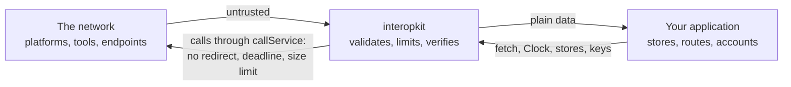

# Security

Report vulnerabilities privately through the repository's security advisory form rather than a public issue. Include the
version, the sequence of calls or the message that shows the problem, and what it lets an attacker do.

Every input is untrusted: launch messages, tokens, key sets, answers of services, events and what a host's callbacks and
stores return. The sections below state the controls of each package and what a deployment adds.

## Points to be aware of when deploying

- **No side channels.** The packages write no log, read no environment variable, make no network request except through the
  `fetch` that the caller passes, and send no telemetry. A library that fails throws; it does not print.
- **No code execution.** The packages run no code they are given and load none: `eval` fails lint, and a plug-in is a function
  that the caller passes.
- **Untrusted input.** Entry points validate their input and throw `DataError` on malformed data, so data from users, from
  the network or from files can be passed in directly. Structures are read with valibot schemas, and each limit below has a
  default.
- **Randomness and time.** The packages never use `Math.random` or read a clock themselves: identifiers and secrets that must
  be unpredictable come from `crypto.getRandomValues`, and the time from the `Clock` the caller passes. `SYSTEM_CLOCK` is the
  one place that reads the system time.
- **Secrets.** Private keys, client secrets and tokens are the host's to keep. The packages take them as arguments, never
  write them to a message, and never return them in an error. A `ServiceError` holds the text of the answer in `body`: do
  not show it to a user, because a service may put data of its own in it.
- **Personal data.** The packages store nothing. Launch claims, the names and emails of a roster, and the actors of events
  pass through them to the host; each guide has a table that says which data flows where, so that a host can meet its
  privacy duties.

## Service calls

Every call to a service goes through `requestService`, or `callService`, which decodes its text ([service calls](docs/core/service.md)).

| Threat                                                                                         | Control                                                                                                                                                                                                                                                                                                                                                                                                                                                          |
| ---------------------------------------------------------------------------------------------- | ---------------------------------------------------------------------------------------------------------------------------------------------------------------------------------------------------------------------------------------------------------------------------------------------------------------------------------------------------------------------------------------------------------------------------------------------------------------- |
| A service redirects from HTTPS to another scheme, or to an address the caller did not choose   | `redirect` is `"manual"`, and any 3xx answer or opaque redirect is a `ServiceError`; no redirect is followed                                                                                                                                                                                                                                                                                                                                                     |
| A service that never answers holds a caller                                                    | `timeoutMs` bounds the request and the whole body; every wait is raced against the deadline, so a `fetch` that ignores its signal cannot hold the call                                                                                                                                                                                                                                                                                                           |
| A service that sends a huge body exhausts memory                                               | The body is read in chunks and counted; more than `maxBytes`, 65,536 by default, is a `ServiceError` and the reader is cancelled                                                                                                                                                                                                                                                                                                                                 |
| A late answer keeps a connection open                                                          | The body of an answer that arrives after the call gave up is cancelled                                                                                                                                                                                                                                                                                                                                                                                           |
| A caller that leaves keeps a request running                                                   | `signal` ends the wait with its `reason`; the request in flight may have reached the service, and the docs say how to resend safely                                                                                                                                                                                                                                                                                                                              |
| A registered platform or tool names an internal address as a URL (server-side request forgery) | Only `https`, no redirect and a size limit bound the reach; the packages cannot tell a private address from a public one. A multi-tenant host passes a `fetch` that refuses private and link-local addresses, checked on the address that the connection resolves to and not on the host name, because a name that is public when it is checked can be private when the connection is made (DNS rebinding); it also treats `ServiceError.body` as untrusted text |
| A URL that is not `https`                                                                      | `checkHttpsUrl` and `httpsUrlSchema` refuse it where the standards require `https`                                                                                                                                                                                                                                                                                                                                                                               |
| A global `fetch` that breaks when called as a method                                           | `fetch` is called as a bare function                                                                                                                                                                                                                                                                                                                                                                                                                             |

## Signing and OAuth clients

Every signing function takes a `Signer`, so that a private key stays where the host keeps it, and `@interopkit/core/oauth`
authenticates and calls authorization servers ([signing](docs/core/signer.md), [OAuth clients](docs/core/oauth.md)). Its
requests go through `requestService`, so the controls of the section above apply.

| Threat                                                         | Control                                                                                                                                                                                                             |
| -------------------------------------------------------------- | ------------------------------------------------------------------------------------------------------------------------------------------------------------------------------------------------------------------- |
| A client assertion is captured and replayed                    | Each request gets an assertion with a new random `jti` and an `exp` after `assertionLifetimeSeconds`, 300 seconds unless the client says otherwise; the server must refuse a `jti` it has seen (RFC 7523 section 3) |
| An assertion is used at another service                        | `aud` is the token endpoint, or the `audience` that the host names for the server                                                                                                                                   |
| A private key leaves the process                               | The packages never see it: they call `Signer.sign`. `signCompactJws` refuses a header whose `jwk` holds the private part (`d`). A key in a KMS or an HSM stays there                                                |
| A signature of the wrong form reaches a verifier               | `signCompactJws` refuses an ECDSA signature that is not the fixed-length R and S, and a header that names another algorithm or key than the signer's                                                                |
| `none` or an HMAC algorithm signs an assertion                 | A signer names the algorithm of a private key only; `none` and the HMAC algorithms are refused                                                                                                                      |
| A login is forged, or its response comes from another server   | `state` is random and new for each request, and `exchangeCode` refuses another or no `state` before any request. With `issuer` set, a callback whose `iss` differs is refused (RFC 9207)                            |
| An authorization code is stolen and exchanged by another party | PKCE with S256: the verifier is random and goes only with the token request of the same flow                                                                                                                        |
| A token or a secret appears in an error or a log               | The messages of the errors name the endpoint, the status and the OAuth `error`, never a token, a secret or an assertion; `ServiceError.body` is the server's text, untrusted                                        |
| A token without an expiry is cached for ever                   | `createTokenCache` serves only a token that has an `expiresAt` and is not within the skew of it                                                                                                                     |
| A random pick is predictable                                   | `SYSTEM_RANDOM` draws from `crypto.getRandomValues`; the `state`, `nonce`, `jti` and verifier of the protocols are drawn from `crypto` inside the packages and take no replaceable source                           |

- Keep `PendingAuthorization` in a server-side session: its code verifier is a secret until the token request.
- Store the secret of a `RegisteredClient` as a secret: the server shows it once.
- Give a `Signer` that calls a KMS its own deadline, and convert a DER signature to the fixed-length R and S before it returns.

## Learning analytics

`sendCaliper` sends events about learners and a bearer token to a Caliper endpoint that the host configures
([learning analytics guide](docs/learning-analytics/guide.md)). It goes through `callService`, so the controls of the section
above apply.

| Threat                                                | Control                                                                                                                                                                                 |
| ----------------------------------------------------- | --------------------------------------------------------------------------------------------------------------------------------------------------------------------------------------- |
| The token travels in the clear                        | `checkHttpsUrl` refuses an endpoint that is not `https`, before any request                                                                                                             |
| The token carries a line break or a header of its own | The token must match the `b64token` form of RFC 6750 section 2.1, which has no space or control character; anything else is a `DataError`                                               |
| A redirect carries the token to another address       | `callService` follows none: any 3xx is a `ServiceError`                                                                                                                                 |
| The token appears in an error or a log                | The token goes only in the `Authorization` header. The messages of the errors name the endpoint and the status, never the token                                                         |
| An envelope carries what Caliper does not define      | The envelope has `sensor`, `sendTime`, `dataVersion` and `data`, and no other property                                                                                                  |
| An event with a malformed identifier, entity or time  | `buildEvent` reads its input with a schema: the identifier is a UUID URN, every entity `id` an absolute IRI, every time in the form of Caliper, a property it does not build is refused |
| Two events get one identifier                         | `mintUrn` names the JSON text of its parts, so parts that a plain join would confuse give different names; a number that is not finite is refused                                       |
| A resend is mistaken for a new event                  | The identifiers of the events do not change between sends; Caliper defines no deduplication, so an endpoint may hold both copies                                                        |

- Give an opaque identifier as the `actor` of an event, such as `urn:uuid:` and a UUID that the host keeps in its own records,
  never an email address, a name or an identifier that another service knows. The library cannot tell the two apart.
- The identifiers of events are UUIDs of the parts that the host gives. Do not put a secret or a personal value in the parts.
- Events hold times, IRIs and scores. A host that sends a response or an answer key builds that event itself and decides
  whether the endpoint may know it.
- A `ServiceError` carries the endpoint's answer as `body`: log it as untrusted text.

## Competency frameworks

`readPackage`, `readEntity`, `validatePackage`, `validateEntity` and `toCaseVersion` take frameworks that a provider or a file gives
([model guide](docs/competency-frameworks/model.md)). The functions of `@interopkit/competency-frameworks/graph` work on packages
that are already read ([graph guide](docs/competency-frameworks/graph.md)). They make no request, keep nothing and write nothing.
The client and the provider have a section each below.

| Threat                                                                       | Control                                                                                                                                               |
| ---------------------------------------------------------------------------- | ----------------------------------------------------------------------------------------------------------------------------------------------------- |
| A package with a property, a type or a form that CASE refuses                | Every property is read with a schema of its class and version; an unknown property is refused, and a finding names its path and rule                  |
| A value in `extensions` that is not data, or nests without end               | The value must be JSON, is copied, and nests at most 64 levels; a member named `__proto__` stays a member and never changes the prototype of the copy |
| Two entities with one identifier                                             | `duplicate-identifier` is an error, so that a lookup by identifier is never ambiguous                                                                 |
| A tree that loops, or a chain of any length                                  | `child-of-cycle` is an error; the walk keeps its own stack and cannot overflow the stack of the host                                                  |
| Markdown or LaTeX in `fullStatement`, `description` and `notes`              | The package carries the text and never renders it. A consumer renders it through a sanitizing renderer and never inserts it into a page as HTML       |
| A result that shares an object with its input                                | A reader returns a copy, and `toCaseVersion` returns a new value; an input is never changed                                                           |
| A package that loops or gives an item several parents, to make a walk run on | `frameworkTree` places each item once and keeps its own queue, so the work is linear in the items and associations                                    |
| An identifier or a base that changes the path of an address                  | `caseEntityUri` refuses `.` and `..`, percent-encodes the identifier, and refuses a base with credentials, a query or a fragment                      |

### The client

`createCaseClient` reads frameworks from a provider ([client guide](docs/competency-frameworks/client.md)). It makes GET requests
through the `fetch` of the host and keeps nothing between calls. A framework carries no personal data.

| Threat                                                      | Control                                                                                                                                              |
| ----------------------------------------------------------- | ---------------------------------------------------------------------------------------------------------------------------------------------------- |
| A provider reached over plain HTTP, or redirected elsewhere | `baseUrl` must be `https` without credentials, query or fragment; every request goes through `requestService`, which follows no redirect             |
| A provider that answers without end, or with too much       | `timeoutMs` ends a request, `maxBytes` stops the read of the body, and the iteration of the documents ends when a page repeats or no page follows    |
| A credential that leaks or splits a header                  | The host's `authorization` function returns the header value; one with a line break is refused, and the value is in no error and is never logged     |
| An identifier or a filter that changes a request            | An identifier is percent-encoded into one path segment and `.` and `..` are refused; the filter, the sort and the fields are checked and encoded     |
| An address in a `Link` header that leads elsewhere          | The client reads `rel="next"` as a signal and builds every request from `baseUrl`; it never requests an address that a provider gives                |
| An answer that is not CASE, or that has a hostile shape     | Every answer is read with `readEntity` or `readPackage` and refused with a `DataError` that names the provider; a status body is read, never trusted |

### The provider

`handleCaseRequest` answers requests from consumers of a framework over the REST binding ([provider guide](docs/competency-frameworks/provider.md)).
It reads a query and no body, keeps nothing between requests and makes no request.

| Threat                                                           | Control                                                                                                                                                                   |
| ---------------------------------------------------------------- | ------------------------------------------------------------------------------------------------------------------------------------------------------------------------- |
| A consumer reads what it may not                                 | `authorize` receives the request and decides before any lookup or query is read; a refusal is 401 or 403 and the store is not asked. The host's `authorize` checks tokens |
| A consumer cannot learn how to authenticate                      | The discovery file is the one answer that skips `authorize`; the host puts nothing secret in it                                                                           |
| An identifier that is not a UUID reaches the store               | It is refused with 404 `Invalid UUID` before the store is asked, so a store never sees a path, a query or a pattern in place of an identifier                             |
| A filter that makes the parser or the evaluator work without end | The filter has at most 2,048 characters and one logical operator; the parser reads it once, left to right, with no backtracking pattern                                   |
| A filter or a sort that reads what an object inherits            | A path reads own properties only, so `constructor`, `__proto__` and a polluted prototype give no value                                                                    |
| A page of any size                                               | `limit` is at most `maxPageSize` (1,000 by default), `offset` is a safe integer, and a store that answers more documents than the limit is refused                        |
| A failure of the store or of `authorize` shows its cause         | The answer is 500 with a fixed sentence; the message of the failure is never in the answer                                                                                |
| A wait for the store that never ends                             | Every call of a port is raced against the `signal`; an abort rejects the request at once                                                                                  |
| A localized discovery file that points elsewhere                 | `localizeOpenApi` sets `servers` to one address that ends with the root of the API, and returns a copy of JSON within 64 levels                                           |
| The URL that builds the `Link` header                            | It is the URL of the request; behind a proxy the host builds the request from its public address and not from a header that a consumer controls                           |

- A host that serves frameworks to anyone leaves `authorize` out. A host that serves some frameworks to some consumers
  decides in `authorize` from the request, or filters in its store: the provider has no notion of an owner.
- Limit the rate in front of the handler; the provider never answers 429.

## Achievement credentials

`readCredential`, `readEntity`, `validateCredential` and `validateEntity` take credentials that an issuer, a wallet or a file
gives ([model guide](docs/achievement-credentials/model.md)), and the builders write credentials from the parts that an issuer
gives ([builders guide](docs/achievement-credentials/issue.md)). They make no request, keep nothing and read no clock. They
check the shape of a credential and the rules of its subject; they do not check a proof, a key, a status or an issuer, and a
result of theirs is not evidence that a credential is genuine.

| Threat                                                                        | Control                                                                                                                                                                            |
| ----------------------------------------------------------------------------- | ---------------------------------------------------------------------------------------------------------------------------------------------------------------------------------- |
| A credential with a property, a type or a form that the specifications refuse | Every property is read with a schema of its class; a closed class refuses an unknown property, and a finding names its path and rule                                               |
| A chain of `parentOrg`, `endorsement` or `issuer` of any depth                | The value is JSON that nests at most 64 levels, checked before the schemas read it, so the recursion of the schemas is bounded                                                     |
| A property that no class lists, of any content                                | It must be JSON and is copied; a member named `__proto__`, `constructor` or `prototype` of an open class is not carried, and elsewhere it stays data and never changes a prototype |
| A claim that nothing ties to a person                                         | `subject-unidentified` is an error: a subject without an `id` and an `identifier` is refused                                                                                       |
| An identity that is said to be hashed and is not                              | `identity-hash-form` is a warning; the plain value of a person is personal data, and the guide tells hosts to hash it                                                              |
| A text with markup or a link in `narrative`, `description` and `name`         | The package carries the text and never renders it. A consumer shows it as text, and never inserts it into a page as HTML                                                           |
| A result that shares an object with its input                                 | A reader and a builder return a copy, and an input is never changed                                                                                                                |
| An input of a builder with a property it does not know, or with a fault       | The builder refuses it with a `DataError` that names every fault, and checks what it wrote with the schemas and rules of the readers                                               |
| A credential whose address is not one                                         | A builder refuses an `id` that is not an absolute URI, so that `sameCredential`, which compares ids after unescaping them, has an address to compare                               |
| The hash of an identity as a weak secret                                      | The hash is a SHA-256 of the identifier and a salt that the host chooses; `matchesIdentifier` also reads `md5$`, which Open Badges names                                           |

## Selective disclosure

`addBaseProof`, `deriveProof` and `selectiveDisclosureSuite.verify` sign, reveal part of, and check a credential with
`ecdsa-sd-2023` ([proofs guide](docs/selective-disclosure/proofs.md)). They keep nothing, write nothing and make no request: a
context is read only through the `contexts` function that the caller passes.

| Threat                                                                         | Control                                                                                                                                                                                                                                                                                                                      |
| ------------------------------------------------------------------------------ | ---------------------------------------------------------------------------------------------------------------------------------------------------------------------------------------------------------------------------------------------------------------------------------------------------------------------------- |
| Someone who holds a base proof replaces the statements that a holder may hide  | The key of the HMAC and the key of the proof come from `crypto.getRandomValues` and no option replaces them. The issuer's signature covers the hash of the proof options, the public key of the proof and the hash of the mandatory statements, and a verifier counts one signature for each statement that is not mandatory |
| A weak random source leaks the key of a proof through the nonce of a signature | Statements are signed with the deterministic nonce of RFC 6979, so a signature depends on the key and the statement alone                                                                                                                                                                                                    |
| A base proof reaches a verifier                                                | It holds the key of the HMAC and the signature of every statement. `verify` answers `false` for it, and `isBaseProof` tells a caller to ask the holder for a derived proof. Give a verifier the output of `deriveProof` only                                                                                                 |
| A verifier, or two, link the disclosures of one credential                     | Every disclosure carries the issuer's signature and the public key of the proof, so disclosures are linkable (Data Integrity ECDSA Cryptosuites, section 5.1). Unlinkable disclosure needs another suite, which this package does not implement                                                                              |
| A pointer reveals more than the holder meant                                   | A pointer must be a JSON pointer that points at something in the document. Text without a leading `/` is refused, because the primitives read it as the empty pointer, which selects the whole document; so is a name that they would read as an array index                                                                 |
| A credential names a context that is fetched from the network                  | The processors get the loader of the caller and no other. A test makes the default loader of `jsonld` and `fetch` fail, and runs the three roles. The caller's loader enforces pins and size limits                                                                                                                          |
| A document built to exhaust canonicalization, such as a clique of blank nodes  | `maxWorkFactor` is 1: more work than that is a `DataError`, and `false` from `verify`                                                                                                                                                                                                                                        |
| A document, a proof value or a context of any size or depth                    | The document with its proof is at most `maxBytes` and nests at most 64 levels, before any processing. The CBOR of a proof value refuses indefinite lengths, tags other than 64, integers beyond 2^53 and repeated keys                                                                                                       |
| A derived proof that was forged from another                                   | `verify` checks the issuer's signature over the proof options, the proof key and the mandatory statements, and the signature of every other statement; the mandatory positions must ascend and name statements                                                                                                               |
| A failure of the caller's loader or signer, or an abort, taken for a verdict   | A failure of the loader or the signer reaches the caller as it was, and an abort ends the wait with its `reason`. `verify` answers `false` only for a fault of the document or the proof                                                                                                                                     |
| A private key passed as the key of the issuer                                  | A JWK with `d` is a `DataError`                                                                                                                                                                                                                                                                                              |
| A result that shares an object with its input                                  | The functions copy what they read, and leave the document and the options as they were                                                                                                                                                                                                                                       |

## Learning records

`readStatementJson`, `readStatement`, `validateStatement` and `validateStatements` take Statements that a client or a file gives
([model guide](docs/learning-records/model.md)). They make no request, keep nothing and write nothing.

| Threat                                                          | Control                                                                                                                                                                                   |
| --------------------------------------------------------------- | ----------------------------------------------------------------------------------------------------------------------------------------------------------------------------------------- |
| A Statement with a property, a type or a form that xAPI refuses | Every property is read with a schema; an unknown property, a `null` outside extensions, a wrong type and an IRI without a scheme are errors, and a finding names its path and rule        |
| A property given twice, which `JSON.parse` keeps the last of    | `readStatementJson` reads the text with a syntax tree and refuses the first object that names a property twice, whatever the escapes in its names                                         |
| A text that is large, or that nests without end                 | `readStatementJson` checks the size in bytes and the depth before it parses; the defaults are 10,485,760 bytes and 64 levels, and a host that reads from many clients passes less         |
| A syntax tree that takes much more memory than the text         | The tree takes 100 to 400 bytes for each value, so 10 MiB of values can take over 1 GB; the host limits the body of a request before it reads it, and sets `maxBytes` to what it can hold |
| A key such as `__proto__` in a map                              | A language map and an extensions map are copied key by key; `__proto__`, `constructor` and `prototype` are refused as keys, and no prototype changes                                      |
| A value in `extensions` that is not data, or nests without end  | The value must be JSON, is copied, and nests at most 64 levels; a deeper value is an `invalid-value`                                                                                      |
| A result that shares an object with its input                   | A reader returns a copy, and an input is never changed                                                                                                                                    |
| A Statement that claims to be about someone it should not       | The package judges form and never identity: a host decides which `authority` and which Actors a client may write                                                                          |
| A resend that makes a second Statement                          | `deriveStatementId` names the event, so the same event gives the same id, and an LRS keeps the first copy; `buildStatement` requires an id                                                |
| A builder that writes what the LRS sets                         | `stored`, `authority` and `version` are refused as input, and the time is written in UTC from the offset that was given                                                                   |
| A hash that hides an address                                    | `mboxSha1sum` is SHA-1 because the standard asks for it, and anyone who can guess an address can compute it: it is a pseudonym and not a secret                                           |

- An Actor may be an email address in `mbox`. Give an `account` with a pseudonym when a Statement leaves the host that knows the
  learner, and treat `mbox_sha1sum` as personal data: it identifies an address for anyone who can guess it.
- A finding names the path of a fault and a sentence, and never repeats the value that was refused beyond the short forms that a
  sentence needs; a host that logs findings still logs paths of personal data.

## The tool role

A learning platform launches the tool through the browser of the user, so the launch is untrusted until `ltiLaunch` has
checked it ([tool role](docs/tool-integration/tool.md)). The checks bind a launch to the browser that logged in, to the
platform's key, to the tool's client and deployment, and to one use.

- Serve the login URL and the launch URL over HTTPS, and limit the size of a request body: the handlers read what the host
  gives them.
- `LtiStore.delete` must be atomic, and expired logins deleted. A login completes once because only one caller's `delete`
  returns `true`.
- **Login CSRF** (Security Framework 1.1 section 7.4.1). A launch is tied to the browser that logged in: by the
  `__Host-lti_state_<state>` cookie, or, without third-party cookies, by the platform's storage, and the tool accepts the second
  post of that path only from the origin of its own launch URL. Pass the `origin` header of the request to `ltiLaunch`.
- The two pages of the storage path carry a content security policy that allows their one script by hash, and encode every
  value. A host that adds headers must not weaken them.
- **Open redirect.** `targetLinkUri` is the signed claim of the launch, returned to the host. Check it against the host's own
  routes before redirecting to it.
- The platform's key set is fetched from the URL of a registration, over HTTPS, through `callService`. A token cannot choose the
  URL, and only RS256 with an RSA key of 2,048 bits or more verifies. Past `ttlSeconds` a failed fetch fails the launch, and a
  stale key is never used.
- **Server-side requests.** The key set, the token endpoint and the line item URL come from a registration or from a claim of a
  registered platform. Each must be `https`, and a redirect is refused, yet an `https` URL may still name an internal host: in a
  multi-tenant tool a platform administrator could point the tool's server, with a bearer token, at one. Pass a `fetch` that
  refuses private and link-local addresses, and treat `ServiceError.body` as untrusted text, since it returns the answer. Check
  the address that the connection resolves to, and not the host name: a name that is public when it is checked can be private
  when the connection is made (DNS rebinding), so resolve it once, refuse a loopback, private or link-local address (the cloud
  metadata address `169.254.169.254` among them, and an IPv4 address written as IPv6), and connect to that address. In Node.js
  that is a `lookup` function in the options of the connection, which the connection then uses. Where the runtime has no such
  hook, block those ranges in the network that the server sends its requests through.
- **Login initiation is open.** `ltiLogin` answers before anything is proven and writes one record per request, which lives 600
  seconds. Limit the rate of requests to the login URL and the size of the store.
- The tool's private key is the host's to keep. It signs client assertions and Deep Linking responses, which expire after five
  minutes.
- A score is not idempotent: AGS requires a strictly later `timestamp` for each update of a line item and user, and a platform
  may drop an equal or earlier one. After a timeout the first attempt is in doubt, and the resend takes a later time.
- Launch claims (the `sub`, roles and custom properties) pass through the package to the host; it stores nothing.

## The platform role

The platform launches tools through the browser of the user, so a tool's requests are untrusted until the handlers have checked
them ([platform role](docs/tool-integration/platform.md)).

- **Three kinds of origin.** The platform's handlers, the page that frames the tool and the reserved origins must differ, because
  the tool's frame has `allow-same-origin`. A handler answers only at its own origin, and a launch refuses a tool on any of them.
- **Hints bind the request to a launch.** `ltiPlatformAuthorize` is a navigation, often a cross-site POST in a frame where the
  host's cookie may be withheld, so it relies on the signed `lti_message_hint` and not on a cookie: valid, unexpired, for this
  tool, naming the principal of `login_hint`, passing `checkLaunch`, and single-use through `once`. The host's check runs
  before the hint is spent.
- **Sealed tokens.** Hints, line item identifiers and access tokens are compact JWS with HMAC-SHA-256. The `typ` header binds a
  token to its use, only `HS256` verifies, the spelling must be canonical, and WebCrypto compares the MAC in constant time. They are
  signed and not encrypted: the tool reads them, so they hold no secret.
- **Server-side requests.** The platform fetches the key set of a tool from the `jwksUrl` of its registration. It must be `https`,
  and a redirect is refused, yet in a multi-tenant platform a tool's administrator could name an internal host. Pass a `fetch` that
  refuses loopback, private and link-local addresses, checked on the address that the connection resolves to and not on the host
  name, because of DNS rebinding (see the tool role). Give a tool its public key in the registration, which needs no fetch.
- **Client assertions.** RS256 only, the audience is the token endpoint, the lifetime is at most 3,600 seconds, and a `jti` is
  accepted once and remembered through the clock-skew leeway after the assertion's expiry. A `once` that rejects fails closed.
- **Scores.** A tool reads and posts only to its own line item, only for the user of the launch, with the scopes the token holds.
  The platform does not order scores: the receiver keeps a score unless a later one is kept (AGS 3.4.9).
- `ToolLaunch.resource`, `target`, `title` and `custom` are signed and not encrypted, and they travel in the login URL, so they are limited.
  They hold no secret and no personal data.
- Keep the private key and the hint key in the host's key store. Rotating the hint key invalidates the hints, line item URLs and
  access tokens that are outstanding.

## Default limits

A limit that has an option in its row can be replaced per call with that option, and a limit left out keeps its default. A row
that says "not replaceable" is fixed. Each package adds its rows when it adds the control.

| Package                   | Limit                                                                    | Default                           | Unit         | Applies to                                                                                                                                                |
| ------------------------- | ------------------------------------------------------------------------ | --------------------------------- | ------------ | --------------------------------------------------------------------------------------------------------------------------------------------------------- |
| `core`                    | `timeoutMs`                                                              | 10,000                            | milliseconds | One call to a service: the request and its whole body (`DEFAULT_TIMEOUT_MS`)                                                                              |
| `core`                    | most bytes of an answer                                                  | 65,536                            | bytes        | The body of the answer of a service; `maxBytes` of a call replaces it (`DEFAULT_MAX_BYTES`)                                                               |
| `core`                    | `redirect`                                                               | `"manual"`                        |              | Every call to a service; a 3xx answer is refused, and this is not replaceable                                                                             |
| `core`                    | `maxBytes` of `readJson`                                                 | 1,048,576                         | bytes        | The body of a request that a handler reads as JSON; `DataError` above it                                                                                  |
| `core`                    | `maxDepth` of `readJson`                                                 | 64                                | levels       | Arrays and objects nested in each other, checked before the body is parsed; `DataError` above it                                                          |
| `core`                    | `assertionLifetimeSeconds` of `private_key_jwt`                          | 300                               | seconds      | `exp` after `iat` of a client assertion                                                                                                                   |
| `core`                    | `refreshSkewSeconds` of `createTokenCache`                               | 60                                | seconds      | How long before its expiry a cached token counts as expired                                                                                               |
| `competency-frameworks`   | Levels that the value of an extension nests                              | 64                                | levels       | The `extensions` of any entity of CASE; a deeper value is an `invalid-value`; not replaceable                                                             |
| `competency-frameworks`   | `pageSize` and `maxPageSize` of the provider                             | 100 and 1,000                     | documents    | A page of `/CFDocuments`; a larger `limit` is lowered to `maxPageSize`                                                                                    |
| `competency-frameworks`   | Characters of a `filter`                                                 | 2,048                             | characters   | The `filter` of a request for the list; a longer one is 400 `invalid_filter_field`; not replaceable                                                       |
| `competency-frameworks`   | Logical operators in a `filter`                                          | 1                                 | operators    | One `AND` or `OR`; a second is 400 `invalid_filter_field`; not replaceable                                                                                |
| `competency-frameworks`   | Levels that the discovery document nests                                 | 64                                | levels       | The OpenAPI document of `localizeOpenApi`; a deeper one is a `DataError`; not replaceable                                                                 |
| `competency-frameworks`   | `timeoutMs` of the client                                                | 10,000                            | milliseconds | One request to a provider: the request and its whole body                                                                                                 |
| `competency-frameworks`   | `maxBytes` of the client                                                 | 16,777,216                        | bytes        | One answer of a provider, a package included; a `ServiceError` above it                                                                                   |
| `competency-frameworks`   | `pageSize` of the client                                                 | 100                               | documents    | One request for the list of documents; the provider may cap it                                                                                            |
| `competency-frameworks`   | Logical operators in a filter that the client writes                     | 1                                 | operators    | One `AND` or `OR`; more is a `DataError` before any request                                                                                               |
| `learning-records`        | `maxBytes` of `readStatementJson`                                        | 10,485,760                        | bytes        | The text of a request, counted as UTF-8; `DataError` above it                                                                                             |
| `learning-records`        | `maxDepth` of `readStatementJson`                                        | 64                                | levels       | Arrays and objects nested in each other, checked before the text is parsed; `DataError` above it                                                          |
| `learning-records`        | Levels that the value of an extension nests                              | 64                                | levels       | The `extensions` of a definition, a Result and a Context; a deeper value is an `invalid-value`; not replaceable                                           |
| `achievement-credentials` | Levels that a value nests                                                | 64                                | levels       | The value that `readCredential`, `readEntity`, the validators and the builders read; a deeper one is an `invalid-value` or a `DataError`; not replaceable |
| `selective-disclosure`    | `maxBytes` of `addBaseProof`, `deriveProof` and `verify`                 | 1,048,576                         | bytes        | The document with its proof, as JSON; a `DataError` above it, and `false` from `verify`                                                                   |
| `selective-disclosure`    | Levels that a document, a proof or a context nests                       | 64                                | levels       | Checked before any processing; a `DataError`, and `false` from `verify`; not replaceable                                                                  |
| `selective-disclosure`    | RDF canonicalization work factor                                         | 1                                 |              | `maxWorkFactor` of the canonicalization; a `DataError`, and `false` from `verify`; not replaceable                                                        |
| `learning-analytics`      | `timeoutMs`                                                              | 10,000                            | milliseconds | One call of `sendCaliper` (`DEFAULT_CALIPER_TIMEOUT_MS`)                                                                                                  |
| `learning-analytics`      | latest time                                                              | 9999-12-31T23:59:59.999Z          |              | The latest time that `caliperTime` writes, after 1970-01-01T00:00:00.000Z; not replaceable                                                                |
| `tool-integration`        | `ttlSeconds` of `createJwksCache`                                        | 3,600                             | seconds      | How long a key set stays cached                                                                                                                           |
| `tool-integration`        | `refreshSeconds` of `createJwksCache`                                    | 60                                | seconds      | The least time between two fetches of a key set that answers; a set that fails is fetched on every request that needs it                                  |
| `tool-integration`        | `timeoutMs` of `createJwksCache`, `ltiAccessToken` and `publishAgsScore` | 10,000                            | milliseconds | One call to the platform                                                                                                                                  |
| `tool-integration`        | Lifetime of a login                                                      | 600                               | seconds      | The time in which a launch must answer a login; not replaceable                                                                                           |
| `tool-integration`        | Lifetime of a client assertion and of a Deep Linking response            | 300                               | seconds      | `exp` after `iat`; not replaceable                                                                                                                        |
| `tool-integration`        | Leeway for clock skew                                                    | 60                                | seconds      | `exp`, `nbf` and `iat` of an `id_token` and of a client assertion; not replaceable                                                                        |
| `tool-integration`        | Lifetime of a hint and of an `id_token`                                  | 300                               | seconds      | `exp` after `iat`; not replaceable                                                                                                                        |
| `tool-integration`        | Longest accepted lifetime of a client assertion                          | 3,600                             | seconds      | `exp` after `iat`; not replaceable                                                                                                                        |
| `tool-integration`        | Lifetime of an access token                                              | 3,600                             | seconds      | Not replaceable                                                                                                                                           |
| `tool-integration`        | Most characters of `ToolLaunch.resource`                                 | 1,024                             | characters   | The query of the login URL; not replaceable                                                                                                               |
| `tool-integration`        | Most characters of `ToolLaunch.target`                                   | 2,048                             | characters   | The query of the login URL, twice; not replaceable                                                                                                        |
| `tool-integration`        | Most characters of `ToolLaunch.title`                                    | 255                               | characters   | The query of the login URL; not replaceable                                                                                                               |
| `tool-integration`        | Most characters of the names and values of `ToolLaunch.custom`           | 2,048                             | characters   | The query of the login URL; not replaceable                                                                                                               |
| `tool-integration`        | Smallest key                                                             | 2,048 bits (RSA), 256 bits (HMAC) |              | The keys of a platform, a tool and a registration; not replaceable                                                                                        |
| `tool-integration`        | `toolFrame` of `platformStorage`                                         | `"lti-tool"`                      |              | The frame that the storage page answers                                                                                                                   |
| `tool-integration`        | `storageTarget` of the login                                             | `"lti-storage"`                   |              | The frame that shows the storage page                                                                                                                     |
| `tool-integration`        | Storage of a tool                                                        | 4,096 bytes and 500 keys          |              | One origin, in the storage page; not replaceable                                                                                                          |

## Runtime dependencies

The packages that the libraries load at run time are pinned to exact versions at least two weeks old:

| Package                           | Version | License      | Used by                                                                                                                                                                                                                                                                                                            |
| --------------------------------- | ------- | ------------ | ------------------------------------------------------------------------------------------------------------------------------------------------------------------------------------------------------------------------------------------------------------------------------------------------------------------ |
| `jose`                            | 6.2.12  | MIT          | `tool-integration`: signs and verifies the JWS and JWT of LTI messages, assertions and hints (algorithm allowlist, `crit`, `iss`, `aud`, `sub`, `exp`), and fetches key sets. Web Crypto only                                                                                                                      |
| `oauth4webapi`                    | 3.8.8   | MIT          | `core`: the requests and the validation of the responses of the OAuth 2.0 clients (client credentials, authorization code with PKCE, refresh, revocation, registration), through the `fetch` of `requestService`. It has no dependency and uses Web Crypto only                                                    |
| `valibot`                         | 1.5.0   | MIT          | `core`, `competency-frameworks`, `achievement-credentials`, `learning-analytics`, `learning-records` and `tool-integration`: the schemas that read untrusted JSON, and `parseWith`, which turns the first issue into a `DataError` that names its path. It has no dependency                                       |
| `@noble/hashes`                   | 2.4.0   | MIT          | `achievement-credentials` and `learning-records`: the SHA-256 and MD5 of the identity hash of a recipient, and the SHA-1 of `mbox_sha1sum`, each in one synchronous call. It has no dependency                                                                                                                     |
| `uuid`                            | 14.0.3  | MIT          | `learning-analytics` and `learning-records`: the name-based UUID of version 5 (RFC 9562) of the identifiers of events. It has no dependency                                                                                                                                                                        |
| `momoa`                           | 3.3.13  | Apache-2.0   | `@humanwhocodes/momoa` in `learning-records`: the syntax tree of `readStatementJson`, to find a property that an object names twice, which `JSON.parse` hides. It has no dependency                                                                                                                                |
| `@digitalbazaar/di-sd-primitives` | 3.3.0   | BSD-3-Clause | `selective-disclosure`: the primitives of `ecdsa-sd-2023` (skolemization, canonicalization with HMAC labels, selection by JSON pointers, grouping of statements), with `jsonld` 9.0.0 and `rdf-canonize` 5.0.0 beneath it. On Node.js it loads `node:crypto`; its `browser` field swaps in Web Crypto for bundlers |
| `cborg`                           | 6.1.3   | Apache-2.0   | `selective-disclosure`: reads and writes the CBOR of proof values. It has no dependency. The newest version that is at least two weeks old                                                                                                                                                                         |
| `@noble/curves`                   | 2.4.0   | MIT          | `selective-disclosure`: signs statements with ECDSA over P-256 and the nonce of RFC 6979, makes the key of a proof, and decodes a compressed point. Web Crypto verifies; it cannot sign deterministically                                                                                                          |
| `@scure/base`                     | 2.4.0   | MIT          | `selective-disclosure`: base64url without padding for proof values, and base58 for the keys of the tests. It has no dependency                                                                                                                                                                                     |
