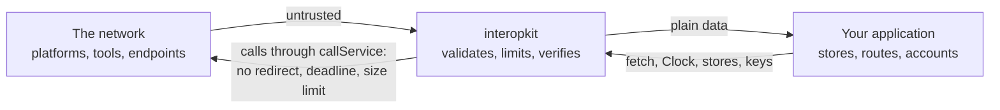

# Security

Report vulnerabilities privately through the repository's security advisory form rather than a public issue. Include the
version, the sequence of calls or the message that shows the problem, and what it lets an attacker do.

Every input is untrusted: launch messages, tokens, key sets, answers of services, events and what a host's callbacks and
stores return. The sections below state the controls of each package and what a deployment adds.

## Points to be aware of when deploying

- **No side channels.** The packages write no log, read no environment variable, make no network request except through the
  `fetch` that the caller passes, and send no telemetry. A library that fails throws; it does not print.
- **No code execution.** The packages run no code they are given and load none: `eval` fails lint, and a plug-in is a function
  that the caller passes.
- **Untrusted input.** Entry points validate their input and throw `DataError` on malformed data, so data from users, from
  the network or from files can be passed in directly. Structures are read with valibot schemas, and each limit below has a
  default.
- **Randomness and time.** The packages never use `Math.random` or read a clock themselves: identifiers and secrets that must
  be unpredictable come from `crypto.getRandomValues`, and the time from the `Clock` the caller passes. `SYSTEM_CLOCK` is the
  one place that reads the system time.
- **Secrets.** Private keys, client secrets and tokens are the host's to keep. The packages take them as arguments, never
  write them to a message, and never return them in an error. A `ServiceError` holds the text of the answer in `body`: do
  not show it to a user, because a service may put data of its own in it.
- **Personal data.** The packages store nothing. Launch claims, the names and emails of a roster, and the actors of events
  pass through them to the host; each guide has a table that says which data flows where, so that a host can meet its
  privacy duties.

## Service calls

Every call to a service goes through `callService` ([service calls](docs/core/service.md)).

| Threat                                                                                       | Control                                                                                                                                                |
| -------------------------------------------------------------------------------------------- | ------------------------------------------------------------------------------------------------------------------------------------------------------ |
| A service redirects from HTTPS to another scheme, or to an address the caller did not choose | `redirect` is `"manual"`, and any 3xx answer or opaque redirect is a `ServiceError`; no redirect is followed                                           |
| A service that never answers holds a caller                                                  | `timeoutMs` bounds the request and the whole body; every wait is raced against the deadline, so a `fetch` that ignores its signal cannot hold the call |
| A service that sends a huge body exhausts memory                                             | The body is read in chunks and counted; more than 65,536 bytes is a `ServiceError` and the reader is cancelled                                         |
| A late answer keeps a connection open                                                        | The body of an answer that arrives after the call gave up is cancelled                                                                                 |
| A caller that leaves keeps a request running                                                 | `signal` ends the wait with its `reason`; the request in flight may have reached the service, and the docs say how to resend safely                    |
| A URL that is not `https`                                                                    | `checkHttpsUrl` and `httpsUrlSchema` refuse it where the standards require `https`                                                                     |
| A global `fetch` that breaks when called as a method                                         | `fetch` is called as a bare function                                                                                                                   |

## Learning analytics

`sendCaliper` sends events about learners and a bearer token to a Caliper endpoint that the host configures
([learning analytics guide](docs/learning-analytics/guide.md)). It goes through `callService`, so the controls of the section
above apply.

| Threat                                                | Control                                                                                                                                                                                 |
| ----------------------------------------------------- | --------------------------------------------------------------------------------------------------------------------------------------------------------------------------------------- |
| The token travels in the clear                        | `checkHttpsUrl` refuses an endpoint that is not `https`, before any request                                                                                                             |
| The token carries a line break or a header of its own | The token must match the `b64token` form of RFC 6750 section 2.1, which has no space or control character; anything else is a `DataError`                                               |
| A redirect carries the token to another address       | `callService` follows none: any 3xx is a `ServiceError`                                                                                                                                 |
| The token appears in an error or a log                | The token goes only in the `Authorization` header. The messages of the errors name the endpoint and the status, never the token                                                         |
| An envelope carries what Caliper does not define      | The envelope has `sensor`, `sendTime`, `dataVersion` and `data`, and no other property                                                                                                  |
| An event with a malformed identifier, entity or time  | `buildEvent` reads its input with a schema: the identifier is a UUID URN, every entity `id` an absolute IRI, every time in the form of Caliper, a property it does not build is refused |
| Two events get one identifier                         | `mintUrn` names the JSON text of its parts, so parts that a plain join would confuse give different names; a number that is not finite is refused                                       |
| A resend is mistaken for a new event                  | The identifiers of the events do not change between sends; Caliper defines no deduplication, so an endpoint may hold both copies                                                        |

- Give an opaque identifier as the `actor` of an event, such as `urn:uuid:` and a UUID that the host keeps in its own records,
  never an email address, a name or an identifier that another service knows. The library cannot tell the two apart.
- The identifiers of events are UUIDs of the parts that the host gives. Do not put a secret or a personal value in the parts.
- Events hold times, IRIs and scores. A host that sends a response or an answer key builds that event itself and decides
  whether the endpoint may know it.
- A `ServiceError` carries the endpoint's answer as `body`: log it as untrusted text.

## Default limits

Every limit is a value that a caller can replace per call with the option named in its row; a limit left out keeps its
default. Each package adds its rows when it adds the control.

| Package              | Limit                   | Default                  | Unit         | Applies to                                                                                 |
| -------------------- | ----------------------- | ------------------------ | ------------ | ------------------------------------------------------------------------------------------ |
| `core`               | `timeoutMs`             | 10,000                   | milliseconds | One call to a service: the request and its whole body (`DEFAULT_TIMEOUT_MS`)               |
| `core`               | most bytes of an answer | 65,536                   | bytes        | The body of the answer of a service; not replaceable                                       |
| `core`               | `redirect`              | `"manual"`               |              | Every call to a service; a 3xx answer is refused, and this is not replaceable              |
| `learning-analytics` | `timeoutMs`             | 10,000                   | milliseconds | One call of `sendCaliper` (`DEFAULT_CALIPER_TIMEOUT_MS`)                                   |
| `learning-analytics` | latest time             | 9999-12-31T23:59:59.999Z |              | The latest time that `caliperTime` writes, after 1970-01-01T00:00:00.000Z; not replaceable |

## Runtime dependencies

The packages that the libraries load at run time are pinned to exact versions at least two weeks old:

| Package   | Version | License | Used by                                                                                                                                                                          |
| --------- | ------- | ------- | -------------------------------------------------------------------------------------------------------------------------------------------------------------------------------- |
| `valibot` | 1.5.0   | MIT     | `core` and `learning-analytics`: the schemas that read untrusted JSON, and `parseWith`, which turns the first issue into a `DataError` that names its path. It has no dependency |
| `uuid`    | 14.0.3  | MIT     | `learning-analytics`: the name-based UUID of version 5 (RFC 9562) of the identifiers of events. It has no dependency                                                             |
