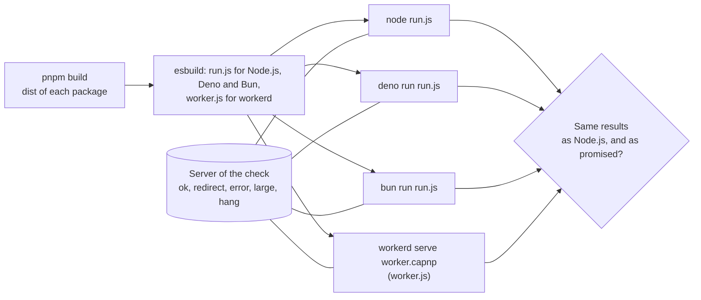

# Runtimes

The packages claim to run in any JavaScript runtime that has the web standards. `pnpm compat` shows it: it bundles the
scenarios of the six examples and a set of calls to a real server, and runs the bundle on Node.js, Deno, Bun and workerd, the
runtime of Cloudflare Workers. The bundle holds the packages as they ship, built with `pnpm build`, and the examples
that use them.



| File           | Holds                                                                                                                     |
| -------------- | ------------------------------------------------------------------------------------------------------------------------- |
| `scenarios.ts` | `runAll`: the scenario of each example, and the calls of `callService` with the global `fetch` of the runtime             |
| `run.ts`       | The entry of Node.js, Deno and Bun: it prints the results as JSON                                                         |
| `worker.ts`    | The entry of workerd: a worker that answers with the results as JSON                                                      |
| `worker.capnp` | The configuration of workerd: the worker, its compatibility date, the socket, and the outbound network the worker may use |
| `check.ts`     | Bundles, starts the server, runs each runtime and compares the results                                                    |

## What is checked

| Check                                 | Proves                                                                                                                                                                                                                        |
| ------------------------------------- | ----------------------------------------------------------------------------------------------------------------------------------------------------------------------------------------------------------------------------- |
| The sensor example                    | Events, identifiers (name-based UUIDs) and the envelope are the same on each runtime, a resend after a 503 works, and the endpoint holds each event once, reads an envelope of Caliper 1.1 into the same model, names the sender by its token, and refuses an unknown token (401) and a version it does not read (422) |
| The CASE example                      | A ministry's provider and a school platform's client give the same documents, copies, outlines, alignments, refusals and changes on each runtime, and a consumer of CASE 1.0 gets the same 12 of 14 associations |
| The credentials example               | A university awards Open Badges as JWTs and with Data Integrity proofs, a wallet serves the Open Badges API and refuses a forgery, an employer verifies, revokes and refreshes, baked PNG and SVG images and an Open Badges 2.0 badge verify, and a VC-API service issues, verifies and derives: the same statuses, checks and names on each runtime |
| The xAPI example                      | A campus LRS, a platform and a dashboard give the same ids, voiding, pages, signature check, ETag outcomes, merge and Activity on each runtime, over the handler and the client                                  |
| The cmi5 example                      | A course package written and read through zip.js, an LMS that registers, launches, judges, satisfies, abandons and waives, and units that start, reload and play their sessions give the same outcomes on each runtime |
| The tool-integration example          | Web Crypto signs and verifies ES256, RS256 and HMAC the same on each runtime: the login, the launch with its substituted custom properties, the token, the line item, the score and the results of the grade services, the members, groups and record of needs of the roster services, the Deep Linking response that the tool signs and the platform reads, the Start Assessment message of a proctored attempt and the pause of the Assessment Control Service, the Submission Review request with the result that it reads, the End Assessment message, the registration of a second tool through Dynamic Registration, and the refusal of a second use of a launch |
| `callService` with the global `fetch` | `redirect: "manual"` is accepted and a 302 is an error; a 503 is an error with its body; an answer over 65,536 bytes is refused; a server that never answers ends at the deadline, and a signal ends the wait with its reason |
| The same results                      | Each runtime gives the results that Node.js gives, and Node.js gives what the packages promise                                                                                                                                |

The bundle of workerd uses no module of Node.js, and the worker runs without the `nodejs_compat` flag of workerd. The Data
Integrity libraries that `achievement-credentials` adopts ship two builds: one that imports `node:crypto` and other modules of
Node.js, which Node.js, Deno and Bun provide, and one for browsers that uses Web Crypto alone. esbuild bundles the first for
`run.js` (platform `node`) and the second for `worker.js` (platform `browser`), so the worker meets no module that it does not
have. Deno runs with `--allow-env`, because the Node.js build of `undici` reads an environment variable when it loads.

## Running it

Node.js 22.18 or later runs `check.ts`. Deno and Bun are programs of their own, and the check runs each that you name. With no
argument it runs all four and fails when one is missing.

```sh
pnpm compat                # builds, then runs node, deno, bun and workerd
pnpm compat node workerd   # only these (node always runs, as the reference)
```

| Runtime | Pinned in                          | Version      |
| ------- | ---------------------------------- | ------------ |
| Node.js | `.node-version`, CI                | 22 and later |
| Deno    | CI                                 | 2.9.6        |
| Bun     | CI                                 | 1.4.3        |
| workerd | `workerd` in `compat/package.json` | 1.20261016.1 |
