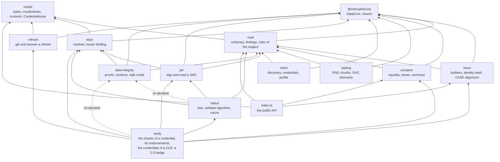
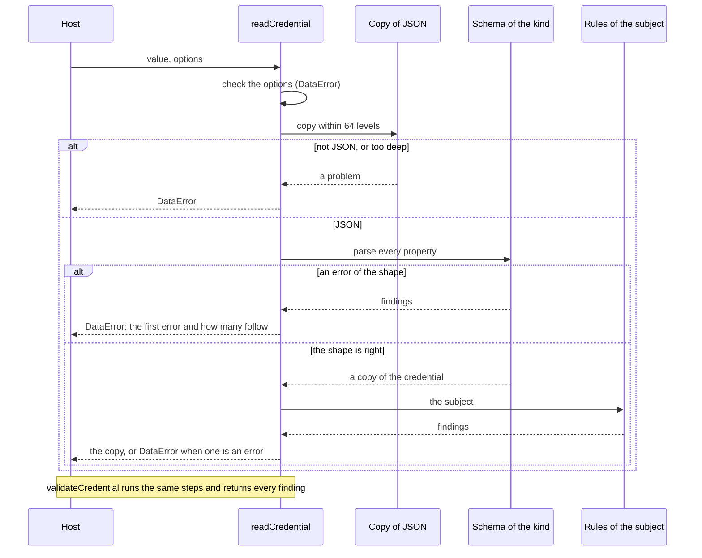

# Architecture of achievement-credentials

`@interopkit/achievement-credentials` has twelve modules that share one model. `model` holds the types, the vocabularies, the
findings and the terms of verification. `read` turns untrusted JSON into the model. `issue` writes credentials from their parts,
`compare` looks at credentials, `baking` writes a credential into an image and reads it out, and `client` calls the APIs of a
server. `keys` resolves the keys that verify a proof and checks that a key belongs to an issuer, `jwt` signs and reads a
credential as a JSON Web Token, and `data-integrity` secures a credential with a Data Integrity proof and loads contexts at their
pins. `status` keeps and checks the status lists of credentials, `refresh` gets and answers the refresh of a credential, and `verify`
joins the checks of Open Badges 9 and CLR 8, and those of Open Badges 2.0.
`read` imports only `model` and `@interopkit/core`, `issue`, `compare`, `baking` and `client` import those and `read` and never
each other, `keys` imports `model` and `core`, `jwt` imports those and `read` and `keys`, `data-integrity` imports those three as
well and never `jwt`, `status` builds on those and loads `data-integrity` only when a Data Integrity proof is asked for, `refresh`
imports `model` and `core` only, `verify` builds on every module but `baking` and `client` and loads `data-integrity` only when a Data
Integrity proof is asked for, and `model` imports nothing of the family.

| Module    | Files                                                                                            | Holds                                                                                                                          |
| --------- | ------------------------------------------------------------------------------------------------ | ------------------------------------------------------------------------------------------------------------------------------ |
| `model`   | `credentials.ts`, `credentials-v1p1.ts`, `clr.ts`, `api.ts`, `keys.ts`, `open-badges-v2.ts`      | The types of every class, by the part of the specifications that defines it, and the classes of Open Badges 2.0               |
|           | `vocabularies.ts`, `context.ts`, `kinds.ts`, `issue.ts`                                          | The vocabularies as tuples with their types, `CONTEXTS`, `CREDENTIAL_KINDS`, `ENTITY_KINDS`, `CredentialIssue`                 |
| `read`    | `credential-schemas.ts`, `v1p1-schemas.ts`, `clr-schemas.ts`, `api-schemas.ts`, `key-schemas.ts` | The valibot schema of each class, built once, typed by the interface of the class                                              |
|           | `primitives.ts`                                                                                  | The parts the schemas share: a list that may be one member, the `type` of a class, an extensible term, contexts                |
|           | `registry.ts`, `inspect.ts`, `rules.ts`, `options.ts`                                            | Which schema reads which kind, the parse and its findings, the rules of the subject, the check of the options                  |
|           | `read-credential.ts`, `read-entity.ts`                                                           | The readers and the validators                                                                                                 |
|           | `context-v2.ts`, `formats-v2.ts`, `open-badges-v2-schemas.ts`, `rules-v2.ts`, `inspect-v2.ts`    | Open Badges 2.0: the terms and aliases of its context, its formats, the schema of each class, its rules, and the reading of the three documents of a badge |
|           | `jws-payload.ts`                                                                                 | The payload of a compact JWS, read without its signature under a limit of tokens, for a verifier                               |
| `issue`   | `build-achievement-credential.ts`, `build-endorsement-credential.ts`, `build-clr-credential.ts`  | The builders, each a few lines that write the credential around the checked input                                              |
|           | `inputs.ts`, `input-schemas.ts`, `finish.ts`, `refusal.ts`, `schema-urls.ts`                     | The input types, the schemas that read an input, the check of what was written, the error of every fault, the official schemas |
|           | `case-alignment.ts`, `identity.ts`                                                               | The alignment to a CASE item, and the hash and the matching of an identity                                                     |
| `compare` | `same-credential.ts`, `newer-credential.ts`, `comparable.ts`                                     | Equality and replacement of credentials as Open Badges 10                                                                      |
|           | `credential-summary.ts`                                                                          | What a wallet shows of a credential                                                                                            |
| `baking`  | `bake-png.ts`, `read-png.ts`, `png-chunks.ts`, `png-text.ts`, `crc32.ts`                         | The PNG functions: the walk over the chunks and their framing, the credential chunk, the CRC-32                                |
|           | `bake-svg.ts`, `read-svg.ts`, `svg-scan.ts`                                                      | The SVG functions and the scan with `saxes` that finds the root and the credential elements under the limits                   |
|           | `credential-text.ts`, `formats.ts`, `options.ts`, `baked-credential.ts`                          | What an image holds of a credential, the keywords and namespaces of the kinds, the options and limits, the result type         |
| `client`  | `client.ts`, `config.ts`, `request.ts`                                                           | The four calls and the iteration of the credentials, the checks of the configuration, the one request with its token and limits |
|           | `discovery.ts`, `paging.ts`, `status.ts`                                                         | The service description, the readers of `X-Total-Count` and `Link`, the status that a server answers an error with             |
| `keys`    | `create-key-resolver.ts`, `verify-issuer-key.ts`                                                 | The resolver of keys and the binding of a key to an issuer                              |
|           | `documents.ts`, `did.ts`, `did-jwk.ts`, `jwk.ts`, `multibase.ts`                                 | The fetch of a document and the keys it holds, the DID methods, the public JWK           |
| `jwt`     | `sign-credential-jwt.ts`, `read-credential-jwt.ts`                                               | Signing a credential as Open Badges 8.2, and reading a compact JWS                      |
|           | `claims.ts`, `options.ts`                                                                        | The claims that repeat a credential, and the options of both                            |
| `data-integrity` | `add-proof.ts`, `derive-disclosure.ts`, `verify-proof.ts`, `validate-json-ld.ts`                | The functions that secure, disclose, verify and check a credential                       |
|           | `suites.ts`, `contexts.ts`, `canonical-json.ts`, `document-loader.ts`, `proof-list.ts`, `mandatory-pointers.ts`, `options.ts` | The suites over the adopted library, the loader of contexts and the pins, and the glue to the processors of JSON-LD |
| `status`  | `bitstring.ts`, `encoded-list.ts`, `issue-status-list-credential.ts`, `verify-credential-status.ts`, `status-list-cache.ts`, `options.ts` | The list as plain data, its encoding under a limit, the issue of its credential, the validate algorithm and the cache |
| `refresh` | `refresh-credential.ts`, `handle-refresh-request.ts`                                             | Getting a credential from its refresh service, and answering as that service              |
| `verify`  | `verify-credential.ts`, `verify-one.ts`                                                          | The entry point, and the checks of one credential in order, with its endorsements and the credentials of a CLR             |
|           | `input.ts`, `options.ts`, `context.ts`, `kind.ts`, `result.ts`                                   | What the input is, the options and their limits, what a call shares, the kind of a credential, the result of the checks     |
|           | `authenticate.ts`                                                                                | The form, the proof and the issuer's hold on the key: the checks that fetch nothing that the credential names               |
|           | `check-schema.ts`, `check-refresh.ts`, `check-status.ts`, `check-validity.ts`, `check-recipient.ts`, `held.ts` | The other checks, and where the endorsements and the held credentials of a credential are                       |
|           | `verify-badge-v2.ts`, `fetch-v2.ts`, `policy-v2.ts`, `signature-v2.ts`, `revocation-v2.ts`, `checks-v2.ts` | An Open Badges 2.0 badge: hosted or signed, the fetch of its documents, the policy of its issuer, its signature, the revocation list, its validity and recipient |

`@interopkit/core/checks` holds what other standards need as much: records that refuse or keep unknown properties, the formats
of a date and a date and time, the copy of JSON within a depth limit, and the conversion of the issues of a parse to findings
that own their rule names.

Each module has an `index.ts`, its public API. `baking` and `client` are entry points of the package, because an application that
needs no images should not load an XML parser, and one that calls no server should not load a client. `read` and `keys` have an
`internal.ts` for what the other modules and the tests share and the package does not export: the schemas of `read`, which the
tests compare with the schemas of 1EdTech and the builders write with, and the public JWK and thumbprint of `keys`. Two files
directly in `src/` serve several modules: the cache of documents and the check of a flag. `pnpm check:standards` and Biome keep modules from
importing by a deep path or against the layers.

## Reading

The schemas are written once for each class, with the classes that refer to each other joined by a reference that is read when
the first value is. The kind of credential comes from its `type`, and the data model from its first context. A value whose only
context is that of Open Badges 2.0, or a `BadgeAssertionV2`, is read by the reader of 2.0 instead: each of its three documents is
copied, its aliases written as their terms, and read at its place, and an embedded document is read from the copy of the one that
holds it ([Reading Open Badges 2.0](open-badges-2.md)). A list of the
properties of each class is kept with its schema, so that the tests compare it with the schemas of 1EdTech and fail when a class
or a property differs.

## Boundaries

| The package owns                                                                    | The package does not own                                                                      |
| ----------------------------------------------------------------------------------- | --------------------------------------------------------------------------------------------- |
| The model of Open Badges 3.0 and CLR 2.0, the readers, the builders, the comparison, baking, the client of the APIs, keys and their binding, JWT and Data Integrity proofs, status lists, refresh, verification | The provider of the APIs: a later module; JSON-LD processing and the cryptosuites: the adopted libraries |
| The model of Open Badges 2.0, its reader, its baked images and its verification, which fetches its documents | Issuing, signing and baking Open Badges 2.0: never, since Open Badges 3.0 supersedes it |
| The classes under both Verifiable Credentials data models                           | Wallets, issuer platforms, storage                                                            |
