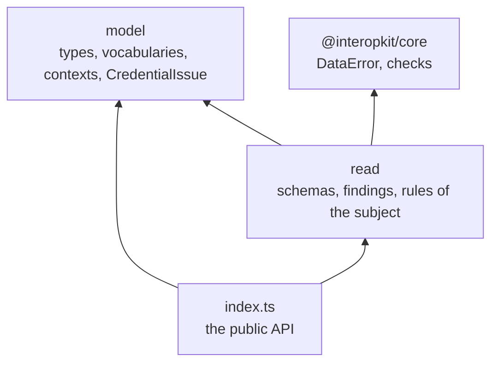
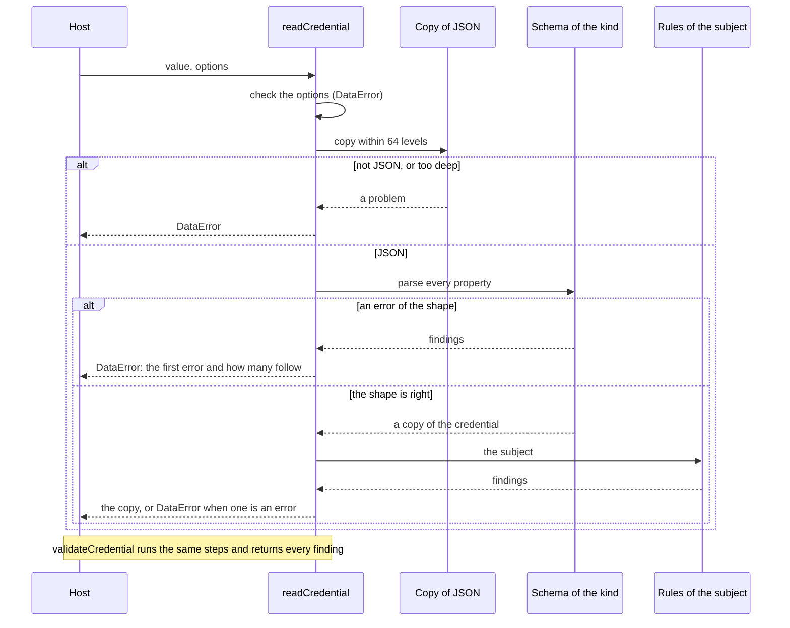

# Architecture of achievement-credentials

`@interopkit/achievement-credentials` has two modules that share one model. `model` holds the types, the vocabularies and the
findings. `read` turns untrusted JSON into the model. `read` imports only `model` and `@interopkit/core`, and `model` imports
nothing of the family.

| Module  | Files                                                                                                      | Holds                                                                                                          |
| ------- | ---------------------------------------------------------------------------------------------------------- | -------------------------------------------------------------------------------------------------------------- |
| `model` | `credentials.ts`, `credentials-v1p1.ts`, `clr.ts`, `api.ts`, `keys.ts`                                     | The types of every class, by the part of the specifications that defines it                                    |
|         | `vocabularies.ts`, `context.ts`, `kinds.ts`, `issue.ts`                                                    | The vocabularies as tuples with their types, `CONTEXTS`, `CREDENTIAL_KINDS`, `ENTITY_KINDS`, `CredentialIssue` |
| `read`  | `credential-schemas.ts`, `v1p1-schemas.ts`, `clr-schemas.ts`, `api-schemas.ts`, `key-schemas.ts`          | The valibot schema of each class, built once, typed by the interface of the class                              |
|         | `primitives.ts`                                                                                            | The parts the schemas share: a list that may be one member, the `type` of a class, an extensible term, contexts |
|         | `registry.ts`, `inspect.ts`, `rules.ts`, `options.ts`                                                      | Which schema reads which kind, the parse and its findings, the rules of the subject, the check of the options   |
|         | `read-credential.ts`, `read-entity.ts`                                                                     | The readers and the validators                                                                                 |

`@interopkit/core/checks` holds what other standards need as much: records that refuse or keep unknown properties, the formats
of a date and a date and time, the copy of JSON within a depth limit, and the conversion of the issues of a parse to findings
that own their rule names.

Each module has an `index.ts`, its public API, and `read` has an `internal.ts` for what the tests share and the package does not
export: the schemas, which the tests compare with the schemas of 1EdTech. `pnpm check:standards` and Biome keep modules from
importing by a deep path or against the layers.

## Reading

The schemas are written once for each class, with the classes that refer to each other joined by a reference that is read when
the first value is. The kind of credential comes from its `type`, and the data model from its first context. A list of the
properties of each class is kept with its schema, so that the tests compare it with the schemas of 1EdTech and fail when a class
or a property differs.

## Boundaries

| The package owns                                                              | The package does not own                                                                     |
| ----------------------------------------------------------------------------- | -------------------------------------------------------------------------------------------- |
| The model of Open Badges 3.0 and CLR 2.0, and the readers                     | Proofs and keys, status lists, verification, baking, the APIs, Open Badges 2.0: later modules |
| The classes under both Verifiable Credentials data models                     | Wallets, issuer platforms, storage                                                           |
