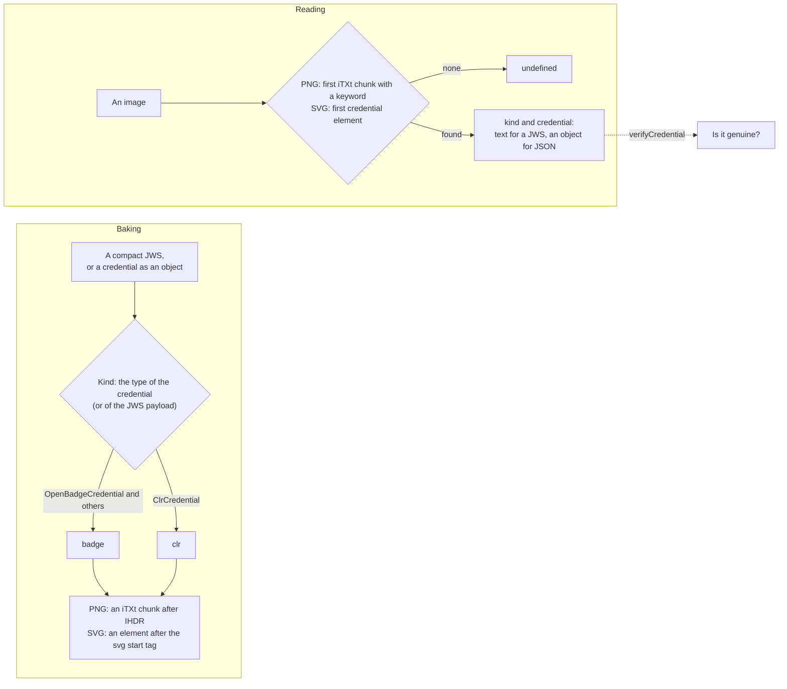

# Baking credentials into images

`@interopkit/achievement-credentials/baking` writes a credential into a PNG or an SVG image, so that the credential travels
wherever the image does, and reads it out again. It covers Open Badges 3.0 section 5.3 and CLR 2.0 section 4.3: the image holds
a compact JWS when the credential is signed as a VC-JWT, and the JSON of the credential when it carries an embedded proof. It
checks the structure of the image and the shape of the credential and nothing else: `verifyCredential` decides whether the
credential is genuine.



| Function                                | Does                                                                                          |
| --------------------------------------- | --------------------------------------------------------------------------------------------- |
| `bakePng(image, credential, options)`   | Returns the PNG with the credential in an `iTXt` chunk right after `IHDR`                     |
| `readPng(image, options)`               | Returns the `BakedCredential` of the first credential chunk, or `undefined`                   |
| `bakeSvg(svg, credential, options)`     | Returns the SVG with a `credential` element right after the `svg` start tag                   |
| `readSvg(svg, options)`                 | Returns the `BakedCredential` of the first credential element, or `undefined`                 |

A `BakedCredential` is `{ kind, credential }`: `kind` is `"badge"` or `"clr"`, and `credential` is the compact JWS as text, or
the JSON as an object that nothing has checked.

## Quick start

```ts
import { bakePng, bakeSvg, readPng, readSvg } from "@interopkit/achievement-credentials/baking";

const credential = {
  "@context": ["https://www.w3.org/ns/credentials/v2", "https://purl.imsglobal.org/spec/ob/v3p0/context-3.0.3.json"],
  id: "https://example.edu/credentials/3732",
  type: ["VerifiableCredential", "OpenBadgeCredential"],
  issuer: { id: "https://example.edu/issuers/565049", type: ["Profile"], name: "Example University" },
  validFrom: "2024-06-13T18:46:03Z",
  credentialSubject: {
    id: "did:example:learner",
    type: ["AchievementSubject"],
    achievement: {
      id: "https://example.edu/achievements/1",
      type: ["Achievement"],
      name: "Fractions",
      description: "Understands fractions as numbers.",
      criteria: { narrative: "Pass the final assessment." },
    },
  },
};

const png = Uint8Array.from(
  atob("iVBORw0KGgoAAAANSUhEUgAAAAEAAAABCAYAAAAfFcSJAAAAC0lEQVR4nGNgAAIAAAUAAXpeqz8AAAAASUVORK5CYII="),
  (character) => character.charCodeAt(0),
);
const baked = bakePng(png, credential);
baked.length > png.length; // => true
readPng(baked)?.kind; // => "badge"
JSON.stringify(readPng(baked)?.credential) === JSON.stringify(credential); // => true
readPng(png); // => undefined

const svg = bakeSvg('<svg xmlns="http://www.w3.org/2000/svg" viewBox="0 0 8 8"><circle r="4"/></svg>', credential);
svg.startsWith('<svg xmlns="http://www.w3.org/2000/svg" viewBox="0 0 8 8" xmlns:openbadges="https://purl.imsglobal.org/ob/v3p0"><openbadges:credential><![CDATA[{"@context"'); // => true
readSvg(svg)?.kind; // => "badge"
```

A credential that is signed as a VC-JWT is the compact JWS itself, and the kind comes from the `type` in its payload:

```ts
import { bakeSvg, readSvg } from "@interopkit/achievement-credentials/baking";

// The header is {"alg":"RS256","kid":"https://example.edu/keys#1"} and the payload names a ClrCredential.
const jws =
  "eyJhbGciOiJSUzI1NiIsImtpZCI6Imh0dHBzOi8vZXhhbXBsZS5lZHUva2V5cyMxIn0.eyJpc3MiOiJodHRwczovL2V4YW1wbGUuZWR1L2lzc3VlcnMvMSIsInR5cGUiOlsiVmVyaWZpYWJsZUNyZWRlbnRpYWwiLCJDbHJDcmVkZW50aWFsIl19.c2ln";
const svg = bakeSvg('<svg xmlns="http://www.w3.org/2000/svg"/>', jws);
svg.endsWith(`</clr:credential></svg>`); // => true
readSvg(svg)?.kind; // => "clr"
readSvg(svg)?.credential === jws; // => true
```

## What is written

| Kind    | PNG: keyword of the `iTXt` chunk | SVG: namespace of the `credential` element   | Prefix written |
| ------- | -------------------------------- | -------------------------------------------- | -------------- |
| `badge` | `openbadgecredential`            | `https://purl.imsglobal.org/ob/v3p0`         | `openbadges`   |
| `clr`   | `clrcredential`                  | `https://purl.imsglobal.org/clr/v2p0`        | `clr`          |

The kind is that of the credential's `type`: a `ClrCredential` is a `clr` and every other credential is a `badge`. For a
compact JWS it is the `type` of the payload, or of its `vc` claim under the Verifiable Credentials Data Model 1.1.

| Image | A compact JWS                                  | A credential with an embedded proof                      |
| ----- | ---------------------------------------------- | -------------------------------------------------------- |
| PNG   | The text of the chunk                          | The JSON in the text of the chunk                        |
| SVG   | The `verify` attribute of the element          | The JSON in a CDATA section of the element               |

The chunk is not compressed, its language tag and translated keyword are empty, and it sits right after `IHDR`: every other chunk
keeps its place and its bytes. In an SVG the baker adds `xmlns:<prefix>` to the `svg` element and the new element right after its
start tag, and leaves every other character as it was. A CDATA end marker (`]]>`) in the JSON is split in two sections, and the
two characters that XML forbids and JSON allows (U+FFFE and U+FFFF) are written as `\u` escapes, which mean the same in JSON.
When the `svg` element already binds the prefix to another namespace, such as `http://openbadges.org` in Open Badges 2.0, the
declaration goes on the new element, and when the `svg` element is empty (`<svg/>`) it gets an end tag.

A reader accepts any prefix: it matches the namespace and the local name `credential`.

## Options

| Option     | Applies to   | Meaning                                                                                                     | Default    |
| ---------- | ------------ | ----------------------------------------------------------------------------------------------------------- | ---------- |
| `replace`  | `bakePng`, `bakeSvg` | Replace the credential that the image holds, of either kind. When it is `false`, such an image is refused | `false`    |
| `maxBytes` | all four     | The most bytes of the image, and of the baked image                                                         | 10,485,760 |
| `maxTokens` | all four    | The most tokens of JSON in the credential that is read or baked, counted before it is parsed                | 1,000,000  |

An image holds one credential: the specifications forbid a second chunk or element, and let the baker choose between an error and
an overwrite. `replace` removes every chunk or element of either kind before it writes the new one.

## Limits

| Limit                                                  | Value             | Refused with                                                  |
| ------------------------------------------------------ | ----------------- | ------------------------------------------------------------- |
| Bytes of an image, and of a baked image                | 10,485,760        | `DataError`, before any of the image is read                  |
| Tokens of JSON in a credential (`maxTokens`)           | 1,000,000         | `DataError`, before the text is parsed                        |
| Levels of JSON in a credential                         | 64                | `DataError`, before the text is parsed                        |
| Elements open at once in an SVG                        | 256               | `DataError`, when the parser meets the 257th                  |
| Attributes of one element of an SVG                    | 256               | `DataError`, when the parser meets the 257th                  |
| Bytes of one PNG chunk                                 | 2,147,483,647     | `DataError`; a chunk that claims more than the image holds is refused too |

The limits are set so that no image costs much more than its size to read. Measured on Node.js 26 with images of 10 MiB:

| Image                                                         | Time of `readSvg` or `readPng` | Memory above the image |
| ------------------------------------------------------------- | ------------------------------ | ---------------------- |
| Elements nested 3.5 million deep, or 1.7 million attributes   | 20 ms (refused)                | 10 MiB                 |
| 2.6 million empty elements, one after the other               | 1.2 s                          | 40 MiB                 |
| 2 million entity references in one text                       | 0.5 s                          | 110 MiB                |
| 870,000 empty chunks in a PNG                                 | 0.1 s                          | 20 MiB                 |
| A credential element of 10 MiB of empty arrays (10 million tokens) | 0.2 s (refused)           | 20 MiB                 |

The SVG parser keeps an object for each open element and keeps the attributes of a tag until it ends, which is why those two
limits exist. `JSON.parse` takes about forty times the text of small objects in memory, which is why the credential has a limit of
tokens, counted from its text before the parse. It has no limit of characters: the bytes of the image bound its text, and a
credential of 2 MB of text that is one string is read.

## Errors

Every error is a `DataError` with a sentence that names the fault.

| Case                                                                                          | What to do                                                                             |
| --------------------------------------------------------------------------------------------- | -------------------------------------------------------------------------------------- |
| The options are not an object, `maxBytes` or `maxTokens` is not a positive integer, `replace` is not a boolean | Pass the documented options                                             |
| The credential has more tokens of JSON than `maxTokens`                                       | Raise `maxTokens` for a source that you trust, or refuse the image                     |
| The image is not a `Uint8Array` (PNG) or a string (SVG)                                       | Read the file as bytes for a PNG and as text for an SVG                                |
| The image has more bytes than `maxBytes`, or the baked image would                           | Raise `maxBytes`, or shrink the image                                                  |
| The PNG lacks the signature, starts with a chunk other than `IHDR`, is truncated, or has no `IEND` | The file is not a whole PNG                                                       |
| The credential chunk fails its CRC-32, is compressed, lacks its fields, or its text is not UTF-8 | The image is damaged or was not baked as the specifications say; bake it again      |
| The SVG is not well-formed XML before the credential, or the root is not `svg` in the SVG namespace | Fix the file; the message gives the line and the column                            |
| The SVG has too many open elements or attributes                                              | The file is not an image that a badge needs                                            |
| The credential element holds an element, or both `verify` and text, or nothing                | The image was not baked as the specifications say                                      |
| The text is neither the JSON of an object nor a compact JWS, or the JSON nests too deep       | The image does not hold a credential                                                   |
| The image holds a credential and `replace` is `false`                                         | Pass `replace: true`, or read the credential that is there                             |
| The credential is not a compact JWS or an object that `readCredential` accepts                | Read the message: it names the first fault. A 2.0 assertion is never baked              |
| A compact JWS whose payload is not base64url text of JSON with a `type`                       | Pass a JWS of a credential                                                             |

`readPng` and `readSvg` return `undefined`, and do not throw, for an image that is well formed and holds no credential.

### Failure paths

| What            | Fails                                              | Hangs         | Called again                                   | May call back |
| --------------- | -------------------------------------------------- | ------------- | ---------------------------------------------- | ------------- |
| Every function  | `DataError`; nothing is returned half done         | No I/O        | Pure: the same input gives the same result     | Nothing       |

## Not included

| Not included                                     | Why                                                                                                       |
| ------------------------------------------------ | --------------------------------------------------------------------------------------------------------- |
| Open Badges 2.0 images                           | A later module reads them: 2.0 is read and never baked                                                     |
| Compressed `iTXt` chunks, and `tEXt` or `zTXt`    | The specifications forbid compression; inflating text from an image is a way to exhaust memory           |
| Verifying the credential                         | `verifyCredential` does it; baking checks the shape of the image and the credential                       |
| Rendering, resizing or validating the picture    | Nothing is decoded or displayed: the pixels and every other chunk are copied                              |
| Other image formats                              | The specifications name PNG and SVG                                                                       |
| Files and the network                            | The host reads the file and passes bytes or text                                                          |

## Differences from the references

| Case                                           | The specification                                                                    | This module                                                                           |
| ---------------------------------------------- | ------------------------------------------------------------------------------------ | ------------------------------------------------------------------------------------- |
| An image that holds a credential               | The baker may choose an error or an overwrite                                        | An error, unless `replace` is `true`                                                  |
| Where the chunk goes                           | Anywhere an `iTXt` chunk may be                                                      | Right after `IHDR`, so that a reader meets it first                                   |
| Where the SVG element goes                     | Directly after the `svg` tag                                                         | The same; a reader finds the first element anywhere                                   |
| The prefix of the SVG element                  | `openbadges` and `clr`                                                               | Written as those; read with any prefix, by namespace                                  |
| A prefix that the root binds to another namespace | Silent                                                                            | The declaration goes on the new element                                               |
| Text after the credential element              | The rest may be discarded                                                            | Not parsed: a fault after the first credential is not found                           |
| Compression                                    | A baker must not use it; the reader's duty is not stated                             | A reader refuses a compressed credential chunk                                        |
