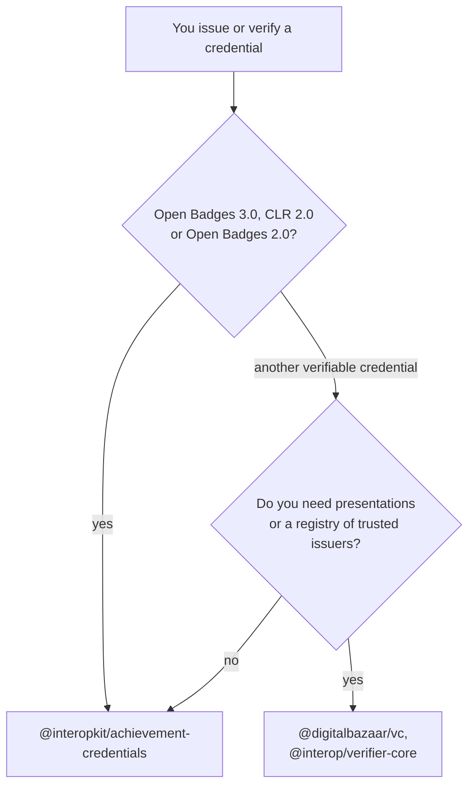

# Choosing achievement-credentials

When `@interopkit/achievement-credentials` fits a project that issues, holds or verifies Open Badges and CLR credentials, and
when another library fits better. Each comparator was read on 2026-11-02 at the version that [the comparators](comparators.md)
give; that page maps all 66 of their capabilities, of which the package has 44, has 3 in part and leaves 19 out with a reason.

| You need                                                                                                  | Use                                                                       |
| --------------------------------------------------------------------------------------------------------- | ------------------------------------------------------------------------- |
| The model of Open Badges 3.0 and CLR 2.0, its readers and builders                                        | This package                                                              |
| Data Integrity and JWT proofs, status lists, refresh and verification as Open Badges 9 and CLR 8 describe | This package: `/data-integrity`, `/jwt`, `/status`, `/refresh`, `/verify` |
| The Open Badges and CLR APIs, as a client or a provider                                                   | This package: `/client`, `/provider`                                      |
| Reading and verifying Open Badges 2.0 badges                                                              | This package                                                              |
| Verifiable presentations, a protocol of delivery, or a registry of trusted issuers                        | `@digitalbazaar/vc` 7.3.0 or `@interop/verifier-core` 3.9.0               |

## What the others have that the package lacks

| Comparator, version                               | What it has                                                                                                           | Here                                                                                         |
| ------------------------------------------------- | --------------------------------------------------------------------------------------------------------------------- | -------------------------------------------------------------------------------------------- |
| The validator of 1EdTech, `67532ac`               | A schema that `credentialSchema` names, judged without a bound of work                                                | In part: judged within a bound; a schema with a regular expression is `unavailable`          |
| The validator of 1EdTech, `67532ac`               | A warning when the issuer's `url` does not answer; DIDs of the Velocity Network; the Trusted Career Profile inspector | Excluded: no step of verification; a network's own registry; not Open Badges or CLR          |
| `openbadges-validator-core` `0a66b52`, 2025-11-04 | Badges of 1.0 and 1.1; extensions judged by their contexts; the endorsements of a 2.0 badge; images fetched           | Excluded: retired versions, JSON-LD processing, a displayer's fetch                          |
| `@digitalbazaar/vc` 7.3.0                         | Presentations, created, signed and verified; a command line                                                           | Excluded: a presentation is the envelope of a protocol of delivery                           |
| `@interop/verifier-core` 3.9.0                    | An HTTP service that refuses private addresses and checks each redirect                                               | In part: every fetch is HTTPS with no redirect; the host's `fetch` refuses private addresses |
| `@interop/verifier-core` 3.9.0                    | Presentations, registries of trusted issuers, recognizers of profiles, added suites of checks, `did:webvh`            | Excluded: a verifier's policy and an application's view; a host plugs in a DID method        |
| `@digitalcredentials/verifier-core` 1.0.0-beta.11 | Presentations, registries of known DIDs                                                                               | Excluded, as above                                                                           |
| `did-jwt-vc` 5.0.1                                | Policies that turn off the checks of the time claims                                                                  | In part: `clockSkewSeconds`; the validity of a credential is not turned off                  |
| `did-jwt-vc` 5.0.1                                | The `vc` claim form, JWT presentations, `ES256K`                                                                      | Excluded: Open Badges 8.2 fixes the claims; Web Crypto has no secp256k1                      |

## Where the evidence is

[The evidence](evidence.md) gives the four W3C suites at their pinned commits, the validator of 1EdTech and the verifiers above
as counterparties; [performance](performance.md) times the proofs and the verification against them.
