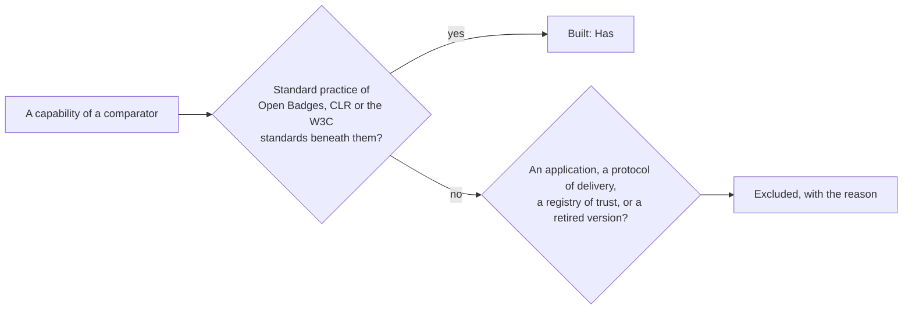

# Comparators

What the validator of 1EdTech and the maintained verifiers of verifiable credentials do, and where
`@interopkit/achievement-credentials` stands against each: **Has** the capability, **Partly**, **Excluded** with the reason, or
**Missing**. A capability that Open Badges 3.0, CLR 2.0, Open Badges 2.0 or the W3C standards beneath them treat as standard
practice is built; what belongs to an application, a protocol of delivery or a registry of trust is excluded. Read on 2026-11-02
from the source of each comparator at the version in the table.

## Summary

| Comparator | Kind | Version, last change | License | Rows | Has | Partly | Excluded | Missing |
| --- | --- | --- | --- | ---: | ---: | ---: | ---: | ---: |
| 1EdTech public validator | Application, Java | `67532ac` | Apache-2.0 | 22 | 18 | 1 | 3 | 0 |
| `openbadges-validator-core` | Validator of Open Badges 2.0, Python | `0a66b52`, 2025-11-04 | Apache-2.0 | 9 | 5 | 0 | 4 | 0 |
| `@digitalbazaar/vc` | Library, JavaScript | 7.3.0 | BSD-3-Clause | 9 | 7 | 0 | 2 | 0 |
| `@interop/verifier-core` | Library, TypeScript | 3.9.0 (4.1.0 current) | MIT | 13 | 7 | 1 | 5 | 0 |
| `@digitalcredentials/verifier-core` | Library, TypeScript | 1.0.0-beta.11 | MIT | 6 | 4 | 0 | 2 | 0 |
| `did-jwt-vc` | Library, TypeScript | 5.0.1 | ISC | 7 | 3 | 1 | 3 | 0 |
| **All** | | | | **66** | **44** | **3** | **19** | **0** |

`openbadges-types` (types of Open Badges 2.0 and 3.0, no checks) and the 1EdTech conformance suites (membership) are not rows: the
first has nothing that the model lacks, and the second is not readable without membership ([evidence](evidence.md)).

## The validator of 1EdTech

| Comparator | Capability | Here | How, or why not |
| --- | --- | --- | --- |
| Validator | A credential as JSON, as a compact JWS, and baked in a PNG or an SVG | Has | `verifyCredential` takes each; `readPng`, `readSvg` |
| Validator | `@context` and `type` of each class | Has | The readers ([model](model.md)) |
| Validator | The published JSON Schemas of Open Badges and CLR | Has | The readers, proven against the published files |
| Validator | A schema that `credentialSchema` names | Partly | Fetched and judged within a bound of work; one that runs a regular expression, a `format` among them, is `unavailable` ([verify](verify.md)) |
| Validator | A subject identified by `id` or `identifier` | Has | `subject-unidentified` |
| Validator | The types of evidence, of the issuer, its `otherIdentifier` and `parentOrg` | Has | The schemas of each class |
| Validator | Criteria with an `id` or a `narrative` | Has | `criteria-undescribed`, a warning: Open Badges 3.0 leaves both optional |
| Validator | JSON-LD in safe mode | Has | `validateJsonLd`; verification does not run it, since Open Badges 9 does not ask it of a verifier |
| Validator | The VC-JWT proof | Has | `readCredentialJwt`: the RSA, ECDSA and EdDSA algorithms, where the validator takes RS256 and ES256 |
| Validator | `eddsa-rdfc-2022` and `ecdsa-sd-2023` proofs | Has | `verifyProof` |
| Validator | The key of a proof | Has | Stricter: the issuer must publish it ([keys](keys.md)); the validator takes the controller from the address of the method |
| Validator | DIDs through a resolver of the host | Has | `did:key`, `did:web` and `did:jwk` built in; any other method through `resolve` of `createKeyResolver` |
| Validator | The refresh service | Has | Followed once after the proof |
| Validator | `1EdTechRevocationList` and `BitstringStatusListEntry` | Has | `verifyCredentialStatus` |
| Validator | Expiry and a validity that has not begun | Has | The `validity` check |
| Validator | Endorsements and `endorsementJwt` wherever the credential holds them | Has | Each verified as Open Badges 9.2 |
| Validator | The credentials that a CLR holds | Has | Each verified as Open Badges 9.1 |
| Validator | A status list credential on its own | Has | `verifyCredentialStatus` reads and verifies it |
| Validator | Open Badges 2.0 | Has | See `openbadges-validator-core` below, which it recommends |
| Validator | A warning when the `url` of the issuer does not answer | Excluded | A fetch of an address that the credential names, for no step of verification; a displayer that shows the address checks it |
| Validator | DIDs of the Velocity Network through its registry | Excluded | A network's own registry; a host plugs it in through `resolve` |
| Validator | The Trusted Career Profile inspector | Excluded | Not Open Badges or CLR |

## Open Badges 2.0

| Comparator | Capability | Here | How, or why not |
| --- | --- | --- | --- |
| `openbadges-validator-core` | Hosted and signed verification with the policy of the issuer | Has | `verifyCredential` ([Open Badges 2.0](open-badges-2.md)) |
| `openbadges-validator-core` | Baked PNG and SVG, with the legacy `tEXt` address | Has | `readPng`, `readSvg` |
| `openbadges-validator-core` | `sha256$` and `md5$` recipients | Has | `matchesIdentifier` |
| `openbadges-validator-core` | The revocation list of the issuer | Has | `status` of a signed badge |
| `openbadges-validator-core` | The vocabulary and the forms of each class | Has | The readers of 2.0, compared with its tasks in `v2-validator.corpus.test.ts` |
| `openbadges-validator-core` | Badges of Open Badges 1.0 and 1.1, upgraded to 2.0 | Excluded | Retired; 2.0 Baking still names the legacy hosted address, which is read |
| `openbadges-validator-core` | Extensions judged by the schemas that their contexts name | Excluded | It needs a processor of JSON-LD and a fetch of each context; 2.0 is read without either, and an extension is kept as JSON |
| `openbadges-validator-core` | The endorsements of a 2.0 badge | Excluded | The verification of 2.0 is that of an assertion; they are read |
| `openbadges-validator-core` | Fetching an image to check that it is a PNG or an SVG | Excluded | The form of its address is checked; the bytes are the displayer's to fetch |

## Verifiers of credentials

| Comparator | Capability | Here | How, or why not |
| --- | --- | --- | --- |
| `@digitalbazaar/vc` | Issuing with a Data Integrity proof | Has | `addProof` |
| `@digitalbazaar/vc` | Deriving a selective disclosure | Has | `deriveDisclosure` |
| `@digitalbazaar/vc` | Verifying with the issuer as the controller of the key | Has | Stricter: the issuer must publish the key |
| `@digitalbazaar/vc` | A hook that checks the status | Has | Built in: Bitstring Status List and the revocation list of 1EdTech |
| `@digitalbazaar/vc` | The checks of the Data Model 1.1 and 2.0, with a skew of the clock | Has | The readers and `clockSkewSeconds` |
| `@digitalbazaar/vc` | A loader of contexts that a host extends | Has | `createContextLoader` with `pins`, `documents` and `cache` |
| `@digitalbazaar/vc` | `Ed25519Signature2020` | Has | With `legacyProofs` |
| `@digitalbazaar/vc` | Creating, signing and verifying presentations | Excluded | Open Badges 9 and CLR 8 verify credentials; a presentation is the envelope of a protocol of delivery (OpenID for Verifiable Presentations, the VC API, the Credential Handler API) that the host speaks, and it passes each credential to `verifyCredential` |
| `@digitalbazaar/vc` | A command line | Excluded | An application |
| `@interop/verifier-core` | Credentials of the Data Model 1.0, 1.1 and 2.0 | Has | 1.0 and 1.1 share the context that the readers take as 1.1 |
| `@interop/verifier-core` | `eddsa-rdfc-2022`, `ecdsa-rdfc-2019`, `Ed25519Signature2020` | Has | And `ecdsa-sd-2023` and VC-JWT, which it lacks |
| `@interop/verifier-core` | Bitstring Status List, with a list of another issuer as a warning | Has | Stricter: a list of another issuer fails unless `statusIssuers` names it |
| `@interop/verifier-core` | A clock that the host passes | Has | `clock` |
| `@interop/verifier-core` | A verifier with caches for repeated work | Has | The caches of the key resolver, of the status lists and of the contexts |
| `@interop/verifier-core` | The checks of Open Badges: a result that names a description, a level in it, a status where it asks for one, a known achievement type | Has | `result-description-unknown`, `achieved-level-unknown` and `result-status-missing` (warnings, as it reports them), and the vocabulary of `achievementType` |
| `@interop/verifier-core` | The schemas of Open Badges by AJV | Has | The readers; AJV compiles schemas into code, which a library does not run |
| `@interop/verifier-core` | An HTTP service that refuses private addresses and checks each redirect | Partly | Every fetch is HTTPS with no redirect, within time and size; the host's `fetch` refuses private addresses, as only it sees the address that a name resolves to. Open Badges 2.0 refuses an address by an IP or a private name |
| `@interop/verifier-core` | Presentations | Excluded | As `@digitalbazaar/vc` |
| `@interop/verifier-core` | Registries of trusted issuers (DCC, OpenID Federation, VC recognition) | Excluded | Validation, which Open Badges 9 leaves to the verifier's policy; a host checks the issuer of the result against its registry |
| `@interop/verifier-core` | Recognizers of credential profiles, and two passes by phase | Excluded | An application's view of a credential; the checks of the result say which passed |
| `@interop/verifier-core` | Suites of checks that a host adds, verbose and timed results | Excluded | A host runs its own checks on the result, and measures as it likes; the package has no side channels |
| `@interop/verifier-core` | `did:webvh` | Excluded | A method of its own, which a host plugs in through `resolve` |
| `@digitalcredentials/verifier-core` | Credentials of the Data Model 1.0 to 2.0 with `eddsa-rdfc-2022` and `Ed25519Signature2020` | Has | As above |
| `@digitalcredentials/verifier-core` | Expiry and revocation | Has | The `validity` and `status` checks |
| `@digitalcredentials/verifier-core` | The schema that a credential names, or that its type suggests | Has | The readers judge every credential by the schemas of its class, and `credentialSchema` as Open Badges 9.1 asks |
| `@digitalcredentials/verifier-core` | Verifying signed and unsigned presentations | Excluded | As `@digitalbazaar/vc` |
| `@digitalcredentials/verifier-core` | Registries of known DIDs | Excluded | As `@interop/verifier-core` |
| `@digitalcredentials/verifier-core` | Signed and unsigned credentials as the same result | Has | A credential without a proof fails the `proof` check, with the reason |
| `did-jwt-vc` | Verifying a JWT credential with a resolver of DIDs | Has | `readCredentialJwt`, `verifyCredential` |
| `did-jwt-vc` | The `vc` claim of VC-JWT 1.1 | Has | Read; Open Badges 8.2 is the form that `signCredentialJwt` writes |
| `did-jwt-vc` | Normalizing a JWT credential into the data model | Has | What `readCredentialJwt` returns |
| `did-jwt-vc` | Policies that turn off the checks of `nbf`, `iat`, `exp` and `aud` | Partly | `clockSkewSeconds`; the time claims are the validity of the credential, which a host does not turn off |
| `did-jwt-vc` | Writing the `vc` claim form | Excluded | Open Badges 8.2 fixes the claims that an issuer writes |
| `did-jwt-vc` | JWT presentations with `aud` and a nonce | Excluded | As `@digitalbazaar/vc` |
| `did-jwt-vc` | `ES256K` (secp256k1) | Excluded | Open Badges 8.2 names RSA at least, and Web Crypto, on which the package runs in every runtime, has no secp256k1 |

## What no comparator has

The model, the readers and the builders of CLR 2.0, the APIs of Open Badges and CLR as a client and as a provider, issuing and
checking `ecdsa-sd-2023` without the unmaintained suite, the issuer's hold on every key with the `iss` of a shared platform,
the status of a credential as a check of its own with the list verified as strictly, a bound on what a schema, a status list, a
refresh, a canonicalization and an image may cost, proof chains verified within a fixed number of proofs, an `AbortSignal` on
every call, and a peak of memory measured for each reader of untrusted input.
