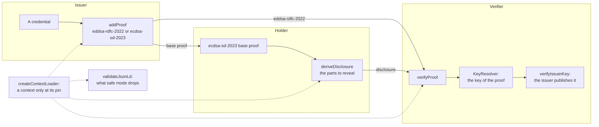

# Data Integrity proofs

`@interopkit/achievement-credentials/data-integrity` secures a credential with a Data Integrity proof and checks one. It signs
with `eddsa-rdfc-2022`, writes the base proof of `ecdsa-sd-2023` for a holder to derive disclosures from, verifies a proof with
the key that the issuer publishes, lists what JSON-LD safe mode would drop, and loads contexts only at their pins.



| Export                | Does                                                                                    |
| --------------------- | --------------------------------------------------------------------------------------- |
| `addProof`            | Signs a credential over a `Signer` and returns it with its proof                        |
| `deriveDisclosure`    | Derives a disclosure from a credential with an `ecdsa-sd-2023` base proof               |
| `verifyProof`         | Verifies the proofs of a credential and says whether the key belongs to the issuer      |
| `validateJsonLd`      | Lists what JSON-LD processing in safe mode would drop or refuse                         |
| `createContextLoader` | Makes the `ContextLoader` that serves a context only after its document matches its pin |
| `KNOWN_CONTEXTS`      | The pinned contexts: address and SHA-256 of the canonical JSON of the document          |

## Quick start

```ts
import { buildAchievementCredential } from "@interopkit/achievement-credentials";
import { addProof, createContextLoader, verifyProof } from "@interopkit/achievement-credentials/data-integrity";
import { createKeyResolver } from "@interopkit/achievement-credentials/keys";
import { createCryptoKeySigner } from "@interopkit/core";

const pair = await crypto.subtle.generateKey("Ed25519", true, ["sign", "verify"]);
const publicKeyJwk = await crypto.subtle.exportKey("jwk", pair.publicKey);
const issuer = "https://example.edu/issuers/565049";
const document = {
  id: issuer,
  verificationMethod: [{ id: `${issuer}#key-1`, type: "JsonWebKey", controller: issuer, publicKeyJwk }],
  assertionMethod: [`${issuer}#key-1`],
};
const clock = { now: () => Date.UTC(2024, 5, 14) };
const keys = createKeyResolver({
  clock,
  fetch: async (url) =>
    new Response(url === issuer ? JSON.stringify(document) : "", { status: url === issuer ? 200 : 404 }),
});

// A host passes the W3C and 1EdTech contexts as documents, which the loader checks against the pins of KNOWN_CONTEXTS. This
// sample stands in a small context for each and pins it, which the option pins allows: it takes the place of a known pin.
const small = { "@context": { "@version": 1.1, "@vocab": "https://example.org/vocab#", id: "@id", type: "@type" } };
const digest = await crypto.subtle.digest("SHA-256", new TextEncoder().encode(JSON.stringify(small)));
const pin = Array.from(new Uint8Array(digest), (byte) => byte.toString(16).padStart(2, "0")).join("");
const addresses = [
  "https://www.w3.org/ns/credentials/v2",
  "https://purl.imsglobal.org/spec/ob/v3p0/context-3.0.3.json",
  "https://purl.imsglobal.org/spec/ob/v3p0/extensions.json",
];
const contexts = createContextLoader({
  documents: new Map(addresses.map((address) => [address, small])),
  pins: new Map(addresses.map((address) => [address, pin])),
});

const credential = buildAchievementCredential({
  id: "https://example.edu/credentials/3732",
  issuer: { id: issuer, type: ["Profile"], name: "Example University" },
  validFrom: "2024-06-13T18:46:03Z",
  name: "Fractions badge",
  subject: { id: "did:example:learner" },
  achievement: {
    id: "https://example.edu/achievements/1",
    type: ["Achievement"],
    name: "Fractions",
    description: "Understands fractions as numbers.",
    criteria: { narrative: "Pass the final assessment." },
  },
});
const signer = createCryptoKeySigner(pair.privateKey, { algorithm: "EdDSA", keyId: `${issuer}#key-1` });
const signed = await addProof(credential, signer, { contexts, clock });
signed.proof?.[0]?.cryptosuite; // => "eddsa-rdfc-2022"
signed.proof?.[0]?.created; // => "2024-06-14T00:00:00Z"

const result = await verifyProof(signed, { keys, clock, contexts });
result.valid; // => true
"bound" in result && result.bound; // => true

(await verifyProof({ ...signed, name: "Another badge" }, { keys, clock, contexts })).valid; // => false
```

## Signing

`addProof(credential, signer, options)` checks the credential as `readCredential` checks it, signs a copy and returns the
credential with the proof. `eddsa-rdfc-2022` adds it to the proofs the credential had, which makes a set of proofs;
`ecdsa-sd-2023` refuses a credential that has a proof already, since a disclosure carries one derived proof. The proof names the signer's `keyId` as its `verificationMethod`, has the purpose
`assertionMethod`, and its `created` is the time of the clock. The result holds the proof as a list, as the model does.

| Option              | Meaning                                                                                                                                 | Default                                                                                          |
| ------------------- | --------------------------------------------------------------------------------------------------------------------------------------- | ------------------------------------------------------------------------------------------------ |
| `cryptosuite`       | `eddsa-rdfc-2022` signs with an Ed25519 signer (`EdDSA`). `ecdsa-sd-2023` writes a base proof with an ES256 signer                      | `"eddsa-rdfc-2022"`                                                                              |
| `mandatoryPointers` | For `ecdsa-sd-2023`: the JSON Pointers to what a holder can never hide                                                                  | The required properties that the credential holds, so that a disclosure stays a valid credential |
| `contexts`          | The `ContextLoader` that returns the contexts of the credential and of the proof                                                        | Required                                                                                         |
| `clock`             | The `Clock` that `created` is written from                                                                                              | `SYSTEM_CLOCK`                                                                                   |
| `maxJsonLdTokens`   | The most tokens of JSON in the credential, counted before a JSON-LD processor reads it (see Limits)                                     | `20000`                                                                                          |
| `signal`            | Ends the caller's wait, and reaches the signer: the wait for the signer and for a context ends when it aborts, whether they stop or not | None                                                                                             |

The default mandatory pointers are `/@context`, `/id`, `/type`, `/issuer/id`, `/issuer/type`, `/validFrom`, `/name`,
`/credentialSubject/type`, the `id` and `identifier` of the subject, and for an achievement credential the `id`, `type`, `criteria`,
`description` and `name` of the achievement. A holder cannot hide a property that the model requires, or the subject that
nothing would then identify. An issuer that is an address is pointed at as a whole (`/issuer`), and so is a subject that holds only its `id` (`/credentialSubject`): a pointer to the `id` of a node that has no other property selects no statement of the document.

## Disclosure

A base proof holds the key that relabels the blank nodes of the credential and the signature of every statement, so it goes to
the holder and never to a verifier: `verifyProof` answers that the proof is not valid and says to derive a disclosure first.
`deriveDisclosure(credential, { selectivePointers, contexts, maxJsonLdTokens })` returns a credential with the mandatory parts, the selected parts
and a derived proof. It refuses a disclosure that is not a valid credential, and names the fix. Disclosures of one credential
can be linked to each other, since they share the base signature and the key of the proof.

## Verifying

`verifyProof(credential, options)` returns a `ProofResult`. The credential is checked for its size and depth, then as the readers
check a credential, and then for what a JSON-LD processor may read (see Limits). The proofs are looked at in order, and the result
is the first that is valid and whose key the issuer publishes: a valid proof of a witness does not end the search, wherever it is in
the set. When no valid proof is the issuer's, the reason is that of its key; when none is valid, that of the first. A proof that names
a `previousProof` is checked over the credential with the proofs that it names, and is valid only when they are (a proof chain, Data
Integrity 4.5). At most four proofs are checked, those that a chain names among them, and the reason says so. The credential is
canonicalized once for all the proofs of a set.

| A proof is not valid when                                                                                                          | Reason                                                             |
| ---------------------------------------------------------------------------------------------------------------------------------- | ------------------------------------------------------------------ |
| The credential has no proof, or is not a credential                                                                                | Said in the reason                                                 |
| It has more tokens of JSON than a JSON-LD processor may read, or needs more than 1,000 runs of Hash N-Degree Quads to canonicalize | The limit, and the option that sets it                             |
| Its type is not `DataIntegrityProof` (or `Ed25519Signature2020` with `legacyProofs`)                                               | Said in the reason                                                 |
| No suite verifies its cryptosuite                                                                                                  | `eddsa-rdfc-2022`, `ecdsa-rdfc-2019`, `ecdsa-sd-2023` and `suites` |
| It is an `ecdsa-sd-2023` base proof                                                                                                | Derive a disclosure first                                          |
| Its purpose is not `assertionMethod`, it names no key, or `expires` has passed                                                     | Said in the reason                                                 |
| The resolver finds no key for its `verificationMethod`                                                                             | Said in the reason                                                 |
| Its signature does not verify with that key                                                                                        | Said in the reason                                                 |
| It names a `previousProof` that the credential lacks or that is not valid, or proofs that name each other in a cycle               | Said in the reason                                                 |
| The key is not published by the issuer, unless `allowUnboundKeys`                                                                  | The reason of `verifyIssuerKey`                                    |

| Option             | Meaning                                                                                                                 | Default        |
| ------------------ | ----------------------------------------------------------------------------------------------------------------------- | -------------- |
| `keys`             | The `KeyResolver` (see the [keys guide](keys.md))                                                                       | Required       |
| `clock`            | The `Clock` that `expires` is compared with                                                                             | `SYSTEM_CLOCK` |
| `contexts`         | The `ContextLoader`                                                                                                     | Required       |
| `clockSkewSeconds` | The seconds by which `expires` may differ from the clock                                                                | `60`           |
| `allowUnboundKeys` | Accept a key that the issuer does not publish; the binding is not looked up and the result has `bound: false`           | `false`        |
| `legacyProofs`     | Accept `Ed25519Signature2020` proofs, which Open Badges 3.0.0 to 3.0.2 used                                             | `false`        |
| `suites`           | More `DataIntegritySuite`s beside the built-in ones; a suite only checks the proof, the glue resolves and binds the key | None           |
| `maxInputBytes`    | The most characters of the credential as JSON                                                                           | `1048576`      |
| `maxTokens`        | The most tokens of JSON in the credential, counted before the readers walk it                                           | `1000000`      |
| `maxJsonLdTokens`  | The most tokens of JSON in the credential that a JSON-LD processor reads to check a proof (see Limits)                  | `20000`        |
| `maxDepth`         | The most levels that the credential nests                                                                               | `64`           |
| `signal`           | Ends the caller's wait                                                                                                  | None           |

### A suite of the host

A `DataIntegritySuite` is given the credential **as the proof secures it**: without its proofs, or, for a proof that names a
`previousProof`, with the proofs that it names as its `proof`. It is also given the proof, the public key that the glue resolved,
the loader of contexts, and the limits that the glue has already checked: `maxBytes` (the number of `maxInputBytes`, which the glue
counts as characters) and `maxTokens` (`maxJsonLdTokens`). A suite that counts them itself, as `ecdsa-sd-2023` does, therefore refuses nothing that the glue let
through, and counts the proof once. A suite answers `false` for a proof that does not verify. It rejects with a `DataError` for a
document it refuses for a reason the caller should read, such as a limit, and the message becomes the reason of the `proof` check.
Any other error is the host's and reaches the caller.

## Contexts

`createContextLoader` serves a context from `documents` or from a fetch through the host's `fetch`, and only
after the SHA-256 of the canonical JSON of its document equals the pin of its address. The pins are those of `KNOWN_CONTEXTS`
and of the `pins` option. An address with no pin is refused before anything is read or fetched for it, unless `allowUnknown` is
set, and a document that differs from its pin is refused always. Nothing is loaded from a hint in a credential: the processors
of JSON-LD call the loader and no other.

| Option         | Meaning                                                                                                                          | Default                      |
| -------------- | -------------------------------------------------------------------------------------------------------------------------------- | ---------------------------- |
| `fetch`        | The `Fetch` that gets a context the loader does not hold                                                                         | None: only `documents` serve |
| `documents`    | Contexts the host holds, by address, checked against their pins                                                                  | None                         |
| `pins`         | More pins, address to SHA-256 of the canonical JSON, for the contexts of an extension; a pin here takes the place of a known one | None                         |
| `allowUnknown` | Serve a context that has no pin                                                                                                  | `false`                      |
| `timeoutMs`    | The time a fetch may take                                                                                                        | `10000`                      |
| `maxTokens`    | The most tokens of JSON in a context, counted before it is parsed                                                                | `1000000`                    |
| `maxBytes`     | The most bytes of a context                                                                                                      | `262144`                     |

W3C asks that its context addresses are not fetched on every request: a host passes the W3C and 1EdTech contexts in `documents`,
or keeps what it fetches in the `fetch` it passes, as a `fetch` that reads a store before the network does; every source is checked against its pin. A verified context stays in memory (100 at most), and callers that ask while it loads share one fetch.

## JSON-LD safe mode

`validateJsonLd(credential, { contexts, maxJsonLdTokens })` expands the credential with safe mode's checks and returns a `JsonLdIssue` for each
event: a property that no context defines, a relative `id` or `type`. At most 100 are reported. Issuer conformance asks that a
credential survive safe mode. The builders write the context of the 1EdTech extensions, which defines the type of the
`credentialSchema`, so that a built credential loses no term.

## Test vectors

The vectors of the Recommendations and of the `did:key` specification run through the functions above, in
`vectors.spec.test.ts`. The pages are downloaded at pinned hashes (`pnpm spec-examples`) and were read on 2026-11-02:
[EdDSA Cryptosuites](https://www.w3.org/TR/2025/REC-vc-di-eddsa-20250515/) (appendix B),
[ECDSA Cryptosuites](https://www.w3.org/TR/2025/REC-vc-di-ecdsa-20250515/) (appendix A) and
[the did:key Method v0.9](https://w3c-ccg.github.io/did-key-spec/). What a vector can show depends on the cryptosuite:

| Vector                                                                                                                            | Through                                       | Result                                                                                                                                                                                                                          |
| --------------------------------------------------------------------------------------------------------------------------------- | --------------------------------------------- | ------------------------------------------------------------------------------------------------------------------------------------------------------------------------------------------------------------------------------- |
| `eddsa-rdfc-2022`, the alumni credential                                                                                          | `addProof`, then `verifyProof`                | The proof equals the printed one byte for byte: EdDSA is deterministic. The signature verifies, with `bound: false`                                                                                                             |
| `Ed25519Signature2020`                                                                                                            | `verifyProof` with `legacyProofs`             | The signature verifies; without the option it is refused                                                                                                                                                                        |
| `ecdsa-rdfc-2019`, the alumni credential, P-256 and P-384                                                                         | `verifyProof`                                 | The signature verifies, and a changed credential does not. Not compared byte for byte: Web Crypto signs with a random nonce, and `addProof` writes no `ecdsa-rdfc-2019` proof                                                   |
| `did:key` of Ed25519                                                                                                              | `createKeyResolver`                           | The method, the controller, the four relationships and the key equal the document that the specification prints; its key agreement key is not a key for a signature and is not resolved                                         |
| `did:key` of P-256 and P-384                                                                                                      | `createKeyResolver`                           | The key equals the point that an independent decompression of the compressed key gives                                                                                                                                          |
| `eddsa-jcs-2022`, `ecdsa-jcs-2019`                                                                                                | `verifyProof`                                 | No suite verifies them: Open Badges names `eddsa-rdfc-2022` and `ecdsa-sd-2023`. A host adds a suite in `suites`                                                                                                                |
| The employment authorization and permanent resident card of the EdDSA and ECDSA pages, including both examples of `ecdsa-sd-2023` | `addProof`, `verifyProof`, `deriveDisclosure` | Refused: the `issuer` of these credentials is an object with an `id` and an `image` and no `type`, and the Profile of Open Badges requires a type. They are no credentials of the model, and the glue does not bypass the check |

The two examples of `ecdsa-sd-2023` are reproduced byte for byte by the tests of `@interopkit/selective-disclosure`, which knows no
model. Through this module they cannot run, for the reason in the last row, and no example of the page has an issuer that is
a Profile or an address.

## Limits

| Limit                                                         | Value                      | Refused with                                                                                                        |
| ------------------------------------------------------------- | -------------------------- | ------------------------------------------------------------------------------------------------------------------- |
| Characters of the credential as JSON                          | `maxInputBytes`, 1,048,576 | `valid: false`, before it is read                                                                                   |
| Levels that the credential nests                              | `maxDepth`, 64             | `valid: false`, before it is read; signing, deriving and validating: `LimitError`, at 64, before anything copies it |
| Tokens of JSON in the credential                              | `maxTokens`, 1,000,000     | `valid: false`, before it is read                                                                                   |
| Tokens of JSON in a credential that a JSON-LD processor reads | `maxJsonLdTokens`, 20,000  | `valid: false` with the limit; signing, deriving and validating: `LimitError`                                       |
| Runs of Hash N-Degree Quads in one canonicalization           | 1,000, fixed               | `valid: false` with the limit; signing: `LimitError` (`maxDeepIterations`)                                          |
| Proofs of a credential that are checked                       | 4, fixed                   | The rest are not looked at, and the reason says so                                                                  |
| Bytes of a context, levels of a context                       | `maxBytes`, 64             | `ServiceError`, `LimitError`                                                                                        |
| Tokens of JSON in a context                                   | `maxTokens`, 1,000,000     | `LimitError`, before it is parsed                                                                                   |
| Contexts kept in memory                                       | 100                        | The oldest goes first                                                                                               |
| Findings of `validateJsonLd`                                  | 100                        | The rest are not reported                                                                                           |

`maxTokens` bounds what a parse builds, and it is far too generous for a JSON-LD processor, whose work grows with the square of the
values of one property: 10,000 values of one property take about a second, 20,000 take four seconds and 60,000 take 35. So a
credential with a proof is also counted against `maxJsonLdTokens` before any processor reads it. A CLR that holds many credentials
as objects can need a higher value; a CLR whose credentials are compact JWS counts each as one token.

The canonicalization of the adopted cryptosuites has no bound of its own, and the work factor of `rdf-canonize` allows one run of
Hash N-Degree Quads for each blank node that looks like another, with each run copying its path, so a list of 5,000 items would take
1.7 seconds and 900 MiB. The package canonicalizes with a fixed count of 1,000 runs instead, as `selective-disclosure` does. The
examples of Open Badges 3.0 and CLR 2.0 need at most 16. A test pins it with a clique of blank nodes, with a graph of 1,500 alike
nodes that the allowance of the library would let pass, and with a list of 5,000 items whose peak of memory it measures.

Each proof is checked on its own and may name another key to fetch, so the work and the requests grow with their number: 5,000
values of one property and 300 proofs would take 95 seconds. Only the first four proofs are looked at, and the credential is
canonicalized once for all of them. Bounded as it is, a credential at the token limit costs about two seconds to verify.

## Errors

| Case                                                                                                        | Result                                                                                                                                   | What to do                                                                                                                       |
| ----------------------------------------------------------------------------------------------------------- | ---------------------------------------------------------------------------------------------------------------------------------------- | -------------------------------------------------------------------------------------------------------------------------------- |
| An option or an argument has the wrong type; a signer of another algorithm or with no `keyId`               | `DataError` that names it                                                                                                                | Fix the call: the message names the value                                                                                        |
| The credential to sign is not valid, or its graph cannot be canonicalized                                   | `DataError`: `The credential is invalid ...`, `... cannot be processed as JSON-LD: ...`                                                  | Fix the credential with `validateCredential`, or define its terms in a context                                                   |
| The credential has more tokens than `maxJsonLdTokens`, or needs more than 1,000 runs of Hash N-Degree Quads | While signing, deriving or validating: `LimitError` with the limit and its value. While verifying: `valid: false` with the same sentence | Raise `maxJsonLdTokens` for a credential you trust, such as a CLR of many embedded credentials; a graph past the runs is refused |
| A context has no pin or is not the pinned document                                                          | While signing or deriving: `DataError`. While verifying: `valid: false`                                                                  | Add the context to `contexts` with its pin, or ask the issuer for the pinned one                                                 |
| A context, a key or what the issuer publishes cannot be fetched                                             | `ServiceError`                                                                                                                           | Check the address and the network; the verification is `unavailable` until it can be read                                        |
| A disclosure hides what the model requires                                                                  | `DataError` that names the pointers to add                                                                                               | Add the pointers that the message names to `selectivePointers`                                                                   |
| The signal aborts                                                                                           | The `reason` of the signal                                                                                                               | Nothing: the caller ended the wait                                                                                               |

## Not included

| Not included                                                                                        | Why                                                                                                                                           |
| --------------------------------------------------------------------------------------------------- | --------------------------------------------------------------------------------------------------------------------------------------------- |
| Signing with `ecdsa-rdfc-2019`, `eddsa-jcs-2022` and `ecdsa-jcs-2019`; verifying the two JCS suites | Open Badges names `eddsa-rdfc-2022` and `ecdsa-sd-2023` for issuers; `ecdsa-rdfc-2019` is verified                                            |
| Presentations                                                                                       | Open Badges and CLR define none                                                                                                               |
| Other cryptosuites                                                                                  | A host passes a `DataIntegritySuite` in `suites`                                                                                              |
| Signing a proof of a chain                                                                          | No role of Open Badges or CLR adds a proof to another party's credential: `addProof` adds a proof to a set, and `verifyProof` verifies chains |
| Where a request goes                                                                                | The host's `fetch` refuses private addresses                                                                                                  |

## Differences from the references

| Case                            | The references                                                                               | This package                                                                                                          |
| ------------------------------- | -------------------------------------------------------------------------------------------- | --------------------------------------------------------------------------------------------------------------------- |
| The controller of the key       | VC Data Integrity 2.6: the method's `controller` is the issuer, checked by the proof purpose | The key must be among what the issuer itself publishes under `assertionMethod`, and its controller must be the issuer |
| A base proof of `ecdsa-sd-2023` | Verify Derived Proof is the only algorithm defined                                           | A credential that carries a base proof is not valid, and the reason says to derive a disclosure first                 |
| Contexts                        | A processor loads a context by its address                                                   | Only at a pinned hash                                                                                                 |
| Proofs                          | The compacted form writes a single proof as an object                                        | The result of `addProof` holds a list of one                                                                          |
| The number of proofs            | Data Integrity 4.5 checks all of them, or a subset whose chains it follows                   | At most four, those that a chain names among them; each costs a canonicalization and may cost a fetch of a key        |
| Canonicalization                | RDF Dataset Canonicalization 4.8: a work factor bounds the runs of Hash N-Degree Quads       | A fixed count of 1,000 runs, and a count of the tokens that a processor reads                                         |
