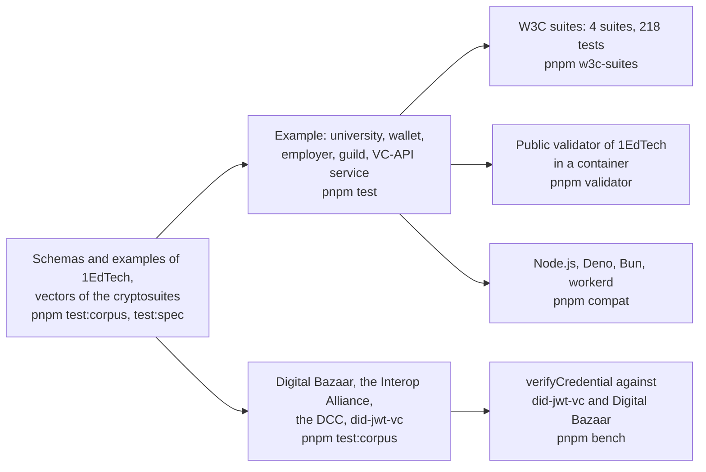

# Evidence for achievement-credentials

What shows that the package does what it says: the schemas and the specification examples, an example of a university, a wallet,
an employer and a VC-API service, the interoperability suites of the W3C, the public validator of 1EdTech, four verifiers that
other projects wrote, the speed of verifying, and four runtimes. Each layer answers a question that the one before cannot.

| Layer                 | Question                                                                                          | Where                                                                                           | Runs                |
| --------------------- | ------------------------------------------------------------------------------------------------- | ----------------------------------------------------------------------------------------------- | ------------------- |
| Schemas, examples     | Does the reader judge as the schemas of 1EdTech do, and read what the pages print?                | `packages/achievement-credentials/test/*.corpus.test.ts`, `*.spec.test.ts`                      | `pnpm test:corpus`, `pnpm test:spec` |
| Vectors               | Does a function of the package give the bytes that the Recommendations print?                     | `packages/achievement-credentials/test/vectors.spec.test.ts`                                    | `pnpm test:spec`    |
| Example               | Does a host award, store, serve, verify, revoke, refresh and show credentials with the package?   | `examples/achievement-credentials/test/*.test.ts`                                               | `pnpm test`         |
| Interoperability      | Do the suites of the W3C find the service of the example conformant?                               | `validation/w3c-suites/`                                                                        | `pnpm w3c-suites`   |
| Validator             | Does the application of 1EdTech take what the example makes, as JSON, JWS, PNG and SVG?            | `validation/1edtech-validator/`, `examples/achievement-credentials/test/validator.corpus.test.ts` | `pnpm validator`    |
| Counterparties        | Does each side verify what the other signs, and refuse what the other changes?                    | `packages/achievement-credentials/test/counterparties.corpus.test.ts`                           | `pnpm test:corpus`  |
| Speed                 | How long does `verifyCredential` take, against the libraries that verify the same credential?     | `packages/achievement-credentials/test/verify.bench.ts`                                         | `pnpm bench`        |
| Runtimes              | Does the scenario give the same results everywhere?                                               | `compat/`                                                                                       | `pnpm compat`       |

## The example

A university awards two credentials, one as a compact JWS and one with an `eddsa-rdfc-2022` proof, each with a place in its
revocation list and a refresh service. A learner's app puts them in a wallet that serves the Open Badges API and verifies what it is
given; an employer lists them with the client and verifies each. The tests check the scenario and the VC-API service.

| What the scenario shows                                                                                                      | Where                           |
| ---------------------------------------------------------------------------------------------------------------------------- | ------------------------------- |
| The wallet keeps both credentials, and refuses with 422 one that a forger signed in the university's name with a key of their own | `scenario.test.ts`              |
| The employer verifies both and shows the name and the issuer of each                                                          | `scenario.test.ts`              |
| After the revocation, the `status` check of that credential fails and no other check does                                    | `scenario.test.ts`              |
| After a reissue, the employer's old copy refreshes to the new credential and verifies                                         | `scenario.test.ts`              |
| The credential read out of a PNG and an SVG verifies as the JWS it was baked from                                             | `scenario.test.ts`              |
| An Open Badges 2.0 badge that a guild hosts verifies at its address, for a recipient that the guild names                     | `scenario.test.ts`              |
| The service issues, verifies, refuses a credential whose name changed, refuses a base proof and verifies a derived disclosure | `scenario.test.ts`, `vc-api.test.ts` |
| The service answers 404, 405 and 400 where its API says so, and serves the lists that it fills                                | `vc-api.test.ts`                |

## The suites of the W3C

`pnpm w3c-suites` runs four suites at pinned commits against the VC-API service of the example, which issues with `addProof`,
verifies with `verifyProof` and `verifyCredentialStatus`, derives with `deriveDisclosure` and serves the lists that it fills.

| Suite                                 | Commit    | Tests | Pass | Skipped by the suite | Not applicable |
| ------------------------------------- | --------- | ----: | ---: | -------------------: | -------------: |
| `vc-di-eddsa-test-suite`              | `1e86cc4` |    44 |   43 |                    0 |              1 |
| `vc-di-ecdsa-test-suite`              | `94dca21` |    59 |   55 |                    1 |              3 |
| `vc-bitstring-status-list-test-suite` | `960ab9a` |    56 |   40 |                   16 |              0 |
| `vc-data-model-2.0-test-suite`        | `6283645` |    59 |   40 |                    0 |             19 |

Every test that fails is listed in `validation/w3c-suites/suites.lock.json` with its reason, the run fails when a listed test
passes, and a suite of another size fails it. A test that the package could fail on a credential of Open Badges or CLR is a
fault of the package and is fixed there; the first runs found these:

| What the suite found                                                                                         | What the package does now                                                                                           |
| ------------------------------------------------------------------------------------------------------------ | ------------------------------------------------------------------------------------------------------------------- |
| An `ecdsa-sd-2023` base proof of a credential whose subject holds only its `id` failed                       | The default mandatory pointers name the subject and an `issuer` that is an address as wholes                         |
| A credential with an empty `credentialSubject` was issued                                                    | `subject-empty` is an error of the readers                                                                           |
| A credential that ends before it begins was issued and verified                                              | `validity-period` is an error of the readers, under both data models                                                 |
| A proof that names a `previousProof` verified as if it named none                                            | It is not valid, with the reason: a proof chain is not verified                                                      |

The 23 tests that do not apply, and the reason of each group, are in [the README of the suites](../../validation/w3c-suites/README.md#what-the-suites-ask-that-open-badges-does-not):
Verifiable Presentations (7), credentials that Open Badges itself narrows (7), `relatedResource` (5), a proof chain (1) and three
vectors of `ecdsa-sd-2023` that cannot take a `validFrom` (3). `vc-jose-cose-test-suite` is not run: its implementations are Docker
images with a command line, not services over HTTP.

## The public validator

`pnpm validator` builds the validator of 1EdTech from its commit `67532ac`, starts it in a container and sends it the credentials
of the example. Open Badges and CLR credentials as JSON with an `eddsa-rdfc-2022` proof, an `ecdsa-sd-2023` disclosure, a compact
JWS signed with ES256 and the images that hold them are VALID, and `verifyCredential` verifies each. The validator reads less than
the package in four places, and the test pins each so that a new build that changes one fails it:

| Where                                                        | The validator                                                                  | The package                                                                           |
| ------------------------------------------------------------ | ------------------------------------------------------------------------------ | ------------------------------------------------------------------------------------- |
| A JWS signed with EdDSA                                      | FATAL: `alg` must be `RS256` or `ES256`                                        | Verifies it                                                                           |
| A CLR in a JWS                                               | EXCEPTION in its CLR inspector                                                 | Verifies it                                                                           |
| A key that the issuer does not publish, under a method at the issuer's address | VALID: the key comes from the method, and the controller from its address | `issuer` is not passed: a method that the issuer does not list names no key           |
| A JWS whose `kid` is an address that no issuer hosts          | Fetches the key there                                                          | Verifies with it only when the host says `allowUnboundKeys`                           |

## Counterparties

`counterparties.corpus.test.ts` signs and verifies beside four libraries that other projects wrote, as devDependencies. Each pair
is checked in both directions where the library does both, and each refuses what the other changed.

| Library                                                                                           | Signs                           | Verifies                          | Result                                                                                                                           |
| ------------------------------------------------------------------------------------------------- | ------------------------------- | --------------------------------- | -------------------------------------------------------------------------------------------------------------------------------- |
| `@digitalbazaar/vc` 7.3.0, `@digitalbazaar/data-integrity` 2.5.0, `eddsa-rdfc-2022-cryptosuite` 1.3.0 | `eddsa-rdfc-2022`               | `eddsa-rdfc-2022`                 | Each verifies the credential that the other signed, refuses it once its name changed, and refuses one that another issuer's key signed |
| `@interop/verifier-core` 3.9.0                                                                   |                                 | `eddsa-rdfc-2022`                 | Verifies the credentials that we and Digital Bazaar sign, and refuses ours once its name changed                                 |
| `@digitalcredentials/verifier-core` 1.0.0-beta.11                                                 |                                 | `eddsa-rdfc-2022`                 | Verifies the signature of ours and answers `invalid_signature` for a changed name                                                |
| `did-jwt-vc` 5.0.1 with `did-jwt` 9.0.2                                                           | The `vc` claim form of VC-JWT 1.1 | The JWT of Open Badges 8.2        | It verifies the JWT that we sign; we verify the one it signs, bound to the issuer; each refuses a changed payload               |

`@interop/verifier-core` is at 3.9.0 and not at the current 4.1.0, which is less than the two weeks that `minimumReleaseAge` asks.
The verifier of the Digital Credentials Consortium carries the contexts that it needs and fetches the schema that a credential
names, so the test serves the schema that `pnpm schemas` pinned.

## Speed

`pnpm bench` times `verifyCredential` of the build that ships against the library that verifies the same credential, in one run.
A benchmark takes at least 20 samples after a warm-up, and the gate is the fastest sample.

| Benchmark                                       | Reference                                            | Measured in five runs | Budget | Holds on     |
| ----------------------------------------------- | ---------------------------------------------------- | --------------------: | -----: | ------------ |
| `verifyCredential` of a JWS                      | `did-jwt-vc`, which checks the signature and the claims | 0.13 to 0.15 times that |    0.8 | Any machine  |
| `verifyCredential` with an `eddsa-rdfc-2022` proof | `@digitalbazaar/vc`, which checks the structure and the proof | 1.04 to 1.10 times that |      6 | Any machine  |

`verifyCredential` also binds the key to the issuer, reads the validity and checks the status and the refresh service, which neither
reference does. The rule of the family sets a ratio to five times the largest ratio measured, rounded up to one significant digit.
No budget in time is set yet: it waits for the samples of the runner of CI. The samples were taken on a laptop with an Apple
processor and Node.js 26.8 at a load of about 11.

## Runtimes

`pnpm compat` bundles the scenario of the example with the packages as they ship and runs it on each runtime. The results must
equal those of Node.js. Node.js, Deno and Bun run a bundle for Node.js; workerd runs a bundle of the build for browsers of the
Data Integrity libraries, which uses Web Crypto and imports no module of Node.js, without the `nodejs_compat` flag.

| Runtime | Version it was run with       | Result |
| ------- | ----------------------------- | ------ |
| Node.js | 22.23, 24.22 and 26.8 locally, 22 in CI | Equal  |
| Deno    | 2.9.6, with `--allow-env`     | Equal  |
| Bun     | 1.4.4 locally, 1.4.3 in CI    | Equal  |
| workerd | 1.20261016.1                  | Equal  |

## Not included

| Not included                                           | Why                                                                                                                       |
| ------------------------------------------------------ | ------------------------------------------------------------------------------------------------------------------------- |
| Certification by 1EdTech                               | It needs membership and the suite of 1EdTech; the docs say that the package implements Open Badges and CLR, and never that it is certified |
| `vc-jose-cose-test-suite`                              | Its implementations are Docker images with a command line, and the package secures nothing with COSE or SD-JWT              |
| The inspector of Open Badges 2.0 of the validator      | It fetches the documents of a badge from the public Internet; the package is compared with `openbadges-validator-core` instead |
| Verifiable Presentations, `relatedResource`, proof chains | Open Badges and CLR do not define or use them (the README of the suites says which tests ask for them)                   |
| A timing in seconds                                    | It waits for the samples of the runner of CI                                                                              |

## Differences from the references

The reference of the example is the text of Open Badges 3.0 and CLR 2.0 and the suites that implement them, and of a counterparty
it is the library itself at its pinned version, not a claim about its other releases.

| Where                                  | The references                                                                                           | The package                                                                                         |
| -------------------------------------- | -------------------------------------------------------------------------------------------------------- | --------------------------------------------------------------------------------------------------- |
| A credential of the generic Data Model | The suites send credentials with an `id`, a type and a subject                                           | Open Badges requires `validFrom`, a `type` of a Profile issuer, one subject and at most one refresh service |
| The key of a proof                     | The validator reads it from the method, and Digital Bazaar's `vc` from the document of the method          | It must be a key that the issuer publishes                                                          |
| A proof that names a `previousProof`   | Data Integrity 4.5 verifies it with the proofs that it names                                             | It is not valid, with the reason                                                                    |
| `relatedResource`                      | The Data Model 2.0 asks a verifier to check its form and the digest of what it names                      | A term of an extension that the package carries and does not check                                  |
