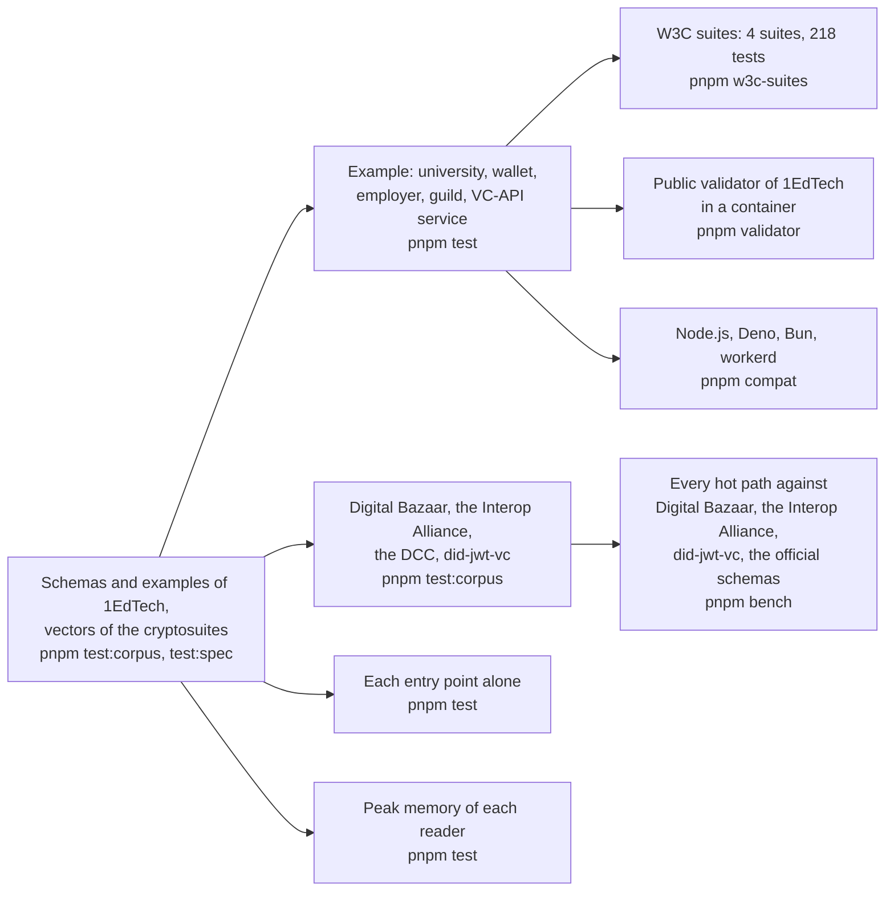

# Evidence for achievement-credentials

What shows that the package does what it says: the schemas and the specification examples, an example of a university, a wallet,
an employer and a VC-API service, the interoperability suites of the W3C, the public validator of 1EdTech, four verifiers that
other projects wrote, the speed of every hot path, the size of each entry point, the peak memory of every reader, and four
runtimes. Each layer answers a question that the one before cannot.

| Layer                 | Question                                                                                          | Where                                                                                           | Runs                |
| --------------------- | ------------------------------------------------------------------------------------------------- | ----------------------------------------------------------------------------------------------- | ------------------- |
| Schemas, examples     | Does the reader judge as the schemas of 1EdTech do, and read what the pages print?                | `packages/achievement-credentials/test/*.corpus.test.ts`, `*.spec.test.ts`                      | `pnpm test:corpus`, `pnpm test:spec` |
| Vectors               | Does a function of the package give the bytes that the Recommendations print?                     | `packages/achievement-credentials/test/vectors.spec.test.ts`                                    | `pnpm test:spec`    |
| Example               | Does a host award, store, serve, verify, revoke, refresh and show credentials with the package?   | `examples/achievement-credentials/test/*.test.ts`                                               | `pnpm test`         |
| Interoperability      | Do the suites of the W3C find the service of the example conformant?                               | `validation/w3c-suites/`                                                                        | `pnpm w3c-suites`   |
| Validator             | Does the application of 1EdTech take what the example makes, as JSON, JWS, PNG and SVG?            | `validation/1edtech-validator/`, `examples/achievement-credentials/test/validator.corpus.test.ts` | `pnpm validator`    |
| Counterparties        | Does each side verify what the other signs, and refuse what the other changes?                    | `packages/achievement-credentials/test/counterparties.corpus.test.ts`                           | `pnpm test:corpus`  |
| Speed                 | How long does each hot path take, against the libraries that do the same work?                    | `packages/achievement-credentials/test/*.bench.ts`                                              | `pnpm bench`        |
| Size                  | Does each entry point hold only what it uses, within its budget?                                  | `packages/achievement-credentials/test/size.test.ts`                                            | `pnpm test`         |
| Memory                | Does each reader of untrusted input stay under its budget on its worst input?                     | `packages/achievement-credentials/test/peak-memory.test.ts`                                        | `pnpm test`         |
| Runtimes              | Does the scenario give the same results everywhere?                                               | `compat/`                                                                                       | `pnpm compat`       |

## The example

A university awards two credentials, one as a compact JWS and one with an `eddsa-rdfc-2022` proof, each with a place in its
revocation list and a refresh service. A learner's app puts them in a wallet that serves the Open Badges API and verifies what it is
given; an employer lists them with the client and verifies each. The tests check the scenario and the VC-API service.

| What the scenario shows                                                                                                      | Where                           |
| ---------------------------------------------------------------------------------------------------------------------------- | ------------------------------- |
| The wallet keeps both credentials, and refuses with 422 one that a forger signed in the university's name with a key of their own | `scenario.test.ts`              |
| The employer verifies both and shows the name and the issuer of each                                                          | `scenario.test.ts`              |
| After the revocation, the `status` check of that credential fails and no other check does                                    | `scenario.test.ts`              |
| After a reissue, the employer's old copy refreshes to the new credential and verifies                                         | `scenario.test.ts`              |
| The credential read out of a PNG and an SVG verifies as the JWS it was baked from                                             | `scenario.test.ts`              |
| An Open Badges 2.0 badge that a guild hosts verifies at its address, for a recipient that the guild names                     | `scenario.test.ts`              |
| The service issues, verifies, refuses a credential whose name changed, refuses a base proof and verifies a derived disclosure | `scenario.test.ts`, `vc-api.test.ts` |
| The service answers 404, 405 and 400 where its API says so, and serves the lists that it fills                                | `vc-api.test.ts`                |

## The suites of the W3C

`pnpm w3c-suites` runs four suites at pinned commits against the VC-API service of the example, which issues with `addProof`,
verifies with `verifyProof` and `verifyCredentialStatus`, derives with `deriveDisclosure` and serves the lists that it fills.

| Suite                                 | Commit    | Tests | Pass | Skipped by the suite | Not applicable |
| ------------------------------------- | --------- | ----: | ---: | -------------------: | -------------: |
| `vc-di-eddsa-test-suite`              | `1e86cc4` |    44 |   44 |                    0 |              0 |
| `vc-di-ecdsa-test-suite`              | `94dca21` |    59 |   55 |                    1 |              3 |
| `vc-bitstring-status-list-test-suite` | `960ab9a` |    56 |   40 |                   16 |              0 |
| `vc-data-model-2.0-test-suite`        | `6283645` |    59 |   44 |                    0 |             15 |

Every test that fails is listed in `validation/w3c-suites/suites.lock.json` with its reason, the run fails when a listed test
passes, and a suite of another size fails it. A test that the package could fail on a credential of Open Badges or CLR is a
fault of the package and is fixed there; the first runs found these:

| What the suite found                                                                                         | What the package does now                                                                                           |
| ------------------------------------------------------------------------------------------------------------ | ------------------------------------------------------------------------------------------------------------------- |
| An `ecdsa-sd-2023` base proof of a credential whose subject holds only its `id` failed                       | The default mandatory pointers name the subject and an `issuer` that is an address as wholes                         |
| A credential with an empty `credentialSubject` was issued                                                    | `subject-empty` is an error of the readers                                                                           |
| Related resources of another form than the data model gives them were issued                                  | `related-resource-form`, `-id`, `-duplicate` and `-digest` are errors of the readers                                  |
| A credential that ends before it begins was issued and verified                                              | `validity-period` is an error of the readers, under both data models                                                 |
| A proof that names a `previousProof` verified as if it named none, and then a proof chain was refused         | A proof of a chain is checked over the credential with the proofs that it names, and counts only when they do      |

The 18 tests that do not apply, and the reason of each group, are in [the README of the suites](../../validation/w3c-suites/README.md#what-the-suites-ask-that-open-badges-does-not):
Verifiable Presentations (7), credentials that Open Badges itself narrows (7), the digest of a related resource (1) and three
vectors of `ecdsa-sd-2023` that cannot take a `validFrom` (3). Proof chains and the form of related resources are verified. `vc-jose-cose-test-suite` is not run: its implementations are Docker
images with a command line, not services over HTTP.

## The public validator

`pnpm validator` builds the validator of 1EdTech from its commit `67532ac`, starts it in a container and sends it the credentials
of the example. Open Badges and CLR credentials as JSON with an `eddsa-rdfc-2022` proof, an `ecdsa-sd-2023` disclosure, a compact
JWS signed with ES256 and the images that hold them are VALID, and `verifyCredential` verifies each. The validator reads less than
the package in four places, and the test pins each so that a new build that changes one fails it:

| Where                                                        | The validator                                                                  | The package                                                                           |
| ------------------------------------------------------------ | ------------------------------------------------------------------------------ | ------------------------------------------------------------------------------------- |
| A JWS signed with EdDSA                                      | FATAL: `alg` must be `RS256` or `ES256`                                        | Verifies it                                                                           |
| A CLR in a JWS                                               | EXCEPTION in its CLR inspector                                                 | Verifies it                                                                           |
| A key that the issuer does not publish, under a method at the issuer's address | VALID: the key comes from the method, and the controller from its address | `issuer` is not passed: a method that the issuer does not list names no key           |
| A JWS whose `kid` is an address that no issuer hosts          | Fetches the key there                                                          | Verifies with it only when the host says `allowUnboundKeys`                           |

## Counterparties

`counterparties.corpus.test.ts` signs and verifies beside four libraries that other projects wrote, as devDependencies. Each pair
is checked in both directions where the library does both, and each refuses what the other changed.

| Library                                                                                           | Signs                           | Verifies                          | Result                                                                                                                           |
| ------------------------------------------------------------------------------------------------- | ------------------------------- | --------------------------------- | -------------------------------------------------------------------------------------------------------------------------------- |
| `@digitalbazaar/vc` 7.3.0, `@digitalbazaar/data-integrity` 2.5.0, `eddsa-rdfc-2022-cryptosuite` 1.3.0 | `eddsa-rdfc-2022`               | `eddsa-rdfc-2022`                 | Each verifies the credential that the other signed, refuses it once its name changed, and refuses one that another issuer's key signed |
| `@interop/verifier-core` 3.9.0                                                                   |                                 | `eddsa-rdfc-2022`                 | Verifies the credentials that we and Digital Bazaar sign, and refuses ours once its name changed                                 |
| `@digitalcredentials/verifier-core` 1.0.0-beta.11                                                 |                                 | `eddsa-rdfc-2022`                 | Verifies the signature of ours and answers `invalid_signature` for a changed name                                                |
| `did-jwt-vc` 5.0.1 with `did-jwt` 9.0.2                                                           | The `vc` claim form of VC-JWT 1.1 | The JWT of Open Badges 8.2        | It verifies the JWT that we sign; we verify the one it signs, bound to the issuer; each refuses a changed payload               |

`@interop/verifier-core` is at 3.9.0 and not at the current 4.1.0, which is less than the two weeks that `minimumReleaseAge` asks.
The verifier of the Digital Credentials Consortium carries the contexts that it needs and fetches the schema that a credential
names, so the test serves the schema that `pnpm schemas` pinned.

## Speed

`pnpm bench` times the build that ships against a reference in the same run: the comparator that does the same work where one
is installable ([comparators](comparators.md)), and otherwise the least work of the same kind. `scripts/bench-rounds.ts` runs the
function and its reference in three rounds, the reference first in the first and the last, so that the load of a shared machine
falls on both, and the gate is the ratio of the fastest samples. The ratios are those of three runs on a laptop with an Apple
processor and Node.js 26.8 at a load of 7 to 27; a budget is five times the highest, rounded up to one significant digit, and
holds on any machine.

| Benchmark | Reference | Ratio | Budget |
| --- | --- | ---: | ---: |
| `verifyCredential` of a JWS | `did-jwt-vc`, which checks the signature and the claims | 0.13–0.14 | 0.8 |
| `verifyCredential` of a CLR in a JWS that holds 10 JWS | `did-jwt-vc` of the 11 JWTs | 0.13–0.17 | 0.9 |
| `verifyCredential` with an `eddsa-rdfc-2022` proof | `@digitalbazaar/vc`, which checks the structure and the proof | 1.03–1.08 | 6 |
| the same | `@interop/verifier-core`, which also checks the status and the expiry | 1.05–1.07 | 6 |
| `addProof` with `eddsa-rdfc-2022` | `vc.issue` of `@digitalbazaar/vc` with its suite | 1.01–1.04 | 6 |
| `verifyProof` of `eddsa-rdfc-2022` | `vc.verifyCredential` of `@digitalbazaar/vc` | 1.05–1.11 | 6 |
| `verifyProof` of `ecdsa-rdfc-2019` | `@interop/verifier-core` | 0.86–0.88 | 5 |
| `verifyProof` of `Ed25519Signature2020`, `legacyProofs` | `@interop/verifier-core` | 1.03–1.06 | 6 |
| `verifyProof` of an `ecdsa-sd-2023` disclosure | `@digitalbazaar/vc` with Digital Bazaar's `ecdsa-sd-2023` suite | 0.91–0.92 | 5 |
| `readCredentialJwt` | `verifyCredential` of `did-jwt-vc` | 0.12–0.14 | 0.7 |
| `signCredentialJwt` with EdDSA | `createVerifiableCredentialJwt` of `did-jwt-vc` | 0.11 | 0.6 |
| `issueStatusListCredential` of 131,072 entries, Data Integrity | `@interop/vc-bitstring-status-list` and `jsigs.sign` | 0.88–0.90 | 5 |
| `verifyCredentialStatus` against that list, fetched each time | `checkStatus` of `@interop/vc-bitstring-status-list` | 1.29–1.37 | 7 |
| `readCredential` of a CLR of 20 credentials | the official schema of CLR 2.0 in `@cfworker/json-schema` | 0.16–0.17 | 0.9 |
| `validateCredential` of the same CLR | the same | 0.17 | 0.9 |
| `bakePng` of that CLR into an image of 256 KiB | `JSON.stringify` of the CLR | 29.9–30.3 | 200 |
| `readPng` of that image | `JSON.parse` of the CLR | 4.06–4.08 | 30 |
| `bakeSvg` of that CLR into an SVG of 140,000 characters | saxes over the SVG | 1.56–1.81 | 10 |
| `readSvg` of that SVG, which stops at the credential | saxes over all of it | 0.61–0.80 | 4 |
| `handleCredentialsRequest`, a page of 100 credentials | `JSON.stringify` of the page | 1.35–1.46 | 8 |
| `handleCredentialsRequest`, the upsert of that CLR | `JSON.parse` of its body | 5.7–5.8 | 30 |
| `handleRefreshRequest` of that CLR | `JSON.stringify` of it | 1.01–1.12 | 6 |

The keyed cache that the key resolver and the status lists share is `createKeyedCache` of `core`, timed with the other hot paths of
`core` ([signals](../core/signals.md)). The profiles named three hot paths that are written as they are for their speed; each
alternative was timed as a build of its own, alternated with the package, three runs of each, with identical outputs on every case
of the fixtures, on the vectors of the W3C and on millions of generated texts:

| Hot path | Written so | The alternative takes |
| --- | --- | --- |
| The CRC-32 of a PNG chunk | By the table of PNG 1.2 annex D | Eight steps for each byte: `readPng` of the CLR 201 µs against 91, `bakePng` 310 against 181 |
| The base64url of a JWS that is signed | By a table in `core` | A string of the bytes as arguments, and `btoa`: `signCredentialJwt` of a CLR of 20, with its credentials, 1.42 ms against 0.91 |
| The parts of a JWS that is read | Decoded in one reading | Three copies of the text first: `readCredentialJwt` of the CLR 231 µs against 215 |

Where a ratio is above parity, the package does work that the reference does not. `verifyProof` and `addProof` are the same
libraries of the Interop Alliance with a bound on canonicalization, and their 1.01 to 1.11 is the reading of the credential in the
model and its limits; each context is copied for each load, so that no caller can change what the loader keeps. `verifyCredentialStatus`
also reads the list credential in the model, counts its tokens and binds its key to the issuer. The upsert reads the CLR in the model
after `JSON.parse`; the baking of a PNG reads and copies the credential it bakes, and the reading of a PNG checks the CRC of its chunk.
No budget in time is set yet: it waits for the samples of the runner of CI.

## Size

`size.test.ts` bundles each entry point alone with `scripts/entry-size.ts`: esbuild, minified, with every dependency inside and a
chunk of its own for what a dynamic `import()` loads, which loads only when the code that imports it runs. It fails above the
budget after gzip, 1.25 times the size measured rounded up to the next 500 bytes, or on a module that its budget does not list.

| Entry point | Bytes | Gzip | Budget | Holds, besides `@interopkit/core`, `model` and valibot |
| --- | ---: | ---: | ---: | --- |
| `@interopkit/achievement-credentials` | 66,886 | 21,101 | 26,500 | `read`, `issue`, `compare`, `@noble/hashes` |
| `/baking` | 92,353 | 27,768 | 35,000 | `read`, saxes |
| `/client` | 65,065 | 20,199 | 25,500 | `read` |
| `/keys` | 146,502 | 49,162 | 61,500 | jose, the DID drivers of the Interop Alliance and the curves of noble |
| `/jwt` | 77,213 | 24,637 | 31,000 | `read`, the internals of `keys`, jose |
| `/data-integrity` | 451,503 | 135,494 | 169,500 | `read`, `keys`, jose, jsonld and the cryptosuites of the Interop Alliance, `selective-disclosure` |
| `/status` | 96,038 | 31,343 | 39,500 | `read`, `keys`, `jwt`, jose; `data-integrity` on demand |
| `/refresh` | 14,704 | 5,274 | 7,000 | nothing else |
| `/verify` | 155,427 | 49,847 | 62,500 | `read`, `issue`, `compare`, `keys`, `jwt`, `status`, `refresh`, jose, `@cfworker/json-schema`; `data-integrity` on demand |
| `/provider` | 109,691 | 36,122 | 45,500 | `read`, `keys`, `jwt`, the internals of `verify`, jose; the rest of `verify` on demand |

A verifier of JWTs, a provider that does not verify and a reader of status lists load no JSON-LD; the DID drivers load only with
`createKeyResolver`.

## Memory

Each reader of untrusted input runs on its worst input within its limits in a Node.js process of its own whose heap is
bounded (`test/peak-memory.test.ts`, with the readings in `test/peak-memory-readings.ts`): what the reading keeps alive at once
must fit, whenever V8 collects, so a regression fails and the load of a machine cannot. The heap of a case is twice the least in
which the reading ends on Node.js 22 and 24, rounded up to 16 MiB; `node scripts/peak-memory.ts achievement-credentials` prints the least, in steps
of 8 MiB.

| Worst input | Reading | Least heap | Heap of the test |
| --- | --- | ---: | ---: |
| A JWS of 1 MiB of the most numbers, verified | `jwtNumbers` | 32 MiB | 64 MiB |
| A JWS of 1 MiB of the most empty objects, verified | `jwtObjects` | 72 MiB | 144 MiB |
| A JWS of 15 MiB of four million empty arrays, refused by its tokens | `v2Payload` | 40 MiB | 80 MiB |
| A PNG whose credential holds the most objects that `maxTokens` leaves | `bakingPng` | 40 MiB | 80 MiB |
| An SVG of 10 MiB whose credential is one string | `bakingSvg` | 56 MiB | 112 MiB |
| A status list within the fetch limit that inflates to 256 MiB | `status` | 24 MiB | 48 MiB |
| A CLR of 600 credentials whose refresh services answer 600,000 characters | `verify` | 32 MiB | 64 MiB |
| A list of 5,000 alike items, refused as a limit of canonicalization | `dataIntegrity` | 64 MiB | 128 MiB |
| A body at the limits of the provider of the most objects | `provider` | 56 MiB | 112 MiB |
| An Open Badges 2.0 document of a million wrong values | `v2` | 56 MiB | 112 MiB |

The services of the CLR sign their answers when they are asked, and that signing falls in the reading. Without their bounds, the
CLR raised the peak by 174–264 MiB, the list of 5,000 items by 800 MiB, the Open Badges 2.0 document by 1 GB, and parsing the payload
of 15 MiB by 354 MiB.

## Runtimes

`pnpm compat` bundles the scenario of the example with the packages as they ship and runs it on each runtime. The results must
equal those of Node.js. Node.js, Deno and Bun run a bundle for Node.js; workerd runs a bundle of the build for browsers of the
Data Integrity libraries, which uses Web Crypto and imports no module of Node.js, without the `nodejs_compat` flag.

| Runtime | Version it was run with       | Result |
| ------- | ----------------------------- | ------ |
| Node.js | 22.23, 24.22 and 26.8 locally, 22 in CI | Equal  |
| Deno    | 2.9.6, with `--allow-env`     | Equal  |
| Bun     | 1.4.4 locally, 1.4.3 in CI    | Equal  |
| workerd | 1.20261016.1                  | Equal  |

## Not included

| Not included                                           | Why                                                                                                                       |
| ------------------------------------------------------ | ------------------------------------------------------------------------------------------------------------------------- |
| Certification by 1EdTech                               | It needs membership and the suite of 1EdTech; the docs say that the package implements Open Badges and CLR, and never that it is certified |
| `vc-jose-cose-test-suite`                              | Its implementations are Docker images with a command line, and the package secures nothing with COSE or SD-JWT              |
| The inspector of Open Badges 2.0 of the validator      | It fetches the documents of a badge from the public Internet; the package is compared with `openbadges-validator-core` instead |
| Verifiable Presentations                               | The envelope of a protocol of delivery, which the host speaks; it passes each credential to `verifyCredential`             |
| The digests of related resources                       | The package fetches no resource that a credential names; contexts come only from their pins                              |
| A timing in seconds                                    | It waits for the samples of the runner of CI                                                                              |

## Differences from the references

The reference of the example is the text of Open Badges 3.0 and CLR 2.0 and the suites that implement them, and of a counterparty
it is the library itself at its pinned version, not a claim about its other releases.

| Where                                  | The references                                                                                           | The package                                                                                         |
| -------------------------------------- | -------------------------------------------------------------------------------------------------------- | --------------------------------------------------------------------------------------------------- |
| A credential of the generic Data Model | The suites send credentials with an `id`, a type and a subject                                           | Open Badges requires `validFrom`, a `type` of a Profile issuer, one subject and at most one refresh service |
| The key of a proof                     | The validator reads it from the method, and Digital Bazaar's `vc` from the document of the method          | It must be a key that the issuer publishes                                                          |
| `relatedResource`                      | The Data Model 2.0 asks a verifier to check its form and the digest of what it names                      | Its form is checked; the digests are not, since no resource that it names is fetched                |
