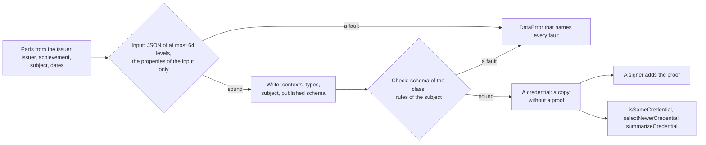

# Building credentials and comparing them

`@interopkit/achievement-credentials` writes the credentials that an issuer awards and looks at the credentials that a host
holds. Three builders write an AchievementCredential, an EndorsementCredential and a ClrCredential around the parts that the
issuer gives, and check what they wrote as `readCredential` does. `hashIdentifier` and `matchesIdentifier` hash and match the
recipient of a credential. `buildCaseAlignment` aligns an achievement to an item of a CASE framework. `isSameCredential` and
`selectNewerCredential` compare two credentials as Open Badges 10 asks, and `summarizeCredential` gives what a wallet shows.



| Module    | Holds                                                                                                                       |
| --------- | --------------------------------------------------------------------------------------------------------------------------- |
| `issue`   | `buildAchievementCredential`, `buildEndorsementCredential`, `buildClrCredential`, `buildCaseAlignment`, `hashIdentifier`, `matchesIdentifier`, the inputs |
| `compare` | `isSameCredential`, `selectNewerCredential`, `summarizeCredential`, `CredentialSummary`                                               |

All of them come from `@interopkit/achievement-credentials`. Nothing here reads a clock, draws a random number or makes a
request: the dates are the issuer's, and the hash is a function of its arguments.

## Quick start

```ts
import {
  buildAchievementCredential,
  buildCaseAlignment,
  hashIdentifier,
  isSameCredential,
  matchesIdentifier,
  selectNewerCredential,
  summarizeCredential,
} from "@interopkit/achievement-credentials";

const hash = hashIdentifier("learner@example.edu", "Kosher");
hash; // => "sha256$957fc9a017d69c52a7ac9895a20f59cb0a109a60afbd219b85c44ffb367389a2"

const credential = buildAchievementCredential({
  id: "https://example.edu/credentials/3732",
  issuer: { id: "https://example.edu/issuers/565049", type: ["Profile"], name: "Example University" },
  validFrom: "2024-06-13T18:46:03Z",
  name: "Fractions badge",
  subject: {
    identifier: [{ type: "IdentityObject", hashed: true, identityHash: hash, identityType: "emailAddress", salt: "Kosher" }],
  },
  achievement: {
    id: "https://example.edu/achievements/1",
    type: ["Achievement"],
    name: "Fractions",
    description: "Understands fractions as numbers.",
    criteria: { narrative: "Pass the final assessment." },
    alignment: [buildCaseAlignment({ uri: "https://standards.example.org/ims/case/v1p1/CFItems/2b6d1c9e", name: "Understand fractions", code: "3.NF.A.1" })],
  },
});
credential.type; // => ["VerifiableCredential", "OpenBadgeCredential"]
credential["@context"]; // => ["https://www.w3.org/ns/credentials/v2", "https://purl.imsglobal.org/spec/ob/v3p0/context-3.0.3.json", "https://purl.imsglobal.org/spec/ob/v3p0/extensions.json"]
const recipients = credential.credentialSubject.identifier ?? [];
recipients.some((recipient) => matchesIdentifier(recipient, { type: "emailAddress", value: "learner@example.edu" })); // => true
recipients.some((recipient) => matchesIdentifier(recipient, { type: "emailAddress", value: "other@example.edu" })); // => false

summarizeCredential(credential).name; // => "Fractions badge"

const reissued = { ...credential, validFrom: "2024-07-01T00:00:00Z" };
isSameCredential(credential, reissued); // => true
selectNewerCredential(credential, reissued) === reissued; // => true
```

## The builders

A builder takes the parts that only the issuer knows, and writes the rest. Its input is plain JSON of at most 64 levels, has
the properties of the input and no others, and holds the classes of the model (`Profile`, `Achievement`, `Evidence`, ...). The
builder reads the input, writes the credential, reads that with the schema of its class and the rules of the subject, and returns
the copy. It adds no proof: a signer does.

| Builder                      | Writes                                                                                                                                   |
| ---------------------------- | ---------------------------------------------------------------------------------------------------------------------------------------- |
| `buildAchievementCredential` | The contexts of the Verifiable Credentials Data Model 2.0, Open Badges 3.0.3 and the extensions of 1EdTech (which define the type of the `credentialSchema`, so that the credential survives JSON-LD safe mode), the types `VerifiableCredential` and `OpenBadgeCredential`, a subject of type `AchievementSubject` that holds the `subject` and the `achievement`, and the `credentialSchema` of the published AchievementCredential schema |
| `buildEndorsementCredential` | The same contexts, the types `VerifiableCredential` and `EndorsementCredential`, a subject of type `EndorsementSubject` with the `id` that `endorses` and the `comment`, and the published EndorsementCredential schema                                                              |
| `buildClrCredential`         | The contexts of the Verifiable Credentials Data Model 2.0, CLR 2.0.1, Open Badges 3.0.3 and the extensions, the types `VerifiableCredential` and `ClrCredential`, a subject of type `ClrSubject` that holds the learner, the credentials, the achievements and the associations, and the published ClrCredential schema |

| Input             | Meaning                                                                                                                                                       | Default                    |
| ----------------- | ------------------------------------------------------------------------------------------------------------------------------------------------------------- | -------------------------- |
| `id`              | The address of the credential, an absolute URI                                                                                                                | Required                   |
| `issuer`          | The issuer as a `Profile`, with its `id` and `type`                                                                                                           | Required                   |
| `validFrom`       | When the credential becomes valid, RFC 3339 with an offset                                                                                                    | Required                   |
| `name`            | The name for display                                                                                                                                          | Required                   |
| `subject`         | Who earned the achievement (AchievementCredential) or the learner (CLR): `id` or `identifier`, one of them at least                                           | Required                   |
| `achievement`     | The `Achievement` that was earned (AchievementCredential)                                                                                                     | Required                   |
| `endorses`        | The identifier of what the endorsement is about (EndorsementCredential)                                                                                                    | Required                   |
| `credentials`     | The credentials of the CLR, at least one: objects, or all compact JWS strings for a CLR that is signed as a VC-JWT after its credentials were signed          | Required                   |
| the rest          | `validUntil`, `description`, `image`, `awardedDate`, `evidence`, `endorsement`, `endorsementJwt`, `credentialStatus`, `refreshService`, `termsOfUse`, `comment`, `achievements`, `associations`, `partial`, and in `subject` `result`, `activityStartDate`, `activityEndDate`, `creditsEarned`, `role`, `term` | None: the property is left out |

With compact JWS strings, `buildClrCredential` returns the payload of that JWT (`ClrCredentialJwtPayload`) and not a
`ClrCredential`; a list that mixes the two forms is refused.

The `id` must be an absolute URI. The specification leaves the `id` open, but a credential whose address is relative cannot
be compared with another or fetched, and the builders refuse it.

`buildCaseAlignment({ uri, name, code?, framework? })` writes an `Alignment` with `targetType: "CFItem"`, `targetUrl` the address of
the item, `targetName`, and `targetCode` and `targetFramework` when given. The item is plain strings, so that no CASE package
is needed.

## Identities

`hashIdentifier(value, salt)` returns `sha256$` and the SHA-256 of the identifier followed by the salt, in lower-case
hexadecimal. `matchesIdentifier(identity, known)` takes the recipient of a credential, an `IdentityObject` of Open Badges 3.0 or
CLR 2.0 or an `IdentityObjectV2` of an Open Badges 2.0 assertion, and the identity that the caller knows. It is true when the
types are the same and the value matches: a plain value must be equal, and a hashed one is compared with the hash of the known
value and the salt of the recipient, in the algorithm the hash names (`sha256$` or `md5$`) and in either case of the digits.
`md5$`, which Open Badges 2.0 and 3.0 both name, is read and never written. The type of a 2.0 recipient is one of
`IDENTITY_TYPES_V2` (`id`, `email`, `url`, `telephone`), and [Reading Open Badges 2.0](open-badges-2.md) reads the assertion that
holds it.

## Comparing

`isSameCredential(a, b)` is true when the two credentials have the same `id` and the same issuer, compared after the
percent-encoded characters are unescaped and the white space around them is trimmed (Open Badges 10). A credential with no `id`
is the same as none. `selectNewerCredential(a, b)` returns the one of two equal credentials with the later `validFrom`, compared as
instants, so that an offset does not matter; when they are the same instant it returns the first. It returns the argument
itself. Under the Verifiable Credentials Data Model 1.1 the later `issuanceDate` counts, so a store that keeps what a provider
received compares the credentials of both models alike.

`summarizeCredential(credential)` returns what a wallet shows: the `kind` (`badge`, `clr` or `endorsement`), the `name`,
`description` and `image` of the credential or, for an achievement credential that has none, of its achievement, the `issuer`
and its name, and the dates: `validFrom`, `validUntil` and, when the credential names one, the `awardedDate`, which a displayer
shows as the date of issue since a reissue moves `validFrom` (OB B.1.2). It reads a credential under either Verifiable
Credentials data model; `validFrom` is `issuanceDate` under 1.1.

## Errors

| Case                                                                                                   | Result                                                                                                                                                    |
| ------------------------------------------------------------------------------------------------------ | --------------------------------------------------------------------------------------------------------------------------------------------------------- |
| A builder is given an input with a fault, one of the properties it does not have included              | `DataError` that names every fault: `The input is invalid: id: expected a URI with a scheme ...; validFrom: expected a date and time ...`                |
| The credential that a builder wrote has a fault, such as a subject with neither an `id` nor an `identifier` | `DataError`: `The credential is invalid: credentialSubject: has neither an id nor an identifier ...`                                                      |
| An input nests more than 64 levels or holds what JSON cannot                                           | `DataError` that says where                                                                                                                               |
| `hashIdentifier` or `matchesIdentifier` is given an argument of the wrong type                         | `DataError` that names it: `The identifier is invalid: expected a string, found 5.`                                                                       |
| `isSameCredential` or `selectNewerCredential` is given a value that is not an object with an `issuer`          | `DataError`: `The first credential is invalid: expected an object, found null.`                                                                           |
| `selectNewerCredential` is given credentials that are not the same, or one with no `validFrom` that is a date and time | `DataError`: `The credentials are not the same credential: they differ in id or in the id of the issuer.`                                              |
| `summarizeCredential` is given a value that is not a credential, or a `VerifiableCredential` of no class of Open Badges or CLR | `DataError`, from the reader or: `The credential is a VerifiableCredential of no class that Open Badges or CLR defines, so there is nothing to show.` |

## Limits

| Limit                          | Value | Refused with |
| ------------------------------ | ----- | ------------ |
| Levels that an input nests     | 64    | `DataError`  |

## Not included

| Not included                                              | Why                                                                                                |
| --------------------------------------------------------- | -------------------------------------------------------------------------------------------------- |
| A proof, a key, a signature                               | A signer adds the proof, in a later module; the builders write the credential that it signs         |
| A clock: no `validFrom` is filled in                      | The dates are the issuer's; a builder that read the clock would write a different credential each time |
| An Open Badges 2.0 assertion                              | 2.0 is read and verified, never issued                                                             |
| A random identifier: no `id` is made up                   | The address of a credential is the issuer's                                                        |

## Differences from the references

The reference is the text of Open Badges 3.0 and its examples, which the tests read at pinned hashes: the credentials that the
page prints are rebuilt from their parts, and the examples of section 10.1 give the verdicts of `isSameCredential` and
`selectNewerCredential`. The hash is checked against the example of the specification and against another implementation.

| Case                                                       | The references                                                                                                          | This package                                                                                               |
| ---------------------------------------------------------- | ----------------------------------------------------------------------------------------------------------------------- | ---------------------------------------------------------------------------------------------------------- |
| The schema in a CLR example                                | The ClrCredential examples of CLR 2.0 name the schema of an AchievementCredential                                       | A ClrCredential names its own schema, as 7.2 asks                                                          |
| The address of a credential                                | Any string                                                                                                              | An absolute URI                                                                                            |
| The comparison of two credentials                          | Equal when the id and the issuer id are equal after unescaping; the more recent `validFrom` replaces                    | The same, with `validFrom` compared as an instant, and the first when the instants are equal              |
