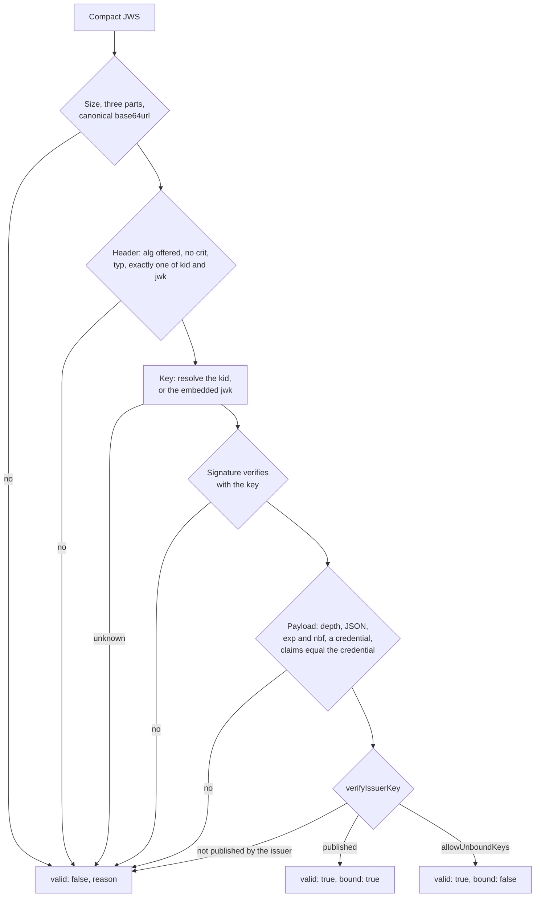

# Credentials as JSON Web Tokens

`@interopkit/achievement-credentials/jwt` signs a credential as a JWT, as Open Badges 8.2 asks, and reads one: it verifies the
signature with the key that the header names, checks the claims against the credential, and checks that the key belongs to the
issuer.



| Export                | Does                                                                                                             |
| --------------------- | ---------------------------------------------------------------------------------------------------------------- |
| `signCredentialJwt`   | Signs a credential over a `Signer`, and returns the compact JWS                                                   |
| `readCredentialJwt`   | Reads a compact JWS into a credential, or says why the proof is not valid                                         |
| `JwtSignOptions`      | The options of the signature                                                                                      |
| `JwtReadOptions`      | The options of the read                                                                                           |

The functions come from `@interopkit/achievement-credentials/jwt`, and `ProofResult` from `@interopkit/achievement-credentials`.

## Quick start

```ts
import { buildAchievementCredential } from "@interopkit/achievement-credentials";
import { readCredentialJwt, signCredentialJwt } from "@interopkit/achievement-credentials/jwt";
import { createKeyResolver } from "@interopkit/achievement-credentials/keys";
import { signerFromCryptoKey } from "@interopkit/core";

const pair = await crypto.subtle.generateKey({ name: "ECDSA", namedCurve: "P-256" }, true, ["sign", "verify"]);
const publicKeyJwk = await crypto.subtle.exportKey("jwk", pair.publicKey);
const issuer = "https://example.edu/issuers/565049";
const document = {
  id: issuer,
  verificationMethod: [{ id: `${issuer}#key-1`, type: "JsonWebKey", controller: issuer, publicKeyJwk }],
  assertionMethod: [`${issuer}#key-1`],
};
const clock = { now: () => Date.UTC(2024, 5, 14) };
const keys = createKeyResolver({
  clock,
  fetch: async (url) => new Response(url === issuer ? JSON.stringify(document) : "", { status: url === issuer ? 200 : 404 }),
});

const credential = buildAchievementCredential({
  id: "https://example.edu/credentials/3732",
  issuer: { id: issuer, type: ["Profile"], name: "Example University" },
  validFrom: "2024-06-13T18:46:03Z",
  name: "Fractions badge",
  subject: { id: "did:example:learner" },
  achievement: {
    id: "https://example.edu/achievements/1",
    type: ["Achievement"],
    name: "Fractions",
    description: "Understands fractions as numbers.",
    criteria: { narrative: "Pass the final assessment." },
  },
});
const signer = signerFromCryptoKey(pair.privateKey, { algorithm: "ES256" });
const jws = await signCredentialJwt(credential, signer, { kid: `${issuer}#key-1` });
jws.split(".").length; // => 3

const result = await readCredentialJwt(jws, { keys, clock });
result.valid; // => true
"bound" in result && result.bound; // => true
"credential" in result && result.credential.id; // => "https://example.edu/credentials/3732"

const [header, payload, signature] = jws.split(".");
const changed = `${header}.${payload.replace("e", "f")}.${signature}`;
(await readCredentialJwt(changed, { keys, clock })).valid; // => false
```

## What is signed

`signCredentialJwt(credential, signer, options)` writes the payload of Open Badges 8.2: the credential, and the claims that
repeat parts of it.

| Claim | From                           | Left out when      |
| ----- | ------------------------------ | ------------------ |
| `iss` | The `id` of the issuer         | Never              |
| `jti` | The `id` of the credential     | It has none        |
| `nbf` | `validFrom`, in whole seconds  | Never              |
| `sub` | The `id` of the subject        | The subject has none |
| `exp` | `validUntil`, in whole seconds | It has none        |

The header holds the algorithm and, when the signer has one, nothing else of the key: the `kid` or `jwk` of the options, and
`typ: "JWT"`. The credential is checked as `readCredential` checks it before it is signed, and one that holds a property named
like a claim (`iss`, `jti`, `nbf`, `exp`, `sub`, `iat`, `aud`, `vc`) is refused. The algorithm is the signer's; Open Badges asks
for RS256 at least. The signer holds the key, so a key in a KMS or an HSM signs as a `CryptoKey` does; a signature of the wrong
length for ES256 or ES384, such as DER, is refused when signing.

| Option       | Meaning                                                                                                                | Default                          |
| ------------ | ---------------------------------------------------------------------------------------------------------------------- | -------------------------------- |
| `kid`        | The address of the key that verifies the JWT, written to the header. Exactly one of `kid` and `jwk`                     | Required without `jwk`           |
| `jwk`        | The public key, written to the header. A key with a private member is refused. A signer with a `keyId` cannot go with it | Required without `kid`           |
| `typ`        | Write `typ: "JWT"`                                                                                                      | `true`                           |
| `signNested` | For a CLR: sign the nested credentials with the same signer and header                                                   | `false`: refused                 |
| `signal`     | Ends the caller's wait, and reaches the signer                                                                          | None                             |

A CLR needs its nested credentials to be compact JWS before it is signed as a JWT (CLR 7.2.4.1). A nested credential that is not
one is refused, or signed with the same signer when `signNested` is set; the payload is then a `ClrCredentialJwtPayload`.

## What is read

`readCredentialJwt(jws, options)` returns a `ProofResult`: `{ valid: true, credential, key, bound }` or `{ valid: false, reason }`.
A proof that is not valid is a value. The payload may be any of three forms:

| Form                                  | Payload                                                                                                    |
| ------------------------------------- | ---------------------------------------------------------------------------------------------------------- |
| Open Badges 8.2                       | The credential with the claims `iss`, `jti`, `nbf`, `sub` and `exp`                                         |
| VC-JOSE-COSE                          | The credential alone, with `typ: "vc+jwt"`                                                                  |
| VC-JWT with the Data Model 1.1        | The credential in the `vc` claim, where `iss`, `jti`, `nbf`, `exp` and `sub` fill the `issuer`, `id`, `issuanceDate`, `expirationDate` and subject `id` that `vc` leaves out |

A claim that is present must equal what the credential says; the credential is read as `readCredential` reads it, so a payload
that is not a credential is not valid. `exp` and `nbf` are checked against the clock within the skew. A CLR whose nested
credentials are not compact JWS is not valid.

| Option             | Meaning                                                                                                              | Default                                              |
| ------------------ | -------------------------------------------------------------------------------------------------------------------- | ---------------------------------------------------- |
| `keys`             | The `KeyResolver` that resolves the `kid` and reads what the issuer publishes                                          | Required                                             |
| `clock`            | The `Clock` that `exp` and `nbf` are compared with                                                                     | Required                                             |
| `algorithms`       | The algorithms a header may name: RS, PS and ES algorithms and `EdDSA`. `none` and HMAC are never accepted             | `["RS256", "RS384", "RS512", "ES256", "ES384", "EdDSA"]` |
| `clockSkewSeconds` | The seconds by which `exp` and `nbf` may differ from the clock                                                         | `60`                                                 |
| `allowUnboundKeys` | Accept a key that the issuer does not publish. The binding is not looked up, and the result has `bound: false`         | `false`                                              |
| `maxInputBytes`    | The most characters of the JWS                                                                                         | `1048576`                                            |
| `maxDepth`         | The most levels that the header and the payload nest                                                                   | `64`                                                 |
| `signal`           | Ends the caller's wait                                                                                                 | None                                                 |

`bound` is true when `verifyIssuerKey` passed (see the [keys guide](keys.md)). By default a key that the issuer does not
publish makes the proof not valid, whatever the signature: a signature by any key is not a signature by the issuer.
`allowUnboundKeys` is for a host that has another way to know the issuer, or that certifies a counterparty: it skips the
lookup and the result says `bound: false`.

## Limits

| Limit                                              | Value                | Refused with                  |
| -------------------------------------------------- | -------------------- | ----------------------------- |
| Characters of the JWS                              | `maxInputBytes`, 1,048,576 | `valid: false`, before anything is decoded |
| Characters of the header                           | 16,384               | `valid: false`                |
| Levels that the header and payload nest            | `maxDepth`, 64       | `valid: false`, before they are parsed |
| Bits of an RSA modulus of a key                    | 8,192                | The key is not a key          |

The size is checked first, then the shape, and the depth of each part is counted from its text before a parser builds anything.

## Errors

| Case                                                                                                | Result                                                                                      |
| --------------------------------------------------------------------------------------------------- | ------------------------------------------------------------------------------------------- |
| An option has the wrong type, `kid` and `jwk` are both given or neither, or the JWS is not a string | `DataError` that names it                                                                   |
| The credential to sign has a fault, holds a property that a claim uses, or a CLR has unsigned nested credentials | `DataError` that says where                                                              |
| The signer returns a signature of the wrong length                                                  | `DataError`: `The signature of ES256 must have 64 bytes ...`                                |
| The JWS is malformed, names an algorithm that is not offered, has a signature that does not verify, expired, or holds a claim that differs from the credential | `{ valid: false, reason }` |
| The key is not published by the issuer                                                              | `{ valid: false, reason }`, unless `allowUnboundKeys`                                        |
| The key or the keys of the issuer cannot be read                                                    | `ServiceError`                                                                              |
| The signal aborts                                                                                   | The `reason` of the signal                                                                  |

## Not included

| Not included                               | Why                                                                                                                              |
| ------------------------------------------ | -------------------------------------------------------------------------------------------------------------------------------- |
| Writing the VC-JOSE-COSE or `vc` claim form | Open Badges 8.2 is written exactly; the other two forms are read                                                                 |
| Encrypted tokens (JWE) and COSE            | Open Badges names the JWS                                                                                                        |
| Keys from `x5c`, `x5u` and `jku`           | The header names the key by `kid` or `jwk`; the extensions of a header (`crit`) are refused                                      |
| The status of the credential               | `/status` checks it, and `/verify` joins the checks                                                                               |

## Differences from the references

| Case                                  | The references                                                                                           | This package                                                                                             |
| ------------------------------------- | -------------------------------------------------------------------------------------------------------- | -------------------------------------------------------------------------------------------------------- |
| The data model of the `vc` claim      | Open Badges 8.2.6 and 9.1 attribute `issuanceDate` and the `vc` claim to the Data Model 2.0              | They belong to 1.1: the `vc` form is read as 1.1, and the OB 8.2 form as 2.0                              |
| The form of VC-JOSE-COSE              | Open Badges 8.2 says the JOSE text was under revision                                                    | Both forms are read; the Open Badges form is written                                                      |
| The example of section 5              | It embeds a key for `https://example.edu/issuers/565049` that the issuer does not publish                 | A valid signature with `bound: false`; with the default options the proof is not valid                    |
| Unbound keys                          | A verifier checks the signature                                                                          | The key must be published by the issuer, unless the host says otherwise                                   |
