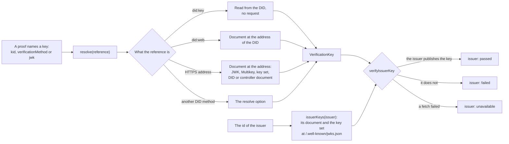

# Keys and the issuer binding

A signature proves nothing about an issuer until its key is bound to the issuer. `@interopkit/achievement-credentials/keys`
resolves the key that a proof names, reads the keys that an issuer publishes, and checks that the first is among the second.



| Export              | Does                                                                                                            |
| ------------------- | --------------------------------------------------------------------------------------------------------------- |
| `createKeyResolver` | Makes a `KeyResolver` over the host's `fetch`, with a cache of documents                                        |
| `verifyIssuerKey`   | Returns the `issuer` check for a key and an issuer: `passed`, `failed` with the reason, or `unavailable`        |
| `KeyResolver`       | The port: `resolve(verificationMethod)` and `issuerKeys(issuer)`; a host with its own key store implements it   |
| `VerificationKey`   | A public key as a JWK, with its `id`, `controller`, `iss` and the relationships under which a document lists it |

`KeyResolver` and `VerificationKey` come from `@interopkit/achievement-credentials`; the functions come from
`@interopkit/achievement-credentials/keys`.

## Quick start

```ts
import { createKeyResolver, verifyIssuerKey } from "@interopkit/achievement-credentials/keys";

const pair = await crypto.subtle.generateKey({ name: "ECDSA", namedCurve: "P-256" }, true, ["sign", "verify"]);
const publicKeyJwk = await crypto.subtle.exportKey("jwk", pair.publicKey);
const issuer = "https://example.edu/issuers/1";
const document = {
  id: issuer,
  verificationMethod: [{ id: `${issuer}#key-1`, type: "JsonWebKey", controller: issuer, publicKeyJwk }],
  assertionMethod: [`${issuer}#key-1`],
};
const keys = createKeyResolver({
  clock: { now: () => 0 },
  fetch: async (url) =>
    new Response(url === issuer ? JSON.stringify(document) : "", { status: url === issuer ? 200 : 404 }),
});

const key = await keys.resolve(`${issuer}#key-1`);
if (key === undefined) throw new Error("The key is published.");
key.controller; // => "https://example.edu/issuers/1"
key.relationships; // => ["assertionMethod"]
const binding = await verifyIssuerKey(key, issuer, { keys });
binding.outcome; // => "passed"
binding.detail; // => "The issuer https://example.edu/issuers/1 publishes the key https://example.edu/issuers/1#key-1 for signing credentials."

const other = await crypto.subtle.generateKey({ name: "ECDSA", namedCurve: "P-256" }, true, ["sign", "verify"]);
const forged = {
  id: "https://evil.example/keys/1",
  publicKeyJwk: await crypto.subtle.exportKey("jwk", other.publicKey),
  relationships: [],
};
(await verifyIssuerKey(forged, issuer, { keys })).outcome; // => "failed"
```

## What a reference resolves to

`resolve` takes the value of a `kid`, a `verificationMethod` or a DID URL, and returns the key or `undefined` when nothing names
one, no enabled method reads the reference, or the document does not hold it. A document is read as the first row that fits.

| The document                               | Its keys                                                                                                                                                   |
| ------------------------------------------ | ---------------------------------------------------------------------------------------------------------------------------------------------------------- |
| A JWK Set (`keys`)                         | Each public key, named `<address>#<kid>` or, without a `kid`, `<address>#<thumbprint>`, under `assertionMethod`, with its `iss`                            |
| A JWK                                      | The key, named by the address, under no relationship and with no controller                                                                                |
| A Multikey or a method with `publicKeyJwk` | The key, when the `id` of the document is its address                                                                                                      |
| A DID document or a controller document    | Each method of `verificationMethod` and each embedded in a relationship, with the relationships that list it; the `id` of the document must be its address |

A method gives its key as `publicKeyJwk` or as a `publicKeyMultibase` of Ed25519, P-256 or P-384. A reference with no fragment
names the only key that its document holds. `did:key` reads Ed25519, P-256 and P-384 keys from the DID. `did:web` derives the
address of the document from the DID, fetches it, and requires its `id` to be the DID. The libraries of the Interop Alliance
read both DID methods; every fetch goes through the host's `fetch`.

A key is refused, and its method is left out, when it holds a private member (`d`, `p`, `q`, `dp`, `dq`, `qi`, `oth`, `k`), is for
encryption (`use` other than `sig`, `key_ops` without `verify`), is not RSA, EC on P-256, P-384 or P-521, or Ed25519, or is an RSA
key of more than 8,192 bits.

## What an issuer publishes

`issuerKeys(issuer)` returns the keys that an issuer lists for signing credentials (Implementation Guide 3.1.12):

| The `id` of the issuer     | It publishes                                                                                                                                     |
| -------------------------- | ------------------------------------------------------------------------------------------------------------------------------------------------ |
| An HTTPS address           | The keys of the document at that address, and the members of the JWK Set at `https://<host>/.well-known/jwks.json`                               |
| A `did:key` or a `did:web` | The keys of its DID document                                                                                                                     |
| A `did:jwk`                | The key that the DID holds, read from the DID with no request; a DID that is not the canonical base64url of the key, without padding, holds none |
| Another DID method, a URN  | Nothing that this resolver reads: a host implements `KeyResolver` itself for such an issuer, or accepts unbound keys                             |

## The binding

`verifyIssuerKey(key, issuer, { keys })` passes when the issuer publishes a key with the same RFC 7638 thumbprint under
`assertionMethod`. A member of the JWK Set counts as listed under `assertionMethod`.

| Rule                                                                                 | Otherwise                                                                                                                                                 |
| ------------------------------------------------------------------------------------ | --------------------------------------------------------------------------------------------------------------------------------------------------------- |
| The key's `controller`, when it has one, is the issuer                               | `failed`: the key is controlled by another entity                                                                                                         |
| The key's `iss`, when it has one, is the issuer                                      | `failed`: it names another issuer                                                                                                                         |
| A published key counts only when it is listed under `assertionMethod`                | `failed`                                                                                                                                                  |
| A published key with an `iss` counts only when the `iss` is the issuer               | The key is skipped, which keeps the issuers of a shared platform apart                                                                                    |
| What the issuer publishes cannot be read: a `ServiceError`                           | `unavailable`                                                                                                                                             |
| The JWK Set at `/.well-known/jwks.json` answers a redirect or a status of 400 to 499 | The host publishes no JWK Set there: a site without the file redirects or refuses as often as it answers 404. A status of 500 or more is a `ServiceError` |

A key with a `controller` that is the issuer is not enough: any document may claim a controller, so the key must also be
among what the issuer itself publishes. A key set member with no `iss` binds for every issuer of its host; a platform that
hosts several issuers writes the `iss` of each key.

## Options of `createKeyResolver`

| Option       | Meaning                                                                                              | Default          |
| ------------ | ---------------------------------------------------------------------------------------------------- | ---------------- |
| `clock`      | The `Clock` that cached documents expire by                                                          | `SYSTEM_CLOCK`   |
| `fetch`      | The `Fetch` that gets documents; without it an HTTPS address and a `did:web` do not resolve          | None             |
| `methods`    | The DID methods read by the resolver                                                                 | `["key", "web"]` |
| `resolve`    | Resolves a verification method of a DID method that is not in `methods`                              | None             |
| `ttlSeconds` | How long a document stays in the cache                                                               | `3600`           |
| `timeoutMs`  | The time a fetch may take                                                                            | `10000`          |
| `maxTokens`  | The most tokens of JSON in a document, counted before it is parsed; a document over it holds nothing | `1000000`        |
| `maxBytes`   | The most bytes of a document                                                                         | `65536`          |

Every call takes the `signal` of `CallOptions`, which ends that caller's wait. A fetch is shared work: callers that ask for a
document while it loads share one fetch, which runs to its own timeout.

## Limits

| Limit                                                          | Value                  | Refused with                   |
| -------------------------------------------------------------- | ---------------------- | ------------------------------ |
| Bytes of a document                                            | `maxBytes`, 65,536     | `ServiceError`                 |
| Levels that a document nests                                   | 16                     | The document holds nothing     |
| Tokens of JSON in a document                                   | `maxTokens`, 1,000,000 | The document holds nothing     |
| Keys that a document lists                                     | 100                    | The document publishes nothing |
| Bits of an RSA modulus                                         | 8,192                  | The key is left out            |
| Characters of a `did:jwk`                                      | 4,096                  | The issuer publishes nothing   |
| Documents in the cache                                         | 1,000, the oldest out  | A fetch                        |
| Time between two fetches of a document for a key that it lacks | 60 s                   | The cached answer              |

Documents are fetched over HTTPS only, from an address with no user, without redirects. The `fetch` of a host whose addresses
come from a counterparty must refuse loopback, private and link-local addresses, checked on the address that the connection
resolves to: the resolver does not check where a request goes.

## Errors

| Case                                                                                                                                      | Result                                                                                                                                   |
| ----------------------------------------------------------------------------------------------------------------------------------------- | ---------------------------------------------------------------------------------------------------------------------------------------- |
| An option has the wrong type or is not one that `createKeyResolver` takes; a reference, an issuer or a key that is not what its type says | `DataError` that names it, such as `The options of createKeyResolver is invalid at ttlSeconds: expected a value of at least 1, found 0.` |
| A fetch fails, is answered with a redirect or another status than 2xx, 404 or 410, or is too large                                        | `ServiceError` with `status`; `verifyIssuerKey` turns it into `unavailable`, `resolve` lets it pass                                      |
| A document answers 404 or 410, is not a JSON object or holds no key                                                                       | No key: `resolve` returns `undefined`, `issuerKeys` returns what the other document holds                                                |
| The signal aborts                                                                                                                         | The `reason` of the signal; a load that others wait for goes on                                                                          |

`resolve` fetches a cached document again when it lacks the key, at most once a minute, so that a rotation is followed and
an invented `kid` cannot make the resolver fetch on every call. `issuerKeys` serves a cached document for `ttlSeconds`.

## Not included

| Not included                                                  | Why                                                                                           |
| ------------------------------------------------------------- | --------------------------------------------------------------------------------------------- |
| DID methods other than `key`, `web` and (for an issuer) `jwk` | Open Badges requires HTTP addresses and allows DID URLs; other methods come through `resolve` |
| `Ed25519VerificationKey2018` (`publicKeyBase58`)              | Superseded by Multikey; such a method is left out                                             |
| X.509 chains (`x5c`, `x5u`) and `jku`                         | Open Badges names `kid` and `jwk`; a header that names another source of keys is not followed |
| Revocation and rotation of keys                               | A key that an issuer stops publishing stops binding when the cache expires                    |
| Where a request goes                                          | The host's `fetch` refuses private addresses                                                  |

## Differences from the references

| Case                                      | The references                                                                                                 | This package                                                                                 |
| ----------------------------------------- | -------------------------------------------------------------------------------------------------------------- | -------------------------------------------------------------------------------------------- |
| A self-describing method `issuer#z6Mk...` | 1EdTech's validator reads the key from the fragment and the controller from the prefix, which anyone can write | The method counts only when the document at `issuer.id` lists the key                        |
| How an issuer publishes keys              | Open Badges 8.2.3 makes `kid` any URI to a JWK, and the Profile has no key field                               | The rules of Implementation Guide 3.1.12: a controller document, a DID document or a key set |
| `jwt` for `jwk`                           | Guide 3.1.12.2 writes `jwt` where the JOSE header is `jwk`                                                     | `jwk`                                                                                        |
