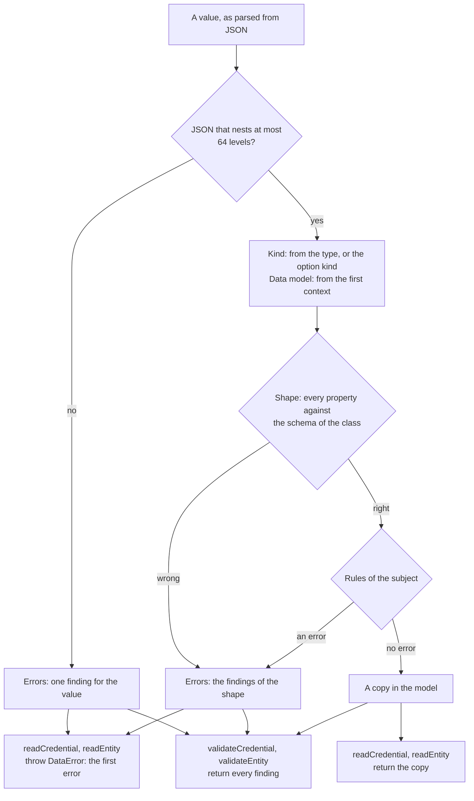

# The Open Badges and CLR model and its readers

`@interopkit/achievement-credentials` holds the model of an Open Badges 3.0 achievement credential, of a CLR 2.0 and of the
objects around them: profiles, achievements, the answers of the APIs, keys. Its readers take JSON that was parsed from anywhere,
check every property against the JSON schemas of 1EdTech and the rules of the specifications, and return a copy that shares
nothing with the input. Its validators judge the same value and return every finding as data. A credential may be under the
Verifiable Credentials Data Model 2.0 or 1.1; both are read into their own classes, and the first context says which.



| Module    | Holds                                                                                                                                    |
| --------- | ---------------------------------------------------------------------------------------------------------------------------------------- |
| `model`   | The types of the classes, the vocabularies as tuples with their types, `CONTEXTS`, `CREDENTIAL_KINDS`, `ENTITY_KINDS`, `CredentialIssue` |
| `read`    | `readCredential`, `readEntity`, `validateCredential`, `validateEntity`, `ReadOptions`                                                    |
| `issue`   | The builders, the identity hash and the CASE alignment: see [Building credentials and comparing them](issue.md)                          |
| `compare` | `isSameCredential`, `selectNewerCredential`, `summarizeCredential`: see the same guide                                                             |

All of them come from `@interopkit/achievement-credentials`. The package depends on `@interopkit/core` for the errors, the
formats, the copy of JSON and the findings, and on `valibot` for the schemas. Its test suite reads the schemas of 1EdTech with
`@cfworker/json-schema`, derives its generators from them, and compares every verdict.

## Quick start

```ts
import { readCredential, validateCredential } from "@interopkit/achievement-credentials";

const credential = {
  "@context": ["https://www.w3.org/ns/credentials/v2", "https://purl.imsglobal.org/spec/ob/v3p0/context-3.0.3.json"],
  id: "https://example.edu/credentials/3732",
  type: ["VerifiableCredential", "OpenBadgeCredential"],
  issuer: "https://example.edu/issuers/565049",
  validFrom: "2024-06-13T18:46:03Z",
  credentialSubject: {
    type: "AchievementSubject",
    achievement: {
      id: "https://example.edu/achievements/1",
      type: "Achievement",
      name: "Introduction to Fractions",
      description: "Understands fractions as numbers.",
      criteria: { narrative: "Pass the final assessment." },
    },
  },
};
// The schemas accept it; the specification asks that something says who earned it.
validateCredential(credential).map((finding) => `${finding.severity} ${finding.rule} at ${finding.path}`); // => ["error subject-unidentified at credentialSubject"]

const named = { ...credential, credentialSubject: { ...credential.credentialSubject, id: "did:example:learner" } };
const read = readCredential(named, { kind: "AchievementCredential" });
read.type; // => ["VerifiableCredential", "OpenBadgeCredential"]
"issuanceDate" in read; // => false

// A first context of the Verifiable Credentials Data Model 1.1 reads the credential as the 1.1 class.
const old = { ...named, "@context": ["https://www.w3.org/2018/credentials/v1", "https://purl.imsglobal.org/spec/ob/v3p0/context-3.0.3.json"] };
validateCredential(old).map((finding) => `${finding.path} ${finding.rule}`); // => ["name missing-property", "issuer wrong-type", "issuanceDate missing-property"]
```

## The classes

| Group                   | Classes                                                                                                                                                                                                                       |
| ----------------------- | ----------------------------------------------------------------------------------------------------------------------------------------------------------------------------------------------------------------------------- |
| Credentials             | `AchievementCredential`, `EndorsementCredential`, `ClrCredential`, `VerifiableCredential`, the type `IssuableCredential` that holds them                                                                                      |
| Credentials, VC 1.1     | `AchievementCredentialV1p1`, `EndorsementCredentialV1p1`, `ClrCredentialV1p1`, `VerifiableCredentialV1p1`, the type `CredentialV1p1` that holds them; `AnyVerifiableCredential` holds both groups                            |
| Open Badges 2.0         | `BadgeAssertionV2`, `AssertionV2`, `BadgeClassV2`, `ProfileV2` and the other classes of 2.0, read and never written: see [Reading Open Badges 2.0](open-badges-2.md); `AnyCredential` holds the three groups                  |
| Subjects and claims     | `AchievementSubject`, `EndorsementSubject`, `ClrSubject`, `CredentialSubject`, `Achievement`, `Result`, `ResultDescription`, `RubricCriterionLevel`, `Association`, `Alignment`, `Criteria`, `Evidence`, `Related`            |
| People and things       | `Profile`, `ProfileRef`, `Address`, `GeoCoordinates`, `IdentityObject`, `IdentifierEntry`, `Image`                                                                                                                            |
| Parts of a credential   | `CredentialSchema`, `CredentialStatus`, `Proof`, `RefreshService`, `TermsOfUse`                                                                                                                                               |
| API models              | `GetOpenBadgeCredentialsResponse`, `GetClrCredentialsResponse`, `ImsxStatusInfo`, `ServiceDescriptionDocument` and its OpenAPI parts                                                                                         |
| Keys and the CLR in JWT | `Multikey`, `JWK`, `JWKS`, `ClrCredentialJwtPayload`, `ClrSubjectJwtPayload`                                                                                                                                                  |

A class under Verifiable Credentials 1.1 differs from its 2.0 form where the specification says: `issuanceDate` and
`expirationDate` for `validFrom` and `validUntil`, a first context of `https://www.w3.org/2018/credentials/v1`, an issuer that is
a profile and not the address of one, and a subject that refuses properties it does not list.

The type of a text, an address, a name or a date is `string`. Dates and times are RFC 3339 with an offset, as `DateTimeZ`
asks, and a date is `YYYY-MM-DD`. A vocabulary is a `const` tuple with its type, and an extensible one accepts an `ext:` term
as well. A class that the specification leaves open keeps the properties it does not list, as JSON, and a closed class
refuses them.

## Reading and validating

`readCredential(value, options)` reads a credential and `readEntity(kind, value, options)` reads another object of a class. Both return a
copy in the model, and throw a `DataError` when the value has an error. `validateCredential(value, options)` and
`validateEntity(kind, value, options)` judge the same value and return the findings as data, at most `maxFindings` of them. The validators take what the readers take:
parsed text, or a value that is already in the model.

| Option | Meaning                                                                                                                                                                                                                      | Default             |
| ------ | ---------------------------------------------------------------------------------------------------------------------------------------------------------------------------------------------------------------------------- | ------------------- |
| `kind` | The kind of credential that the value must be, one of `CREDENTIAL_KINDS`. The default reads an Open Badges 2.0 assertion as one ([Reading Open Badges 2.0](open-badges-2.md)), and any other value as the kind that its `type` names: `ClrCredential`, then `EndorsementCredential`, then `AchievementCredential` or `OpenBadgeCredential` (`readCredential` and `validateCredential` only). With a `kind`, `readCredential` returns an `AnyVerifiableCredential` | 2.0, or the kind of `type`  |
| `maxFindings` | The most findings that a validator lists, or that a reader counts errors up to. The check stops at the first one beyond the limit and ends the list with a finding of the rule `findings-stopped`, so that a value that is wrong in a million places costs the memory of the limit. A reader counts errors and not warnings | 1,000 |

| Function                                | Result                                                                                                                    |
| --------------------------------------- | ------------------------------------------------------------------------------------------------------------------------- |
| `readCredential`, `readEntity`          | The copy, when the value has no error. A warning is not reported. Otherwise a `DataError`: see Errors                     |
| `validateCredential`, `validateEntity`  | A list of `CredentialIssue`, the errors and the warnings, in the order of the value. An empty list means that it is sound |

The result is the data model and not the text that was read. A list that the compacted form of JSON-LD writes as its only member
(`type`, `evidence`, `proof`, `credentialSchema`, `termsOfUse`, `alignment`, `identifier`, `result` and the other lists) is a list
in the result, so a credential that is read and written again has the same meaning and may differ in bytes. Read the original text
to check a signature.

A finding is a `CredentialIssue`: its `path` as code writes it (`credentialSubject.achievement.name`; the empty string is the
value as a whole), its `rule`, a `message` that is a sentence that reads after the path and does not repeat it, and its
`severity`. An error means that the data breaks the specification or cannot be used without a guess. A warning means that it is
usable and departs from what the specification asks for.

| Rule                   | Severity | When                                                                                                                                  |
| ---------------------- | -------- | ------------------------------------------------------------------------------------------------------------------------------------- |
| `missing-property`     | error    | A property that the class requires is absent                                                                                          |
| `unknown-property`     | error    | A closed class has a property that it does not list. One is reported for each object                                                  |
| `wrong-type`           | error    | A value is not of the JSON type of the property: a string, a number, a boolean, an array or an object                                 |
| `invalid-format`       | error    | A string is not a date, a date and time, a compact JWS, a language tag or an address of a context, in the form the schema gives      |
| `invalid-value`        | error    | A value is not in its vocabulary, a `type` lacks the class, a value is not JSON or nests too deep                                     |
| `too-few-entries`      | error    | A list that needs a member has none                                                                                                   |
| `subject-unidentified` | error    | An `AchievementSubject` or a `ClrSubject` has neither an `id` nor an `identifier` (OB B.1.3, CLR B.1.2)                               |
| `subject-empty`        | error    | The `credentialSubject` of a credential of no class of Open Badges or CLR has no property, so it is the subject of no claim (Verifiable Credentials Data Model 2.0, 4.8) |
| `validity-period`      | error    | `validUntil` is earlier than `validFrom`, or `expirationDate` than `issuanceDate`, compared as instants (Verifiable Credentials Data Model 2.0, 4.9) |
| `related-resource-form` | error   | `relatedResource` is empty, or a member is not an object (Verifiable Credentials Data Model 2.0, 5.3)                                 |
| `related-resource-id`  | error    | A related resource has no `id` that is an absolute URI (Data Model 2.0, 5.3)                                                          |
| `related-resource-duplicate` | error | Two related resources have the same `id` (Data Model 2.0, 5.3)                                                                   |
| `related-resource-digest` | error | A related resource has neither a `digestSRI` nor a `digestMultibase` (Data Model 2.0, 5.3)                                              |
| `identity-hash-form`   | warning  | An `IdentityObject` that says it is hashed holds no `sha256$` and 64 hexadecimal digits, and no `md5$` and 32 (OB B.7, `IdentityHash`) |
| `result-description-unknown` | warning | A `Result` names a `resultDescription` that is the `id` of no `ResultDescription` of the achievement (OB B.1.16)                 |
| `achieved-level-unknown` | warning | The `achievedLevel` of a `Result` is the `id` of no `RubricCriterionLevel` of the `ResultDescription` that it names (OB B.1.16)        |
| `result-status-missing` | warning | A `Result` of a `ResultDescription` of the `resultType` `Status` has no `status`, which OB B.1.16 requires                               |
| `criteria-undescribed` | warning  | The `criteria` of an achievement have neither an `id` nor a `narrative`, so nothing says how to earn it                                 |

The rules of the subject, the results, the criteria, the period and the related resources look at the credential as a whole, so
they run only when its shape is right. The rules of the results and of the criteria are warnings: the schemas do not check them,
and the verifiers in use report them and verify the credential. The related resources of a credential under the Data Model 1.1 are
an extension, and are not judged.

## Limits

| Limit                                  | Value | Refused with                    |
| -------------------------------------- | ----- | ------------------------------- |
| Levels that a value nests              | 64    | `invalid-value`, at the value   |

The size of what is read is the caller's: the readers take a value that was already parsed, so the caller limits the bytes of
the text that it parses. The depth limit keeps a hostile chain of `parentOrg` or `endorsement` from exhausting the stack.

## Errors

| Case                                                                                  | Result                                                                                                                                                                                  |
| ------------------------------------------------------------------------------------- | --------------------------------------------------------------------------------------------------------------------------------------------------------------------------------------- |
| `readCredential` or `readEntity` is given a value that has an error                   | `DataError`: `The credential is invalid at id: expected a string, found 5. 1 more error: validateCredential lists every finding.` Fix the data, or ask for the kind it is with `options.kind` |
| `options` is not an object, has a property other than `kind`, or `kind` is not listed | `DataError`: `The read options is invalid at kind: expected "AchievementCredential", "EndorsementCredential", "ClrCredential" or "VerifiableCredential", found "Badge".`                 |
| The kind of `readEntity` or `validateEntity` is not one of `ENTITY_KINDS`             | `DataError` that lists the kinds                                                                                                                                                        |
| `validateCredential` or `validateEntity` is given a value that is not an object       | The findings. It does not throw                                                                                                                                                         |

## Not included

| Not included                                                       | Why                                                                                                    |
| ------------------------------------------------------------------ | ------------------------------------------------------------------------------------------------------ |
| Checking a proof, a status, a key or an issuer                     | Verification belongs to the units that follow; the readers check the shape and the rules of the subject |
| JSON-LD processing                                                 | The readers read the compacted form as JSON, as the specification allows                               |
| A text as a map of languages, or a context as a single value       | See the differences below                                                                              |
| Reading a value that is wrong, to recover what is right in it      | A value with an error is not returned; `validateCredential` says where to look                         |

## Differences from the references

The reference is the set of JSON schemas that 1EdTech publishes, which the tests read at pinned hashes and compare with the
readers for every class, on generated values and on values with one change, and the schemas that the specification pages print
for the classes that have no file. The readers give the verdict of the schemas, except in the cases below, each of which a test
pins.

| Case                                                | The JSON schemas, as a validator reads them                                                                                          | The readers                                                                                          |
| --------------------------------------------------- | ------------------------------------------------------------------------------------------------------------------------------------ | ---------------------------------------------------------------------------------------------------- |
| A text that is a map of languages                   | Any text may be `{"en": "..."}`                                                                                                      | Refused: the contexts give no language container, so a processor could not read it                   |
| A `type` that is one string                         | Any string is valid, whatever the class                                                                                              | The one string is a list of one, and it must hold the class: it is valid only for a class that needs one |
| A `@context` that is one context                    | Valid: one string or one object                                                                                                      | Refused: the list must start with the contexts that the class requires                                |
| A term of `ext:`                                    | `pattern` without anchors, and a class of characters that holds `\|` and no hyphen: it accepts `ext:a\|b` and refuses `ext:-a`       | Anchored, with letters, digits, `.`, `-` and `_`                                                      |
| A date and time with a space, or an offset without a colon | The validator accepts `2024-06-13 18:46:03Z` and `+0000`                                                                      | Refused: RFC 3339 has `T` and an offset of `hh:mm`                                                    |
| A subject with no `id` and no `identifier`          | Valid: only `type` and `achievement` are required                                                                                    | An error, `subject-unidentified`: the specification says that one of them MUST be supplied          |
| A subject with no property, in a credential of no class of Open Badges or CLR | Valid: `id` is optional | An error, `subject-empty`: the data model says that a subject is the subject of one or more claims |
| A validity period that ends before it begins        | Valid: both are dates and times                                                                                                      | An error, `validity-period`: the data model says that `validFrom` MUST NOT be later than `validUntil` |
| `relatedResource` of any form                       | Valid: the schemas do not name it                                                                                                    | Errors of the form that the data model gives it; the digests are not compared, since the package fetches no resource that it names |
| A result linked to another description, or criteria with neither `id` nor `narrative` | Valid                                                                               | Warnings. The validator of 1EdTech refuses criteria with neither, and Open Badges 3.0 leaves both optional |
| Several properties that a closed class does not have | A validator reports every one                                                                                                        | One is reported for each object; the verdict is the same                                              |
| A member named `__proto__`, `constructor` or `prototype` of an open class | Valid                                                                                                           | Not carried: it would change the prototype. Inside a property that no class lists it stays data     |
