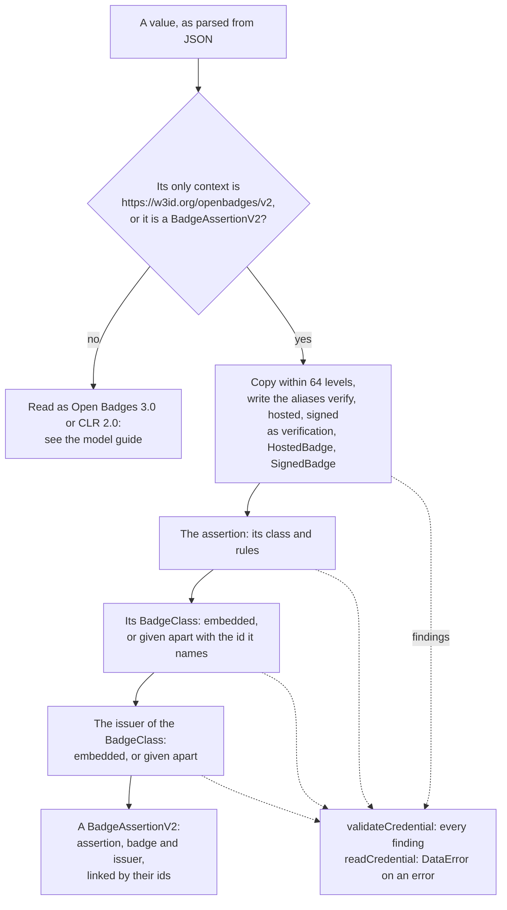

# Reading Open Badges 2.0

`@interopkit/achievement-credentials` reads Open Badges 2.0 assertions, the badges that issuers awarded before Open Badges 3.0
and that wallets and backpacks still hold. A 2.0 badge is three documents of JSON-LD under the context
`https://w3id.org/openbadges/v2`: the assertion, its BadgeClass and the Profile of its issuer, each embedded in the document that
names it or hosted at its own address. `readCredential` reads them into a `BadgeAssertionV2`, `validateCredential` lists what is
wrong with them, `credentialSummary` shows one, and `matchesIdentifier` tells whether its recipient is a known person. A 2.0
badge is read and never written.



| Function                | Takes                                                                                                         | Gives                                                  |
| ----------------------- | ------------------------------------------------------------------------------------------------------------- | ------------------------------------------------------ |
| `readCredential`        | An assertion that embeds its BadgeClass, which embeds its issuer; or a `BadgeAssertionV2`, as parsed JSON       | A `BadgeAssertionV2`, or a `DataError` on an error     |
| `validateCredential`    | The same                                                                                                      | Every finding, errors and warnings, as data            |
| `credentialSummary`     | A `BadgeAssertionV2`                                                                                          | The name, description, image, issuer and dates to show |
| `matchesIdentifier`     | The `recipient` of an assertion and an identity that the caller knows                                         | Whether they are the same person                       |

## Quick start

```ts
import { credentialSummary, matchesIdentifier, readCredential, validateCredential } from "@interopkit/achievement-credentials";

const assertion = {
  "@context": "https://w3id.org/openbadges/v2",
  id: "https://example.org/assertions/123",
  type: "Assertion",
  recipient: {
    type: "email",
    hashed: true,
    salt: "deadsea",
    identity: "sha256$c934fdacc6242be0277a284970416aa9bfa583241fb85094bc96c504ee0abd4e",
  },
  issuedOn: "2016-12-31T23:59:59+00:00",
  verify: { type: "hosted" },
  badge: {
    type: "BadgeClass",
    id: "https://example.org/badges/5",
    name: "3-D Printmaster",
    description: "Awarded for passing the 3-D printing knowledge and safety test.",
    image: "https://example.org/badges/5/image",
    criteria: { narrative: "Pass a paper test and a supervised evaluation." },
    issuer: {
      id: "https://example.org/issuer",
      type: "Profile",
      name: "Example Maker Society",
      url: "https://example.org",
      email: "contact@example.org",
    },
  },
};
const badge = readCredential(assertion);
"assertion" in badge && badge.assertion.verification; // => { type: ["HostedBadge"] }
"assertion" in badge && badge.assertion.badge; // => "https://example.org/badges/5"
"assertion" in badge && matchesIdentifier(badge.assertion.recipient, { type: "email", value: "alice@example.org" }); // => true
credentialSummary(badge).issuerName; // => "Example Maker Society"

// A hosted assertion usually names its BadgeClass by its address, which reading does not follow.
validateCredential({ ...assertion, badge: "https://example.org/badges/5" }).map((finding) => `${finding.rule} at ${finding.path}`); // => ["not-embedded at badge"]
```

`readCredential` returns an `AnyCredential`; a 2.0 badge is the one that has `assertion`, `badge` and `issuer` and no `@context`.
Pass the option `kind` to read only credentials of Open Badges 3.0 and CLR 2.0, which returns an `AnyVerifiableCredential`.

## What is read

| Value                                                                 | Read as                                                                                                                                       |
| --------------------------------------------------------------------- | --------------------------------------------------------------------------------------------------------------------------------------------- |
| An object whose `@context` is the string `https://w3id.org/openbadges/v2` | An assertion, whose `badge` must be an embedded BadgeClass, whose `issuer` must be an embedded Profile                                     |
| An object with `version: "2.0"`, `assertion`, `badge` and `issuer`, and no `@context` | A `BadgeAssertionV2`: the three documents, each with the context of Open Badges 2.0 or none, the assertion naming the BadgeClass and the BadgeClass naming the issuer by their `id` |
| Any other value                                                       | A credential of Open Badges 3.0 or CLR 2.0                                                                                                    |
| Any value, with the option `kind`                                     | A credential of Open Badges 3.0 or CLR 2.0 of that kind                                                                                       |

The documents are the compacted form of JSON-LD under the context of Open Badges 2.0, and the reader needs no JSON-LD processor:
it knows the terms, prefixes and aliases of that context from a fixed table, which a test compares with the context at its pinned
hash. A document embedded in another may name the same context. An extension, an object that names a context of its own, is kept
as it is.

| Alias of the context | Read as                       |
| -------------------- | ----------------------------- |
| `verify`             | The property `verification`   |
| `hosted`             | The class `HostedBadge`       |
| `signed`             | The class `SignedBadge`       |

The result holds the model and not the text: a `type` and every property that may have several values are lists, and the
aliases are their terms. A document that names its context keeps it in `@context`. The assertion's `badge` is the `id` of the
BadgeClass, and the BadgeClass's `issuer` is the `id` of the profile, so a `BadgeAssertionV2` is read again as itself.

## The classes

| Class                   | Required                                                       | Notes                                                                                                         |
| ----------------------- | -------------------------------------------------------------- | ------------------------------------------------------------------------------------------------------------- |
| `AssertionV2`           | `id`, `type` with `Assertion`, `recipient`, `badge`, `verification`, `issuedOn` | `image` is a URL or an image whose `id` is a URL, never a data URI; `uid` is read for badges before 1.1 |
| `BadgeClassV2`          | `id`, `type` with `BadgeClass`, `name`, `description`, `image`, `criteria`, `issuer` | `image` is a URL or a data URI of a PNG or an SVG; `criteria` is a URL or a document               |
| `ProfileV2`             | `id`, `type` with `Issuer` or `Profile`, `name`, `url`, `email` | What an issuer must have; `publicKey` and `verification` say how its badges are verified                    |
| `IdentityObjectV2`      | `identity`, `type` of `IDENTITY_TYPES_V2`, `hashed`             | `id`, `email`, `url` or `telephone`                                                                          |
| `VerificationObjectV2`  | In an assertion or an endorsement, a `type` with one of `HostedBadge` and `SignedBadge` | In a profile, the scope of hosted assertions: `startsWith`, `allowedOrigins`, `verificationProperty` |
| `CryptographicKeyV2`, `RevocationListV2`, `RevokedAssertionV2` | `type` with `RevocationList` and `revokedAssertions` for a list | The documents of signed verification                                                 |
| `EvidenceV2`, `ImageV2`, `CriteriaV2`, `AlignmentObjectV2`, `EndorsementV2`, `EndorsementClaimV2`, `RelatedV2` | `targetName` and `targetUrl` of an alignment; `id` of an image; `id`, `type`, `claim`, `issuer`, `issuedOn` and `verification` of an endorsement | |

Every class keeps the properties it does not list, as JSON. `id` is an IRI: an HTTP or HTTPS URL, a `urn:uuid` or a blank node.
A date and time is ISO 8601 with a time zone, as Open Badges 2.0 describes it: `2016-12-31T23:59:59+00:00`, `2016-12-31T23:59Z` or
`2016-12-31T23:59:59.5-0500`. A value of `type` is a term of the context, a compact IRI of one of its prefixes, or an IRI.

## Findings

The findings are those of the model guide (`missing-property`, `wrong-type`, `invalid-format`, `invalid-value`) at the path of
the input, and these rules. `scripts/open-badges-v2-rules.ts` lists a document that breaks each sentence of the specification and
each class rule of the validator of 1EdTech, with what the reader finds, and a test runs it.

| Rule                  | Severity | When                                                                                                         |
| --------------------- | -------- | ------------------------------------------------------------------------------------------------------------ |
| `duplicate-term`      | error    | An object holds both `verify` and `verification`, which the context reads as one property with two values     |
| `not-embedded`        | error    | The assertion names its BadgeClass, or the BadgeClass its issuer, by an IRI, and the document is not there    |
| `unlinked-document`   | error    | In a `BadgeAssertionV2`, a document's `id` is not the IRI that names it, or a document is embedded and given apart as well |
| `identity-hash-form`  | error    | A recipient that says it is hashed holds no `sha256$` and 64 hexadecimal digits, and no `md5$` and 32         |
| `identity-hash-flag`  | error    | A recipient that says it is not hashed holds a hash                                                          |
| `identity-email-form` | error    | A plain recipient of the type `email` is not an email address                                                |
| `expiry-before-issue` | error    | `expires` is before `issuedOn`                                                                                |
| `criteria-undescribed` | error   | Embedded criteria have neither an `id` nor a `narrative`                                                      |
| `entry-unidentified`  | error    | An entry of a revocation list is an object with neither an `id` nor a `uid`                                   |
| `issuer-not-http`     | warning  | The `id` of the issuer is not an HTTP or HTTPS URL, so no origin bounds its hosted assertions                 |

## Options and limits

The options are those of `readCredential` and `validateCredential` in the model guide.

| Option        | Meaning                                                                                       | Default                                |
| ------------- | --------------------------------------------------------------------------------------------- | -------------------------------------- |
| `kind`        | Reads the value as a credential of Open Badges 3.0 or CLR 2.0 of this kind, and never as 2.0     | 2.0 when the value is, else from `type` |
| `maxFindings` | The most findings that a validator lists, or that a reader counts errors up to                 | 1,000                                  |

| Limit                                                     | Value     | Refused with                             |
| --------------------------------------------------------- | --------- | ---------------------------------------- |
| Levels that a document nests                              | 64        | `invalid-value`, at the document          |
| Findings                                                  | `maxFindings` | The last finding is `findings-stopped` |

The reader takes a value that was already parsed, so the caller limits the bytes of the text and counts its tokens with
`hasMoreTokensThan` of `@interopkit/core/checks` before it parses it. A list of a million wrong values is read in about 90 MiB, and
its findings stop at the limit.

## Errors

| Case                                                                     | Result                                                                                                                                            |
| ------------------------------------------------------------------------ | ------------------------------------------------------------------------------------------------------------------------------------------------- |
| `readCredential` is given an assertion with an error                     | `DataError`: `The credential is invalid at badge: is the IRI of the BadgeClass, which is not embedded: embed it, or verify the assertion, which fetches it.` |
| `credentialSummary` or `matchesIdentifier` is given a value that is not one | `DataError` that names the path of the first error                                                                                              |
| `validateCredential` is given any value                                   | The findings. It does not throw                                                                                                                  |

## Not included

| Not included                                                                 | Why                                                                                                                       |
| ---------------------------------------------------------------------------- | ------------------------------------------------------------------------------------------------------------------------- |
| Fetching a hosted assertion, its BadgeClass, its issuer, a key or a revocation list | Verification fetches them under the verification policy of the issuer; reading makes no request                    |
| Checking a signature, a revocation, an expiry against the clock, or the scope of a hosted assertion | Verification                                                                                     |
| Baked 2.0 badges                                                             | `readPng` and `readSvg` read 2.0 badges with verification                                                                 |
| Issuing, signing or baking a 2.0 badge                                       | Open Badges 3.0 supersedes 2.0; a 2.0 badge is read and verified only                                                     |
| A document under another context, or with more contexts than that of 2.0     | Their terms may differ from the table; reading them needs a JSON-LD processor, so they are read as Open Badges 3.0 and refused |
| The expanded form, and a property written as an IRI or a compact IRI of a term | The reader reads the compacted form; such a property is kept as one that no class lists                                 |
| The JSON schemas that an extension's context links                            | They need the network                                                                                                    |
| Open Badges 1.x and 0.5                                                      | Retired before 2.0                                                                                                        |

## Differences from the references

The references are the vocabulary of Open Badges 2.0 and its examples, which the tests read at pinned hashes, and the class
validators of `openbadges-validator-core`, whose rules the table of `scripts/open-badges-v2-rules.ts` follows. The reader gives
their verdict, except in the cases below.

| Case                                                                | The references                                                                                         | The reader                                                                          |
| ------------------------------------------------------------------- | ------------------------------------------------------------------------------------------------------ | ----------------------------------------------------------------------------------- |
| The first example of the specification                              | Its recipient has no `hashed`, which the IdentityObject table requires                                  | `missing-property` at `recipient.hashed`                                             |
| A revoked assertion or endorsement that holds only its `id`, `revoked` and `issuer` | The specification lets a revoked document leave out the other properties                    | Refused as a document without them: verification reads `revoked` before the rest    |
| A property of one value written as a list of one                     | A JSON-LD processor reads the list as the value                                                         | `wrong-type`                                                                        |
| A BadgeClass or a profile embedded without an `id`                   | The validator gives it a blank node and warns                                                          | `missing-property`: the class requires an `id`                                      |
| Several `publicKey` of a profile, or several `startsWith`            | The specification allows several; the validator takes one                                               | Several, as the specification says                                                  |
| An endorsement without `verification`                                | The specification requires it; the validator does not check it                                          | `missing-property`                                                                  |
| A verification object of an assertion with `HostedBadge` and `SignedBadge` | The validator takes one type                                                                       | `invalid-value`: one of them                                                        |
| `@language`                                                         | The validator looks the tag up in the registry of IANA                                                  | A tag that is well-formed by RFC 5646                                              |
| A date and time in the basic form of ISO 8601, such as `20161231T235959Z` | The validator reads it                                                                           | `invalid-format`: the form that the specification describes                         |
| The properties of an embedded related edition                        | The validator checks those it has against its class                                                     | Its `id`, `@language` and `version`; the others are kept as JSON                    |
| An image                                                            | The validator fetches it                                                                                | Its address and, for a data URI, its media type                                     |
