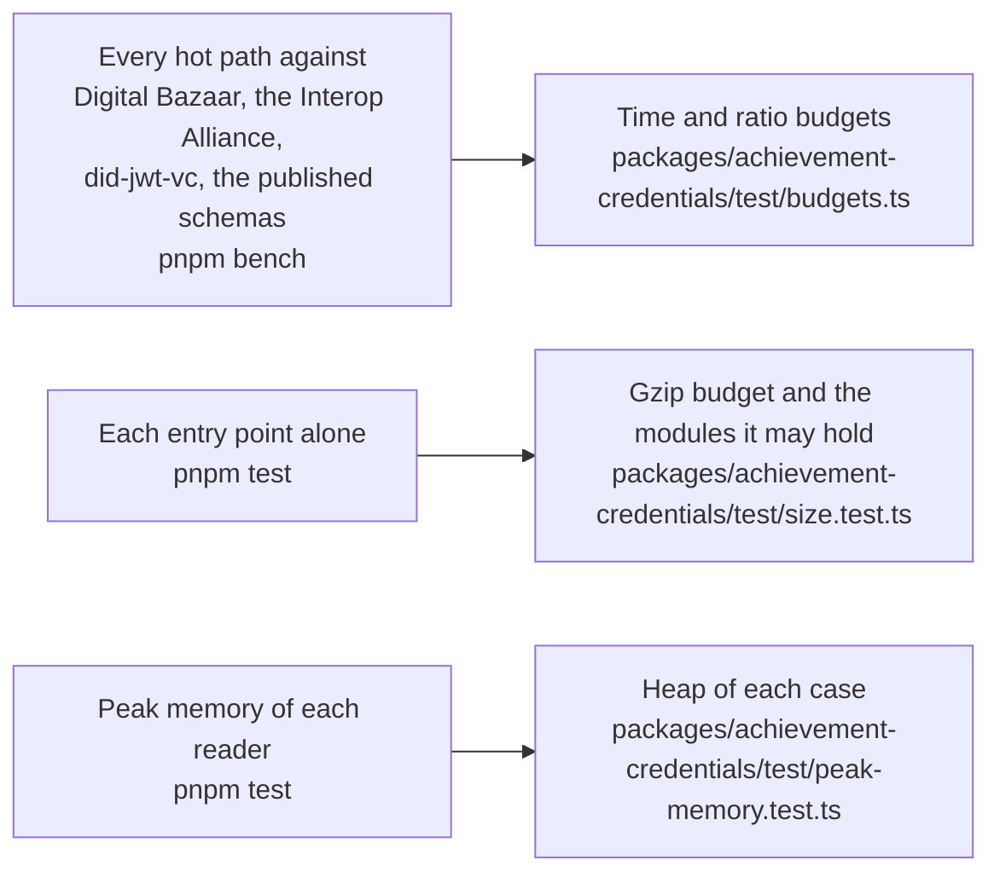

# Performance of achievement-credentials

What the benchmarks of `@interopkit/achievement-credentials` hold to a budget in CI (`pnpm bench`), how much each entry point adds to a bundle, and the heap that each reader of untrusted input needs on its worst input (`pnpm test`). The docs publish no measured time: it differs on every machine. That the package does what it says is in [evidence](evidence.md).

## Speed

`pnpm bench` times the build that ships against a reference in the same run: the comparator that does the same work where one
is installable ([comparators](comparators.md)), and otherwise the least work of the same kind. `scripts/bench-rounds.ts` runs the
function and its reference in three rounds, the reference first in the first and the last, so that the load of a shared machine
falls on both, and the gate is the ratio of the fastest samples. A budget is twice the highest ratio measured in 12 runs of the `bench` job on the runner of CI, rounded up to one significant digit, and holds on any machine, with no exception for a validator that does the same work.

| Benchmark                                                      | Reference                                                             |
| -------------------------------------------------------------- | --------------------------------------------------------------------- |
| `verifyCredential` of a JWS                                    | `did-jwt-vc`, which checks the signature and the claims               |
| `verifyCredential` of a CLR in a JWS that holds 10 JWS         | `did-jwt-vc` of the 11 JWTs                                           |
| `verifyCredential` with an `eddsa-rdfc-2022` proof             | `@digitalbazaar/vc`, which checks the structure and the proof         |
| the same                                                       | `@interop/verifier-core`, which also checks the status and the expiry |
| `addProof` with `eddsa-rdfc-2022`                              | `vc.issue` of `@digitalbazaar/vc` with its suite                      |
| `verifyProof` of `eddsa-rdfc-2022`                             | `vc.verifyCredential` of `@digitalbazaar/vc`                          |
| `verifyProof` of `ecdsa-rdfc-2019`                             | `@interop/verifier-core`                                              |
| `verifyProof` of `Ed25519Signature2020`, `legacyProofs`        | `@interop/verifier-core`                                              |
| `verifyProof` of an `ecdsa-sd-2023` disclosure                 | `@digitalbazaar/vc` with Digital Bazaar's `ecdsa-sd-2023` suite       |
| `readCredentialJwt`                                            | `verifyCredential` of `did-jwt-vc`                                    |
| `signCredentialJwt` with EdDSA                                 | `createVerifiableCredentialJwt` of `did-jwt-vc`                       |
| `issueStatusListCredential` of 131,072 entries, Data Integrity | `@interop/vc-bitstring-status-list` and `jsigs.sign`                  |
| `verifyCredentialStatus` against that list, fetched each time  | `checkStatus` of `@interop/vc-bitstring-status-list`                  |
| `readCredential` of a CLR of 20 credentials                    | the published schema of CLR 2.0 in `@cfworker/json-schema`            |
| `validateCredential` of the same CLR                           | the same                                                              |
| `bakePng` of that CLR into an image of 256 KiB                 | `JSON.stringify` of the CLR                                           |
| `readPng` of that image                                        | `JSON.parse` of the CLR                                               |
| `bakeSvg` of that CLR into an SVG of 140,000 characters        | saxes over the SVG                                                    |
| `readSvg` of that SVG, which stops at the credential           | saxes over all of it                                                  |
| `handleCredentialsRequest`, a page of 100 credentials          | `JSON.stringify` of the page                                          |
| `handleCredentialsRequest`, the upsert of that CLR             | `JSON.parse` of its body                                              |
| `handleRefreshRequest` of that CLR                             | `JSON.stringify` of it                                                |

The keyed cache that the key resolver and the status lists share is `createKeyedCache` of `core`, timed with the other hot paths of
`core` ([signals](../core/signals.md)). The profiles named three hot paths that are written as they are for their speed; each
alternative was timed as a build of its own, alternated with the package, three runs of each, with identical outputs on every case
of the fixtures, on the vectors of the W3C and on millions of generated texts:

| Hot path                              | Written so                      | The alternative takes                                                                                                                   |
| ------------------------------------- | ------------------------------- | --------------------------------------------------------------------------------------------------------------------------------------- |
| The CRC-32 of a PNG chunk             | By the table of PNG 1.2 annex D | Eight steps for each byte: `readPng` of the CLR takes about twice as long                                                               |
| The base64url of a JWS that is signed | By a table in `core`            | A string of the bytes as arguments, and `btoa`: `signCredentialJwt` of a CLR of 20, with its credentials, takes about 1.6 times as long |
| The parts of a JWS that is read       | Decoded in one reading          | Three copies of the text first: `readCredentialJwt` of the CLR takes about 7 percent longer                                             |

Where a ratio is above parity, the package does work that the reference does not; no budget is in time, since a ratio holds on
any machine.

| Path                                 | Work the reference does not do                                                                                                                                                                                               |
| ------------------------------------ | ---------------------------------------------------------------------------------------------------------------------------------------------------------------------------------------------------------------------------- |
| `verifyProof`, `addProof`            | The same libraries of the Interop Alliance, with a bound on canonicalization, the reading of the credential in the model and its limits; each context is copied for each load, so no caller can change what the loader keeps |
| `verifyCredentialStatus`             | Reads the list credential in the model, counts its tokens and binds its key to the issuer                                                                                                                                    |
| The upsert of the provider           | Reads the CLR in the model after `JSON.parse`                                                                                                                                                                                |
| The baking of a PNG, and its reading | Reads and copies the credential it bakes; checks the CRC of the chunk                                                                                                                                                        |

## Size

`size.test.ts` bundles each entry point alone with `scripts/entry-size.ts`: esbuild, minified, with every dependency inside and a
chunk of its own for what a dynamic `import()` loads, which loads only when the code that imports it runs. It fails above the
budget after gzip, 1.25 times the size measured rounded up to the next 500 bytes, or on a module that its budget does not list.

Gzip is measured on Node.js 22; other versions of Node.js differ by up to 1 percent.

| Entry point                           |   Bytes |    Gzip |  Budget | Holds, besides `@interopkit/core`, `model` and valibot                                                                    |
| ------------------------------------- | ------: | ------: | ------: | ------------------------------------------------------------------------------------------------------------------------- |
| `@interopkit/achievement-credentials` |  67,971 |  21,604 |  27,500 | `read`, `issue`, `compare`, `@noble/hashes`                                                                               |
| `/baking`                             |  93,545 |  28,330 |  35,500 | `read`, saxes                                                                                                             |
| `/client`                             |  67,381 |  20,995 |  26,500 | `read`                                                                                                                    |
| `/keys`                               | 153,285 |  51,806 |  65,000 | jose, the DID drivers of the Interop Alliance and the curves of noble                                                     |
| `/jwt`                                |  79,014 |  25,416 |  32,000 | `read`, the internals of `keys`, jose                                                                                     |
| `/data-integrity`                     | 453,389 | 136,886 | 171,500 | `read`, `keys`, jose, jsonld and the cryptosuites of the Interop Alliance, `selective-disclosure`                         |
| `/status`                             |  97,920 |  32,472 |  41,000 | `read`, `keys`, `jwt`, jose; `data-integrity` on demand                                                                   |
| `/refresh`                            |  20,011 |   6,981 |   9,000 | nothing else                                                                                                              |
| `/verify`                             | 155,294 |  50,648 |  63,500 | `read`, `issue`, `compare`, `keys`, `jwt`, `status`, `refresh`, jose, `@cfworker/json-schema`; `data-integrity` on demand |
| `/provider`                           | 119,971 |  39,881 |  50,000 | `read`, `keys`, `jwt`, the internals of `verify`, jose; the rest of `verify` on demand                                    |

A verifier of JWTs, a provider that does not verify and a reader of status lists load no JSON-LD; the DID drivers load only with
`createKeyResolver`.

## Memory

Each reader of untrusted input runs on its worst input within its limits in a Node.js process of its own whose heap is
bounded (`test/peak-memory.test.ts`, with the readings in `test/peak-memory-readings.ts`): what the reading keeps alive at once
must fit, whenever V8 collects, so a regression fails and the load of a machine cannot. The heap of a case is twice the least in
which the reading ends on Node.js 22 and 24, rounded up to 16 MiB; `node scripts/peak-memory.ts achievement-credentials` prints the least, in steps
of 8 MiB.

| Worst input                                                               | Reading         | Least heap | Heap of the test |
| ------------------------------------------------------------------------- | --------------- | ---------: | ---------------: |
| A JWS of 1 MiB of the most numbers, verified                              | `jwtNumbers`    |     32 MiB |           64 MiB |
| A JWS of 1 MiB of the most empty objects, verified                        | `jwtObjects`    |     72 MiB |          144 MiB |
| A JWS of 15 MiB of four million empty arrays, refused by its tokens       | `v2Payload`     |     40 MiB |           80 MiB |
| A PNG whose credential holds the most objects that `maxTokens` leaves     | `bakingPng`     |     40 MiB |           80 MiB |
| An SVG of 10 MiB whose credential is one string                           | `bakingSvg`     |     56 MiB |          112 MiB |
| A status list within the fetch limit that inflates to 256 MiB             | `status`        |     24 MiB |           48 MiB |
| A CLR of 600 credentials whose refresh services answer 600,000 characters | `verify`        |     32 MiB |           64 MiB |
| A list of 5,000 alike items, refused as a limit of canonicalization       | `dataIntegrity` |     64 MiB |          128 MiB |
| A body at the limits of the provider of the most objects                  | `provider`      |     56 MiB |          112 MiB |
| An Open Badges 2.0 document of a million wrong values                     | `v2`            |     56 MiB |          112 MiB |

The services of the CLR sign their answers when they are asked, and that signing falls in the reading. Without their bounds, the
CLR raised the peak by 174–264 MiB, the list of 5,000 items by 800 MiB, the Open Badges 2.0 document by 1 GB, and parsing the payload
of 15 MiB by 354 MiB.
