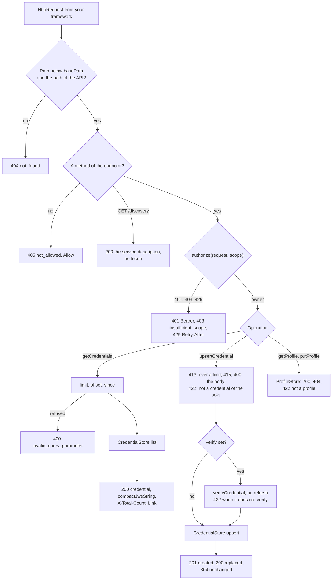
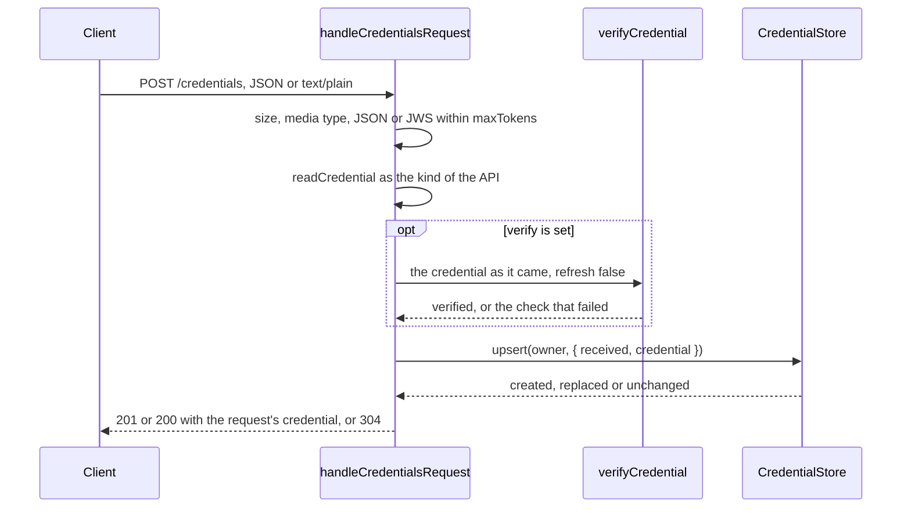

# The provider of the Open Badges and CLR APIs

`@interopkit/achievement-credentials/provider` is the resource server of the Open Badges API (OB 6) and of the CLR Standard API
(CLR 5): it lists the credentials of a user page by page, adds or replaces one, reads and replaces the user's profile, and serves
the service description. The handler takes a plain request and answers a plain response, so it runs under any web framework, in
a worker or in a test. The host brings a store of credentials, a store of profiles, and `authorize`, which checks the access
token that its authorization server issued; the package reads and checks every credential and profile that comes in, and
verifies a credential before it is stored when the host asks.



| Part                                                            | Holds                                                                                         |
| --------------------------------------------------------------- | --------------------------------------------------------------------------------------------- |
| `handleCredentialsRequest`, `CredentialsProviderOptions`        | The router and the five operations of an API, over the stores                                 |
| `CredentialStore`, `CredentialsPage`, `CredentialList`          | Where the credentials of each user are kept, and the page that the list asks for              |
| `ReceivedCredential`, `UpsertOutcome`                           | What an upsert gives the store: the credential as it came and as the model reads it           |
| `ProfileStore`                                                  | Where the profile of each user is kept                                                        |
| `CredentialsAccess`                                             | What `authorize` answers: the owner of the token, or a refusal with 401, 403 or 429           |

The root of the package exports the same types. `@interopkit/core/http` holds what the providers of the 1EdTech services share:
the request and the answer, `AccessDecision`, the paging by `limit` and `offset`, and the `imsx_StatusInfo` of a failure.

## Quick start

```ts
import { handleCredentialsRequest } from "@interopkit/achievement-credentials/provider";

const users = new Map();
const token = "863DF0B10F5D432EB2933C2A37CD3135A7BB7B07A68F65D92";
const scopes = [
  "https://purl.imsglobal.org/spec/ob/v3p0/scope/credential.readonly",
  "https://purl.imsglobal.org/spec/ob/v3p0/scope/credential.upsert",
  "https://purl.imsglobal.org/spec/ob/v3p0/scope/profile.readonly",
  "https://purl.imsglobal.org/spec/ob/v3p0/scope/profile.update",
];
const credential = {
  "@context": ["https://www.w3.org/ns/credentials/v2", "https://purl.imsglobal.org/spec/ob/v3p0/context-3.0.3.json"],
  id: "https://example.edu/credentials/3732",
  type: ["VerifiableCredential", "OpenBadgeCredential"],
  issuer: { id: "https://example.edu/issuers/565049", type: ["Profile"], name: "Example University" },
  validFrom: "2024-06-13T18:46:03Z",
  credentialSubject: {
    id: "did:example:learner",
    type: ["AchievementSubject"],
    achievement: {
      id: "https://example.edu/achievements/1",
      type: ["Achievement"],
      name: "Fractions",
      description: "Understands fractions as numbers.",
      criteria: { narrative: "Pass the final assessment." },
    },
  },
};
const requests = [
  {
    method: "POST",
    url: "https://badges.example.org/ims/ob/v3p0/credentials",
    headers: { authorization: `Bearer ${token}`, "content-type": "application/json" },
    body: new TextEncoder().encode(JSON.stringify(credential)),
  },
  {
    method: "GET",
    url: "https://badges.example.org/ims/ob/v3p0/credentials?limit=10",
    headers: { authorization: `Bearer ${token}`, "content-type": "application/json" },
    body: new Uint8Array(),
  },
];
const answers = [];
for (const request of requests)
  answers.push(
    await handleCredentialsRequest(request, {
      api: "badges",
      credentials: {
        list: async (owner, page) => {
          const mine = [...(users.get(owner)?.values() ?? [])];
          return { credentials: mine.slice(page.offset, page.offset + page.limit), total: mine.length };
        },
        upsert: async (owner, { received, credential: read }) => {
          const mine = users.get(owner) ?? new Map();
          const created = !mine.has(read.id);
          users.set(owner, mine.set(read.id, received));
          return created ? "created" : "replaced";
        },
      },
      profiles: { get: async () => undefined, put: async (_owner, profile) => profile },
      authorize: async (asked, scope) =>
        asked.headers.authorization === `Bearer ${token}` && scopes.includes(scope)
          ? { allowed: true, owner: "learner-1" }
          : { allowed: false, status: 401 },
      serviceDescription: {
        openapi: "3.0.1",
        info: {
          title: "Example Provider",
          version: "1.0",
          termsOfService: "https://badges.example.org/terms",
          "x-imssf-privacyPolicyUrl": "https://badges.example.org/privacy",
        },
        components: {
          securitySchemes: {
            OAuth2ACG: {
              type: "oauth2",
              "x-imssf-registrationUrl": "https://auth.example.org/registration",
              flows: {
                authorizationCode: {
                  authorizationUrl: "https://auth.example.org/authorize",
                  tokenUrl: "https://auth.example.org/token",
                  scopes: Object.fromEntries(scopes.map((scope) => [scope, "..."])),
                },
              },
            },
          },
        },
      },
    }),
  );
answers.map((answer) => answer.status); // => [201, 200]
answers.at(-1)?.headers["x-total-count"]; // => "1"
JSON.parse(String(answers.at(-1)?.body)).credential.length; // => 1
```

Mount the handler on one route for everything below `basePath`, build an `HttpRequest` from the request of your framework with
the public address of the request, and send the `HttpResponse` that it returns. The store of the sample keys a credential by its
`id`; a store finds the same credential with `isSameCredential`, which compares the `id` and the issuer (OB 10), keeps the newer of
two with `selectNewerCredential`, and answers `"unchanged"` when it keeps the one it holds.

## The endpoints

Each API is below its own path: `{basePath}/ims/ob/v3p0` for `api: "badges"`, `{basePath}/ims/clr/v2p0` for `api: "clr"`. A host
that serves both mounts two handlers.

| Endpoint            | Operation               | Scope (`.../ob/v3p0/scope/` or `.../clr/v2p0/scope/`) | Port                    | Answer                                                               |
| ------------------- | ----------------------- | ----------------------------------------------------- | ----------------------- | -------------------------------------------------------------------- |
| `GET /credentials`  | `getCredentials`        | `credential.readonly`                                 | `CredentialStore.list`   | 200 `GetOpenBadgeCredentialsResponse` or `GetClrCredentialsResponse` |
| `POST /credentials` | `upsertCredential`      | `credential.upsert`                                   | `CredentialStore.upsert` | 201, 200 with the credential of the request; 304 with no body        |
| `GET /profile`      | `getProfile`            | `profile.readonly`                                    | `ProfileStore.get`       | 200 `Profile`; 404 when there is none                                 |
| `PUT /profile`      | `putProfile`            | `profile.update`                                      | `ProfileStore.put`       | 200 the `Profile` that the store returns                             |
| `GET /discovery`    | `getServiceDescription` | none: OB 6.3 says it MUST NOT be protected            | none                    | 200 `serviceDescription`                                             |

A path with other segments, a trailing slash or another case is 404; another method is 405 with the methods of the endpoint in
`Allow`.

## Options

| Option               | Meaning                                                                                                                       | Default   |
| -------------------- | ----------------------------------------------------------------------------------------------------------------------------- | --------- |
| `api`                | `"badges"` or `"clr"`. Required                                                                                               | none      |
| `credentials`        | The `CredentialStore`. Required                                                                                               | none      |
| `profiles`           | The `ProfileStore`. Required                                                                                                  | none      |
| `authorize`          | `(request, scope, { signal }) => CredentialsAccess`: checks the token for the scope and names its owner. Required             | none      |
| `serviceDescription` | The OpenAPI file of the API, profiled: `info` with the name and the policies, and the authorization code flow with every scope of the API. Required | none |
| `basePath`           | The path the provider is mounted at: `""`, or a path that starts with `/` and does not end with one. It is compared percent-encoded, as `URL` writes the path of a request, so `/café` and `/caf%C3%A9` are one path; one whose dot segments leave `/` is refused | `""`      |
| `pageSize`           | Credentials in a page when the request has no `limit`; lowered to `maxPageSize` when above it                                 | 100       |
| `maxPageSize`        | The most credentials in a page; a larger `limit` is lowered to it                                                             | 1,000     |
| `maxBodyBytes`       | The most bytes of a body                                                                                                      | 1,048,576 |
| `maxTokens`          | The most tokens of JSON in a body, or in the payload of a compact JWS, counted before parsing                                 | 1,000,000 |
| `verify`             | The options of `verifyCredential`: a credential is verified before it is stored, without following its refresh service        | none      |
| `signal`             | An `AbortSignal` that ends the wait for the ports and the verifier                                                            | none      |

The URL of the request is the one the client used, and the `Link` header is built from it: behind a proxy, build the request
from the public address.

## Authorization

The provider holds no tokens. `authorize` gets the whole request and the scope of the operation (OB 6.2.1, CLR 5.2.1), checks
the access token, for example by introspection at the authorization server or by verifying a JWT, and answers whose resources it
reaches.

| `authorize` answers                                       | The provider answers                                                                                    |
| --------------------------------------------------------- | ------------------------------------------------------------------------------------------------------- |
| `{ allowed: true, owner }`                                | Goes on with the stores of `owner`, and of no one else                                                  |
| `{ allowed: false, status: 401, reason?, challenge? }`    | 401 `unauthorizedrequest` with `WWW-Authenticate` of `challenge`, or `Bearer`                            |
| `{ allowed: false, status: 403, reason? }`                | 403 `forbidden` with `WWW-Authenticate: Bearer error="insufficient_scope", scope="<scope>"` (RFC 6750)  |
| `{ allowed: false, status: 429, retryAfterSeconds? }`     | 429 `server_busy`, with `Retry-After` when the seconds are given                                        |
| A `reason` in a refusal                                   | The `imsx_description` of the answer, in place of the provider's sentence                               |
| Rejects or throws                                         | 500 `internal_server_error`                                                                             |
| Another shape                                             | `DataError`                                                                                             |

The stores are not asked when `authorize` refuses. The scopes of one API are not those of the other.

## The list

`getCredentials` reads `limit` (a whole number of at least 1), `offset` (at least 0) and `since` (a date and time of RFC 3339 with
an offset), and passes them to `CredentialStore.list` as a `CredentialsPage`. The store applies `since` and returns at most
`limit` credentials as it keeps them: an object goes into `credential`, a compact JWS into `compactJwsString`, each list in the
order of the store. Both lists are always present.

| The store                         | `X-Total-Count`     | `Link`                                                                                      |
| --------------------------------- | ------------------- | ------------------------------------------------------------------------------------------- |
| Returns `total`                   | The total           | `first`, `prev` when the offset is above 0, `next` when credentials follow, `last`          |
| Returns no `total` (cannot count) | None (OB 6.4)       | `first`, `prev` when the offset is above 0, `next` when the page is full; no `last`        |

Each link keeps the other parameters of the request. A page past the end is two empty lists.

## The upsert



| The body                                                                   | Read as                                                                                           |
| -------------------------------------------------------------------------- | ------------------------------------------------------------------------------------------------- |
| `application/json`, `application/vc+ld+json`                              | JSON within `maxBodyBytes` and `maxTokens`, then `readCredential` with the kind of the API        |
| `text/plain`                                                               | A compact JWS; its payload within `maxTokens`, in any form that `readCredentialJwt` reads, then `readCredential` |
| Another media type, or none                                                | 415                                                                                               |

The Open Badges API takes an `AchievementCredential` (a type with `AchievementCredential` or `OpenBadgeCredential`), the CLR API
a `ClrCredential`; a credential of another kind, such as an endorsement, is 422. A CLR in a compact JWS holds its credentials as
compact JWS (CLR 7.2.4.1).

The store receives a `ReceivedCredential`: `received` is the compact JWS or the parsed JSON object as the request carried it,
which the store keeps and lists, so that a proof still verifies; `credential` is the model of it, which `isSameCredential` and
`selectNewerCredential` compare (OB 10). Without `verify`, the provider checks the form and the kind and not the proof: a host that
stores what a user uploads for that user alone may want only that, and a host that shows a credential to others verifies it
when it shows it or here.

With `verify`, the credential is verified with those options and `refresh: false`, so that the store keeps the credential that
came and the provider never fetches the address of a refresh service. A credential that does not verify is 422 `invalid_data`,
whose description names the first check that did not pass, and nothing is stored. A credential whose proof fails causes no
fetch of an address that it names.

## The profile

`getProfile` answers what `ProfileStore.get` returns, or 404 `not_found` with the severity `status` when it returns `undefined`.
`putProfile` takes the whole profile as `application/json`, reads it with `readEntity("Profile")`, and passes the result to
`ProfileStore.put`; the answer is the profile that the store returns, which may not hold the new values yet (OB 6.2.5).

## The ports

| What the port does                                                                                                     | The provider answers                                                              |
| ---------------------------------------------------------------------------------------------------------------------- | --------------------------------------------------------------------------------- |
| A method rejects or throws                                                                                             | 500 `internal_server_error`, with nothing of the failure                           |
| The `signal` aborts                                                                                                    | The request rejects with the reason of the signal, whatever the port does          |
| `list` answers a shape other than `CredentialList`, a string that is not a compact JWS, or more credentials than the limit | `DataError`: a broken port contract is a bug of the host                      |
| `upsert` answers something other than `"created"`, `"replaced"` or `"unchanged"`                                       | `DataError`                                                                       |
| `get` answers something other than an object or `undefined`, `put` something other than an object                     | `DataError`                                                                       |
| A repeat of a request                                                                                                  | The stores are asked again: an upsert of an equal credential is `"unchanged"`, a `put` replaces again |

Every port receives the `signal` of the options. The handler keeps nothing between requests.

## Answers

| Status | When                                                                                                   | `imsx_codeMinor`          |
| ------ | ------------------------------------------------------------------------------------------------------ | ------------------------- |
| 200    | The list, a replaced credential, the profile, the replaced profile, the service description            |                           |
| 201    | A new credential                                                                                       |                           |
| 304    | An upsert that changed nothing, with no body                                                           |                           |
| 400    | A `limit`, `offset` or `since` that cannot be used, or a parameter given twice                         | `invalid_query_parameter` |
| 400    | A body that is not UTF-8 or not JSON, or a `text/plain` that is no compact JWS                         | `unknown`                 |
| 401    | `authorize` refuses: no token it accepts                                                               | `unauthorizedrequest`     |
| 403    | `authorize` refuses: the token lacks the scope                                                         | `forbidden`               |
| 404    | A path that is no endpoint of the API, or no profile                                                   | `not_found`               |
| 405    | A method that the endpoint does not serve                                                              | `not_allowed`             |
| 413    | A body above `maxBodyBytes`, or JSON over `maxTokens` or 64 levels, in a body or in the payload of its JWS | `unknown`                 |
| 415    | A body of a media type that the operation does not take                                                | `unknown`                 |
| 422    | JSON that is not a credential or a profile of the API, a credential of another kind, one that does not verify | `invalid_data`     |
| 429    | `authorize` refuses: one request too many                                                              | `server_busy`             |
| 500    | A port rejects                                                                                         | `internal_server_error`   |

Every failure is an `imsx_StatusInfo` with `failure`, the severity that OB B.3.6 pairs with the code (`status` for `not_found`,
`error` for the others), a description, and a detail of `TargetEndSystem` with the code.

## Limits

| Limit                                   | Value     | Refused with |
| --------------------------------------- | --------- | ------------ |
| Bytes of a body (`maxBodyBytes`)        | 1,048,576 | 413          |
| Tokens of JSON (`maxTokens`)            | 1,000,000 | 400, or 422 for the payload of a JWS |
| Levels of JSON                          | 64        | 400          |
| Credentials in a page (`maxPageSize`)   | 1,000     | Lowered to the limit |
| The verification                        | The limits of `verifyCredential`: its input, its fetches, its endorsements and nested credentials | 422 |

A body at the limits that holds the most objects that the tokens allow raises the peak memory of the process by about 120 MiB;
`provider-memory.test.ts` measures it.

## Errors

| Case                                                                                                         | Result                                                                                         |
| ------------------------------------------------------------------------------------------------------------ | ---------------------------------------------------------------------------------------------- |
| The request is not an `HttpRequest`                                                                          | `DataError` from `checkHttpRequest`                                                            |
| An option is missing, of the wrong type, or unknown, or an option of `verify` is not valid                   | `DataError`: `The provider options is invalid at pageSize: expected a value of at least 1, found 0.` |
| The service description is not one, has an address that is not `https`, or lacks a scope of the API, when it is served | `DataError` that names what it lacks                                                 |
| A port breaks its contract                                                                                   | `DataError` that names the port                                                                |
| The `signal` aborts                                                                                          | The request rejects with the reason of the signal                                              |

## Not included

| Not included                                                                   | Why                                                                                         |
| ------------------------------------------------------------------------------ | ------------------------------------------------------------------------------------------- |
| An authorization server: registration, authorization, tokens, revocation       | An application; `authorize` takes the decision, and `@interopkit/core/oauth` is the client side |
| A store: a database, an account                                                | The host keeps the credentials; the ports are the contract                                  |
| 202 of `putProfile`, conditional requests and 304 of `putProfile`               | A store returns the profile as it is; nothing in the API says what a condition would be     |
| 406 for an `Accept` that takes no JSON                                         | Every answer is JSON or the credential of the request, as OB 6.2 says                       |
| The client credentials grant                                                   | OB 6 leaves system-to-system access out of this version                                     |
| CORS, caching headers, compression, HEAD and OPTIONS                          | The host's framework answers them                                                           |

## Differences from the references

The references are the API sections of Open Badges 3.0 and CLR 2.0 and their OpenAPI files, which `provider.corpus.test.ts`
reads: the paths, the methods, the scopes, the query parameters and the media types come from the files, and every answer is
validated against the schema of its status. The choices are in [spec-gaps](spec-gaps.md).

| Case                                         | The references                                                                 | The provider                                                                      |
| -------------------------------------------- | ------------------------------------------------------------------------------ | --------------------------------------------------------------------------------- |
| A body that is JSON and not a credential     | The files list 400; OB B.3.6 pairs `invalid_data` with 422                      | 422 `invalid_data`; 400 for a body that does not parse                            |
| 304 of an upsert                             | The files give it an `imsx_StatusInfo`                                          | No body: a 304 has none (RFC 9110)                                                |
| The last link when the store cannot count    | OB 6.4: `last` MUST always appear, and `X-Total-Count` is omitted when unknown   | No `last`; `next` while the page is full                                          |
| `since`                                      | The table says `YYYY-MM-DDThh:mm:ss`; the files give the format `date-time`    | A date and time of RFC 3339 with an offset                                        |
| A member of `@context` in the files          | A `oneOf` of two schemas of a string, which no context passes                  | The tests read it as `anyOf`                                                      |
| 413, 415 and 429                             | Not listed; `default` is an `imsx_StatusInfo`                                  | Answered with an `imsx_StatusInfo`                                                |
