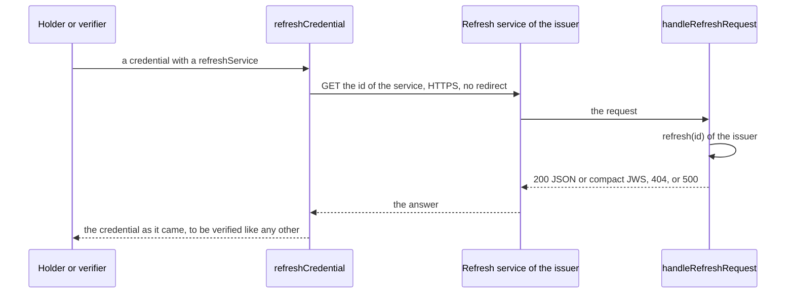

# Refreshing a credential

`@interopkit/achievement-credentials/refresh` gets the newer version of a credential from the refresh service that it names, and
answers requests for it as the issuer's service (1EdTech Verifiable Credential Refresh, VCCR, which Open Badges 9.1 uses).



| Export                 | Does                                                                                    |
| ---------------------- | --------------------------------------------------------------------------------------- |
| `refreshCredential`    | Gets the newer version of a credential, or `undefined` when it has no refresh service   |
| `handleRefreshRequest` | Answers a `GET` for the issuer, over a `refresh` port that gives the current credential |

## Quick start

```ts
import { buildAchievementCredential } from "@interopkit/achievement-credentials";
import { handleRefreshRequest, refreshCredential } from "@interopkit/achievement-credentials/refresh";

// The issuer's service: it gives the current version of the credential 3732.
const current = { id: "https://example.edu/credentials/3732", name: "Fractions badge, reissued" };
const credential = buildAchievementCredential({
  id: "https://example.edu/credentials/3732",
  issuer: { id: "https://example.edu/issuers/565049", type: ["Profile"], name: "Example University" },
  validFrom: "2024-06-13T18:46:03Z",
  name: "Fractions badge",
  subject: { id: "did:example:learner" },
  achievement: {
    id: "https://example.edu/achievements/1",
    type: ["Achievement"],
    name: "Fractions",
    description: "Understands fractions as numbers.",
    criteria: { narrative: "Pass the final assessment." },
  },
  refreshService: { id: "https://example.edu/refresh/3732", type: "1EdTechCredentialRefresh" },
});
const refreshed = await refreshCredential(credential, {
  fetch: async (url) => {
    const answer = await handleRefreshRequest(
      { method: "GET", url, headers: {}, body: new Uint8Array(0) },
      { refresh: async (id) => (id === "3732" ? current : undefined) },
    );
    return new Response(answer.body, { status: answer.status, headers: answer.headers });
  },
});
typeof refreshed === "object" && refreshed.name; // => "Fractions badge, reissued"
```

## Getting it

`refreshCredential(credential, { fetch })` does a `GET` of the `id` of the `refreshService` when its `type` is
`1EdTechCredentialRefresh` or `ImsCredentialRefresh` (CLR 8.1 writes that name), over HTTPS, without redirects, within the limits.
The answer is a credential as JSON or a compact JWS and is returned as it came. It is a candidate: the caller verifies it like any
credential, and refreshes it once, not again when it names a refresh service of its own (Open Badges 9.1).

| Option      | Meaning                                                            | Default   |
| ----------- | ------------------------------------------------------------------ | --------- |
| `fetch`     | The `Fetch` that gets the credential                               | Required  |
| `timeoutMs` | The time the fetch may take                                        | `10000`   |
| `maxBytes`  | The most bytes of the answer                                       | `1048576` |
| `maxTokens` | The most tokens of JSON in the answer, counted before it is parsed | `1000000` |
| `signal`    | Ends the caller's wait                                             | None      |

## Answering

`handleRefreshRequest(request, { refresh })` answers a `GET`. The identifier is the last segment of the path, decoded; the
host routes the requests that reach it.

| Request                                  | Answer                                                    |
| ---------------------------------------- | --------------------------------------------------------- |
| A `GET`, and `refresh` gives an object   | 200 with the credential as JSON                           |
| A `GET`, and `refresh` gives a string    | 200 with the compact JWS, `application/jwt`               |
| A `GET`, and `refresh` gives `undefined` | 404                                                       |
| `refresh` rejects                        | 500 with an empty body: nothing of the cause is said      |
| The `signal` aborts while `refresh` runs | The `reason` of the signal, whether the port stops or not |
| Another method                           | 405 with `Allow: GET`                                     |
| A path with no identifier                | 400                                                       |

## Limits

| Limit                        | Value                  | Refused with   |
| ---------------------------- | ---------------------- | -------------- |
| Bytes of the answer          | `maxBytes`, 1,048,576  | `ServiceError` |
| Levels that the answer nests | 64                     | `LimitError`   |
| Tokens of JSON in the answer | `maxTokens`, 1,000,000 | `LimitError`   |

## Errors

| Case                                                                                                 | Result                         |
| ---------------------------------------------------------------------------------------------------- | ------------------------------ |
| An option has the wrong type; the service is not HTTPS; the answer is neither JSON nor a compact JWS | `DataError`                    |
| The service fails, answers a status other than 200, redirects or sends too much                      | `ServiceError` with the status |
| The signal aborts                                                                                    | The `reason` of the signal     |

A failed refresh does not make a credential invalid: the verifier continues with the credential it has and reports the
`refresh` check as `unavailable` (Open Badges 9.1).

## Not included

| Not included                       | Why                                                                         |
| ---------------------------------- | --------------------------------------------------------------------------- |
| Verifying the refreshed credential | The caller verifies it like any credential; `/verify` does it once          |
| A route for the service            | The host mounts `handleRefreshRequest` where its `refreshService.id` points |

## Differences from the references

| Case          | The references                                                                       | This package                   |
| ------------- | ------------------------------------------------------------------------------------ | ------------------------------ |
| The type name | Open Badges 9.1 says `1EdTechCredentialRefresh`, CLR 8.1 says `ImsCredentialRefresh` | Both are accepted when reading |
