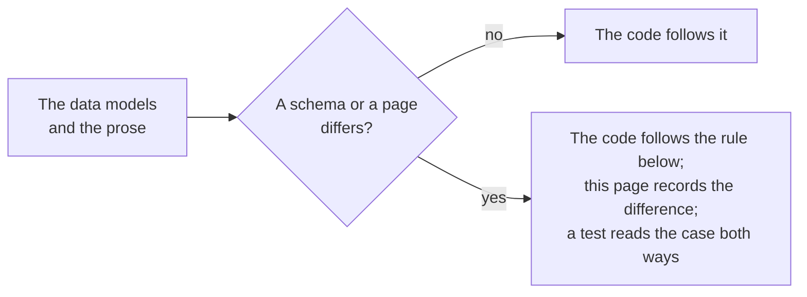

# Gaps in the specifications

Where the data models, the JSON schemas and the pages of the specifications disagree, or say nothing, the package follows the
rule below and a test pins the choice. The schemas are those that `pnpm schemas` downloads at pinned hashes, and the pages are
read by `pnpm spec-examples`.

| Where                                                              | What the specifications say                                                                                                                                                                                                                                                | What the package does                                                                                                                                                                                                                                                  |
| ------------------------------------------------------------------ | -------------------------------------------------------------------------------------------------------------------------------------------------------------------------------------------------------------------------------------------------------------------------- | ---------------------------------------------------------------------------------------------------------------------------------------------------------------------------------------------------------------------------------------------------------------------- |
| A member named `__proto__`, `constructor` or `prototype`           | The schemas take any name for a member of a class that anyone may extend, and of `extensions`                                                                                                                                                                              | Refuses it with `invalid-value`, at any depth, as every reader of the family does: a schema library would drop it, and an assignment would set a prototype. The generator of the corpus tests makes no such member, and a test pins the refusal                        |
| Lists written as one member                                        | OB A.1 says that a set MUST be an array, A.2.1 says that `type`, `credentialSchema`, `proof` and `termsOfUse` may be compacted, and the published schemas accept one member in every list property                                                                         | Reads one member at every list property of the schemas, and returns a list                                                                                                                                                                                             |
| A text that is a map of languages                                  | The published schemas let any string property be an object of language codes to strings. The contexts define no language container, so a JSON-LD processor does not read such a map as the text                                                                            | Refuses it with `wrong-type`                                                                                                                                                                                                                                           |
| A `type` that is one string                                        | The schemas accept any string, whatever the class. The data model says that the types MUST include the class                                                                                                                                                               | Reads the string as a list of one, which must include the class: only for a class that needs one type                                                                                                                                                                  |
| A `@context` that is one context                                   | The schemas accept one string or one object. The data model says that the first two items are the Verifiable Credentials context and the Open Badges context (the CLR context between them for a CLR)                                                                      | Refuses it: the list must start with the contexts that the class requires                                                                                                                                                                                              |
| The vocabulary of `ext:`                                           | The pattern of the schemas is not anchored and its class of characters holds `\|` and has no hyphen; OB C.2 says that the term MUST start with `ext:`                                                                                                                      | Anchors it, with letters, digits, `.`, `-` and `_`                                                                                                                                                                                                                     |
| The subject of an achievement                                      | OB B.1.3 says that either `id` or at least one `identifier` MUST be supplied; the schemas require only `type` and `achievement`. CLR B.1.2 says the same of a `ClrSubject`                                                                                                 | `subject-unidentified` is an error                                                                                                                                                                                                                                     |
| The subject of a credential of no class of Open Badges             | The schemas make `id` optional, so `{}` is a valid subject. The Verifiable Credentials Data Model 2.0 (4.8) says that each subject MUST be the subject of one or more claims                                                                                               | `subject-empty` is an error                                                                                                                                                                                                                                            |
| The validity period                                                | The schemas read `validFrom` and `validUntil` as two dates and times. The Verifiable Credentials Data Model 2.0 (4.9) says that the first MUST NOT be later than the second, and 1.1 says the same of `issuanceDate` and `expirationDate`                                  | `validity-period` is an error                                                                                                                                                                                                                                          |
| The hash of an identity                                            | OB B.7 gives the form `sha256$` or `md5$` and hexadecimal digits; the schemas accept any string                                                                                                                                                                            | `identity-hash-form` is a warning when `hashed` is true                                                                                                                                                                                                                |
| One subject                                                        | The Verifiable Credentials Data Model 2.0 allows many subjects; OB B.1.2 gives `credentialSubject` the multiplicity 1                                                                                                                                                      | Follows OB                                                                                                                                                                                                                                                             |
| `key_ops` of a JWK                                                 | RFC 7517 makes it an array of strings; the schema of OB B.6.2 makes it one string                                                                                                                                                                                          | Follows the schema                                                                                                                                                                                                                                                     |
| `parentOrg` of a profile under 1.1                                 | The schema of `ProfileV1p1` points `parentOrg` to the `Profile` of 2.0, whose endorsements are 2.0 credentials                                                                                                                                                             | Follows the schema                                                                                                                                                                                                                                                     |
| The OAuth error vocabularies                                       | OB B.5 gives `AuthorizationError`, `RegistrationError` and `TokenError` as objects that have a string property for each code; no message has that shape                                                                                                                    | The vocabularies are tuples of the codes                                                                                                                                                                                                                               |
| The codes of a status                                              | OB B.3.6 lists `unauthorizedrequest`, `invalid_data`, `not_found` and ten more                                                                                                                                                                                             | Follows OB                                                                                                                                                                                                                                                             |
| Dates and times                                                    | `DateTimeZ` is a date and time with a trailing time zone; the schemas give `format: date-time`, which a validator reads with a space or an offset without a colon                                                                                                          | RFC 3339 with an offset: `T`, and `hh:mm` for an offset                                                                                                                                                                                                                |
| The 2020-12 form of a tuple on the pages                           | The schemas that the pages print write a tuple with `prefixItems`, the files with an `items` list and `additionalItems`                                                                                                                                                    | The tests read the page form as the file form                                                                                                                                                                                                                          |
| The profile example of OB D                                        | The page prints a `Profile` with a context among its credentials                                                                                                                                                                                                           | It is read as a `Profile` and not as a credential: a test pins both                                                                                                                                                                                                    |
| The `credentialSchema` of the CLR examples                         | The ClrCredential examples of CLR 2.0 name the schema of an AchievementCredential; CLR B.1.1 says that one instance MUST name the schema of this credential, which is the schema of the ClrCredential                                                                      | `buildClrCredential` writes the schema of the ClrCredential; a test rebuilds the examples with that one                                                                                                                                                                |
| The address of a credential                                        | OB B.1.2 gives `id` the type URI, and the schemas accept any string                                                                                                                                                                                                        | The builders refuse an `id` that is not an absolute URI, so that two credentials can be compared and fetched                                                                                                                                                           |
| The salt of a hash                                                 | OB B.7 says that the identifier and "an optionally appended salt string" are hashed                                                                                                                                                                                        | The salt is appended to the identifier as text, an empty salt is no salt, and both are encoded in UTF-8                                                                                                                                                                |
| Equality when an `id` is missing                                   | OB 10 compares the id of the credential and of the issuer; a VerifiableCredential need not have an id                                                                                                                                                                      | A credential with no `id` is equal to no credential                                                                                                                                                                                                                    |
| Which credential is newer when `validFrom` is equal                | OB 10.1.1 calls both up-to-date                                                                                                                                                                                                                                            | `selectNewerCredential` returns the first                                                                                                                                                                                                                              |
| An image that holds a credential, when baking                      | OB 5.3.1.1 and 5.3.2.1: the implementer may choose an error or an overwrite; CLR 4.3 says the same                                                                                                                                                                         | An error; the option `replace` overwrites, and removes the credential of either kind, since an image holds one                                                                                                                                                         |
| Where the chunk of a PNG goes                                      | OB 5.3.1.1 says to insert an `iTXt` chunk, and 5.3.1.2 to read up to the first one                                                                                                                                                                                         | Right after `IHDR`, so that a reader meets it first                                                                                                                                                                                                                    |
| The prefix of the SVG element                                      | OB 5.3.2.1 and CLR 4.3.2.1 write `openbadges:credential` and `clr:credential`                                                                                                                                                                                              | Written as given; read by namespace and local name, so any prefix works                                                                                                                                                                                                |
| Compression of the credential chunk                                | OB 5.3.1.1: "Compression MUST NOT be used", said of the baker; 5.3.1.2 says nothing of a reader that meets it                                                                                                                                                              | A reader refuses a compressed chunk: it is a violation, and inflating text from an image is a way to exhaust memory                                                                                                                                                    |
| The size of the credential in an image                             | Neither specification limits it                                                                                                                                                                                                                                            | 1,048,576 characters, the size that `verifyCredential` takes by default                                                                                                                                                                                                |
| The sample of `getCredentials`                                     | OB 6.2.2 prints `GET /ims/ob/v3p0/credentials=2&offset=0`, and its response writes `compactJwsStrings`; the schema names `compactJwsString`                                                                                                                                | The request table is the rule: `credentials?limit=2&offset=0`; the property is `compactJwsString`                                                                                                                                                                      |
| The sample of the service description                              | OB 6.3 puts `x-imssf-name`, `x-imssf-privacyPolicyUrl` and `x-imssf-termsOfServiceUrl` in the security scheme, and its addresses have no scheme                                                                                                                            | The schema (OB B.4) puts the name, the terms and the privacy policy in `info`; the client reads those and requires `https` addresses                                                                                                                                   |
| The revocation endpoint                                            | OB 7.3 says that the client and the server share it; no property of the service description carries it                                                                                                                                                                     | `ServiceDescription` has none: the host passes `revocationEndpoint` to the OAuth client                                                                                                                                                                                |
| Grant types of a registration                                      | OB 7.1.1.2 allows `authorization_code` and `refresh_token` and no other                                                                                                                                                                                                    | `registerClient` of `@interopkit/core/oauth` asks for those two unless the host names `grantTypes`; a test registers at a server that refuses the third                                                                                                                |
| 202 and 304 of `putProfile`                                        | OB 6.2.5.2 lists both, with an `imsx_StatusInfo`                                                                                                                                                                                                                           | `putProfile` returns the profile of a 200 only; the others are a `ServiceError`                                                                                                                                                                                        |
| 304 of `upsertCredential`                                          | OB 6.2.3.2 lists it with a body                                                                                                                                                                                                                                            | `"unchanged"`: a 304 has no body                                                                                                                                                                                                                                       |
| A body that is JSON and not a credential or profile                | The OpenAPI files list 400 for upsertCredential and putProfile; OB B.3.6 pairs `invalid_data`, "well-formed but semantically erroneous", with 422                                                                                                                          | The provider answers 422 `invalid_data`, and 400 for a body that does not parse                                                                                                                                                                                        |
| 304 of `upsertCredential`, as a provider                           | OB 6.2.3.2 and the OpenAPI files give it an `imsx_StatusInfo`; RFC 9110 15.4.5 says a 304 has no content                                                                                                                                                                   | The provider answers 304 with no body                                                                                                                                                                                                                                  |
| The last link when the total is unknown                            | OB 6.4 says `last` MUST always appear in `Link`, and that `X-Total-Count` is omitted when the total is not known                                                                                                                                                           | The provider writes no `last` when the store cannot count, and `next` while a page is full                                                                                                                                                                             |
| The form of `since`                                                | The request table of OB 6.2.2.1 says "using the syntax YYYY-MM-DDThh:mm:ss", without a zone; the OpenAPI files give the format `date-time`, which has an offset                                                                                                            | A date and time of RFC 3339 with an offset, since a time without one names no instant                                                                                                                                                                                  |
| A member of `@context` in the OpenAPI files                        | The files give it a `oneOf` of two schemas of a string, the second meant as a map, so every string matches both and no context is valid                                                                                                                                    | The tests read the `oneOf` as an `anyOf`, and a test pins the defect                                                                                                                                                                                                   |
| 413, 415 and 429 of the APIs                                       | The OpenAPI files do not list them; `default` is an `imsx_StatusInfo`, and B.3.6 has `server_busy` for 429 and `unknown` for any other error                                                                                                                               | The provider answers them with an `imsx_StatusInfo`: `unknown` for 413 and 415                                                                                                                                                                                         |
| How an issuer publishes keys                                       | OB 8.2.3 makes `kid` any URI that dereferences to a JWK, and the Profile (B.1.14) has no key field, although a Guide example shows `verificationMethod`. Guide 3.1.12 says that no standard fully assures where a key comes from                                           | The rules of the Guide: the keys of the document at `issuer.id` (whatever its type) and of the key set at `/.well-known/jwks.json`, a member's `iss` keeping the issuers of a shared platform apart                                                                    |
| A self-describing verification method                              | OB's examples use `https://example.edu/issuers/565049#z6Mk...`, and 1EdTech's validator reads the key from the fragment and the controller from the prefix, which anyone can write                                                                                         | The method counts only when the document at `issuer.id` lists it                                                                                                                                                                                                       |
| `jwt` in the Guide                                                 | Guide 3.1.12.2 says `jwt` where the JOSE header is `jwk`                                                                                                                                                                                                                   | `jwk`                                                                                                                                                                                                                                                                  |
| Which data model uses `issuanceDate` and the `vc` claim            | OB 8.2.6 and 9.1 attribute them to the Verifiable Credentials Data Model 2.0; they belong to 1.1                                                                                                                                                                           | Read by the data: the `vc` claim, `issuanceDate` and `expirationDate` are the 1.1 form, accepted when reading and verifying                                                                                                                                            |
| OB's JWT form and VC-JOSE-COSE                                     | OB 8.2 says the JOSE text was under revision; VC-JOSE-COSE became a Recommendation on 2026-10-13, with `typ: vc+jwt` and no duplicated claims                                                                                                                              | OB 8.2 is written exactly; both forms are read                                                                                                                                                                                                                         |
| The example JWT of section 5                                       | It names `https://example.edu/keys#key-1` for the issuer `https://example.edu/issuers/565049`, whose profile lists no key                                                                                                                                                  | A valid signature with `bound: false`; the default options refuse it as a key the issuer does not publish                                                                                                                                                              |
| The issuer of the examples of the cryptosuites                     | The vectors of the EdDSA and ECDSA Recommendations are credentials of other vocabularies, and some have an `issuer` object with an `id` and an `image` and no `type`; the Profile of OB B.1.14 requires a `type`                                                           | The package reads credentials of Open Badges and CLR, so it refuses those vectors for `issuer.type`; their proofs are checked at the level of the cryptosuite by `@interopkit/selective-disclosure`                                                                    |
| The credential schema and safe mode                                | OB B.1.2 and 9.1 give the type `1EdTechJsonSchemaValidator2019` to the `credentialSchema`, and Conformance 3 asks that a credential survive JSON-LD safe mode; the contexts VC 2.0 and OB 3.0.3 define no such type, which the context of the extensions defines           | The builders add `https://purl.imsglobal.org/spec/ob/v3p0/extensions.json` to the contexts they write                                                                                                                                                                  |
| A base proof of `ecdsa-sd-2023` given to a verifier                | Data Integrity ECDSA defines only Verify Derived Proof; the base proof holds the HMAC key and the signature of every statement                                                                                                                                             | `verifyProof` refuses it and says to derive a disclosure first                                                                                                                                                                                                         |
| The address of the first Open Badges context                       | Contexts `context-3.0.1.json` to `context-3.0.3.json` have versioned addresses; the first, 3.0.0, is `context.json`                                                                                                                                                        | `KNOWN_CONTEXTS` pins `context.json` as 3.0.0                                                                                                                                                                                                                          |
| The refresh type name                                              | OB 9.1 says `1EdTechCredentialRefresh`; CLR 8.1 says `ImsCredentialRefresh`                                                                                                                                                                                                | `1EdTechCredentialRefresh` is written; both are accepted                                                                                                                                                                                                               |
| Who may publish the status list of a credential                    | Bitstring Status List 3.2 verifies the list credential and says nothing of who issues it; Open Badges 9.1 says only that a status is checked                                                                                                                               | The list credential must come from the credential's issuer or an issuer the host names in `statusIssuers`, and its key must be published by its issuer                                                                                                                 |
| Entries that are not one bit                                       | The `message` purpose and `statusSize` above 1 make an entry wider than a bit; Open Badges uses revocation and suspension                                                                                                                                                  | `status` is `skipped` with a detail, never read as one bit                                                                                                                                                                                                             |
| The recipient of the first example of Open Badges 2.0              | The example has a recipient without `hashed`, which the table of IdentityObject marks required                                                                                                                                                                             | `missing-property` at `recipient.hashed`; a test pins the example with it                                                                                                                                                                                              |
| A revoked 2.0 assertion or endorsement                             | Open Badges 2.0 lets a revoked document hold only `id` and `revoked` (and `issuer` for an endorsement), and its examples print one                                                                                                                                         | A reader refuses it as a document without its properties; verification reads `revoked` first and answers that the badge is revoked                                                                                                                                     |
| The keys of a 2.0 issuer, and the `startsWith` of its verification | Open Badges 2.0 allows several of each; the validator of 1EdTech takes one                                                                                                                                                                                                 | Several, as the specification says                                                                                                                                                                                                                                     |
| The verification of a 2.0 endorsement                              | Open Badges 2.0 marks it required; the validator of 1EdTech does not check it                                                                                                                                                                                              | Required                                                                                                                                                                                                                                                               |
| The type of the verification of a 2.0 assertion                    | Open Badges 2.0 allows several types; one assertion is verified one way                                                                                                                                                                                                    | The types include one of `HostedBadge` and `SignedBadge`, not both, as the validator of 1EdTech asks                                                                                                                                                                   |
| The kinds of a 2.0 recipient                                       | Open Badges 2.0 says that the type should be a property of the context, and names `email`, `url` and `telephone`; the validator also takes `id`                                                                                                                            | `id`, `email`, `url` or `telephone`                                                                                                                                                                                                                                    |
| The image of a 2.0 assertion                                       | Open Badges 2.0 asks for a PNG or SVG; the validator of 1EdTech refuses a data URI for the image of an assertion and takes one for a BadgeClass                                                                                                                            | As the validator: a URL for an assertion; a URL, or a data URI of a PNG or an SVG, for a BadgeClass or a profile                                                                                                                                                       |
| `md5$` hashes of a recipient                                       | Open Badges 2.0 and 3.0 (B.7) both name MD5 and SHA-256                                                                                                                                                                                                                    | `matchesIdentifier` reads both for either version; `hashIdentifier` writes SHA-256 only                                                                                                                                                                                |
| A signed 2.0 assertion without a `creator`                         | Open Badges 2.0 makes `creator` optional and says that verifiers then check the keys that the issuer declares; it does not say how many                                                                                                                                    | The first 8 keys that the issuer lists, each fetched unless the issuer embeds it                                                                                                                                                                                       |
| The `owner` of a 2.0 key                                           | Open Badges 2.0 names the owner of a key; the validator of 1EdTech checks only that the issuer lists the key                                                                                                                                                               | A key that names an owner must name the issuer, else `issuer` `failed`                                                                                                                                                                                                 |
| A 2.0 issuer that is not at an HTTPS address                       | The default policy of a hosted assertion is the origin of the issuer's `id`, which a URN does not have; the validator then passes it with a warning                                                                                                                        | `issuer` `failed` for hosted and signed badges: nothing ties the keys or the policy of such an issuer to it                                                                                                                                                            |
| A hosted 2.0 document that says it is signed                       | Open Badges 2.0 verifies a signed badge from its JWS; the validator reads such a document at an address and checks no signature                                                                                                                                            | `format` `failed`                                                                                                                                                                                                                                                      |
| The order of the checks of a verification                          | OB 9.1 and CLR 8.1 list the schema, then the proof, then the refresh                                                                                                                                                                                                       | The schema is judged after the proof, so that an address that a credential names is fetched only for a credential that is authentic; the result lists the checks in the order of the specifications                                                                    |
| What a refresh may give                                            | OB 9.1 says to refresh, repeat the schema and the proof, and go on with the original when the refresh is not successful; it does not say what a credential may be that the service gives                                                                                   | The refreshed credential must be authentic and the same credential (OB 10: its id and its issuer), else the refresh is `unavailable` and the original is verified                                                                                                      |
| Which endorsements a credential has                                | OB 9.1 says "if the OpenBadgeCredential contains any EndorsementCredentials", and the model puts `endorsement` on the credential, the achievement and the profile                                                                                                          | Those of the credential, of its issuer's profile and of the achievements of its subject; an endorsement's own endorsements are not followed                                                                                                                            |
| The recipient of the credentials of a CLR                          | CLR 8.1 says to verify each nested credential as OB 9.1, which has the optional recipient step                                                                                                                                                                             | The recipient is checked on the credential that was passed and not on those a CLR holds: they need not name the learner as the CLR does                                                                                                                                |
| The id of the subject in the recipient step                        | OB 9.1 says to compare the known id "with the id in the ClrSubject", in the section of an `AchievementSubject`                                                                                                                                                             | The `id` of the subject of the credential that is verified                                                                                                                                                                                                             |
| A schema that a credential names                                   | OB 9.1 says to check a `1EdTechJsonSchemaValidator2019` schema, which may be any schema, and 1EdTech's validator applies it                                                                                                                                                | A schema of 1EdTech is what the readers checked; another is fetched, and one that runs a regular expression is `unavailable`, since the issuer writes both the schema and the credential and a pattern can be written to backtrack for longer than a verifier can wait |
| A 2.0 document with a list of contexts                             | Open Badges 2.0 lets a document add contexts after its own; the validator of 1EdTech reads a list as 2.0 and compacts it into the 2.0 context                                                                                                                              | Read as 2.0 by the terms of 2.0, with `unknown-term` for any other name and `redefined-term` for an inline context that redefines a term of 2.0; a context given by its address is not fetched, so a term that it redefines is read as 2.0 defines it                  |
| A baked 2.0 SVG element with a body and `verify`                   | 2.0 Baking says that `verify` holds a signature or an address and that a body is the assertion, and its example has both                                                                                                                                                   | The body is the assertion; `verify` is not read                                                                                                                                                                                                                        |
| The results of the complete example of Open Badges 3.0 (D.2)       | B.1.16 says that a result names a description of the achievement and its achieved level is a level of that description; the example links its second result to the letter grade and gives it a level of the rubric, and its third result to the letter grade with a status | `achieved-level-unknown`, a warning; the example is pinned with it, and read                                                                                                                                                                                           |
| The revoked credentials of a revocation list of 1EdTech            | The 1EdTech Revocation List Status Method names the list `revokedCredential` in its data model and `revokedCredentials` in its protocol and its example, whose `revoked` is the text `"true"` though the model says Boolean                                                | Both names are read; `revoked` is true, the text `true`, or absent                                                                                                                                                                                                     |
