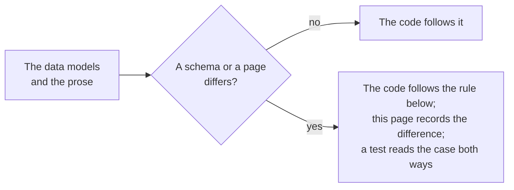

# Gaps in the specifications

Where the data models, the JSON schemas and the pages of the specifications disagree, or say nothing, the package follows the
rule below and a test pins the choice. The schemas are those that `pnpm schemas` downloads at pinned hashes, and the pages are
read by `pnpm spec-examples`.

| Where                                               | What the specifications say                                                                                                                                                                                      | What the package does                                                                                        |
| --------------------------------------------------- | ---------------------------------------------------------------------------------------------------------------------------------------------------------------------------------------------------------------- | ------------------------------------------------------------------------------------------------------------ |
| Lists written as one member                         | OB A.1 says that a set MUST be an array, A.2.1 says that `type`, `credentialSchema`, `proof` and `termsOfUse` may be compacted, and the published schemas accept one member in every list property               | Reads one member at every list property of the schemas, and returns a list                                   |
| A text that is a map of languages                   | The published schemas let any string property be an object of language codes to strings. The contexts define no language container, so a JSON-LD processor does not read such a map as the text                  | Refuses it with `wrong-type`                                                                                 |
| A `type` that is one string                         | The schemas accept any string, whatever the class. The data model says that the types MUST include the class                                                                                                     | Reads the string as a list of one, which must include the class: only for a class that needs one type        |
| A `@context` that is one context                    | The schemas accept one string or one object. The data model says that the first two items are the Verifiable Credentials context and the Open Badges context (the CLR context between them for a CLR)            | Refuses it: the list must start with the contexts that the class requires                                    |
| The vocabulary of `ext:`                            | The pattern of the schemas is not anchored and its class of characters holds `\|` and has no hyphen; OB C.2 says that the term MUST start with `ext:`                                                            | Anchors it, with letters, digits, `.`, `-` and `_`                                                           |
| The subject of an achievement                       | OB B.1.3 says that either `id` or at least one `identifier` MUST be supplied; the schemas require only `type` and `achievement`. CLR B.1.2 says the same of a `ClrSubject`                                       | `subject-unidentified` is an error                                                                           |
| The hash of an identity                             | OB B.7 gives the form `sha256$` or `md5$` and hexadecimal digits; the schemas accept any string                                                                                                                  | `identity-hash-form` is a warning when `hashed` is true                                                      |
| One subject                                         | The Verifiable Credentials Data Model 2.0 allows many subjects; OB B.1.2 gives `credentialSubject` the multiplicity 1                                                                                            | Follows OB                                                                                                   |
| `key_ops` of a JWK                                  | RFC 7517 makes it an array of strings; the schema of OB B.6.2 makes it one string                                                                                                                                | Follows the schema                                                                                           |
| `parentOrg` of a profile under 1.1                  | The schema of `ProfileV1p1` points `parentOrg` to the `Profile` of 2.0, whose endorsements are 2.0 credentials                                                                                                   | Follows the schema                                                                                           |
| The OAuth error vocabularies                        | OB B.5 gives `AuthorizationError`, `RegistrationError` and `TokenError` as objects that have a string property for each code; no message has that shape                                                          | The vocabularies are tuples of the codes                                                                     |
| The codes of a status                               | OB B.3.6 lists `unauthorizedrequest`, `invalid_data`, `not_found` and ten more                                                                                                                                   | Follows OB                                                                                                   |
| Dates and times                                     | `DateTimeZ` is a date and time with a trailing time zone; the schemas give `format: date-time`, which a validator reads with a space or an offset without a colon                                                | RFC 3339 with an offset: `T`, and `hh:mm` for an offset                                                      |
| The 2020-12 form of a tuple on the pages            | The schemas that the pages print write a tuple with `prefixItems`, the files with an `items` list and `additionalItems`                                                                                          | The tests read the page form as the file form                                                                |
| The profile example of OB D                         | The page prints a `Profile` with a context among its credentials                                                                                                                                                 | It is read as a `Profile` and not as a credential: a test pins both                                          |
| The `credentialSchema` of the CLR examples          | The ClrCredential examples of CLR 2.0 name the schema of an AchievementCredential; CLR B.1.1 says that one instance MUST name the schema of this credential, which is the schema of the ClrCredential | `buildClrCredential` writes the schema of the ClrCredential; a test rebuilds the examples with that one      |
| The address of a credential                         | OB B.1.2 gives `id` the type URI, and the schemas accept any string                                                                                                                                              | The builders refuse an `id` that is not an absolute URI, so that two credentials can be compared and fetched |
| The salt of a hash                                  | OB B.7 says that the identifier and "an optionally appended salt string" are hashed                                                                                                                              | The salt is appended to the identifier as text, an empty salt is no salt, and both are encoded in UTF-8      |
| Equality when an `id` is missing                    | OB 10 compares the id of the credential and of the issuer; a VerifiableCredential need not have an id                                                                                                            | A credential with no `id` is equal to no credential                                                          |
| Which credential is newer when `validFrom` is equal | OB 10.1.1 calls both up-to-date                                                                                                                                                                                  | `newerCredential` returns the first                                                                          |
| An image that holds a credential, when baking                   | OB 5.3.1.1 and 5.3.2.1: the implementer may choose an error or an overwrite; CLR 4.3 says the same                                             | An error; the option `replace` overwrites, and removes the credential of either kind, since an image holds one                                       |
| Where the chunk of a PNG goes                                   | OB 5.3.1.1 says to insert an `iTXt` chunk, and 5.3.1.2 to read up to the first one                                                              | Right after `IHDR`, so that a reader meets it first                                                                                                  |
| The prefix of the SVG element                                   | OB 5.3.2.1 and CLR 4.3.2.1 write `openbadges:credential` and `clr:credential`                                                                   | Written as given; read by namespace and local name, so any prefix works                                                                              |
| Compression of the credential chunk                             | OB 5.3.1.1: "Compression MUST NOT be used", said of the baker; 5.3.1.2 says nothing of a reader that meets it                                   | A reader refuses a compressed chunk: it is a violation, and inflating text from an image is a way to exhaust memory                                  |
| The size of the credential in an image                          | Neither specification limits it                                                                                                                 | 1,048,576 characters, the size that `verifyCredential` takes by default                                                                              |
| The sample of `getCredentials`                                  | OB 6.2.2 prints `GET /ims/ob/v3p0/credentials=2&offset=0`, and its response writes `compactJwsStrings`; the schema names `compactJwsString` | The request table is the rule: `credentials?limit=2&offset=0`; the property is `compactJwsString`                                                     |
| The sample of the service description                           | OB 6.3 puts `x-imssf-name`, `x-imssf-privacyPolicyUrl` and `x-imssf-termsOfServiceUrl` in the security scheme, and its addresses have no scheme | The schema (OB B.4) puts the name, the terms and the privacy policy in `info`; the client reads those and requires `https` addresses                  |
| The revocation endpoint                                         | OB 7.3 says that the client and the server share it; no property of the service description carries it                                         | `ServiceDescription` has none: the host passes `revocationEndpoint` to the OAuth client                                                              |
| Grant types of a registration                                   | OB 7.1.1.2 allows `authorization_code` and `refresh_token` and no other                                                                         | `registerClient` of `@interopkit/core/oauth` asks for those two unless the host names `grantTypes`; a test registers at a server that refuses the third |
| 202 and 304 of `putProfile`                                     | OB 6.2.5.2 lists both, with an `imsx_StatusInfo`                                                                                                | `putProfile` returns the profile of a 200 only; the others are a `ServiceError`                                                                       |
| 304 of `upsertCredential`                                       | OB 6.2.3.2 lists it with a body                                                                                                                 | `"unchanged"`: a 304 has no body                                                                                                                      |
