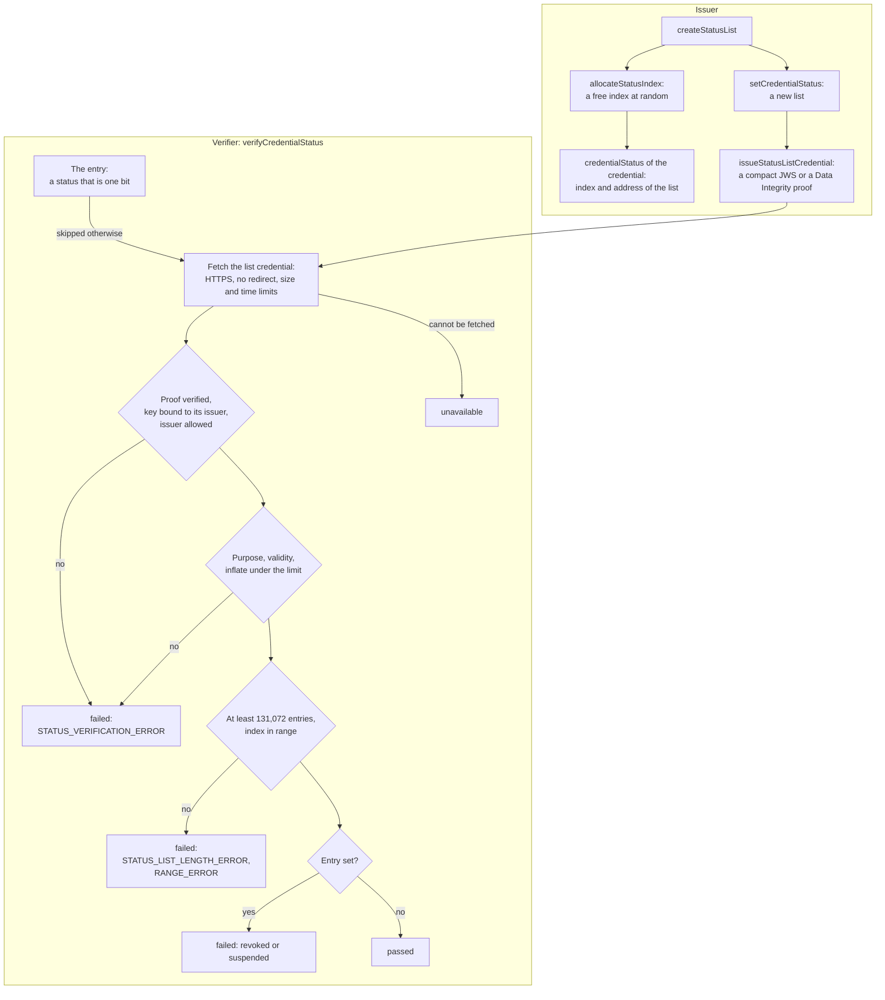

# Status lists

`@interopkit/achievement-credentials/status` revokes and suspends credentials with a Bitstring Status List: it creates a list,
picks an index for a credential at random, sets an entry, issues the credential that holds the list, and checks the status of a
credential against it.



| Export                       | Does                                                                                                                      |
| ---------------------------- | ------------------------------------------------------------------------------------------------------------------------- |
| `createStatusList`           | Creates a list of 131,072 entries or more, all clear                                                                       |
| `allocateStatusIndex`        | Picks a free index at random, from an injected `Random`                                                                    |
| `setCredentialStatus`        | Returns a new list with one entry set or cleared                                                                           |
| `issueStatusListCredential`  | Issues the credential that holds the list, secured by the issuer                                                           |
| `verifyCredentialStatus`     | Returns the `status` check of a credential                                                                                 |
| `createStatusListCache`      | Keeps list credentials across verifications until their `ttl` or `validUntil`                                              |

`StatusList` is plain data, `{ length, bits }`, which a host stores as it is; entry 0 is the most significant bit of the first byte.

## Quick start

```ts
import { buildAchievementCredential } from "@interopkit/achievement-credentials";
import { allocateStatusIndex, createStatusList, issueStatusListCredential, setCredentialStatus, verifyCredentialStatus } from "@interopkit/achievement-credentials/status";
import { createKeyResolver } from "@interopkit/achievement-credentials/keys";
import { SYSTEM_RANDOM, signerFromCryptoKey } from "@interopkit/core";

const pair = await crypto.subtle.generateKey({ name: "ECDSA", namedCurve: "P-256" }, true, ["sign", "verify"]);
const publicKeyJwk = await crypto.subtle.exportKey("jwk", pair.publicKey);
const issuer = "https://example.edu/issuers/565049";
const listAddress = "https://example.edu/status/revocations/1";
const controller = {
  id: issuer,
  verificationMethod: [{ id: `${issuer}#key-1`, type: "JsonWebKey", controller: issuer, publicKeyJwk }],
  assertionMethod: [`${issuer}#key-1`],
};
const clock = { now: () => Date.UTC(2024, 5, 14) };
const signer = signerFromCryptoKey(pair.privateKey, { algorithm: "ES256", keyId: `${issuer}#key-1` });

// The issuer gives the credential an index that says nothing of the order of issue, and revokes it.
const index = allocateStatusIndex(new Set(), { length: 131_072, random: SYSTEM_RANDOM });
const list = setCredentialStatus(createStatusList(), index, true);
const jws = await issueStatusListCredential(
  { id: listAddress, issuer, validFrom: "2024-06-01T00:00:00Z", purpose: "revocation", list },
  signer,
  { clock },
);
typeof jws; // => "string"

const documents = new Map([[issuer, JSON.stringify(controller)], [listAddress, String(jws)]]);
const keys = createKeyResolver({
  clock,
  fetch: async (url) => new Response(documents.get(url) ?? "", { status: documents.has(url) ? 200 : 404 }),
});
const entry = {
  id: `${listAddress}#${index}`,
  type: "BitstringStatusListEntry",
  statusPurpose: "revocation",
  statusListIndex: String(index),
  statusListCredential: listAddress,
};
const credential = buildAchievementCredential({
  id: "https://example.edu/credentials/3732",
  issuer: { id: issuer, type: ["Profile"], name: "Example University" },
  validFrom: "2024-06-13T18:46:03Z",
  name: "Fractions badge",
  subject: { id: "did:example:learner" },
  achievement: {
    id: "https://example.edu/achievements/1",
    type: ["Achievement"],
    name: "Fractions",
    description: "Understands fractions as numbers.",
    criteria: { narrative: "Pass the final assessment." },
  },
  credentialStatus: entry,
});
const result = await verifyCredentialStatus(credential, {
  fetch: async (url) => new Response(documents.get(url) ?? "", { status: documents.has(url) ? 200 : 404 }),
  keys,
  clock,
});
result.outcome; // => "failed"
result.detail.startsWith("The credential is revoked"); // => true
```

## The validate algorithm

`verifyCredentialStatus(credential, options)` follows Bitstring Status List 3.2 and returns a `VerificationCheck` with the check
`status`. It reads the `credentialStatus` of the credential, fetches the list credential it names, and answers:

| Outcome       | When, and the code in the detail                                                                                                                                                    |
| ------------- | ----------------------------------------------------------------------------------------------------------------------------------------------------------------------------------- |
| `passed`      | The entry is clear in a list that passed every check                                                                                                                                 |
| `failed`      | The entry is set: `The credential is revoked` or `suspended`                                                                                                                         |
| `failed`      | The list credential's proof does not verify, its key is not published by its issuer, it is issued by another issuer than the credential's (unless in `statusIssuers`), it is not valid at this time, it is no status list credential, or its `encodedList` is not a list or inflates past the limit: `STATUS_VERIFICATION_ERROR` |
| `failed`      | The list's purpose is not the entry's: `purpose mismatch`                                                                                                                            |
| `failed`      | The list has fewer than 131,072 entries: `STATUS_LIST_LENGTH_ERROR`                                                                                                                  |
| `failed`      | The index is not an integer, or is outside the list: `RANGE_ERROR`                                                                                                                   |
| `failed`      | The address of the list is not an HTTPS address: `STATUS_VERIFICATION_ERROR`                                                                                                        |
| `unavailable` | The list cannot be fetched, or it carries a Data Integrity proof and no loader of `contexts` was given: `STATUS_RETRIEVAL_ERROR`                                                      |
| `skipped`     | The credential has no `credentialStatus`; it is not a `BitstringStatusListEntry`; its `statusPurpose` is not `revocation` or `suspension` (a `message`, for one); its `statusSize` is not 1. The list is never read as one bit then |

The list credential is a compact JWS (read by `readCredentialJwt`) or JSON with a Data Integrity proof (read by `verifyProof`,
which `verifyCredentialStatus` loads only then, so that a verifier of JWTs never loads a processor of JSON-LD). The proof is
verified and its key is bound to the issuer of the list, who must be the issuer of the credential or one of `statusIssuers`.

| Option          | Meaning                                                                                                              | Default                          |
| --------------- | -------------------------------------------------------------------------------------------------------------------- | -------------------------------- |
| `fetch`         | The `Fetch` that gets the list credential                                                                             | Required                         |
| `keys`          | The `KeyResolver` for the list credential's proof                                                                     | Required                         |
| `clock`         | The `Clock` that the list credential's validity is compared with, within 60 seconds                                   | Required                         |
| `contexts`      | The `ContextLoader`, for a list credential with a Data Integrity proof                                                | None: such a list is `unavailable` |
| `cache`         | A `StatusListCache`                                                                                                    | None: fetched for each verification |
| `statusIssuers` | Issuers other than the credential's that may publish its list                                                         | None                             |
| `timeoutMs`     | The time a fetch may take                                                                                              | `10000`                          |
| `maxBytes`      | The most bytes of the list credential                                                                                  | `1048576`                        |
| `signal`        | Ends the caller's wait                                                                                                 | None                             |

## Keeping list credentials

`createStatusListCache({ clock, maxEntries })` keeps the list credentials that were fetched and verified, by address. An entry
expires at its `ttl` (the `ttl` of the subject in milliseconds; 300,000 when it gives none) or at its `validUntil`, whichever
comes first. Verifications that run together share one fetch, which runs to its own timeout, and a failure is not kept. The
credential that the cache holds is the list credential and not its answer: its issuer is compared with each credential's issuer
on every verification.

| Option       | Meaning                              | Default |
| ------------ | ------------------------------------ | ------- |
| `clock`      | The `Clock` that entries expire by   | Required |
| `maxEntries` | The most list credentials kept       | `1000`  |

## Issuing

`issueStatusListCredential(input, signer, options)` writes the credential: the types `VerifiableCredential` and
`BitstringStatusListCredential`, and a subject of type `BitstringStatusList` with the purpose, the `encodedList` (GZIP, then
multibase base64url) and, when given, the `ttl`. `options.proof` is `"jwt"` (a compact JWS, with the signer's `keyId` as the `kid`)
or `"data-integrity"` (`eddsa-rdfc-2022`, with `contexts` and `clock`). The list must have at least 131,072 entries.

`allocateStatusIndex(used, { length, random })` returns the n-th free index for a draw of `random`, so that every free index has
the same chance; the indexes of credentials then say nothing of when they were issued (Bitstring Status List 2.1). It takes
`SYSTEM_RANDOM` of `@interopkit/core` in production and a seeded source in a test, and throws when the list is full.

## Limits

| Limit                                                  | Value                      | Refused with                          |
| ------------------------------------------------------ | -------------------------- | ------------------------------------- |
| Entries of a list when it is created, and the least accepted | 131,072, 131,072     | `DataError`; `STATUS_LIST_LENGTH_ERROR` |
| Entries of a list, at most                              | 134,217,728                | `DataError`                           |
| Bytes that a list inflates to                           | 16,777,216                 | `failed`, and the stream is cancelled |
| Bytes of the list credential                            | `maxBytes`, 1,048,576      | `unavailable`                         |
| Levels that a JSON list credential nests                | 64                         | `failed`                              |
| List credentials in the cache                           | `maxEntries`, 1,000        | The oldest goes first                 |

The list is inflated through a `DecompressionStream` and the library's own decoder is never called, because it inflates with no
limit: a list credential within the fetch limit could fill the memory. A test inflates a bomb of 20 MiB from under 100 KB and
checks that it stops at the limit.

## Errors

| Case                                                                              | Result                                                               |
| --------------------------------------------------------------------------------- | -------------------------------------------------------------------- |
| An option, a list or an input has the wrong type; a list is full; the signer has no `keyId` | `DataError` that names it                                    |
| The list credential cannot be fetched                                              | `unavailable` with `STATUS_RETRIEVAL_ERROR`                          |
| The list credential is not valid                                                   | `failed` with the code                                               |
| The signal aborts                                                                  | The `reason` of the signal                                           |

## Not included

| Not included                                       | Why                                                                                                                                  |
| -------------------------------------------------- | ------------------------------------------------------------------------------------------------------------------------------------ |
| The `message` purpose and entries wider than 1 bit | Open Badges 9.1 uses revocation and suspension; such an entry is `skipped`, never read as a bit                                       |
| The `refresh` purpose, other status methods         | Nothing in Open Badges or CLR uses them; a status of another type is `skipped`                                                       |
| `1EdTechRevocationList` of Open Badges 2.0          | Open Badges 2.0 is read and verified in its own module                                                                              |
| A library for the list                              | The libraries inflate with no limit and load JSON-LD for the whole package; the list is about 150 lines on web streams              |

## Differences from the references

| Case                      | The references                                                                       | This package                                                                                                 |
| ------------------------- | ------------------------------------------------------------------------------------ | ------------------------------------------------------------------------------------------------------------ |
| Decoding the list         | `@digitalbazaar/vc-bitstring-status-list` and the Interop Alliance's inflate with no limit | A `DecompressionStream` cancelled at 16,777,216 bytes                                                        |
| The list and the issuer   | The algorithm verifies the list credential                                           | Its key must also be published by its issuer, who must be the credential's issuer or in `statusIssuers`      |
| The list as a value       | A class whose `setStatus` changes it                                                 | Plain data; setting an entry returns a new list                                                              |
