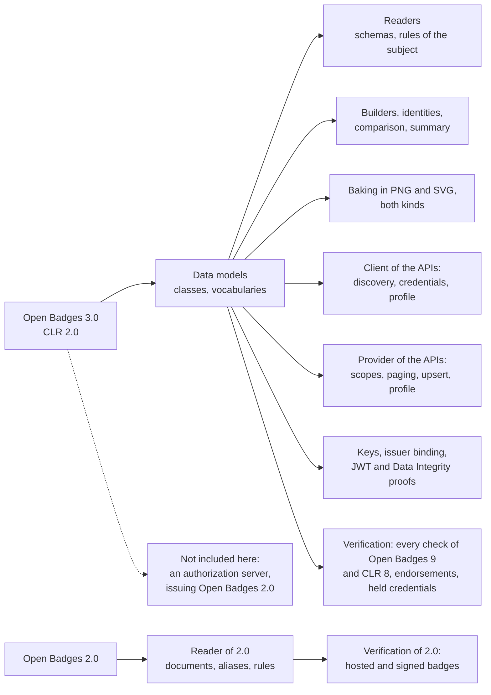

# Supported

What `@interopkit/achievement-credentials` implements of Open Badges 3.0 and CLR 2.0. The package implements these
specifications and is not certified by 1EdTech. It claims no conformance of an issuer or a host.

| Area                    | Specification              | Included                                                                                                                                                                                                                                                                                                                                                                                                                                                        |
| ----------------------- | -------------------------- | --------------------------------------------------------------------------------------------------------------------------------------------------------------------------------------------------------------------------------------------------------------------------------------------------------------------------------------------------------------------------------------------------------------------------------------------------------------- |
| Credential classes      | OB B.1.1 to B.1.27         | `Achievement`, `AchievementCredential`, `AchievementSubject`, `Address`, `Alignment`, `Criteria`, `EndorsementCredential`, `EndorsementSubject`, `Evidence`, `GeoCoordinates`, `IdentifierEntry`, `IdentityObject`, `Image`, `Profile`, `Related`, `Result`, `ResultDescription`, `RubricCriterionLevel`, `VerifiableCredential`, `ProfileRef`, `CredentialSchema`, `CredentialStatus`, `CredentialSubject`, `Proof`, `RefreshService`, `TermsOfUse`, `Context` |
| Enumerations            | OB B.1.28 to B.1.32        | `ACHIEVEMENT_TYPES`, `ALIGNMENT_TARGET_TYPES`, `IDENTIFIER_TYPES`, `RESULT_TYPES`, `RESULT_STATUS_TYPES`, all but the last open to `ext:` terms                                                                                                                                                                                                                                                                                                                 |
| API models              | OB B.2 to B.4, CLR B.3     | `GetOpenBadgeCredentialsResponse`, `GetClrCredentialsResponse`, `ImsxStatusInfo` with its codes, `ServiceDescriptionDocument` and the OpenAPI parts                                                                                                                                                                                                                                                                                                             |
| OAuth vocabularies      | OB B.5                     | `AUTHORIZATION_ERRORS`, `REGISTRATION_ERRORS`, `TOKEN_ERRORS`                                                                                                                                                                                                                                                                                                                                                                                                   |
| Key models              | OB B.6                     | `Multikey`, `JWK`, `JWKS`                                                                                                                                                                                                                                                                                                                                                                                                                                       |
| Data model 1.1          | OB B.9                     | `AchievementCredentialV1p1`, `EndorsementCredentialV1p1`, `VerifiableCredentialV1p1`, `AchievementSubjectV1p1`, `AchievementV1p1`, `ProfileV1p1`                                                                                                                                                                                                                                                                                                                |
| CLR                     | CLR B.1, B.2               | `ClrCredential`, `ClrSubject`, `Association` with `ASSOCIATION_TYPES`, the forms under 1.1, `ClrCredentialJwtPayload`, `ClrSubjectJwtPayload`                                                                                                                                                                                                                                                                                                                   |
| Compacted JSON-LD       | OB A.2.1                   | A list written as its only member is read as a list                                                                                                                                                                                                                                                                                                                                                                                                             |
| Builders                | OB B.1.2, B.1.7, CLR B.1.1 | `buildAchievementCredential`, `buildEndorsementCredential`, `buildClrCredential` (and the payload of a CLR in a JWT), `caseAlignment`: the contexts, the types, the subject and the official `credentialSchema`, checked as the readers check                                                                                                                                                                                                                   |
| Recipient identity      | OB B.1.12, B.7, 9.3        | `hashIdentifier` (`sha256$`), `matchesIdentifier` for `IdentityObject` and `IdentityObjectV2`, `sha256$` and `md5$` hashes                                                                                                                                                                                                                                                                                                                                      |
| Equality and comparison | OB 10                      | `sameCredential`, `newerCredential`                                                                                                                                                                                                                                                                                                                                                                                                                             |
| Document formats        | OB 5.3, CLR 4.3            | `bakePng`, `readPng`, `bakeSvg`, `readSvg`: a compact JWS or the JSON of a credential in an `iTXt` chunk (`openbadgecredential`, `clrcredential`) or in a `credential` element of `https://purl.imsglobal.org/ob/v3p0` or `https://purl.imsglobal.org/clr/v2p0`; the shape of the image and of the credential is checked and the credential is not verified |
| Open Badges 2.0 images  | OB 2.0 Baking              | `readPng` and `readSvg` find an assertion as JSON or a compact JWS in an `iTXt` chunk `openbadges`, the address of a hosted assertion in a legacy `tEXt` chunk, and an `assertion` element of `http://openbadges.org`; the bakers refuse 2.0 |
| API                     | OB 6, CLR 5                | `discoverService`, `createCredentialsClient`: `getCredentials` with `limit`, `offset`, `since`, `X-Total-Count` and `Link`; `upsertCredential` as a compact JWS or JSON (200, 201, 304); `getProfile`; `putProfile`; `getServiceDescription`; the paths of both APIs; `Retry-After` reported by `readStatusInfo` and no retry |
| API provider            | OB 6, CLR 5                | `handleCredentialsRequest`: the five operations of each API below its path; the scopes of OB 6.2.1 and CLR 5.2.1 asked of the host's `authorize`; `limit`, `offset` and `since`, `X-Total-Count` when the store counts and `Link`; an upsert as JSON or a compact JWS, read as the kind of the API and answered 201, 200 or 304; `getProfile` and `putProfile`; the service description, unprotected; `imsx_StatusInfo` with the codes of OB B.3.6; verification before storing on request |
| API security            | OB 7, CLR 6                | The client takes its tokens from a function of the host: `@interopkit/core/oauth` does registration, the authorization code flow with PKCE S256, refresh and revocation from the endpoints that `discoverService` reads |
| Display                 | OB conformance 4           | `credentialSummary`: name, description, image, issuer and dates, the date of the award among them, of a badge, a CLR or an endorsement, under either data model, and of an Open Badges 2.0 assertion                                                                                                                                                                                                                                                                                              |
| Open Badges 2.0 classes | OB 2.0 vocabulary          | `AssertionV2`, `BadgeClassV2`, `ProfileV2`, `IdentityObjectV2`, `VerificationObjectV2`, `CryptographicKeyV2`, `RevocationListV2`, `EvidenceV2`, `CriteriaV2`, `AlignmentObjectV2`, `ImageV2`, `EndorsementV2`, joined in `BadgeAssertionV2`; read and never written ([guide](open-badges-2.md)) |
| Open Badges 2.0 inputs  | OB 2.0, its context        | An assertion under `https://w3id.org/openbadges/v2`, alone or in a list of contexts, that embeds its BadgeClass and issuer, or the three documents as a `BadgeAssertionV2`; the aliases `verify`, `hosted` and `signed` from a fixed table that the tests compare with the pinned context |
| Open Badges 2.0 rules   | OB 2.0, validator core     | The required properties and forms of each class, the recipient's hash and email, an expiry after the issue, criteria that say something, the entries of a revocation list, an issuer hosted over HTTP; a table of the rules in `scripts/open-badges-v2-rules.ts` |
| Open Badges 2.0 recipients | OB 2.0 IdentityObject   | `matchesIdentifier` for `sha256$` and `md5$` hashes and plain values of `id`, `email`, `url` and `telephone` |
| Rules of the subject    | OB B.1.3, B.1.16, B.7, CLR B.1.2, VC Data Model 2.0 4.8, 4.9, 5.3 | An `AchievementSubject` and a `ClrSubject` with an `id` or an `identifier`; an identity hash in a form the specification names; results that name a description of the achievement, levels of it and a status where it asks for one, and criteria that say something (warnings); a subject that says something, a period that does not end before it begins, and related resources of the form that the data model gives them |
| JSON schemas            | The schemas of 1EdTech     | Every class, compared in the tests with the published files at pinned hashes, and with the schemas that the pages print for the classes that lack a file                                                                                                                                                                                                                                                                                                        |
| Examples                | OB D, CLR 2                | Every credential that the pages print is read without a finding                                                                                                                                                                                                                                                                                                                                                                                                 |
| VC-JWT proof            | OB 8.2, VC-JOSE-COSE       | `signCredentialJwt` over a `Signer`: the claims `iss`, `jti`, `nbf`, `sub`, `exp`, `kid` or `jwk`, `typ`; a CLR with its nested credentials as compact JWS. `readCredentialJwt` reads that form, the VC-JOSE-COSE form and the `vc` claim form of VC-JWT 1.1 |
| Keys                    | OB 8.5, B.6                | `createKeyResolver`: a `kid` or verification method at an HTTPS address (a JWK, a Multikey, a key set, a controller document), `did:key` and `did:web`; other DID methods through a port |
| Issuer binding          | Guide 3.1.12               | `verifyIssuerKey`: a key counts when the issuer publishes it under `assertionMethod` in its document or in the key set at `/.well-known/jwks.json`, with `controller` and `iss` kept apart |
| Data Integrity proofs   | OB 8.3, Conformance 3.1.1, 4.2.1 | `addProof` with `eddsa-rdfc-2022` and `ecdsa-sd-2023` (the base proof), `deriveDisclosure`, `verifyProof` for `eddsa-rdfc-2022`, `ecdsa-rdfc-2019`, `ecdsa-sd-2023` and, with `legacyProofs`, `Ed25519Signature2020`; the key must be bound to the issuer |
| JSON-LD safe mode       | OB Conformance 3           | `validateJsonLd`: the properties and values that safe mode drops, with their paths                                                                                  |
| Contexts                | OB 5.3, VC Data Model 2.0  | `createContextLoader`: a context only at the pin of its address (`KNOWN_CONTEXTS`: VC 1.1 and 2.0, OB 3.0.0 to 3.0.3 and its extensions, CLR 2.0.0 and 2.0.1, Data Integrity 2, Multikey, DID) |
| Status lists            | OB 9.1, Bitstring Status List 2.1, 3.2 | `createStatusList`, `allocateStatusIndex` (a free index at random), `setCredentialStatus`, `issueStatusListCredential` (a JWS or a Data Integrity proof), `verifyCredentialStatus` (the validate algorithm with its codes), `createStatusListCache` (`ttl` and `validUntil`); entries of the `message` purpose or wider than 1 bit are `skipped`; a status of the 1EdTech Revocation List Status Method is read from its list |
| Refresh                 | OB 9.1, VCCR               | `refreshCredential` (`1EdTechCredentialRefresh` and `ImsCredentialRefresh`), `handleRefreshRequest` for the issuer                                                                                |
| Examples of 2.0         | OB 2.0 and its examples    | Every document that the pages print is read; the first example lacks `hashed`, and a revoked endorsement holds only what revocation requires: both are pinned with their findings                                                                                                                                                                                                                                                                             |
| Open Badges 2.0 verification | OB 2.0 Verification   | `verifyCredential`: a hosted assertion fetched at its `id`, revoked by 410 Gone or `revoked`, within the `startsWith` and `allowedOrigins` of its issuer; a signed assertion as a compact JWS, by its `creator` or a key of its issuer's `publicKey` and that key's `owner`, and not in its issuer's `revocationList`; `issuedOn` and `expires`; the recipient |
| Verification            | OB 9, CLR 8                | `verifyCredential`: the form, the schema (1EdTech's, and any other that is fetched, runs no regular expression and is judged within a bound of work), the proof, the issuer's hold on the key, the refresh, the status, the validity and the recipient; the endorsements that the credential holds anywhere, its issuer's and its achievements' among them; the credentials that a CLR holds |

## Not included

| Not included                                                         | Why                                                                                                         |
| -------------------------------------------------------------------- | ----------------------------------------------------------------------------------------------------------- |
| An authorization server for the APIs                                 | An application: the provider asks the host's `authorize` about each token                                    |
| Issuing, signing and baking Open Badges 2.0                          | Open Badges 3.0 supersedes it: a 2.0 badge is read, verified and found in an image only                      |
| The endorsements of a 2.0 badge                                      | They are read and not verified: the verification of Open Badges 2.0 is that of an assertion                  |
| Verifiable presentations                                             | Open Badges 9 and CLR 8 verify credentials; a presentation is the envelope of a protocol of delivery that the host speaks, and it passes each credential to `verifyCredential` |
| Registries of trusted issuers                                        | Validation, which Open Badges 9 leaves to the verifier's policy: a host checks the issuer of the result against its registry |
| JSON-LD processing, a map of languages for a text, a single context | The compacted form is read as JSON; the contexts give no language container and a credential needs both contexts |

[The comparators](comparators.md) map what the validator of 1EdTech and the verifiers of verifiable credentials do against the
package, with the reason for each exclusion.
