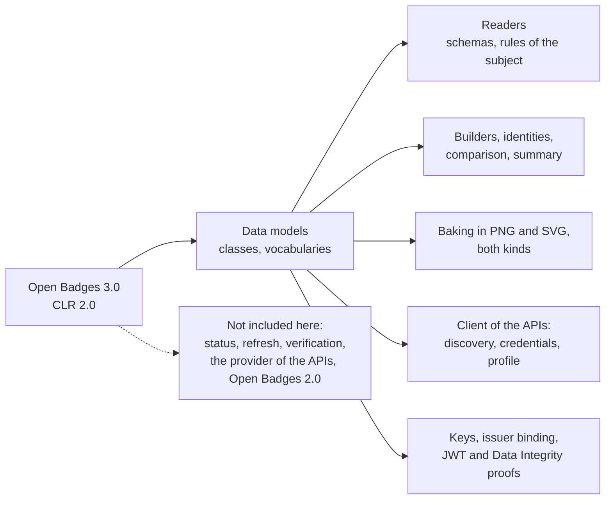

# Supported

What `@interopkit/achievement-credentials` implements of Open Badges 3.0 and CLR 2.0. The package implements these
specifications and is not certified by 1EdTech. It claims no conformance of an issuer or a host.

| Area                    | Specification              | Included                                                                                                                                                                                                                                                                                                                                                                                                                                                        |
| ----------------------- | -------------------------- | --------------------------------------------------------------------------------------------------------------------------------------------------------------------------------------------------------------------------------------------------------------------------------------------------------------------------------------------------------------------------------------------------------------------------------------------------------------- |
| Credential classes      | OB B.1.1 to B.1.27         | `Achievement`, `AchievementCredential`, `AchievementSubject`, `Address`, `Alignment`, `Criteria`, `EndorsementCredential`, `EndorsementSubject`, `Evidence`, `GeoCoordinates`, `IdentifierEntry`, `IdentityObject`, `Image`, `Profile`, `Related`, `Result`, `ResultDescription`, `RubricCriterionLevel`, `VerifiableCredential`, `ProfileRef`, `CredentialSchema`, `CredentialStatus`, `CredentialSubject`, `Proof`, `RefreshService`, `TermsOfUse`, `Context` |
| Enumerations            | OB B.1.28 to B.1.32        | `ACHIEVEMENT_TYPES`, `ALIGNMENT_TARGET_TYPES`, `IDENTIFIER_TYPES`, `RESULT_TYPES`, `RESULT_STATUS_TYPES`, all but the last open to `ext:` terms                                                                                                                                                                                                                                                                                                                 |
| API models              | OB B.2 to B.4, CLR B.3     | `GetOpenBadgeCredentialsResponse`, `GetClrCredentialsResponse`, `ImsxStatusInfo` with its codes, `ServiceDescriptionDocument` and the OpenAPI parts                                                                                                                                                                                                                                                                                                             |
| OAuth vocabularies      | OB B.5                     | `AUTHORIZATION_ERRORS`, `REGISTRATION_ERRORS`, `TOKEN_ERRORS`                                                                                                                                                                                                                                                                                                                                                                                                   |
| Key models              | OB B.6                     | `Multikey`, `JWK`, `JWKS`                                                                                                                                                                                                                                                                                                                                                                                                                                       |
| Data model 1.1          | OB B.9                     | `AchievementCredentialV1p1`, `EndorsementCredentialV1p1`, `VerifiableCredentialV1p1`, `AchievementSubjectV1p1`, `AchievementV1p1`, `ProfileV1p1`                                                                                                                                                                                                                                                                                                                |
| CLR                     | CLR B.1, B.2               | `ClrCredential`, `ClrSubject`, `Association` with `ASSOCIATION_TYPES`, the forms under 1.1, `ClrCredentialJwtPayload`, `ClrSubjectJwtPayload`                                                                                                                                                                                                                                                                                                                   |
| Compacted JSON-LD       | OB A.2.1                   | A list written as its only member is read as a list                                                                                                                                                                                                                                                                                                                                                                                                             |
| Builders                | OB B.1.2, B.1.7, CLR B.1.1 | `buildAchievementCredential`, `buildEndorsementCredential`, `buildClrCredential` (and the payload of a CLR in a JWT), `caseAlignment`: the contexts, the types, the subject and the official `credentialSchema`, checked as the readers check                                                                                                                                                                                                                   |
| Recipient identity      | OB B.1.12, B.7, 9.3        | `hashIdentifier` (`sha256$`), `matchesIdentifier` for `IdentityObject` and `IdentityObjectV2`, `sha256$` and `md5$` hashes                                                                                                                                                                                                                                                                                                                                      |
| Equality and comparison | OB 10                      | `sameCredential`, `newerCredential`                                                                                                                                                                                                                                                                                                                                                                                                                             |
| Document formats        | OB 5.3, CLR 4.3            | `bakePng`, `readPng`, `bakeSvg`, `readSvg`: a compact JWS or the JSON of a credential in an `iTXt` chunk (`openbadgecredential`, `clrcredential`) or in a `credential` element of `https://purl.imsglobal.org/ob/v3p0` or `https://purl.imsglobal.org/clr/v2p0`; the shape of the image and of the credential is checked and the credential is not verified |
| API                     | OB 6, CLR 5                | `discoverService`, `createCredentialsClient`: `getCredentials` with `limit`, `offset`, `since`, `X-Total-Count` and `Link`; `upsertCredential` as a compact JWS or JSON (200, 201, 304); `getProfile`; `putProfile`; `getServiceDescription`; the paths of both APIs; `Retry-After` reported by `readStatusInfo` and no retry |
| API security            | OB 7, CLR 6                | The client takes its tokens from a function of the host: `@interopkit/core/oauth` does registration, the authorization code flow with PKCE S256, refresh and revocation from the endpoints that `discoverService` reads |
| Display                 | OB conformance 4           | `credentialSummary`: name, description, image, issuer and dates of a badge, a CLR or an endorsement, under either data model                                                                                                                                                                                                                                                                                                                                    |
| Rules of the subject    | OB B.1.3, B.7, CLR B.1.2   | An `AchievementSubject` and a `ClrSubject` with an `id` or an `identifier`; an identity hash in a form the specification names                                                                                                                                                                                                                                                                                                                                  |
| JSON schemas            | The schemas of 1EdTech     | Every class, compared in the tests with the published files at pinned hashes, and with the schemas that the pages print for the classes that lack a file                                                                                                                                                                                                                                                                                                        |
| Examples                | OB D, CLR 2                | Every credential that the pages print is read without a finding                                                                                                                                                                                                                                                                                                                                                                                                 |
| VC-JWT proof            | OB 8.2, VC-JOSE-COSE       | `signCredentialJwt` over a `Signer`: the claims `iss`, `jti`, `nbf`, `sub`, `exp`, `kid` or `jwk`, `typ`; a CLR with its nested credentials as compact JWS. `readCredentialJwt` reads that form, the VC-JOSE-COSE form and the `vc` claim form of VC-JWT 1.1 |
| Keys                    | OB 8.5, B.6                | `createKeyResolver`: a `kid` or verification method at an HTTPS address (a JWK, a Multikey, a key set, a controller document), `did:key` and `did:web`; other DID methods through a port |
| Issuer binding          | Guide 3.1.12               | `verifyIssuerKey`: a key counts when the issuer publishes it under `assertionMethod` in its document or in the key set at `/.well-known/jwks.json`, with `controller` and `iss` kept apart |
| Data Integrity proofs   | OB 8.3, Conformance 3.1.1, 4.2.1 | `addProof` with `eddsa-rdfc-2022` and `ecdsa-sd-2023` (the base proof), `deriveDisclosure`, `verifyProof` for `eddsa-rdfc-2022`, `ecdsa-rdfc-2019`, `ecdsa-sd-2023` and, with `legacyProofs`, `Ed25519Signature2020`; the key must be bound to the issuer |
| JSON-LD safe mode       | OB Conformance 3           | `validateJsonLd`: the properties and values that safe mode drops, with their paths                                                                                  |
| Contexts                | OB 5.3, VC Data Model 2.0  | `createContextLoader`: a context only at the pin of its address (`KNOWN_CONTEXTS`: VC 1.1 and 2.0, OB 3.0.0 to 3.0.3 and its extensions, CLR 2.0.0 and 2.0.1, Data Integrity 2, Multikey, DID) |

## Not included

| Not included                                                         | Why                                                                                                         |
| -------------------------------------------------------------------- | ----------------------------------------------------------------------------------------------------------- |
| Status lists, refresh, verification of a whole credential            | They need a clock and requests; the readers only check shape and the rules of the subject                    |
| The provider side of the APIs of Open Badges and CLR                 | A server over requests, with the host's storage and authorization                                            |
| Open Badges 2.0                                                      | A model of its own                                                                                          |
| JSON-LD processing, a map of languages for a text, a single context | The compacted form is read as JSON; the contexts give no language container and a credential needs both contexts |
