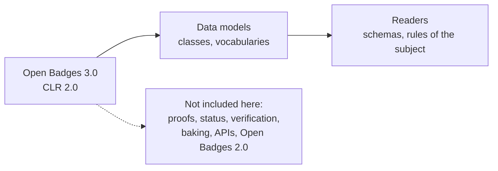

# Supported

What `@interopkit/achievement-credentials` implements of Open Badges 3.0 and CLR 2.0. The package implements these
specifications and is not certified by 1EdTech. It claims no conformance of an issuer or a host.

| Area                               | Specification            | Included                                                                                                                                                |
| ---------------------------------- | ------------------------ | ------------------------------------------------------------------------------------------------------------------------------------------------------- |
| Credential classes                 | OB B.1.1 to B.1.27       | `Achievement`, `AchievementCredential`, `AchievementSubject`, `Address`, `Alignment`, `Criteria`, `EndorsementCredential`, `EndorsementSubject`, `Evidence`, `GeoCoordinates`, `IdentifierEntry`, `IdentityObject`, `Image`, `Profile`, `Related`, `Result`, `ResultDescription`, `RubricCriterionLevel`, `VerifiableCredential`, `ProfileRef`, `CredentialSchema`, `CredentialStatus`, `CredentialSubject`, `Proof`, `RefreshService`, `TermsOfUse`, `Context` |
| Enumerations                       | OB B.1.28 to B.1.32      | `ACHIEVEMENT_TYPES`, `ALIGNMENT_TARGET_TYPES`, `IDENTIFIER_TYPES`, `RESULT_TYPES`, `RESULT_STATUS_TYPES`, all but the last open to `ext:` terms       |
| API models                         | OB B.2 to B.4, CLR B.3   | `GetOpenBadgeCredentialsResponse`, `GetClrCredentialsResponse`, `ImsxStatusInfo` with its codes, `ServiceDescriptionDocument` and the OpenAPI parts      |
| OAuth vocabularies                 | OB B.5                   | `AUTHORIZATION_ERRORS`, `REGISTRATION_ERRORS`, `TOKEN_ERRORS`                                                                                           |
| Key models                         | OB B.6                   | `Multikey`, `JWK`, `JWKS`                                                                                                                               |
| Data model 1.1                     | OB B.9                   | `AchievementCredentialV1p1`, `EndorsementCredentialV1p1`, `VerifiableCredentialV1p1`, `AchievementSubjectV1p1`, `AchievementV1p1`, `ProfileV1p1`       |
| CLR                                | CLR B.1, B.2             | `ClrCredential`, `ClrSubject`, `Association` with `ASSOCIATION_TYPES`, the forms under 1.1, `ClrCredentialJwtPayload`, `ClrSubjectJwtPayload`          |
| Compacted JSON-LD                  | OB A.2.1                 | A list written as its only member is read as a list                                                                                                     |
| Rules of the subject               | OB B.1.3, B.7, CLR B.1.2 | An `AchievementSubject` and a `ClrSubject` with an `id` or an `identifier`; an identity hash in a form the specification names                         |
| JSON schemas                       | The schemas of 1EdTech   | Every class, compared in the tests with the published files at pinned hashes, and with the schemas that the pages print for the classes that lack a file |
| Examples                           | OB D, CLR 2              | Every credential that the pages print is read without a finding                                                                                         |

## Not included

| Not included                                                         | Why                                                                                                         |
| -------------------------------------------------------------------- | ----------------------------------------------------------------------------------------------------------- |
| Proofs, keys, status lists, refresh, verification                    | They need keys, a clock and requests; the readers only check shape and the rules of the subject            |
| Baking a credential in an image                                      | A format of its own                                                                                         |
| The APIs of Open Badges and CLR                                      | Clients and servers over requests                                                                           |
| Open Badges 2.0                                                      | A model of its own                                                                                          |
| JSON-LD processing, a map of languages for a text, a single context | The compacted form is read as JSON; the contexts give no language container and a credential needs both contexts |
