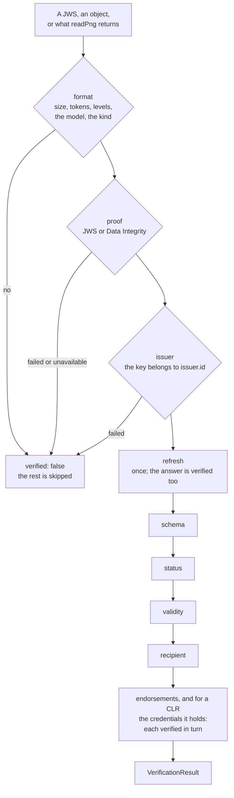

# Verifying a credential

`@interopkit/achievement-credentials/verify` verifies an Open Badges 3.0 credential, an endorsement or a CLR as Open Badges 9 and
CLR 8 say: the form and the schema, the proof, the issuer's hold on the key, the refresh, the status, the validity and, when the
recipient is known, the recipient, then the endorsements and, for a CLR, the credentials that it holds. The result is a value.



| Export                | Does                                                                                                               |
| --------------------- | ------------------------------------------------------------------------------------------------------------------ |
| `verifyCredential`    | Verifies a credential, its endorsements and the credentials of a CLR, and returns every check                       |
| `VerifyOptions`       | The options of the verification                                                                                     |
| `KnownRecipient`      | The recipient that the verifier knows: an `id`, an identifier, or both                                              |

The function comes from `@interopkit/achievement-credentials/verify`, and `VerificationResult`, `VerificationCheck` and
`VERIFICATION_CHECKS` from `@interopkit/achievement-credentials`.

## Quick start

```ts
import { buildAchievementCredential } from "@interopkit/achievement-credentials";
import { signCredentialJwt } from "@interopkit/achievement-credentials/jwt";
import { createKeyResolver } from "@interopkit/achievement-credentials/keys";
import { verifyCredential } from "@interopkit/achievement-credentials/verify";
import { signerFromCryptoKey } from "@interopkit/core";

const issuer = "https://example.edu/issuers/565049";
const pair = await crypto.subtle.generateKey({ name: "ECDSA", namedCurve: "P-256" }, true, ["sign", "verify"]);
const document = {
  id: issuer,
  verificationMethod: [
    { id: `${issuer}#key-1`, type: "JsonWebKey", controller: issuer, publicKeyJwk: await crypto.subtle.exportKey("jwk", pair.publicKey) },
  ],
  assertionMethod: [`${issuer}#key-1`],
};
const clock = { now: () => Date.UTC(2024, 5, 14) };
const keys = createKeyResolver({
  clock,
  fetch: async (url) => new Response(url === issuer ? JSON.stringify(document) : "", { status: url === issuer ? 200 : 404 }),
});

const credential = buildAchievementCredential({
  id: "https://example.edu/credentials/3732",
  issuer: { id: issuer, type: ["Profile"], name: "Example University" },
  validFrom: "2024-06-13T18:46:03Z",
  name: "Fractions badge",
  subject: { id: "did:example:learner" },
  achievement: {
    id: "https://example.edu/achievements/1",
    type: ["Achievement"],
    name: "Fractions",
    description: "Understands fractions as numbers.",
    criteria: { narrative: "Pass the final assessment." },
  },
});
const signer = signerFromCryptoKey(pair.privateKey, { algorithm: "ES256" });
const jws = await signCredentialJwt(credential, signer, { kid: `${issuer}#key-1` });

const result = await verifyCredential(jws, { keys, clock });
result.verified; // => true
result.checks.map(({ check, outcome }) => `${check} ${outcome}`).join(", "); // => "format passed, schema passed, proof passed, issuer passed, refresh skipped, status skipped, validity passed, recipient skipped"

// A good signature by a key that the issuer does not publish proves nothing about the issuer.
const other = await crypto.subtle.generateKey({ name: "ECDSA", namedCurve: "P-256" }, true, ["sign", "verify"]);
const forged = await signCredentialJwt(credential, signerFromCryptoKey(other.privateKey, { algorithm: "ES256" }), {
  jwk: await crypto.subtle.exportKey("jwk", other.publicKey),
});
const refused = await verifyCredential(forged, { keys, clock });
refused.verified; // => false
refused.checks.find(({ check }) => check === "issuer")?.outcome; // => "failed"
refused.credential; // => undefined
```

## The checks

The result lists all eight checks, always in this order. A check that did not run is `skipped` and says which check stopped the
others.

| Check       | What it does                                                                                                                                                                  | Outcomes                                                   |
| ----------- | ----------------------------------------------------------------------------------------------------------------------------------------------------------------------------- | ---------------------------------------------------------- |
| `format`    | The input is a compact JWS or an object within the limits, the readers accept it as a credential, and it is an `AchievementCredential`, an `EndorsementCredential` or a `ClrCredential` | `passed`, `failed`                                         |
| `schema`    | A `credentialSchema` of the type `1EdTechJsonSchemaValidator2019`: a schema of 1EdTech is what the readers checked, any other is fetched and judges the credential as written | `passed`, `failed`, `unavailable`, `skipped` (none named)  |
| `proof`     | The signature of the JWS, or a Data Integrity proof, with a key that the resolver finds                                                                                        | `passed`, `failed`, `unavailable`                          |
| `issuer`    | The key belongs to `issuer.id`: the issuer publishes it under `assertionMethod`, in its document or in its JWK Set (`verifyIssuerKey`)                                          | `passed`, `failed`, `unavailable`, `skipped` (`allowUnboundKeys`) |
| `refresh`   | The `refreshService` is followed once; the answer must be authentic and the same credential, and it takes the place of the original                                            | `passed`, `unavailable`, `skipped`                         |
| `status`    | The `BitstringStatusListEntry` is read from its list credential, which is verified as strictly as the credential (`verifyCredentialStatus`)                                     | `passed`, `failed`, `unavailable`, `skipped`               |
| `validity`  | Not before `validFrom` and not after `validUntil` (`issuanceDate` and `expirationDate` under Data Model 1.1), within `clockSkewSeconds`; a JWT's `exp` and `nbf` count the same | `passed`, `failed`                                         |
| `recipient` | The subject is the known recipient, by `id` or by an identifier (`matchesIdentifier`)                                                                                          | `passed`, `failed`, `skipped` (none known)                 |

`verified` is true when every check passed or did not apply, and so does every endorsement and every credential that a CLR holds.
`unavailable` fails the verification unless `unavailable` is `"warn"`, which applies to `schema`, `issuer`, `refresh` and
`status`. A proof that cannot be checked always fails it.

| Result field   | Holds                                                                                                                                                         |
| -------------- | ------------------------------------------------------------------------------------------------------------------------------------------------------------- |
| `verified`     | Whether the credential may be treated as verified                                                                                                              |
| `credential`   | What the proof secures: set when the proof is valid and the issuer check did not fail. After a successful refresh it is the refreshed credential, so a host that stores what it was given sets `refresh` to `false`. A credential that failed its status or its validity is still returned, so that a displayer can say why. Read `verified` first |
| `checks`       | The eight checks, each with its `outcome` and a `detail` that says what was found                                                                              |
| `endorsements` | The results for the endorsements of the credential, of its issuer's profile and of its achievements, each verified as an `EndorsementCredential`                |
| `nested`       | For a CLR, the results for the credentials that it holds, each verified as an Open Badges credential                                                           |

## The order of the work

A credential is verified in the order that keeps a forger from making the verifier call an address.

| Step | What runs                                                                                                              | Fetches                                           |
| ---- | ---------------------------------------------------------------------------------------------------------------------- | ------------------------------------------------- |
| 1    | The limits of the input, then the model: size, tokens and levels are counted before anything reads the text              | Nothing                                           |
| 2    | The proof, then the issuer's hold on the key                                                                            | The keys and the contexts of the proof            |
| 3    | The limits of what the credential holds: its endorsements, and for a CLR its credentials                                | Nothing                                           |
| 4    | The refresh, once; a refreshed credential goes through steps 1 and 2 and takes the place of the original               | The refresh service                               |
| 5    | The schema, the status, the validity and the recipient                                                                  | A schema, a status list                           |
| 6    | The endorsements, and for a CLR the credentials it holds, each from step 1                                              | As above, for each                                |

A credential whose form, proof or issuer check fails stops at step 2 or 3: nothing that it names is fetched, and its `credential`
is withheld. The status lists of one call are fetched once, and so is each schema, however many credentials name them.

## Endorsements and CLRs

| Case                                      | Rule                                                                                                                                                           |
| ----------------------------------------- | -------------------------------------------------------------------------------------------------------------------------------------------------------------- |
| Which endorsements are verified           | `endorsement` and `endorsementJwt` of the credential, of its issuer's profile and of the achievements of its subject                                            |
| An endorsement                            | Verified as Open Badges 9.2: form, schema, proof, issuer, refresh, status and validity, with its own issuer's key. Its recipient check is `skipped`; its own endorsements are not followed |
| The credentials of a CLR                  | Verified as Open Badges 9.1, each with its own proof and issuer. Their recipient check is `skipped`: the recipient is checked on the CLR. The credentials they hold are not followed |
| A forged endorsement or held credential   | Its result is `verified: false` with `issuer` `failed`, the credential that holds it keeps its own checks, and `verified` of the credential is false                |
| Limits                                    | `maxEndorsements` for one credential and `maxNestedCredentials` for one CLR: more is `format` `failed`, counted before any of them is verified                   |

## Options

| Option                 | Meaning                                                                                                   | Default                                              |
| ---------------------- | --------------------------------------------------------------------------------------------------------- | ---------------------------------------------------- |
| `keys`                 | The `KeyResolver` from `createKeyResolver`                                                                | Required                                             |
| `clock`                | The `Clock` that validity is judged at                                                                    | Required                                             |
| `contexts`             | The loader of JSON-LD contexts, for a Data Integrity proof                                                | None: such a proof is `unavailable`                  |
| `fetch`                | The `Fetch` for status lists, refresh services and schemas                                                | None: those checks are `unavailable`                 |
| `statusLists`          | A `StatusListCache` that keeps list credentials across calls                                              | None: a list is fetched once for each call           |
| `statusIssuers`        | Issuers other than a credential's that may publish its status list                                        | None                                                 |
| `recipient`            | The known recipient: `{ id }`, `{ identifier: { type, value } }` or both; either is a match               | None: the check is `skipped`                         |
| `refresh`              | Whether to follow the refresh service                                                                     | `true`                                               |
| `unavailable`          | `"fail"` or `"warn"`: whether `schema`, `issuer`, `refresh` and `status` that cannot be read fail the verification | `"fail"`                                  |
| `allowUnboundKeys`     | Accept keys that the issuer does not publish, for the credential and its status lists                      | `false`                                              |
| `legacyProofs`         | Accept `Ed25519Signature2020` proofs                                                                      | `false`                                              |
| `suites`               | More Data Integrity suites beside `eddsa-rdfc-2022`, `ecdsa-rdfc-2019` and `ecdsa-sd-2023`                | None                                                 |
| `algorithms`           | The algorithms that may sign a JWT                                                                        | `RS256`, `RS384`, `RS512`, `ES256`, `ES384`, `EdDSA` |
| `clockSkewSeconds`     | The skew of a time claim, a validity period and a proof's expiry                                           | `60`                                                 |
| `maxEndorsements`      | The most endorsements of one credential                                                                   | `32`                                                 |
| `maxNestedCredentials` | The most credentials of one CLR                                                                           | `1000`                                               |
| `maxInputBytes`        | The most characters of the input, and of each JWS that it holds                                           | `1048576`                                            |
| `maxDepth`             | The most levels that the JSON of the input nests                                                          | `64`                                                 |
| `maxTokens`            | The most tokens of JSON of the input, counted before it is parsed                                         | `1000000`                                            |
| `timeoutMs`            | The time of each fetch                                                                                    | `10000`                                              |
| `maxBytes`             | The most bytes of each fetch                                                                              | `1048576`                                            |
| `signal`               | Ends the caller's wait. A call has no deadline of its own: a CLR may hold 1,000 credentials, and each may name a status list, a refresh service and a schema, so a host passes `AbortSignal.timeout(...)` | None |

## Limits

| Limit                                              | Value                  | Refused with                                      |
| -------------------------------------------------- | ---------------------- | ------------------------------------------------- |
| Characters of the input                            | `maxInputBytes`        | `format` `failed`                                 |
| Tokens of JSON of the input                        | `maxTokens`            | `format` `failed`                                 |
| Levels of JSON of the input                        | `maxDepth`             | `format` `failed`                                 |
| Endorsements of one credential                     | `maxEndorsements`      | `format` `failed`                                 |
| Credentials of one CLR                             | `maxNestedCredentials` | `format` `failed`                                 |
| Bytes of a schema, a status list or a refresh      | `maxBytes`             | `schema`, `status` or `refresh` `unavailable`      |
| Time of each fetch                                 | `timeoutMs`            | `unavailable`                                     |
| Tokens and levels of a schema                      | `maxTokens`, `maxDepth` | `schema` `unavailable`                           |

## Errors

| Case                                                                      | Result                                              |
| ------------------------------------------------------------------------- | --------------------------------------------------- |
| The input is no string and no object, or an option has the wrong type      | `DataError`                                         |
| A credential that is not valid, a proof that does not verify, a service that fails | A check that is `failed` or `unavailable`   |
| The signal aborts                                                         | The `reason` of the signal                           |

A service that fails is never an error of the call: it makes its check `unavailable`.

## Not included

| Not included                                                    | Why                                                                                                             |
| --------------------------------------------------------------- | --------------------------------------------------------------------------------------------------------------- |
| Open Badges 2.0                                                 | The address of a hosted assertion, and a baked image of that kind, are `format` `failed`: this verifier reads Open Badges 3.0 and CLR 2.0 |
| Validation: whether an issuer is trusted                        | Open Badges 9 leaves it outside verification                                                                    |
| Verifiable presentations                                        | Open Badges and CLR define none                                                                                 |
| JSON text as input                                              | Parse it into an object first; a string is a compact JWS                                                        |
| A deadline for the whole call                                   | The host's `signal`                                                                                             |

## Differences from the references

| Case                                       | The references                                                                                                    | This package                                                                                                      |
| ------------------------------------------ | ----------------------------------------------------------------------------------------------------------------- | ----------------------------------------------------------------------------------------------------------------- |
| A key that the issuer does not publish     | 1EdTech's validator reads the key and the controller from the verification method, which anyone can write          | `issuer` `failed`, whatever the signature; `allowUnboundKeys` skips it                                            |
| The order of the checks                    | Open Badges 9.1 checks the schema first                                                                           | The schema is judged after the proof, so that an address that a credential names is fetched only for a credential that is authentic. The result lists the checks in the order of Open Badges |
| A refreshed credential                     | Open Badges 9.1 says to repeat the schema and the proof, and to go on with the original when the refresh is not successful | The refreshed credential must be authentic and the same credential (Open Badges 10): its id and its issuer. Otherwise the refresh is `unavailable` and the original is verified |
| A schema that runs a regular expression    | 1EdTech's validator applies any schema                                                                            | `unavailable`: the schema and the credential are written by the same issuer, and a pattern can be written to backtrack for longer than a verifier can wait |
| The schema of a credential                 | Open Badges 9.1 names `1EdTechJsonSchemaValidator2019` and any schema                                              | A schema of 1EdTech is what the readers checked; another is fetched once for the call and judges the credential as written |
| The recipient of a held credential         | Open Badges 9.1 lists the recipient check for every credential                                                     | Checked on the credential that was passed: the credentials of a CLR need not name the learner as the CLR does        |
| The endorsements of an endorsement         | Open Badges 9.2 has no step for them                                                                              | Not followed                                                                                                      |
| Which endorsements                         | Open Badges 9.1 says "any EndorsementCredentials" the credential contains                                          | Those of the credential, of its issuer's profile and of the achievements of its subject                           |
