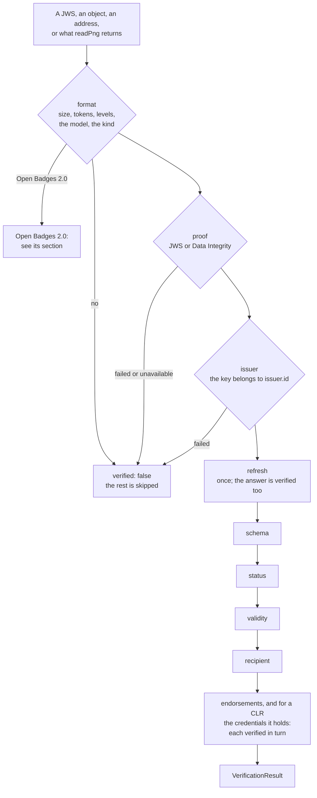
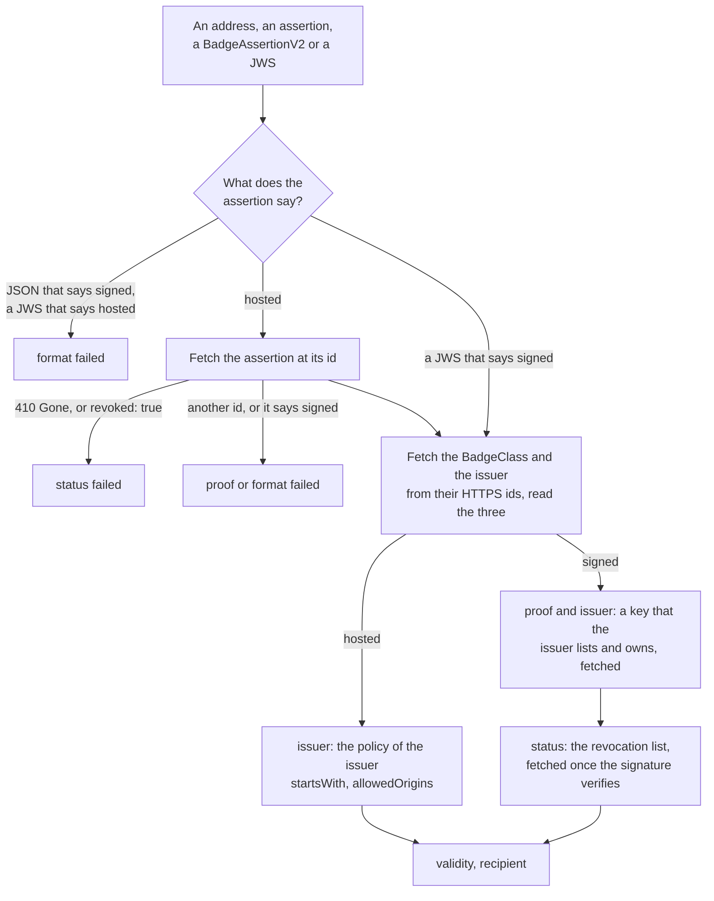

# Verifying a credential

`@interopkit/achievement-credentials/verify` verifies an Open Badges 3.0 credential, an endorsement or a CLR as Open Badges 9 and
CLR 8 say: the form and the schema, the proof, the issuer's hold on the key, the refresh, the status, the validity and, when the
recipient is known, the recipient, then the endorsements and, for a CLR, the credentials that it holds. It verifies an Open
Badges 2.0 badge as Open Badges 2.0 says: a hosted assertion at its `id` and within the verification policy of its issuer, or a
signed one by a key that its issuer lists and not on the issuer's revocation list. The result is a value.



| Export             | Does                                                                                          |
| ------------------ | --------------------------------------------------------------------------------------------- |
| `verifyCredential` | Verifies a credential, its endorsements and the credentials of a CLR, and returns every check |
| `VerifyOptions`    | The options of the verification                                                               |
| `KnownRecipient`   | The recipient that the verifier knows: an `id`, an identifier, or both                        |

The function comes from `@interopkit/achievement-credentials/verify`, and `VerificationResult`, `VerificationCheck` and
`VERIFICATION_CHECKS` from `@interopkit/achievement-credentials`.

## Quick start

```ts
import { buildAchievementCredential } from "@interopkit/achievement-credentials";
import { signCredentialJwt } from "@interopkit/achievement-credentials/jwt";
import { createKeyResolver } from "@interopkit/achievement-credentials/keys";
import { verifyCredential } from "@interopkit/achievement-credentials/verify";
import { createCryptoKeySigner } from "@interopkit/core";

const issuer = "https://example.edu/issuers/565049";
const pair = await crypto.subtle.generateKey({ name: "ECDSA", namedCurve: "P-256" }, true, ["sign", "verify"]);
const document = {
  id: issuer,
  verificationMethod: [
    {
      id: `${issuer}#key-1`,
      type: "JsonWebKey",
      controller: issuer,
      publicKeyJwk: await crypto.subtle.exportKey("jwk", pair.publicKey),
    },
  ],
  assertionMethod: [`${issuer}#key-1`],
};
const clock = { now: () => Date.UTC(2024, 5, 14) };
const keys = createKeyResolver({
  clock,
  fetch: async (url) =>
    new Response(url === issuer ? JSON.stringify(document) : "", { status: url === issuer ? 200 : 404 }),
});

const credential = buildAchievementCredential({
  id: "https://example.edu/credentials/3732",
  issuer: { id: issuer, type: ["Profile"], name: "Example University" },
  validFrom: "2024-06-13T18:46:03Z",
  name: "Fractions badge",
  subject: { id: "did:example:learner" },
  achievement: {
    id: "https://example.edu/achievements/1",
    type: ["Achievement"],
    name: "Fractions",
    description: "Understands fractions as numbers.",
    criteria: { narrative: "Pass the final assessment." },
  },
});
const signer = createCryptoKeySigner(pair.privateKey, { algorithm: "ES256" });
const jws = await signCredentialJwt(credential, signer, { kid: `${issuer}#key-1` });

const result = await verifyCredential(jws, { keys, clock });
result.verified; // => true
result.checks.map(({ check, outcome }) => `${check} ${outcome}`).join(", "); // => "format passed, schema passed, proof passed, issuer passed, refresh skipped, status skipped, validity passed, recipient skipped"

// A good signature by a key that the issuer does not publish proves nothing about the issuer.
const other = await crypto.subtle.generateKey({ name: "ECDSA", namedCurve: "P-256" }, true, ["sign", "verify"]);
const forged = await signCredentialJwt(credential, createCryptoKeySigner(other.privateKey, { algorithm: "ES256" }), {
  jwk: await crypto.subtle.exportKey("jwk", other.publicKey),
});
const refused = await verifyCredential(forged, { keys, clock });
refused.verified; // => false
refused.checks.find(({ check }) => check === "issuer")?.outcome; // => "failed"
refused.credential; // => undefined
```

## The checks

The result lists all eight checks, always in this order. A check that did not run is `skipped` and says which check stopped the
others.

| Check       | What it does                                                                                                                                                                            | Outcomes                                                          |
| ----------- | --------------------------------------------------------------------------------------------------------------------------------------------------------------------------------------- | ----------------------------------------------------------------- |
| `format`    | The input is a compact JWS or an object within the limits, the readers accept it as a credential, and it is an `AchievementCredential`, an `EndorsementCredential` or a `ClrCredential` | `passed`, `failed`                                                |
| `schema`    | A `credentialSchema` of the type `1EdTechJsonSchemaValidator2019`: a schema of 1EdTech is what the readers checked, any other is fetched and judges the credential as written           | `passed`, `failed`, `unavailable`, `skipped` (none named)         |
| `proof`     | The signature of the JWS, or a Data Integrity proof, with a key that the resolver finds                                                                                                 | `passed`, `failed`, `unavailable`                                 |
| `issuer`    | The key belongs to `issuer.id`: the issuer publishes it under `assertionMethod`, in its document or in its JWK Set (`verifyIssuerKey`)                                                  | `passed`, `failed`, `unavailable`, `skipped` (`allowUnboundKeys`) |
| `refresh`   | The `refreshService` is followed once; the answer must be authentic and the same credential, and it takes the place of the original                                                     | `passed`, `unavailable`, `skipped`                                |
| `status`    | The `BitstringStatusListEntry` is read from its list credential, which is verified as strictly as the credential (`verifyCredentialStatus`)                                             | `passed`, `failed`, `unavailable`, `skipped`                      |
| `validity`  | Not before `validFrom` and not after `validUntil` (`issuanceDate` and `expirationDate` under Data Model 1.1), within `clockSkewSeconds`; a JWT's `exp` and `nbf` count the same         | `passed`, `failed`                                                |
| `recipient` | The subject is the known recipient, by `id` or by an identifier (`matchesIdentifier`)                                                                                                   | `passed`, `failed`, `skipped` (none known)                        |

`verified` is true when every check passed or did not apply, and so does every endorsement and every credential that a CLR holds.
`unavailable` fails the verification unless `unavailable` is `"warn"`, which applies to `schema`, `refresh` and `status`. A
proof that cannot be checked, and a key that cannot be tied to the issuer, always fail it: a forger who signs in the name of an
issuer whose documents cannot be read would otherwise pass.

| Result field   | Holds                                                                                                                                                                                                                                                                                                                                              |
| -------------- | -------------------------------------------------------------------------------------------------------------------------------------------------------------------------------------------------------------------------------------------------------------------------------------------------------------------------------------------------- |
| `verified`     | Whether the credential may be treated as verified                                                                                                                                                                                                                                                                                                  |
| `credential`   | What the proof secures: set when the proof is valid and the issuer check did not fail. After a successful refresh it is the refreshed credential, so a host that stores what it was given sets `refresh` to `false`. A credential that failed its status or its validity is still returned, so that a displayer can say why. Read `verified` first |
| `checks`       | The eight checks, each with its `outcome` and a `detail` that says what was found                                                                                                                                                                                                                                                                  |
| `endorsements` | The results for the endorsements that the credential holds, wherever they are, each verified as an `EndorsementCredential`, in the order of the credential                                                                                                                                                                                         |
| `nested`       | For a CLR, the results for the credentials that it holds, each verified as an Open Badges credential                                                                                                                                                                                                                                               |

## The order of the work

A credential is verified in the order that keeps a forger from making the verifier call an address.

| Step | What runs                                                                                                   | Fetches                                |
| ---- | ----------------------------------------------------------------------------------------------------------- | -------------------------------------- |
| 1    | The limits of the input, then the model: size, tokens and levels are counted before anything reads the text | Nothing                                |
| 2    | The proof, then the issuer's hold on the key                                                                | The keys and the contexts of the proof |
| 3    | The limits of what the credential holds: its endorsements, and for a CLR its credentials                    | Nothing                                |
| 4    | The refresh, once; a refreshed credential goes through steps 1 and 2 and takes the place of the original    | The refresh service                    |
| 5    | The schema, the status, the validity and the recipient                                                      | A schema, a status list                |
| 6    | The endorsements, and for a CLR the credentials it holds, each from step 1                                  | As above, for each                     |

A credential whose form, proof or issuer check fails stops at step 2 or 3: nothing that it names is fetched, and its `credential`
is withheld. The status lists of one call are fetched once, and so is each schema, however many credentials name them.

## Endorsements and CLRs

| Case                                    | Rule                                                                                                                                                                                                                                                                                                                    |
| --------------------------------------- | ----------------------------------------------------------------------------------------------------------------------------------------------------------------------------------------------------------------------------------------------------------------------------------------------------------------------- |
| Which endorsements are verified         | Every `endorsement` and `endorsementJwt` that the credential holds (Open Badges 9.1: any it contains): its own, its issuer's and its parent organizations', its achievements' and their creators', the source of its subject. Not those inside an endorsement or a credential of a CLR, which are verified on their own |
| An endorsement                          | Verified as Open Badges 9.2: form, schema, proof, issuer, refresh, status and validity, with its own issuer's key. Its recipient check is `skipped`; its own endorsements are not followed                                                                                                                              |
| The credentials of a CLR                | Verified as Open Badges 9.1, each with its own proof and issuer. Their recipient check is `skipped`: the recipient is checked on the CLR. The credentials they hold are not followed                                                                                                                                    |
| A forged endorsement or held credential | Its result is `verified: false` with `issuer` `failed`, the credential that holds it keeps its own checks, and `verified` of the credential is false                                                                                                                                                                    |
| Limits                                  | `maxEndorsements` for one credential and `maxNestedCredentials` for one CLR: more is `format` `failed`, counted before any of them is verified                                                                                                                                                                          |

## Open Badges 2.0

A 2.0 badge is verified from the documents that its issuer hosts, which are the source of truth: the input only names them.



```ts
import { createKeyResolver } from "@interopkit/achievement-credentials/keys";
import { verifyCredential } from "@interopkit/achievement-credentials/verify";

// What the issuer hosts: the assertion, its BadgeClass and the issuer's profile, each at its id.
const documents = new Map(
  Object.entries({
    "https://badges.example.org/assertions/1": {
      "@context": "https://w3id.org/openbadges/v2",
      id: "https://badges.example.org/assertions/1",
      type: "Assertion",
      recipient: { type: "email", hashed: false, identity: "learner@example.org" },
      badge: "https://badges.example.org/badges/welding",
      verification: { type: "HostedBadge" },
      issuedOn: "2025-11-02T09:00:00Z",
    },
    "https://badges.example.org/badges/welding": {
      "@context": "https://w3id.org/openbadges/v2",
      id: "https://badges.example.org/badges/welding",
      type: "BadgeClass",
      name: "Welding",
      description: "Welds a joint to the standard of the guild.",
      image: "https://badges.example.org/badges/welding.png",
      criteria: { narrative: "Pass the practical test." },
      issuer: "https://badges.example.org/issuer",
    },
    "https://badges.example.org/issuer": {
      "@context": "https://w3id.org/openbadges/v2",
      id: "https://badges.example.org/issuer",
      type: "Issuer",
      name: "Example Guild",
      url: "https://badges.example.org",
      email: "badges@example.org",
    },
  }),
);
const clock = { now: () => Date.UTC(2026, 0, 15) };

const result = await verifyCredential("https://badges.example.org/assertions/1", {
  keys: createKeyResolver({ clock }),
  clock,
  fetch: async (url) => {
    const document = documents.get(url);
    return document === undefined ? new Response("", { status: 404 }) : new Response(JSON.stringify(document));
  },
  recipient: { identifier: { type: "email", value: "learner@example.org" } },
});
result.verified; // => true
result.checks.map(({ check, outcome }) => `${check} ${outcome}`).join(", "); // => "format passed, schema skipped, proof passed, issuer passed, refresh skipped, status passed, validity passed, recipient passed"
```

| Input                                                                             | Verified as                                                                                 |
| --------------------------------------------------------------------------------- | ------------------------------------------------------------------------------------------- |
| An address: a string that starts with `https://`                                  | The hosted assertion at that address                                                        |
| An assertion or a `BadgeAssertionV2` as an object, whose verification is hosted   | The hosted assertion at its `id`: nothing else of the object is read                        |
| A compact JWS whose payload is under the context of 2.0 and says it is signed     | A signed assertion                                                                          |
| What `readPng` and `readSvg` return with the kind `badge-v2`                      | Any of the above                                                                            |
| An assertion as an object that says it is signed, or a JWS that says it is hosted | `format` `failed`: a signed badge is verified from its JWS, and a hosted one at its address |

| Check       | A hosted assertion                                                                                                                                                                                          | A signed assertion                                                                                                                               |
| ----------- | ----------------------------------------------------------------------------------------------------------------------------------------------------------------------------------------------------------- | ------------------------------------------------------------------------------------------------------------------------------------------------ |
| `format`    | The assertion, its BadgeClass and its issuer are documents that the readers accept                                                                                                                          | The same                                                                                                                                         |
| `schema`    | `skipped`: Open Badges 2.0 names no JSON schema of a badge                                                                                                                                                  | `skipped`                                                                                                                                        |
| `proof`     | The document at the address declares that address as its `id`                                                                                                                                               | The signature verifies with the `publicKeyPem` of the `creator`, or, without one, of one of the first 8 keys that the issuer lists               |
| `issuer`    | The issuer is at an HTTPS address, and the assertion's `id` starts with one of `startsWith` and is on one of `allowedOrigins`, by default the host of the issuer's `id`; `verificationProperty` is `id`     | The issuer is at an HTTPS address and lists the key in `publicKey`, and the key's `owner`, when it names one, is the issuer                      |
| `refresh`   | `skipped`: Open Badges 2.0 has no refresh service                                                                                                                                                           | `skipped`                                                                                                                                        |
| `status`    | `failed` when the host answers 410 Gone or the document says `revoked: true`, both read before the rest of the document                                                                                     | The issuer's `revocationList` does not name the `id` of the assertion, or the `uid` of a badge before 1.1; an issuer without one revoked nothing |
| `validity`  | `issuedOn` is not after now and `expires` has not passed, within `clockSkewSeconds`                                                                                                                         | The same                                                                                                                                         |
| `recipient` | The known identifier, of the kind of the recipient, is its plain value or matches its hash; a known `id` is a recipient of the kind `id`; `emailAddress` and `phoneNumber` count as `email` and `telephone` | The same                                                                                                                                         |

`credential` is the `BadgeAssertionV2` read from the documents fetched, and `endorsements` is empty.

| Document            | Fetched                                                                                          |
| ------------------- | ------------------------------------------------------------------------------------------------ |
| The assertion       | For a hosted badge, first                                                                        |
| The BadgeClass      | From its `id` when it is HTTPS; one that the assertion embeds with another `id` is read as it is |
| The issuer          | The same, from what the BadgeClass names                                                         |
| A key               | For a signed badge, before its signature is checked, unless the issuer embeds it                 |
| The revocation list | For a signed badge, once its signature verifies and its key belongs to the issuer                |

Each fetch is HTTPS to a host that a public name names, as `checkRemoteUrl` of `@interopkit/core/checks` checks: not an IP
address, a single label or a name of a private network. It goes through `fetch`, with no redirect, within `timeoutMs` and
`maxBytes`, and its tokens and levels are counted before it is parsed. A document that cannot be fetched makes the `proof` `unavailable`, which never verifies, and the
revocation list the `status` `unavailable`, which `unavailable: "warn"` accepts.

## Options

| Option                 | Meaning                                                                                                                                                                                                                                                                                                                       | Default                                                               |
| ---------------------- | ----------------------------------------------------------------------------------------------------------------------------------------------------------------------------------------------------------------------------------------------------------------------------------------------------------------------------- | --------------------------------------------------------------------- |
| `keys`                 | The `KeyResolver` from `createKeyResolver`                                                                                                                                                                                                                                                                                    | Required                                                              |
| `clock`                | The `Clock` that validity is judged at                                                                                                                                                                                                                                                                                        | `SYSTEM_CLOCK`                                                        |
| `contexts`             | The loader of JSON-LD contexts, for a Data Integrity proof                                                                                                                                                                                                                                                                    | None: such a proof is `unavailable`                                   |
| `fetch`                | The `Fetch` for status lists, refresh services, schemas and the documents of a 2.0 badge                                                                                                                                                                                                                                      | None: those checks are `unavailable`, and a 2.0 badge is not verified |
| `statusLists`          | A `StatusListCache` that keeps list credentials across calls                                                                                                                                                                                                                                                                  | None: a list is fetched once for each call                            |
| `statusIssuers`        | Issuers other than a credential's that may publish its status list                                                                                                                                                                                                                                                            | None                                                                  |
| `recipient`            | The known recipient: `{ id }`, `{ identifier: { type, value } }` or both; either is a match                                                                                                                                                                                                                                   | None: the check is `skipped`                                          |
| `refresh`              | Whether to follow the refresh service                                                                                                                                                                                                                                                                                         | `true`                                                                |
| `unavailable`          | `"fail"` or `"warn"`: whether `schema`, `refresh` and `status` that cannot be read fail the verification; `proof` and `issuer` always do                                                                                                                                                                                      | `"fail"`                                                              |
| `allowUnboundKeys`     | Accept keys that the issuer does not publish, for the credential and its status lists                                                                                                                                                                                                                                         | `false`                                                               |
| `legacyProofs`         | Accept `Ed25519Signature2020` proofs                                                                                                                                                                                                                                                                                          | `false`                                                               |
| `suites`               | More Data Integrity suites beside `eddsa-rdfc-2022`, `ecdsa-rdfc-2019` and `ecdsa-sd-2023`                                                                                                                                                                                                                                    | None                                                                  |
| `algorithms`           | The algorithms that may sign a JWT or a 2.0 JWS                                                                                                                                                                                                                                                                               | `RS256`, `RS384`, `RS512`, `ES256`, `ES384`, `EdDSA`                  |
| `clockSkewSeconds`     | The skew of a time claim, a validity period and a proof's expiry                                                                                                                                                                                                                                                              | `60`                                                                  |
| `maxEndorsements`      | The most endorsements of one credential                                                                                                                                                                                                                                                                                       | `32`                                                                  |
| `maxNestedCredentials` | The most credentials of one CLR                                                                                                                                                                                                                                                                                               | `1000`                                                                |
| `maxInputBytes`        | The most characters of the input, of each JWS that it holds, and of each status list credential                                                                                                                                                                                                                               | `1048576`                                                             |
| `maxDepth`             | The most levels that the JSON of the input, of each status list credential or revocation list, of each schema and of each document of a 2.0 badge, nests                                                                                                                                                                      | `64`                                                                  |
| `maxTokens`            | The most tokens of JSON of the input, of each status list credential or revocation list, of each schema and of each document of a 2.0 badge, counted before it is parsed                                                                                                                                                      | `1000000`                                                             |
| `maxJsonLdTokens`      | The most tokens of JSON in a credential or a status list credential with a Data Integrity proof, which a JSON-LD processor reads to check it; a CLR that holds many credentials as objects can need more                                                                                                                      | `20000`                                                               |
| `timeoutMs`            | The time of each fetch                                                                                                                                                                                                                                                                                                        | `10000`                                                               |
| `maxBytes`             | The most bytes of each fetch                                                                                                                                                                                                                                                                                                  | `1048576`                                                             |
| `signal`               | Ends the caller's wait, and so a wait for a `KeyResolver`, a loader of contexts or a suite of the host that ignores the signal it is given. A call has no deadline of its own: a CLR may hold 1,000 credentials, and each may name a status list, a refresh service and a schema, so a host passes `AbortSignal.timeout(...)` | None                                                                  |

## Limits

| Limit                                                                                                      | Value                                                       | Refused with                                                                                                                                                                                               |
| ---------------------------------------------------------------------------------------------------------- | ----------------------------------------------------------- | ---------------------------------------------------------------------------------------------------------------------------------------------------------------------------------------------------------- |
| Characters of the input                                                                                    | `maxInputBytes`                                             | `format` `failed`                                                                                                                                                                                          |
| Tokens of JSON of the input                                                                                | `maxTokens`                                                 | `format` `failed`                                                                                                                                                                                          |
| Levels of JSON of the input                                                                                | `maxDepth`                                                  | `format` `failed`                                                                                                                                                                                          |
| Tokens of a credential that a JSON-LD processor reads                                                      | `maxJsonLdTokens`                                           | `proof` `failed`, with the limit in the detail                                                                                                                                                             |
| Runs of Hash N-Degree Quads in a canonicalization                                                          | 1,000, fixed                                                | `proof` `failed`, with the limit in the detail                                                                                                                                                             |
| Proofs of a credential that are checked                                                                    | 4, fixed, those of a chain among them                       | The rest are not looked at, and the detail says so                                                                                                                                                         |
| Endorsements of one credential                                                                             | `maxEndorsements`                                           | `format` `failed`                                                                                                                                                                                          |
| Credentials refreshed in one call                                                                          | 16, fixed                                                   | `refresh` `skipped` for the rest, which are verified as they are: a CLR of 1,000 credentials that each name a refresh service would otherwise make the verifier fetch 1,000 of them and keep about 700 MiB |
| Credentials of one CLR                                                                                     | `maxNestedCredentials`                                      | `format` `failed`                                                                                                                                                                                          |
| Bytes of a schema, a status list or a refresh                                                              | `maxBytes`                                                  | `schema`, `status` or `refresh` `unavailable`                                                                                                                                                              |
| Characters, tokens and levels of a status list credential, and tokens that a JSON-LD processor reads of it | `maxInputBytes`, `maxTokens`, `maxDepth`, `maxJsonLdTokens` | `status` `failed`                                                                                                                                                                                          |
| Time of each fetch                                                                                         | `timeoutMs`                                                 | `unavailable`                                                                                                                                                                                              |
| Tokens and levels of a schema                                                                              | `maxTokens`, `maxDepth`                                     | `schema` `unavailable`                                                                                                                                                                                     |
| Schemas of a credential other than 1EdTech's                                                               | 4, fixed                                                    | `schema` `unavailable`, and none is fetched                                                                                                                                                                |
| Values that the validator reads to judge one credential, of the schema and of the credential               | 10,000,000, fixed                                           | `schema` `unavailable`: a keyword applied to each item of a long list, `uniqueItems`, or definitions that refer to each other many times end here, in about a second                                       |
| Bytes of a document of a 2.0 badge                                                                         | `maxBytes`                                                  | `proof` `unavailable`, or `status` for the revocation list                                                                                                                                                 |
| Tokens and levels of a document of a 2.0 badge                                                             | `maxTokens`, `maxDepth`                                     | `format` `failed`, `proof` `failed` for a key, or `status` `unavailable` for the revocation list                                                                                                           |
| Keys of an issuer tried for a 2.0 badge without a `creator`                                                | 8, fixed                                                    | The others are not tried                                                                                                                                                                                   |
| Bits of an RSA key of a 2.0 badge                                                                          | 8,192, fixed                                                | `proof` `failed`, before the signature is checked                                                                                                                                                          |
| Characters of the header of a 2.0 JWS                                                                      | 16,384, fixed                                               | `proof` `failed`                                                                                                                                                                                           |

## Errors

| Case                                                                               | Result                                    | What to do                                                     |
| ---------------------------------------------------------------------------------- | ----------------------------------------- | -------------------------------------------------------------- |
| The input is no string and no object, or an option has the wrong type              | `DataError`                               | Fix the call: the message names the value                      |
| A credential that is not valid, a proof that does not verify, a service that fails | A check that is `failed` or `unavailable` | Read the checks: each says what failed or could not be fetched |
| The signal aborts                                                                  | The `reason` of the signal                | Nothing: the caller ended the wait                             |

A service that fails is never an error of the call: it makes its check `unavailable`.

## Not included

| Not included                             | Why                                                                                                                                                                                                                                                                                                                                |
| ---------------------------------------- | ---------------------------------------------------------------------------------------------------------------------------------------------------------------------------------------------------------------------------------------------------------------------------------------------------------------------------------- |
| The endorsements of a 2.0 badge          | They are read with the badge and not verified: the verification of Open Badges 2.0 is that of an assertion                                                                                                                                                                                                                         |
| A `verificationProperty` other than `id` | Open Badges 2.0 supports `id` only: the `issuer` check fails                                                                                                                                                                                                                                                                       |
| Validation: whether an issuer is trusted | Open Badges 9 leaves it outside verification                                                                                                                                                                                                                                                                                       |
| Verifiable presentations                 | Open Badges 9 and CLR 8 verify credentials; a presentation is the envelope of a protocol of delivery (OpenID for Verifiable Presentations, the VC API, the Credential Handler API) that the host speaks, and it passes each credential to `verifyCredential`                                                                       |
| JSON text as input                       | Parse it into an object first; a string is a compact JWS                                                                                                                                                                                                                                                                           |
| A deadline for the whole call            | The host's `signal`                                                                                                                                                                                                                                                                                                                |
| Refusing a 3.0 address by its host name  | Only the address that a name resolves to says whether it is private, and issuers and conformance suites serve keys and lists from hosts of their own network: the host's `fetch` refuses loopback, private and link-local addresses ([SECURITY.md](../../SECURITY.md)). A 2.0 badge given as an address is refused by name as well |

## Differences from the references

| Case                                   | The references                                                                                            | This package                                                                                                                                                         |
| -------------------------------------- | --------------------------------------------------------------------------------------------------------- | -------------------------------------------------------------------------------------------------------------------------------------------------------------------- |
| A key that the issuer does not publish | 1EdTech's validator reads the key and the controller from the verification method, which anyone can write | `issuer` `failed`, whatever the signature; `allowUnboundKeys` skips it                                                                                               |
| The work of a schema                   | A validator judges with any schema until it is done                                                       | It stops after 10,000,000 values read, about a second: the work of a schema can grow with the product of its size and the credential's, or with the square of a list |

The order of the checks, a refreshed credential, the schema that a credential names, the recipient of a held credential, the endorsements that are verified, and for a 2.0 badge a document that says it is signed, a signed assertion without a `creator`, the `owner` of a key and an issuer that is not at an HTTPS address are readings that [spec gaps](spec-gaps.md) records.

The references of a 2.0 badge are the Verification section of Open Badges 2.0 and the tasks of `openbadges-validator-core` at
commit `0a66b52` (`verification.py`, `crypto.py`).

| Case                                            | The validator                                                                                                               | This package                                                                                                                                                         |
| ----------------------------------------------- | --------------------------------------------------------------------------------------------------------------------------- | -------------------------------------------------------------------------------------------------------------------------------------------------------------------- |
| The address of a document                       | `http` or `https`, following redirects                                                                                      | `https` to a public host name only, with no redirect                                                                                                                 |
| A hosted document that declares another `id`    | Fetches the declared `id`                                                                                                   | `proof` `failed`: a hosted assertion is at its `id`                                                                                                                  |
| A host that answers 410 Gone or `revoked: true` | Reads neither                                                                                                               | `status` `failed`, before the document is read, as Open Badges 2.0 says                                                                                              |
| The `startsWith` of an issuer's policy          | Compares the `id` as written, which a fetch resolves: `/acme/../other/1` starts with `/acme/` and is served from `/other/1` | Compares the `id` and each prefix as `URL` resolves them, the address that was fetched, so no dot segment, written or escaped, leaves the path that the policy names |
| When the revocation list is fetched             | With the signature check, whatever its outcome                                                                              | Once the signature verifies and its key belongs to the issuer, so that a forged badge causes no request                                                              |
| The algorithm of a signed assertion             | RS256                                                                                                                       | Those of `algorithms`, which hold RS256 by default                                                                                                                   |
