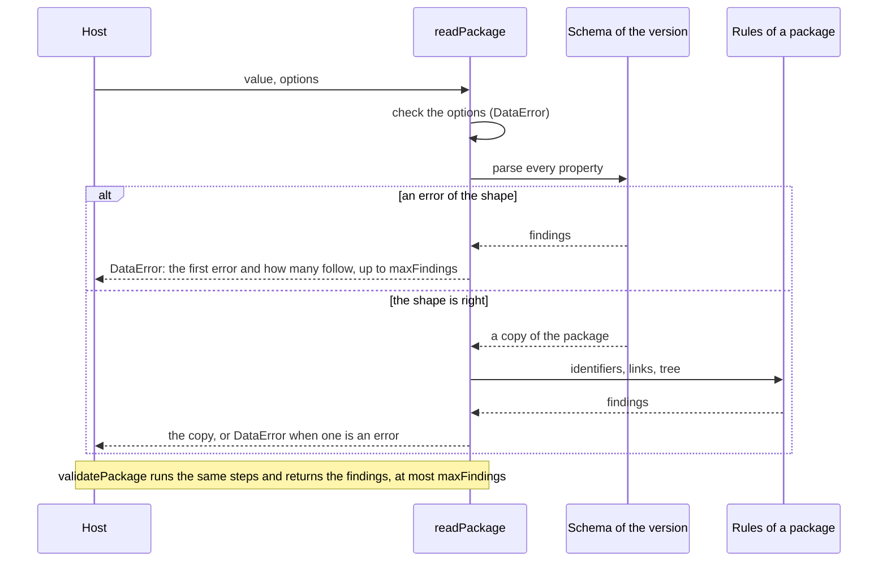

# Architecture of competency-frameworks

`@interopkit/competency-frameworks` has six modules over one model: `read` turns untrusted JSON into the model, `version` takes
the model back to CASE 1.0, `graph` answers what a consumer asks of a package, `client` reads frameworks from a provider, and
`provider` serves a store of frameworks over the CASE REST binding in either version. `read`, `version` and `graph` never import
one another.

```mermaid
flowchart BT
  core["@interopkit/core<br/>DataError, checks"]
  model["model<br/>types, terms, query, status"]
  read["read<br/>schemas, findings, rules of a package"]
  version["version<br/>convertCaseVersion"]
  graph["graph<br/>tree, associations, crosswalk,<br/>diff, staleness, status, addresses"]
  client["client<br/>twelve endpoints, paging, filter, errors"]
  provider["provider<br/>router, query grammar, discovery"]
  root["index.ts<br/>the public API"]
  read --> model
  read --> core
  version --> model
  version --> core
  graph --> model
  graph --> core
  client --> model
  client --> read
  client --> core
  provider --> model
  provider --> read
  provider --> version
  provider --> core
  root --> model
  root --> read
  root --> version
```

| Module     | Files                                                                                                     | Holds                                                                                                                                                                                                                 |
| ---------- | --------------------------------------------------------------------------------------------------------- | --------------------------------------------------------------------------------------------------------------------------------------------------------------------------------------------------------------------- |
| `model`    | `entities.ts`, `links.ts`, `sets.ts`, `status-info.ts`, `kinds.ts`, `terms.ts`, `query.ts`, `open-api.ts` | The types of every class, the vocabularies as tuples with their types, `ENTITY_KINDS`, the query types and `OpenApiDocument`                                                                                          |
|            | `json.ts`, `internal.ts`                                                                                  | `Extensions`, and what the other modules and the tests share: the pattern and the key of an identifier, the association types of 1.0, the address of a service and of an endpoint, and the name of the discovery file |
| `read`     | `schemas.ts`, `extension-term.ts`, `open-api.ts`                                                          | The valibot schemas of each version, built once, the form of an extension term, and the schema of an OpenAPI document                                                                                                 |
|            | `inspect.ts`, `issues.ts`, `integrity.ts`, `package-form.ts`                                              | The parse, the conversion of an issue of the schema to an `Issue`, the rules of a package, and the warnings of the links that the form of a package lacks                                                             |
|            | `read-package.ts`, `read-entity.ts`, `options.ts`                                                         | The readers, the validators and the check of their options                                                                                                                                                            |
| `version`  | `convert-case-version.ts`                                                                                 | The conversion of a package or an entity to the form of 1.0                                                                                                                                                           |
| `graph`    | `tree.ts`, `associations.ts`, `crosswalk.ts`, `diff.ts`                                                   | `buildFrameworkTree`, `listAssociations`, `crosswalk` and `diffPackages` over a package                                                                                                                               |
|            | `staleness.ts`, `adoption-status.ts`, `entity-uri.ts`, `package-view.ts`                                  | `isNewer`, `readAdoptionStatus`, `buildEntityUri`, and the check and the copy of a package that the others share                                                                                                      |
| `client`   | `client.ts`, `config.ts`                                                                                  | `createCaseClient` with its twelve calls and the iteration of the documents, and the check of the configuration                                                                                                       |
|            | `query.ts`                                                                                                | The writer of the `filter` parameter and the parameters of a request. `@interopkit/core` reads `imsx_StatusInfo`, `X-Total-Count`, `Link` and `Retry-After`                                                           |
| `provider` | `handle-request.ts`, `routes.ts`, `options.ts`, `store.ts`, `status.ts`                                   | The handler, the twelve routes, the options and the port, and the `imsx_StatusInfo` answers; `@interopkit/core/http` reads `limit` and `offset` and writes `Link`                                                     |
|            | `parse-query.ts`, `filter-text.ts`, `fields.ts`                                                           | The parameters of the list, the grammar of a filter, and the names of a CFDocument in each version                                                                                                                    |
|            | `query-entities.ts`, `values.ts`                                                                          | The filter and the sort in memory, and the values at a path, with the order of text, numbers and times                                                                                                                |
|            | `discovery.ts`                                                                                            | `localizeOpenApi`                                                                                                                                                                                                     |

`@interopkit/core/http` holds the request and the answer of the handler, and `@interopkit/core/checks` what other standards
need as much: strict records, the formats of a date, a date and time, a UUID and a URI, the copy of JSON within a depth limit,
and the findings of a parse.

Each module has an `index.ts`, its public API. `model`, `read` and `client` have an `internal.ts` that the package and its tests
share and the package does not export: the schemas, which the tests compare with those of 1EdTech and the provider reads the
names of a CFDocument from, the tuples, and the writer of the parameters of a request. The graph, the client and the provider are
entry points of their own, so a host that only reads frameworks loads no router or client. `pnpm check:standards` and Biome keep
modules from importing by a deep path or against the layers.

## Reading



The schemas are written once as the 1.1 classes and once as the 1.0 classes: the 1.0 form leaves out what 1.1 adds and holds
identifiers and URIs to the stricter forms. A list of the properties of each class is kept with its schema, so that the tests
compare it with the schemas of 1EdTech and fail when a class or a property differs.

## Boundaries

| The package owns                                                                                                                                                                       | The package does not own                                                                                             |
| -------------------------------------------------------------------------------------------------------------------------------------------------------------------------------------- | -------------------------------------------------------------------------------------------------------------------- |
| The model of CASE 1.1 and 1.0, the readers, the rules of a package, the conversion, the questions of a consumer, the client of the binding, the provider handler and its query grammar | Rendering Markdown and LaTeX, authoring a framework, a store, a cache, obtaining a token, authentication, a registry |

The package keeps nothing between calls and reads no clock; its runtimes and requests are in [the README](../../packages/competency-frameworks/README.md#architecture).
