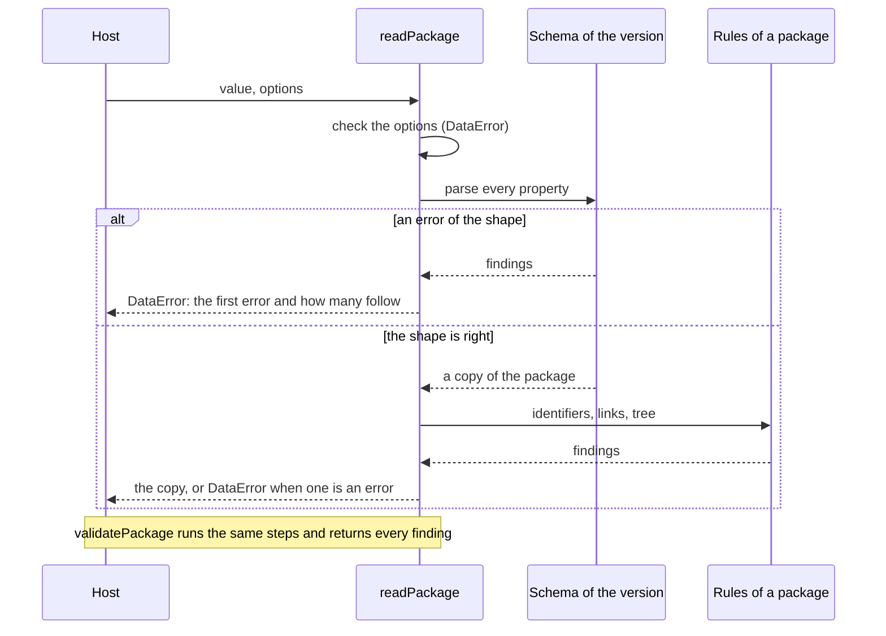

# Architecture of competency-frameworks

`@interopkit/competency-frameworks` has six modules that share one model. `model` holds the types and the terms. `read`
turns untrusted JSON into the model, `version` takes the model back to CASE 1.0, `graph` answers what a consumer asks of a
package it holds, and `client` reads frameworks from a provider. `provider` serves a store of frameworks over the CASE REST
binding, in the form of either version. `read`, `version` and `graph` are siblings: none imports another, and each imports
only `model` and `@interopkit/core`. `client` builds on `model`, `read` and `@interopkit/core`, and `provider` on `model`,
`read`, `version` and `@interopkit/core`. `model` imports nothing of the family.

```mermaid
flowchart BT
  core["@interopkit/core<br/>DataError, checks"]
  model["model<br/>types, terms, copy of JSON"]
  read["read<br/>schemas, findings, rules of a package"]
  version["version<br/>toCaseVersion"]
  graph["graph<br/>tree, associations, crosswalk,<br/>diff, staleness, status, addresses"]
  client["client<br/>twelve endpoints, paging, filter, errors"]
  provider["provider<br/>router, query grammar, discovery"]
  root["index.ts<br/>the public API"]
  read --> model
  read --> core
  version --> model
  version --> core
  graph --> model
  graph --> core
  client --> model
  client --> read
  client --> core
  provider --> model
  provider --> read
  provider --> version
  provider --> core
  root --> model
  root --> read
  root --> version
```

| Module     | Files                                                                                      | Holds                                                                                                                                                                 |
| ---------- | ------------------------------------------------------------------------------------------ | --------------------------------------------------------------------------------------------------------------------------------------------------------------------- |
| `model`    | `entities.ts`, `links.ts`, `sets.ts`, `status-info.ts`, `kinds.ts`, `issue.ts`, `terms.ts` | The types of every class, the vocabularies as tuples with their types, `ENTITY_KINDS` and `CaseIssue`                                                                 |
|            | `json.ts`, `internal.ts`                                                                   | `Extensions`, and what the other modules and the tests share: the pattern and the key of an identifier, the service address and the discovery file, the status tuples |
| `read`     | `schemas.ts`, `extension-term.ts`                                                          | The valibot schemas of each version, built once, and the form of an extension term                                                                                    |
|            | `inspect.ts`, `issues.ts`, `integrity.ts`                                                  | The parse, the conversion of an issue to a `CaseIssue`, and the rules of a package                                                                                    |
|            | `read-package.ts`, `read-entity.ts`, `options.ts`                                          | The readers, the validators and the check of their options                                                                                                            |
| `version`  | `to-case-version.ts`                                                                       | The conversion of a package or an entity to the form of 1.0                                                                                                           |
| `graph`    | `tree.ts`, `associations.ts`, `crosswalk.ts`, `diff.ts`                                    | `frameworkTree`, `associationsOf`, `crosswalk` and `diffPackages` over a package                                                                                      |
|            | `staleness.ts`, `adoption-status.ts`, `entity-uri.ts`, `package-view.ts`                   | `isNewer`, `adoptionStatus`, `caseEntityUri`, and the check and the copy of a package that the others share                                                           |
| `client`   | `client.ts`, `config.ts`                                                                   | `createCaseClient` with its twelve calls and the iteration of the documents, and the check of the configuration                                                       |
|            | `query.ts`, `paging.ts`, `status.ts`                                                       | `caseFilter` and the parameters of a request, the reading of `X-Total-Count` and `Link`, and `readStatusInfo`                                                         |
| `provider` | `handle-request.ts`, `routes.ts`, `options.ts`, `store.ts`, `status.ts`, `paging.ts`       | The handler, the twelve routes, the options and the port, the `imsx_StatusInfo` answers, `limit`, `offset` and `Link`                                                 |
|            | `parse-query.ts`, `filter-text.ts`, `fields.ts`                                            | The parameters of the list, the grammar of a filter, and the names of a CFDocument in each version                                                                    |
|            | `query-entities.ts`, `values.ts`                                                           | The filter and the sort in memory, and the values at a path, with the order of text, numbers and times                                                                |
|            | `discovery.ts`                                                                             | `localizeOpenApi` and the name of the discovery file                                                                                                                  |

`@interopkit/core/http` holds the request and the answer of the handler. `@interopkit/core/checks` holds what other standards need as much: strict records, the formats of a date, a date and time, a UUID
and a URI, the copy of JSON within a depth limit, and the conversion of the issues of a parse to findings that own their rule names.

Each module has an `index.ts`, its public API, and `model` and `read` have an `internal.ts` for what the package and its tests
share and the package does not export: the schemas, which the tests compare with the schemas of 1EdTech and the provider reads the
names of a CFDocument from, and the tuples. The graph, the client and the provider are
entry points of their own, `@interopkit/competency-frameworks/graph`, `.../client` and `.../provider`, so that a package that
only reads frameworks does not load a router or a client. `client` has an `internal.ts` too, for the readers of the paging headers
that its tests share.
`pnpm check:standards` and Biome keep modules from importing by a deep path or against the layers.

## Reading



The schemas are written once as the 1.1 classes and once as the 1.0 classes: the 1.0 form leaves out what 1.1 adds and holds
identifiers and URIs to the stricter forms. A list of the properties of each class is kept with its schema, so that the tests
compare it with the schemas of 1EdTech and fail when a class or a property differs.

## Boundaries

| The package owns                                                                                                                                                                       | The package does not own                                                                                             |
| -------------------------------------------------------------------------------------------------------------------------------------------------------------------------------------- | -------------------------------------------------------------------------------------------------------------------- |
| The model of CASE 1.1 and 1.0, the readers, the rules of a package, the conversion, the questions of a consumer, the client of the binding, the provider handler and its query grammar | Rendering Markdown and LaTeX, authoring a framework, a store, a cache, obtaining a token, authentication, a registry |

The package makes no request except those of the client through the `fetch` that the host passes in, keeps nothing between
calls, reads no clock and no environment variable, and imports no other family of interopkit. It uses no API outside web
standards, so it runs in Node.js, browsers, Deno, Bun and Cloudflare Workers.
