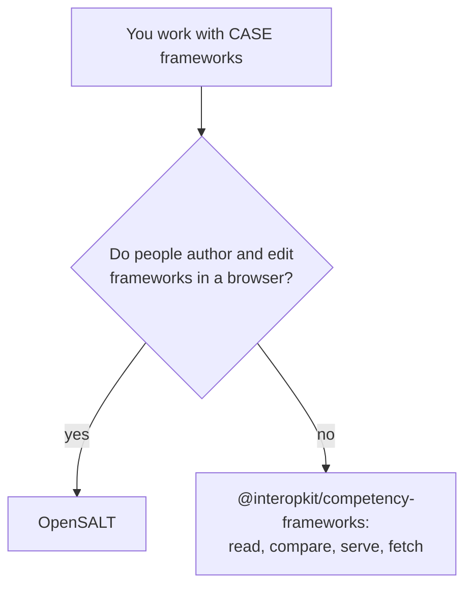

# Choosing competency-frameworks

When `@interopkit/competency-frameworks` fits a project that reads, serves or compares CASE frameworks, and when another tool
fits better. Each comparator was read at the version that [the comparators](comparators.md) give; that page maps all 26 of their
capabilities, of which the package has 11, has 2 in part and leaves 13 out with a reason.

| You need | Use |
| --- | --- |
| The model of CASE 1.1 and 1.0, read and judged against the published JSON schemas | This package: `readPackage`, `validatePackage` |
| A framework's tree, its crosswalks and what changed between two versions | This package: `/graph` |
| A client of a CASE provider, or a provider over your own store | This package: `/client`, `/provider` |
| An application where people write, review and publish frameworks | OpenSALT (`develop` at `f719f24`, 2026-11-02) |

## What the others have that the package lacks

| Comparator, version | What it has | Here |
| --- | --- | --- |
| OpenSALT `f719f24`, 2026-11-02 | OpenAPI documents of 1.0 and 1.1; a mirror fetched again on a schedule | In part: `localizeOpenApi` for 1.1; `isNewer` says when a copy is stale, and the schedule is the host's |
| OpenSALT `f719f24`, 2026-11-02 | Editing with comments, locks and revisions; spreadsheets, ASN and GitHub import; registries of credentials, jobs and pathways | Excluded: an application, formats other than CASE, other standards |
| OpenSALT `f719f24`, 2026-11-02 | Endpoints and paths beyond the binding, 304 to conditional requests, an address that answers a page | Excluded: not part of the REST binding; caching is the host's framework's |
| `@timeback/case` 0.3.3, 2026-09-25 | Every item of one vendor in a list, creating and replacing packages, the vendor's server addresses | Excluded: the binding defines GET alone, and the host names its provider |

## Where the evidence is

[The evidence](evidence.md) gives the published schemas, real frameworks of public providers and OpenSALT as a counterparty;
[performance](performance.md) times the readers against the published schemas.
