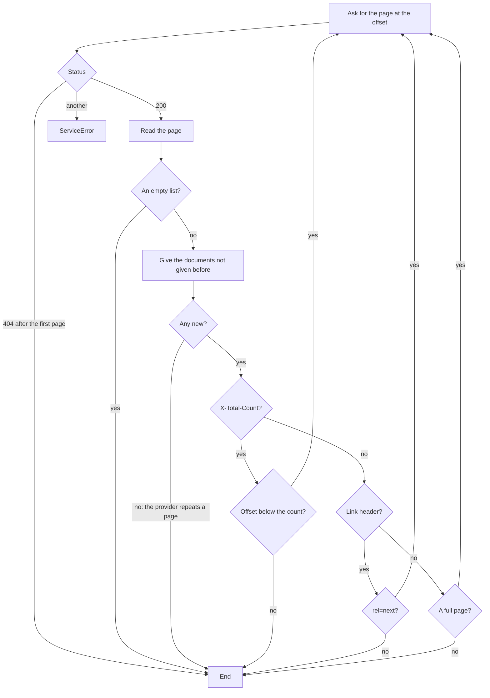

# The CASE client

`@interopkit/competency-frameworks/client` reads frameworks from a CASE provider over the REST binding: a call for each of the
twelve endpoints, the document list read page by page, the filter and the other parameters of a request, the OpenAPI file of
service discovery, and the status that a provider answers an error with. It makes GET requests only, through `fetch` that the
host passes in, and reads every answer with the readers of the package, so a value is in the model of CASE 1.1 whichever
version the provider speaks.

```mermaid
flowchart LR
  host["Your application"] -->|"id, query, signal"| call["A call of the client"]
  call --> auth["authorization()<br/>the Authorization header"]
  auth --> service["requestService of core<br/>HTTPS, no redirect, deadline, size limit"]
  service --> provider[("CASE provider")]
  provider -->|"200"| read["readEntity, readPackage<br/>valid CASE 1.1 or DataError"]
  provider -->|"404"| none["undefined"]
  provider -->|"another status"| error["ServiceError<br/>status, headers, body"]
  read --> host
  none --> host
  error -->|"readStatusInfo of core"| detail["imsx_StatusInfo<br/>and Retry-After"]
```

| Call                               | Endpoint                                        | Gives                                             |
| ---------------------------------- | ----------------------------------------------- | ------------------------------------------------- |
| `documents(query, options)`        | `GET /CFDocuments`                              | An async iterable of `CFDocument`, page by page   |
| `document(id, options)`            | `GET /CFDocuments/{id}`                         | `CFDocument`                                      |
| `package(id, options)`             | `GET /CFPackages/{id}`                          | `CasePackage`                                     |
| `item(id, options)`                | `GET /CFItems/{id}`                             | `CFItem`                                          |
| `itemAssociations(id, options)`    | `GET /CFItemAssociations/{id}`                  | `CFAssociationSet`: the item and its associations |
| `association(id, options)`         | `GET /CFAssociations/{id}`                      | `CFAssociation`                                   |
| `associationGrouping(id, options)` | `GET /CFAssociationGroupings/{id}`              | `CFAssociationGrouping`                           |
| `concept(id, options)`             | `GET /CFConcepts/{id}`                          | `CFConceptSet`: the concept and its children      |
| `subject(id, options)`             | `GET /CFSubjects/{id}`                          | `CFSubjectSet`: the subject and its children      |
| `license(id, options)`             | `GET /CFLicenses/{id}`                          | `CFLicense`                                       |
| `itemType(id, options)`            | `GET /CFItemTypes/{id}`                         | `CFItemTypeSet`: the item type and its children   |
| `rubric(id, options)`              | `GET /CFRubrics/{id}`                           | `CFRubric`                                        |
| `discovery(options)`               | `GET /discovery/imscasev1p1_openapi3_v1p0.json` | `OpenApiDocument`                                 |

Each path is below `/ims/case/v1p1`, or `/ims/case/v1p0` for a client of 1.0. A call for one entity gives `undefined` when the
provider answers 404, which it does for an identifier it does not know and for one that is not a UUID. The caller's `options` is
`{ signal }`, which ends that caller's wait.

## Quick start

```ts
import { createCaseClient } from "@interopkit/competency-frameworks/client";

const item = {
  CFDocumentURI: {
    title: "Mathematics",
    identifier: "8f3e2a14-4c1b-4d77-9a3e-1b2c3d4e5f60",
    uri: "https://standards.example.org/ims/case/v1p1/CFDocuments/8f3e2a14-4c1b-4d77-9a3e-1b2c3d4e5f60",
  },
  identifier: "2b6d1c9e-7a53-4e08-b1f4-5c8a9d0e3f21",
  uri: "https://standards.example.org/ims/case/v1p1/CFItems/2b6d1c9e-7a53-4e08-b1f4-5c8a9d0e3f21",
  fullStatement: "Understand fractions as numbers.",
  lastChangeDateTime: "2024-06-13T18:46:03+00:00",
};
const client = createCaseClient({
  baseUrl: "https://standards.example.org",
  fetch: async (url) => new Response(JSON.stringify({ ...item, uri: url }), { status: 200 }),
});

const found = await client.item("2b6d1c9e-7a53-4e08-b1f4-5c8a9d0e3f21");
found?.fullStatement; // => "Understand fractions as numbers."
found?.uri; // => "https://standards.example.org/ims/case/v1p1/CFItems/2b6d1c9e-7a53-4e08-b1f4-5c8a9d0e3f21"
```

The `fetch` of the sample answers with the item and echoes the address it was asked for in `uri`. In a program, pass the global
`fetch` as `fetch`. A host whose provider URLs come from a counterparty passes a `fetch` that
refuses loopback, private and link-local addresses.

## Options

| Option          | Meaning                                                                                                                                                                                                                             | Default    |
| --------------- | ----------------------------------------------------------------------------------------------------------------------------------------------------------------------------------------------------------------------------------- | ---------- |
| `baseUrl`       | The address of the provider before the path of the version: an `https` URL without credentials, query or fragment, whose path does not end with `/ims/case/v1p1`                                                                    | required   |
| `fetch`         | The `fetch` that makes the requests                                                                                                                                                                                                 | required   |
| `version`       | `"1.1"` or `"1.0"`: the path, and the rules that the answers are read by                                                                                                                                                            | `"1.1"`    |
| `authorization` | `(options) => Promise<string \| undefined>`: the value of the `Authorization` header, such as `Bearer abc`, or `undefined` for none. It is called before every request                                                              | none       |
| `timeoutMs`     | The most time in milliseconds that one request may take, from the request to the last byte of the answer                                                                                                                            | 10,000     |
| `maxBytes`      | The most bytes of one answer                                                                                                                                                                                                        | 16,777,216 |
| `maxTokens`     | The most tokens of JSON in one answer: each bracket, brace, colon and comma, each string, each number and each `true`, `false` and `null`. Counted before the answer is parsed, because the memory of a parse grows with the tokens | 2,000,000  |
| `pageSize`      | The number of documents that `documents` asks for in one request                                                                                                                                                                    | 100        |
| `signal`        | An `AbortSignal` that ends the wait of every call                                                                                                                                                                                   | none       |

`authorization` is where the credential of the host comes in. It can return a token that a cache keeps fresh, such as the one that
`createTokenCache` of `@interopkit/core/oauth` returns, with `Bearer ` in front. It receives a `signal` that joins the signal of
the configuration and the signal of the call. The client does not log the value, and the value is in no error.

## Listing documents

`documents(query, options)` is an async iterable. Nothing is requested until the iteration starts, and it asks for the next page
only when the loop needs another document, so a loop that stops early asks for no more. Each request carries `limit` and
`offset`, and the parameters of the query.



| Rule                        | Behavior                                                                                                                                                             |
| --------------------------- | -------------------------------------------------------------------------------------------------------------------------------------------------------------------- |
| The offset of the next page | The offset plus the number of documents the page held, so a provider that caps the page below `limit` is followed                                                    |
| A document seen before      | Given once, matched by identifier in either case: a collection that changes between pages may repeat a document. With `fields`, the client asks for `identifier` too |
| `Link` header               | Read for `rel="next"` only. The client builds the next request itself and never requests an address that the provider gives                                          |
| An empty first page         | The iteration ends without a document                                                                                                                                |
| A 404 for the first page    | A `ServiceError`: the path is wrong or the provider has no such service                                                                                              |

### The query

| `CaseQuery` property | Meaning                                                                                     | Default |
| -------------------- | ------------------------------------------------------------------------------------------- | ------- |
| `sort`               | The field to sort on, or a path through nested objects with dots                            | none    |
| `orderBy`            | `"asc"` or `"desc"`                                                                         | none    |
| `filter`             | A comparison, or two comparisons joined by `and` or `or`; see below                         | none    |
| `fields`             | The fields to return, and only those; the documents then have those fields and `identifier` | none    |

A query is checked when `documents` is called, before any request: a property that a query does not have, a field that is not a
name, an empty list of fields, a predicate or an order that does not exist, a value that is not text, or a logical operator
with other than two comparisons is a `DataError`.

`documents` writes the value of the `filter` parameter from the `CaseFilter` of its query. A comparison is
`{ field, predicate, value }` with a predicate of `=`, `!=`, `>`, `>=`, `<`, `<=` or `~`. The binding asks a provider to compare
without regard to case, `=` of a list to need every element, and `~` to need any.

| The `filter` of the query                                                                                                                       | The value of the parameter                                    |
| ----------------------------------------------------------------------------------------------------------------------------------------------- | ------------------------------------------------------------- |
| `{ field: "version", predicate: "=", value: "1.0" }`                                                                                            | `version='1.0'`                                               |
| `{ and: [{ field: "version", predicate: "=", value: "1.0" }, { field: "lastChangeDateTime", predicate: ">", value: "2016-12-12T00:00:00Z" }] }` | `version='1.0' AND lastChangeDateTime>'2016-12-12T00:00:00Z'` |
| `{ field: "title", predicate: "~", value: "children's" }`                                                                                       | `title~'children''s'`                                         |

The binding gives no way to write a single quote inside a value. The client writes it twice, as the provider of this package
reads it (`title~'children''s'`); a provider that reads it otherwise needs the value cut at the quote and filtered with `~`.

The request carries the filter percent-encoded, with a space as `%20` and `'` as `%27`, as the binding's examples write it. `fields`
is a comma separated list.

### Selecting fields

A document that a provider returns with only the fields asked for lacks the properties that the class requires, so the type of
the iteration changes with the query: with `fields` it yields `SelectedDocument`, a document with every property optional but
`identifier`, and without it `CFDocument`. The client adds `identifier` to the fields when the query leaves it out, because it
tells a document that it has given from a new one by it: so the iteration ends when a provider that ignores the offset repeats
a page. Each document is checked: a property it has must be right, and the only fault that is allowed is a missing property
other than `identifier`. The use that the Implementation Guide names (4.3.6) is to ask for the time of change of every document, and to fetch
a package only when `isNewer` says it is stale.

```ts
import { createCaseClient } from "@interopkit/competency-frameworks/client";

const client = createCaseClient({
  baseUrl: "https://standards.example.org",
  fetch: async () =>
    new Response(
      JSON.stringify({
        CFDocuments: [
          { identifier: "8f3e2a14-4c1b-4d77-9a3e-1b2c3d4e5f60", lastChangeDateTime: "2024-06-13T18:46:03+00:00" },
        ],
      }),
      {
        status: 200,
        headers: { "X-Total-Count": "1" },
      },
    ),
});
const stamps = [];
for await (const document of client.documents({ fields: ["identifier", "lastChangeDateTime"] }))
  stamps.push(document.lastChangeDateTime);
stamps; // => ["2024-06-13T18:46:03+00:00"]
```

## Errors

| Case                                                                                              | Result                                                                                                                                                                                                                  |
| ------------------------------------------------------------------------------------------------- | ----------------------------------------------------------------------------------------------------------------------------------------------------------------------------------------------------------------------- |
| The configuration, a query, an identifier, `options` or the value of `authorization` is not valid | `DataError` that names the option and what it must be, before any request                                                                                                                                               |
| An identifier is empty, `.` or `..`                                                               | `DataError`: a URL would resolve it to another path. Any other identifier is percent-encoded into one segment                                                                                                           |
| The provider does not know the object (404)                                                       | `undefined` from a call for one entity                                                                                                                                                                                  |
| Another status: 400, 401, 403, 429, 500 or any other                                              | `ServiceError` with `status`, `headers` and `body`; read it with `readStatusInfo` of `@interopkit/core`                                                                                                                 |
| The provider did not answer within `timeoutMs`, or `fetch` rejected                               | `ServiceError` with status 0                                                                                                                                                                                            |
| The answer is larger than `maxBytes`                                                              | `ServiceError` with the status of the answer, naming the limit; the body is cancelled. Raise `maxBytes` for a larger package                                                                                            |
| The answer has more tokens of JSON than `maxTokens`                                               | `LimitError`: `The CASE provider at <url> answered with a body of more than N tokens of JSON, above the limit of the option maxTokens.` Raise `maxTokens` for a larger package; a framework of 10,000 items has 990,000 |
| The answer is a redirect                                                                          | `ServiceError`: the client follows none. Use the address that the provider redirects to as `baseUrl`                                                                                                                    |
| The answer is not UTF-8, or nests more than 128 levels of JSON                                    | `DataError`, or a `LimitError` for the levels, that names the provider and says which, before the answer is parsed                                                                                                      |
| The answer is not JSON, or is JSON that is not valid CASE                                         | `DataError`: `The CASE provider at <url> answered with data that is not valid CASE: <the first fault>`                                                                                                                  |
| The client is configured for 1.0 and `discovery` is called                                        | `DataError`: 1.0 defines no discovery file                                                                                                                                                                              |
| The `signal` of the call or the configuration aborts                                              | The call rejects with `signal.reason`                                                                                                                                                                                   |
| `authorization` rejects                                                                           | Its error, unchanged, and no request is made                                                                                                                                                                            |

`readStatusInfo(error)` of `@interopkit/core` returns `{ info, retryAfterSeconds }`. `info` is the `imsx_StatusInfo` in the body, whose `imsx_codeMinor`
names the cause (`invalid_filter_field`, `invalid_selection_field`, `unknownobject`, `invalid_uuid`, `server_busy`,
`forbidden`, `unauthorised_request`, `internal_server_error`); it is left out when the body is not a status, as a proxy's page is
not. `retryAfterSeconds` is `Retry-After` when it is a number of seconds. The form with a date needs a clock and stays in
`error.headers["retry-after"]`. The client retries nothing: a host that waits and asks again is safe, because every call is a GET.

### Failure paths

| What                 | Fails                                                | Hangs                                                                                                   | Called again                                                                                               | May call back |
| -------------------- | ---------------------------------------------------- | ------------------------------------------------------------------------------------------------------- | ---------------------------------------------------------------------------------------------------------- | ------------- |
| `fetch`              | `ServiceError`; 404 for one entity gives `undefined` | `timeoutMs`, then status 0                                                                              | Safe: GET only. A collection that changes between pages may repeat or skip a document; repeats are dropped | Nothing       |
| `authorization`      | Its error reaches the caller; no request is made     | The caller's `signal` is passed on, and the wait ends when it aborts, whether the function stops or not | Called before every request, so it may return a fresh token                                                | Nothing       |
| The answer too large | `ServiceError` naming the limit                      | As `fetch`                                                                                              | The same answer until `maxBytes` grows                                                                     | Nothing       |

## Limits

| Limit                         | Value                                                                                          | Refused with             |
| ----------------------------- | ---------------------------------------------------------------------------------------------- | ------------------------ |
| `timeoutMs`                   | 10,000 ms                                                                                      | `ServiceError`, status 0 |
| `maxBytes`                    | 16,777,216                                                                                     | `ServiceError`           |
| `maxTokens`                   | 2,000,000                                                                                      | `LimitError`             |
| Levels of JSON in an answer   | 128: an extension, which the readers bound to 64 levels, may sit below the levels of a package | `LimitError`             |
| `pageSize`                    | 100                                                                                            | The provider caps it     |
| Logical operators in a filter | 1                                                                                              | `DataError`              |
| Redirects                     | 0                                                                                              | `ServiceError`           |

## Not included

| Not included                            | Why                                                                                           |
| --------------------------------------- | --------------------------------------------------------------------------------------------- |
| Retries and backing off                 | The host knows its own budget; `readStatusInfo` gives `Retry-After`                           |
| A cache of frameworks                   | The host stores them; `isNewer` of the graph module tells it when a copy is stale             |
| Fetching the address of a `Link` header | An address from a provider could lead anywhere; the client builds each request from `baseUrl` |
| Obtaining a token                       | `@interopkit/core/oauth` does it; the client only sends what `authorization` returns          |
| Writing to a provider                   | The REST binding of CASE 1.1 defines GET endpoints only                                       |
| The discovery file of CASE 1.0          | 1.0 defines none                                                                              |

## Differences from the references

| Case                                         | The binding                                                                       | The client                                                                        |
| -------------------------------------------- | --------------------------------------------------------------------------------- | --------------------------------------------------------------------------------- |
| `X-Total-Count` and `Link`                   | Recommended, not required                                                         | Used when present; a page shorter than `limit` ends the iteration when neither is |
| A sort or a filter on a field that is absent | Sort: the provider's order; filter: no data and `invalid_filter_field`            | The client does not know the fields of a provider and sends them as written       |
| The example of a filter with a date          | Writes `2016%3D12%3D12` for `2016-12-12`, which is a slip                         | Encodes the characters that need it and leaves `-` as it is                       |
| 404 for an unknown object                    | Answers 404 with an `imsx_StatusInfo` that says `unknownobject` or `invalid_uuid` | `undefined`, whatever the body is                                                 |
