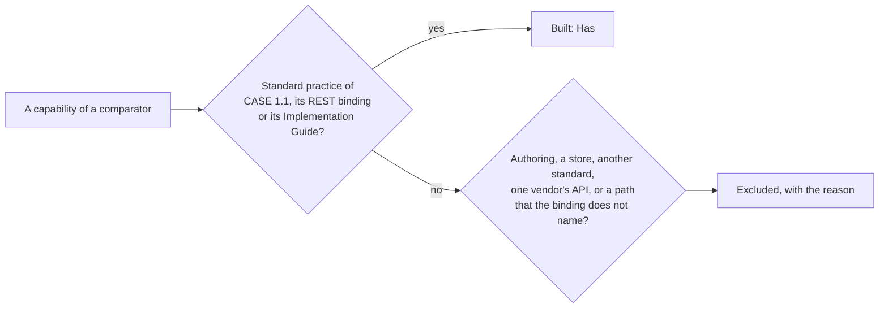

# Comparators of competency-frameworks

What the other implementations of CASE do, and where `@interopkit/competency-frameworks` stands against each: **Has** the
capability, **Partly**, **Excluded** with the reason, or **Missing**. A capability that CASE 1.1, its REST binding, its
Implementation Guide or the reading of CASE 1.0 treat as standard practice is built; what belongs to an authoring application,
a store, another standard or one vendor's API is excluded. Read on 2026-11-03 from the source of each comparator at the version
in the table. No library of CASE exists in any language but a client of one vendor's API, so OpenSALT, an application, is the
other comparator; it is also the counterparty of the tests ([evidence](evidence.md)).

## Summary

| Comparator       | Kind                                   | Version, last change               | License |   Rows |    Has | Partly | Excluded | Missing |
| ---------------- | -------------------------------------- | ---------------------------------- | ------- | -----: | -----: | -----: | -------: | ------: |
| `@timeback/case` | Client of one vendor's API, TypeScript | 0.3.3, 2026-09-25                  | None    |     10 |      6 |      0 |        4 |       0 |
| OpenSALT         | Application, PHP                       | `develop` at `f719f24`, 2026-11-02 | MIT     |     16 |      5 |      2 |        9 |       0 |
| **All**          |                                        |                                    |         | **26** | **11** |  **2** |   **13** |   **0** |

The certification of a CASE provider or consumer needs 1EdTech membership, and its requirements are not read.

## The client of one vendor

| Comparator       | Capability                                                           | Here     | How, or why not                                                                                            |
| ---------------- | -------------------------------------------------------------------- | -------- | ---------------------------------------------------------------------------------------------------------- |
| `@timeback/case` | The list of documents with `limit` and `offset`                      | Has      | `documents` of the client, page by page, with `sort`, `filter` and `fields` too ([client](client.md))      |
| `@timeback/case` | A document, an item, an association and a package by identifier      | Has      | `document`, `item`, `association`, `package`, and the seven other endpoints of the binding                 |
| `@timeback/case` | A package with the tree of its items                                 | Has      | `buildFrameworkTree` of a package that the client read ([graph](graph.md))                                 |
| `@timeback/case` | OAuth 2.0 client credentials with a cache of tokens                  | Has      | `authorization` returns the token of `createTokenCache` of `@interopkit/core/oauth`                        |
| `@timeback/case` | An object that the provider does not know, told apart from a failure | Has      | `undefined` for a 404; any other status is a `ServiceError` that `readStatusInfo` reads                    |
| `@timeback/case` | Answers read by schemas                                              | Has      | `readEntity` and `readPackage`, proven against the schemas of 1EdTech ([model](model.md))                  |
| `@timeback/case` | Every item of the vendor in one list                                 | Excluded | The binding has no list of items; the items of a framework are in its package                              |
| `@timeback/case` | Creating a package, and replacing one that exists                    | Excluded | The binding defines GET alone; a host writes to its own store                                              |
| `@timeback/case` | The addresses of the vendor's staging and production servers         | Excluded | The host gives the address of its provider as `baseUrl`                                                    |
| `@timeback/case` | A request that only checks that the credentials are accepted         | Excluded | A call of any endpoint answers 401 as a `ServiceError`; no request of the binding tests a credential alone |

## OpenSALT

| Comparator | Capability                                                                           | Here     | How, or why not                                                                                                                     |
| ---------- | ------------------------------------------------------------------------------------ | -------- | ----------------------------------------------------------------------------------------------------------------------------------- |
| OpenSALT   | The endpoints of the binding at `/ims/case/v1p1` and `/ims/case/v1p0`                | Has      | `handleCaseRequest` with `versions` ([provider](provider.md))                                                                       |
| OpenSALT   | `limit`, `offset`, `sort`, `orderBy` and `X-Total-Count` on the list of documents    | Has      | With `filter`, `fields` and `Link`, which OpenSALT leaves out                                                                       |
| OpenSALT   | Drafts left out of the list for a consumer that may not see them                     | Has      | The host passes with each request a store that answers what that consumer may see, and `authorize` refuses one that may see nothing |
| OpenSALT   | A package imported from a file of CASE or from another provider                      | Has      | `readPackage`, and `package` of the client                                                                                          |
| OpenSALT   | Frameworks mirrored from a remote provider, with OAuth 2.0 client credentials        | Has      | `documents` and `package` of the client, with `authorization`                                                                       |
| OpenSALT   | OpenAPI documents of 1.0 and 1.1                                                     | Partly   | The localized file of 1.1, `localizeOpenApi`; the binding of 1.0 defines none                                                       |
| OpenSALT   | A mirror fetched again on a schedule, and kept when its content is the same          | Partly   | `isNewer` says when a copy is stale; the schedule and the copy are the host's                                                       |
| OpenSALT   | Endpoints for one criterion and one level of a rubric                                | Excluded | Not endpoints of the binding; a rubric holds its criteria and levels                                                                |
| OpenSALT   | A `.json` suffix, and `/CFItems/{id}/associations` beside `/CFItemAssociations/{id}` | Excluded | Not paths of the binding; another path is 404                                                                                       |
| OpenSALT   | 304 to a conditional request, from the time of the latest change                     | Excluded | Caching headers are the host's framework's; a consumer compares `lastChangeDateTime` with `isNewer`                                 |
| OpenSALT   | An empty string read as an absent property before a framework is judged              | Excluded | An empty string is a value to the schemas of 1EdTech, and the readers judge it as they do                                           |
| OpenSALT   | A list of documents as a bare array, as one provider writes it                       | Excluded | Not the `CFDocumentSet` of the binding; the client refuses it with a `DataError`                                                    |
| OpenSALT   | An address of each entity that answers a page or the JSON-LD form of 1.0             | Excluded | The binding serves neither; `buildEntityUri` gives an entity the address of its endpoint                                            |
| OpenSALT   | Editing frameworks, with comments, locks, revisions and access by framework          | Excluded | Authoring is an application; `validatePackage` checks what a host builds                                                            |
| OpenSALT   | Import and export of spreadsheets, of ASN and of GitHub                              | Excluded | Formats other than CASE                                                                                                             |
| OpenSALT   | Registries of issuers, credentials, jobs and pathways                                | Excluded | Other standards; Open Badges and CLR are in `@interopkit/achievement-credentials`                                                   |

## What no comparator has

The rules of a package as findings with their severity (identifiers that two entities share, links that point to nothing, an
`isChildOf` tree that loops, items outside the tree), the reading of CASE 1.0 into the model of 1.1 and the conversion back with
what 1.0 cannot hold reported, a crosswalk between two frameworks, the difference of two versions with the items that
`replacedBy` retires, the adoption status read with the terms of 1.0, the filter grammar of the binding in both roles with one
`AND` or `OR` and dot paths, the `Link` header, the localized discovery file, an `AbortSignal` on every call, limits of bytes,
tokens, characters and findings, and a peak of memory measured for each reader of untrusted input.
