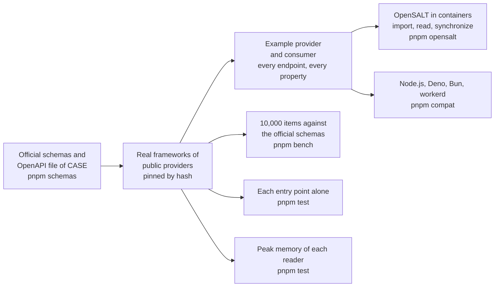

# Evidence for competency-frameworks

What shows that the package does what it says: the official schemas, real frameworks of public providers, an example provider
and consumer, OpenSALT as a counterparty, the speed of every hot path, the size of each entry point, the peak memory of every
reader, and four runtimes. Each layer answers a question that the
one before cannot.

| Layer             | Question                                                                       | Where                                                                          | Runs                           |
| ----------------- | ------------------------------------------------------------------------------ | ------------------------------------------------------------------------------ | ------------------------------ |
| Schemas           | Does the reader judge as the schemas of 1EdTech do?                            | `packages/competency-frameworks/test/schemas.corpus.test.ts`                   | `pnpm test:corpus`             |
| Real frameworks   | Does it read what providers publish, and write it back unchanged?             | `packages/competency-frameworks/test/frameworks.corpus.test.ts`                | `pnpm test:corpus`             |
| Example provider  | Does a host serve all twelve endpoints and every property, in both versions?   | `examples/competency-frameworks/test/conformance.corpus.test.ts`               | `pnpm test:corpus`             |
| Example consumer  | Does a consumer keep fresh copies, outline, align and diff with the graph?     | `examples/competency-frameworks/test/*.test.ts`                                | `pnpm test`                    |
| Counterparty      | Does another implementation take in what the provider serves, and vice versa? | `examples/competency-frameworks/test/opensalt.corpus.test.ts`                  | `pnpm opensalt`                |
| Speed             | How long does each hot path take, against the official schemas and the JSON?   | `packages/competency-frameworks/test/*.bench.ts`                               | `pnpm bench`                   |
| Size              | Does each entry point hold only what it uses, within its budget?               | `packages/competency-frameworks/test/size.test.ts`                             | `pnpm test`                    |
| Memory            | Does each reader of untrusted input stay under its budget on its worst input?  | `packages/competency-frameworks/test/peak-memory.test.ts`                         | `pnpm test`                    |
| Runtimes          | Does the scenario give the same results everywhere?                            | `compat/`                                                                      | `pnpm compat`                  |

## Real frameworks

`pnpm schemas` downloads six frameworks from two public providers at the hash that `scripts/schemas.lock.json` pins, each under the identifier of its document. They are
not committed. Each is read as CASE 1.0, which both providers speak, and written back with `convertCaseVersion`.

| Framework (identifier of the document, the name of its download)                       | Provider            | Items | Associations | Reads as published | Written back as published |
| -------------------------------------------------------------------------------------- | ------------------- | ----: | -----------: | ------------------ | ------------------------- |
| Normalized Data Schema (`0ef60b38-9109-11e9-9ab3-ef46d22b49d8`)                         | opensalt.net        |    16 |           16 | yes                | yes                       |
| Norm Webb's Depth of Knowledge Levels (`c5fb3436-d7cb-11e8-824f-0242ac160002`)          | opensalt.net        |    15 |           15 | yes                | yes                       |
| AP Computer Science Principles (`4f37094a-cf04-11e7-b9f8-2ff5c05be24b`)                 | opensalt.net        |   266 |          266 | yes                | yes                       |
| Next Generation Science Standards (`c608881b-d7cb-11e8-824f-0242ac160002`)              | opensalt.net        | 1,037 |        1,045 | yes                | yes                       |
| South Carolina Teacher Standards 4.0 (`fb7db201-fcf7-4187-b42b-8272e3d01270`)           | standards.ed.sc.gov |   119 |          209 | yes, with warnings | yes, without those links  |
| South Carolina World Language (`4f146ce5-efd0-4d73-b920-9aac07fb0db0`)                  | standards.ed.sc.gov |   605 |          605 | yes, with warnings | yes, without those links  |

Written back as published means equal after the keys of every object are sorted, with nothing dropped. For every framework the
tree holds each item once, and a framework differs from itself in nothing.

The package schema of CASE 1.0 has no `CFDocumentURI` in an item or an association and no `CFPackageURI` in the document,
since a package is one document. The provider of South Carolina writes them, so the official schema refuses its packages. The
readers read them with three `package-form-link` warnings, one for the document and one for each list, and leave the links out
([spec gaps](spec-gaps.md)); each link names the package's own document. The package that the reader returns equals the
published one without those links, which the schema accepts. The teacher standards also have five items whose `licenseURI`
points to a license that the package does not hold, which `validatePackage` reports as a warning.

A provider can change a framework, and then the download fails its hash. The frameworks are the ones last changed in 2018 to
2024, which a provider rarely edits; run `pnpm schemas:pin` to take a new version, and read what changed in the diff of the lock.

## The example provider

The example host serves a ministry's frameworks from memory, in both versions of the binding. The conformance test derives what
to check from the specifications and not from a list of its own.

| Check                                              | Derived from                                                           | Result                          |
| -------------------------------------------------- | ---------------------------------------------------------------------- | ------------------------------- |
| Every endpoint answers with a body its schema accepts | The twelve paths of the OpenAPI file of CASE 1.1 and their 200 schemas | All twelve pass                 |
| Both versions answer with a body their schema accepts | The JSON schemas of 1.1 and 1.0                                        | All endpoints pass, both versions |
| The discovery file has the paths of the file of 1EdTech, with the provider as its server | The OpenAPI file | Same paths; `servers` is the provider |
| Every property of every class is in the data       | The properties of the classes of the package schema and of the schemas of an item, an association and a document | Nothing missing |
| Every class that holds data is checked             | The classes of the schemas, less the sets and the status                | Nothing unmapped                |

## OpenSALT

[OpenSALT](https://github.com/interopkit/interopkit/blob/main/validation/opensalt/README.md) runs from the image the project builds, with a database, in containers. The
flows sign in as a user, send the packages that the example provider serves to the import route of its editor, and read them
back with the client.

| Flow                                     | Result                                                                                                                  |
| ---------------------------------------- | ----------------------------------------------------------------------------------------------------------------------- |
| Import of the two frameworks             | Accepted once the `extensions` of the rubric levels are left out; the route refuses them                                |
| List of documents                        | Both frameworks; `limit` and `offset` are honored, so the client asks twice with a page size of 1                        |
| Package read back                        | Equal to what was sent except for the differences below                                                                 |
| Nine single entities                     | Each reads, with its link to the document                                                                               |
| An unknown identifier                    | `undefined`                                                                                                             |
| The school platform's synchronization    | Both frameworks the first time, none the second; after the second edition is imported only the framework that changed    |
| The changes of the second edition        | The same items added, changed and replaced as against the example provider                                              |
| A consumer of CASE 1.0                   | Document, item and association read; the package of a framework with a node in another kind of system is refused        |

OpenSALT differs from the references, and the flows pin each difference, so that a new build that changes one fails them:

| Where                          | The references                                                                       | OpenSALT                                                                                                    | A consumer                                                                 |
| ------------------------------ | ------------------------------------------------------------------------------------ | ----------------------------------------------------------------------------------------------------------- | -------------------------------------------------------------------------- |
| `extensions` of a rubric level | A list of objects in the schema of 1EdTech                                           | The import route refuses a list: it expects one object                                                      | Leaves them out of a package it sends to OpenSALT                          |
| `filter` on `/CFDocuments`     | The binding defines the grammar                                                      | Not applied: every document comes back                                                                      | Filters what it gets                                                       |
| `/CFItemAssociations/{id}`     | An item and associations in the form of a package                                    | Each association also has `CFDocumentURI`, which the form of a package lacks                                | Reads the set with a `package-form-link` warning, without the links        |
| Discovery file                 | Served at `/discovery/imscasev1p1_openapi3_v1p0.json`                                | 404                                                                                                         | Does not depend on it for OpenSALT                                         |
| `targetType` on the 1.0 path   | A property of 1.1 only                                                               | Written for a node in another kind of system on `/ims/case/v1p0`                                            | Reads such a package as 1.1                                                |
| Status dates of an item        | Optional                                                                             | An item with none gets the dates of the document                                                            | Reads them as the item's own                                               |
| `sequenceNumber`               | Optional                                                                             | An association with none gets 0                                                                             | Reads 0 as a position                                                      |
| Type of an item                | `CFItemType` is a text, `CFItemTypeURI` a link                                       | The text is kept only when the item links to its type                                                       | Reads the type from the definitions                                        |
| Nodes                          | `targetType` `CASE` is the default; a title for every node                           | `CASE` is omitted for a node in the package; a node it does not hold gets the title "destination node"      | Takes the title from the framework that holds the node                     |
| Definitions                    | Concepts and subjects of the package                                                  | Only those that the document or an item links to                                                            | Does not expect a child concept it did not link                            |
| Rubrics                        | `rubricId` and `rubricCriterionId` in the criterion and the level                    | Left out, since they sit inside what they name                                                              | Takes them from the nesting                                                |
| Extensions of the package      | A property of the package                                                            | Left out                                                                                                    | Keeps its own                                                              |
| Import of a known identifier   | Not defined                                                                          | Replaces the framework: a second edition with the same identifiers is the new state                         | Fetches when `lastChangeDateTime` is later                                 |

OpenSALT's own import from a URL accepts public HTTPS addresses only, so it cannot reach a provider in a test; the flows send
the file instead, as the editor does.

## Speed

`pnpm bench` times the build that ships on a framework of 10,000 items, 10,200 associations and 10.6 MB of JSON that
`packages/competency-frameworks/test/bank.ts` makes from the number alone. A benchmark takes at least 10 samples after a
warm-up, and the gate is the fastest sample.

| Benchmark                          | What it times                                                    | Fastest on the CI runner |   Budget | Holds on                                    |
| ---------------------------------- | ---------------------------------------------------------------- | -----------------------: | -------: | ------------------------------------------- |
| `readPackage`                      | Reading and checking the parsed framework                        |                  75.6 ms |   400 ms | A machine of the class of the CI runner     |
| `validatePackage`                  | The findings of the framework                                    |                  74.9 ms |   400 ms | A machine of the class of the CI runner     |
| `buildFrameworkTree`                    | The tree of 10,000 items                                         |                  58.9 ms |   300 ms | A machine of the class of the CI runner     |
| `queryEntities`                    | A filter and a sort over 10,000 documents                        |                   6.5 ms |    40 ms | A machine of the class of the CI runner     |

The other benchmarks are ratios to a reference in the same run, so they hold on any machine. The ratios are the fastest samples
of seven runs on a laptop at a load of 10 to 28; the official schemas are applied by `@cfworker/json-schema`.

| Benchmark                                   | Reference                                       |     Ratio | Budget |
| ------------------------------------------- | ----------------------------------------------- | --------: | -----: |
| `readPackage` of the framework              | the package schema of CASE 1.1, 144 to 237 ms   | 0.20–0.38 |      1 |
| `readEntity` of each item alone             | the item schema of CASE 1.1, 76 to 112 ms       | 0.25–0.45 |      1 |
| `readPackage` of the framework              | `JSON.parse` of its text; 2.1 to 3.4 on CI      |   3.7–5.3 |     20 |
| `buildFrameworkTree`                             | the same                                        |   2.4–3.1 |     20 |
| `convertCaseVersion` to 1.0                      | the same                                        |   1.5–2.0 |     10 |
| `diffPackages` of the framework and an edition | the same                                     |   2.3–3.3 |     20 |
| `crosswalk` to the framework it matches     | the same                                        |   0.7–1.2 |      7 |
| `listAssociations` an item                    | the same                                        |   0.6–1.2 |      6 |
| `handleCaseRequest` for the package in 1.1  | `JSON.stringify` of the package                 |   1.0–1.1 |      6 |
| `handleCaseRequest` for the package in 1.0  | the same                                        |  8.5–11.8 |     60 |
| `package` of a client                       | `JSON.parse` of the answer                      |  6.1–11.0 |     60 |

A ratio to an official schema is parity or better; another is five times the highest measured, rounded up to one significant
digit, and a time five times the fastest sample of the runner of CI (`ubuntu-latest`, Node.js 22) over the first four runs of the
`bench` job, whose fastest samples of one benchmark differ by up to 2.2 times from run to run. A budget changes only with the
reason in the commit that changes it. No other library reads CASE packages, so the references are the schemas and the JSON.

`convertCaseVersion` copies a string, a number, a list of them and a node of plain values without the deep copy, and writes the path of
a member only for a warning or an error, so it takes 0.74 to 0.83 of the time of the build before, alternated in one process, and
the 1.0 answer of a provider 0.76; the checks of a package write a path only for a finding, about 0.95. The six real frameworks,
each with an edited copy, read and convert to the same values and findings. `listAssociations` checks the whole package at each
call, as every function of the graph checks its argument, so a host that asks for the associations of each item walks
`CFAssociations` once instead.

## Size

`size.test.ts` bundles each entry point alone with `scripts/entry-size.ts`: esbuild, minified, with every dependency inside. It
fails above the budget after gzip, or when an entry point holds a module that its budget does not list.

| Entry point                                   |  Bytes |   Gzip | Budget | Holds, besides `@interopkit/core`, `model` and valibot |
| --------------------------------------------- | -----: | -----: | -----: | ------------------------------------------------------ |
| `@interopkit/competency-frameworks`           | 34,885 | 11,624 | 15,000 | `read`, `version`                                      |
| `@interopkit/competency-frameworks/client`    | 45,126 | 14,866 | 19,000 | `read`                                                 |
| `@interopkit/competency-frameworks/graph`     | 21,013 |  7,315 |  9,500 | nothing else                                           |
| `@interopkit/competency-frameworks/provider`  | 43,730 | 14,158 | 18,000 | `read`, `version`                                      |

## Memory

Each reader of untrusted input runs on its worst input within its limits in a Node.js process of its own whose heap is
bounded (`test/peak-memory.test.ts`, with the readings in `test/peak-memory-readings.ts`): what the reading keeps alive at once
must fit, whenever V8 collects, so a regression fails and the load of a machine cannot. The heap of a case is twice the least in
which the reading ends on Node.js 22 and 24, rounded up to 16 MiB; `node scripts/peak-memory.ts competency-frameworks` prints the least, in steps
of 8 MiB.

| Reader                       | Worst input                                                                 | Least heap | Heap of the test |
| ---------------------------- | --------------------------------------------------------------------------- | ---------: | ---------------: |
| `readPackage`                | A package whose `CFItems` are a million wrong values                        | 16 MiB     | 32 MiB           |
| `validatePackage`            | The same                                                                    | 16 MiB     | 32 MiB           |
| `readEntity`                 | The associations of an item, a million wrong ones                           | 16 MiB     | 32 MiB           |
| `package` of a client        | The largest framework of the bank that the 16 MiB of an answer hold, 15,000 items | 64 MiB | 128 MiB      |
| `package` of a client        | Extensions of 499,000 distinct keys, the most that 2,000,000 tokens hold, in 16 MiB | 144 MiB | 288 MiB   |
| `handleCaseRequest`          | A request for the list with a `fields` list of 10 MiB                        | 32 MiB     | 64 MiB           |

Without its limit of 2,048 characters, as a filter has, a `fields` list of 10 MiB needs a heap of 192 MiB and raises the peak by 629 MiB; the rest is the URL
that the host gave. An object of distinct keys is the costliest answer for its tokens, about 15 times its bytes: lower `maxBytes`
and `maxTokens` for a provider that you do not trust.

## Runtimes

`pnpm compat` bundles the scenario of the example with the packages as they ship and runs the one file on each runtime. The
results must equal those of Node.js.

| Runtime | Version it was run with       | Result |
| ------- | ----------------------------- | ------ |
| Node.js | 26.8 locally, 22 in CI        | Equal  |
| Deno    | 2.9.6                         | Equal  |
| Bun     | 1.4.3                         | Equal  |
| workerd | 1.20261016.1, without `nodejs_compat` | Equal |

## Not included

| Not included                                        | Why                                                                                                                       |
| --------------------------------------------------- | ------------------------------------------------------------------------------------------------------------------------- |
| Certification by 1EdTech                            | It needs membership and a suite of 1EdTech; the docs say that the package implements CASE, and never that it is certified |
| Frameworks that a provider may change, as live tests | A test of a live provider fails when the provider is down or edits a framework; the downloads are pinned instead          |
| OpenSALT 3.x                                        | The 4.x line is where the project works, and its images are the ones tested                                              |
| A bearer token or the Security Framework in the flows against OpenSALT | OpenSALT's token is made in its web interface for a user; the authorization port is tested with the example provider |
| A timing against another library                    | None reads or writes CASE packages in any language; the official schemas are the reference of the readers                 |

## Differences from the references

The reference of a real framework is the official schema of its version, applied by `@cfworker/json-schema`; the reader and the
schema agree on every file above but the two of South Carolina, which the schema refuses and the reader reads with warnings. The reference of the example provider is the OpenAPI file of CASE 1.1, whose schemas are
stricter than the JSON schemas about identifiers and URIs, as [spec-gaps](spec-gaps.md) lists. The reference of OpenSALT is itself: the table
of its differences is what it does at the pinned image, not a claim about its other builds.
