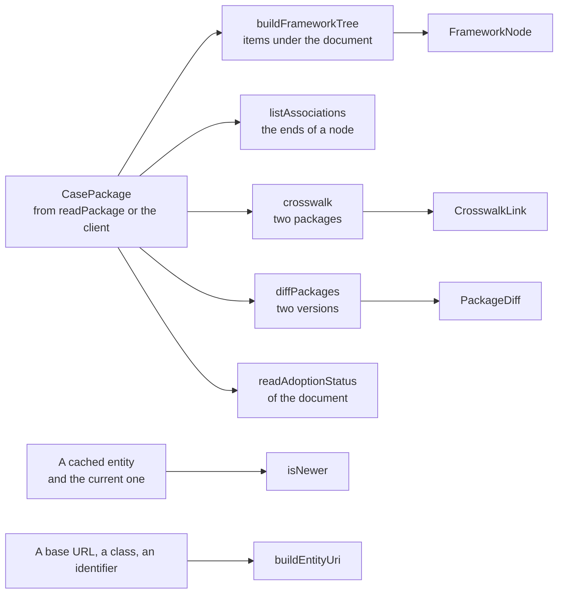

# Trees, associations, crosswalks and change

`@interopkit/competency-frameworks/graph` answers what a consumer asks of a framework once it holds the package: the tree of
its items, the associations of a node, the links between two frameworks, what changed between two versions, whether a cached
copy is stale, the adoption status of a framework, and the address at which an entity belongs. The functions are pure. They take
packages as `readPackage` returns them, make no request, read no clock, and return copies that share nothing with their
arguments.



| Function                                   | Answers                                                                                                          |
| ------------------------------------------ | ---------------------------------------------------------------------------------------------------------------- |
| `buildFrameworkTree(pkg)`                       | The items under the document, each with its children, from the `isChildOf` associations                          |
| `listAssociations(pkg, identifier)`          | The associations that start at a node and those that end at it                                                   |
| `crosswalk(from, to, options)`             | The associations that link an item of one package to an item of another                                          |
| `diffPackages(before, after)`              | The items added, removed and changed between two versions, and the `replacedBy` associations that the later adds |
| `isNewer(cached, current)`                 | Whether the current entity was changed after the cached one                                                      |
| `readAdoptionStatus(document)`                 | The adoption status of a framework, in the vocabulary that the working group recommends                          |
| `buildEntityUri(baseUrl, kind, identifier)` | The address at which the REST binding serves an entity, which is the `uri` that the guide recommends             |

All of them come from `@interopkit/competency-frameworks/graph`, and they depend on `@interopkit/core` and `valibot`.

## Quick start

```ts
import { readPackage } from "@interopkit/competency-frameworks";
import { buildFrameworkTree, isNewer, listAssociations, readAdoptionStatus } from "@interopkit/competency-frameworks/graph";

const base = "https://standards.example.org/ims/case/v1p1";
const time = "2024-06-13T18:46:03+00:00";
const pkg = readPackage({
  CFDocument: {
    identifier: "00000000-0000-4000-8000-000000000001",
    uri: `${base}/CFDocuments/00000000-0000-4000-8000-000000000001`,
    creator: "Ministry of Education",
    title: "Mathematics",
    adoptionStatus: "Adopted",
    lastChangeDateTime: time,
  },
  CFItems: [
    {
      identifier: "00000000-0000-4000-8000-000000000002",
      uri: `${base}/CFItems/00000000-0000-4000-8000-000000000002`,
      fullStatement: "Number and operations",
      humanCodingScheme: "N",
      lastChangeDateTime: time,
    },
    {
      identifier: "00000000-0000-4000-8000-000000000003",
      uri: `${base}/CFItems/00000000-0000-4000-8000-000000000003`,
      fullStatement: "Understand fractions as numbers.",
      humanCodingScheme: "N.10",
      lastChangeDateTime: time,
    },
    {
      identifier: "00000000-0000-4000-8000-000000000004",
      uri: `${base}/CFItems/00000000-0000-4000-8000-000000000004`,
      fullStatement: "Add and subtract fractions.",
      humanCodingScheme: "N.2",
      lastChangeDateTime: time,
    },
  ],
  CFAssociations: [
    {
      identifier: "00000000-0000-4000-8000-0000000000a1",
      associationType: "isChildOf",
      uri: `${base}/CFAssociations/00000000-0000-4000-8000-0000000000a1`,
      originNodeURI: {
        title: "Number and operations",
        identifier: "00000000-0000-4000-8000-000000000002",
        uri: `${base}/CFItems/00000000-0000-4000-8000-000000000002`,
      },
      destinationNodeURI: {
        title: "Mathematics",
        identifier: "00000000-0000-4000-8000-000000000001",
        uri: `${base}/CFDocuments/00000000-0000-4000-8000-000000000001`,
      },
      lastChangeDateTime: time,
    },
    {
      identifier: "00000000-0000-4000-8000-0000000000a2",
      associationType: "isChildOf",
      uri: `${base}/CFAssociations/00000000-0000-4000-8000-0000000000a2`,
      originNodeURI: {
        title: "Understand fractions as numbers.",
        identifier: "00000000-0000-4000-8000-000000000003",
        uri: `${base}/CFItems/00000000-0000-4000-8000-000000000003`,
      },
      destinationNodeURI: {
        title: "Number and operations",
        identifier: "00000000-0000-4000-8000-000000000002",
        uri: `${base}/CFItems/00000000-0000-4000-8000-000000000002`,
      },
      lastChangeDateTime: time,
    },
    {
      identifier: "00000000-0000-4000-8000-0000000000a3",
      associationType: "isChildOf",
      uri: `${base}/CFAssociations/00000000-0000-4000-8000-0000000000a3`,
      originNodeURI: {
        title: "Add and subtract fractions.",
        identifier: "00000000-0000-4000-8000-000000000004",
        uri: `${base}/CFItems/00000000-0000-4000-8000-000000000004`,
      },
      destinationNodeURI: {
        title: "Number and operations",
        identifier: "00000000-0000-4000-8000-000000000002",
        uri: `${base}/CFItems/00000000-0000-4000-8000-000000000002`,
      },
      lastChangeDateTime: time,
    },
  ],
});

const tree = buildFrameworkTree(pkg);
tree.map((node) => node.item.humanCodingScheme); // => ["N"]
tree[0]?.children.map((node) => node.item.humanCodingScheme); // => ["N.2", "N.10"]

listAssociations(pkg, "00000000-0000-4000-8000-000000000002").destination.map((association) => association.originNodeURI.title); // => ["Understand fractions as numbers.", "Add and subtract fractions."]

readAdoptionStatus(pkg.CFDocument); // => "Implemented"
isNewer(pkg.CFDocument, { lastChangeDateTime: "2024-06-13T20:46:04+02:00" }); // => true
```

## The tree

`buildFrameworkTree` starts at the document and follows the `isChildOf` associations downward, level by level. The result is the
list of the items whose parent is the document, each with its `children`.

| Rule                                       | Behavior                                                                                                                                            |
| ------------------------------------------ | --------------------------------------------------------------------------------------------------------------------------------------------------- |
| Order of siblings                          | By the `sequenceNumber` of their association, the items without one after those with one; then by `humanCodingScheme`; then by place in the package |
| Order of codes                             | Numbers inside a code are read as numbers, so `N.2` comes before `N.10`; items without a code follow those with one                                 |
| An item with two parents                   | Appears once, under the first parent that the walk reaches, which is the shallower one. The Information Model places an item in one place           |
| An item with no path to the document       | Not in the tree. `validatePackage` reports it as `item-outside-tree`                                                                                |
| A loop of `isChildOf` associations         | Not followed again. An item that is only in a loop is not in the tree. `validatePackage` reports the loop as `child-of-cycle`                       |
| A node that is not an item or the document | Its association is ignored, as is an association whose node has a `targetType` other than `CASE`                                                    |
| Identifiers                                | Compared in either case, as UUIDs are                                                                                                               |
| Two items with one identifier              | The first is the item                                                                                                                               |

The walk keeps its own queue, so a chain of thousands of levels cannot overflow the stack. Reading `children` recursively is the
caller's choice, and a caller that fears a very deep package walks with its own stack.

## Associations and the crosswalk

`listAssociations(pkg, identifier)` returns `{ origin, destination }`: the associations in which the node is the `originNodeURI`
and those in which it is the `destinationNodeURI`, in the order of the package. For `isChildOf`, `origin` leads to the parents of
the item and `destination` to its children. A package holds the associations of its own document and items, so the associations
that another framework makes to an item are in that framework's package.

`crosswalk(from, to, options)` lists the associations that link an item of `from` to an item of `to`, whichever package holds
the association and whichever end is the origin. Each `CrosswalkLink` has the `uri` of the item in `from`, the `uri` of the item
in `to`, the type, and a copy of the association.

| Option  | Meaning                                                                                                                                         | Default                                                          |
| ------- | ----------------------------------------------------------------------------------------------------------------------------------------------- | ---------------------------------------------------------------- |
| `types` | The association types that make a link. A term that starts with `ext:` may be listed: the guide advises reading an unknown one as `isRelatedTo` | `["exactMatchOf", "isRelatedTo", "isPeerOf", "isTranslationOf"]` |

An association that both packages hold makes one link. A link to a document, a link between two items of one package, and a
link to an item that neither package holds are not links of a crosswalk.

## Change between versions

`diffPackages(before, after)` matches the items of two packages by identifier, in either case.

| Field      | Holds                                                                                                                                                                                           |
| ---------- | ----------------------------------------------------------------------------------------------------------------------------------------------------------------------------------------------- |
| `added`    | Copies of the items that only `after` holds, in its order                                                                                                                                       |
| `removed`  | Copies of the items that only `before` holds. A publisher keeps a retired item and sets its `statusEndDate` (guide 4.3.3), so such an item is in `changed`                                      |
| `changed`  | The items that both hold and that differ in any property, `lastChangeDateTime` and `extensions` included, whatever the order of the keys: `before` and `after`                                  |
| `replaced` | The `replacedBy` associations that `after` holds and `before` lacks, matched by the identifier of the association: the `uri` of the retired item and of the item that replaces it (guide 4.3.5) |

`isNewer(cached, current)` compares the `lastChangeDateTime` of two entities as instants, across offsets, and returns `true`
when the current one is later. A consumer that caches a framework asks for its document, which changes whenever anything in the
framework does (guide 4.3.6), and fetches the package only when the document is newer.

`readAdoptionStatus(document)` returns one of `ADOPTION_STATUSES`: `Draft`, `Pending Implementation`, `Implemented` or `Retired`.
`Adopted` is read as `Implemented` and `Deprecated` as `Retired`, as the guide says (4.2). Case is ignored. It returns
`undefined` when the document states no status or one that is not in the vocabulary. The status is the one that the document
states, and it is not worked out from `statusStartDate` and `statusEndDate`.

## Addresses

`buildEntityUri(baseUrl, kind, identifier, options)` builds the `uri` that the guide recommends for an entity (4.1): the address
from which the REST binding serves it. `kind` is one of `SERVED_KINDS`, and the collection is its name in the plural.

| Option    | Meaning                                                                      | Default |
| --------- | ---------------------------------------------------------------------------- | ------- |
| `version` | The version whose path the address has: `/ims/case/v1p0` or `/ims/case/v1p1` | `"1.1"` |

The base is an `https` URL without credentials, query or fragment, and does not end with the path of a version.

## Limits

The functions set no limit on the size of a package or on the levels of a tree: the caller bounds the bytes it reads, and the
work grows with the number of items and associations. A package of 10,000 items takes tens of milliseconds. The tree and the checks keep
their own queues, so a chain of any length does not exhaust the stack.

## Errors

Each function checks what it reads of its arguments before it works, so a value from plain JavaScript or JSON gives a
`DataError` and not a `TypeError`.

| Case                                                                                                                                                                                                              | Result                                                                                                                                                                                   |
| ----------------------------------------------------------------------------------------------------------------------------------------------------------------------------------------------------------------- | ---------------------------------------------------------------------------------------------------------------------------------------------------------------------------------------- |
| A package lacks the document, or an item or an association lacks an identifier, a URI, a type or a node                                                                                                           | `DataError` that names the path of the first fault: `The package is invalid at CFAssociations[0].associationType: expected a string, found 5.` Read the package with `readPackage` first |
| A package holds a function or a symbol, which cannot be copied                                                                                                                                                    | `DataError`: `The item ... must be plain data that can be copied`. Read the package with `readPackage`, which refuses it                                                                 |
| `listAssociations` is given an identifier that is not a non-empty string                                                                                                                                            | `DataError`                                                                                                                                                                              |
| `crosswalk` is given options that are not an object, that have a property other than `types`, or `types` that is not a list of non-empty strings                                                                                                           | `DataError`                                                                                                                                                                              |
| `isNewer` is given an entity with no `lastChangeDateTime` that is an RFC 3339 date and time with an offset                                                                                                        | `DataError` that says which entity                                                                                                                                                       |
| `readAdoptionStatus` is given a value that is not an object, or an `adoptionStatus` that is not a string                                                                                                              | `DataError`                                                                                                                                                                              |
| `buildEntityUri` is given a base that is not an `https` URL, has credentials, a query, a fragment or the path of a version, a class that is not served, an identifier that is empty, `.` or `..`, or other options | `DataError`                                                                                                                                                                              |

## Not included

| Not included                                                                               | Why                                                                                                              |
| ------------------------------------------------------------------------------------------ | ---------------------------------------------------------------------------------------------------------------- |
| Moves of an item in the hierarchy                                                          | They are changes of `isChildOf` associations, which `diffPackages` does not compare; `listAssociations` reads them |
| Differences of definitions, rubrics, the document and associations other than `replacedBy` | The shape of the result is the items; compare the rest with `isNewer` and `listAssociations`                       |
| The adoption status worked out from the dates                                              | The issuing agency states the status; the guide gives no rule that turns dates into one                          |
| Crosswalks through a third framework                                                       | A chain of links is the caller's to follow with `crosswalk`; the guide defines no transitive meaning             |
| Fetching the other package, or the current entity                                          | The client does it: see the client guide                                                                         |

## Differences from the references

There is no reference implementation of these operations. The specification states the rules that the code follows, and the
tests derive their expected values from a reading of the guide and from independent walks written for the test.

| Case                                | The guide                                                                           | The functions                                                                                 |
| ----------------------------------- | ----------------------------------------------------------------------------------- | --------------------------------------------------------------------------------------------- |
| An item in more than one place      | Each item belongs in one place; frameworks that reuse items alias them (4.4)        | The item appears once; a package that breaks the rule is not refused                          |
| An `ext:` association type          | Treat an unknown extended type as `isRelatedTo` (4.7)                               | The crosswalk lists only the types it is asked for: the caller adds the `ext:` terms it knows |
| `replacedBy` in a complete overhaul | The new framework has `exactMatch` or `related` associations to the old one (4.3.1) | Those are crosswalk links; `replaced` holds only `replacedBy`                                 |
