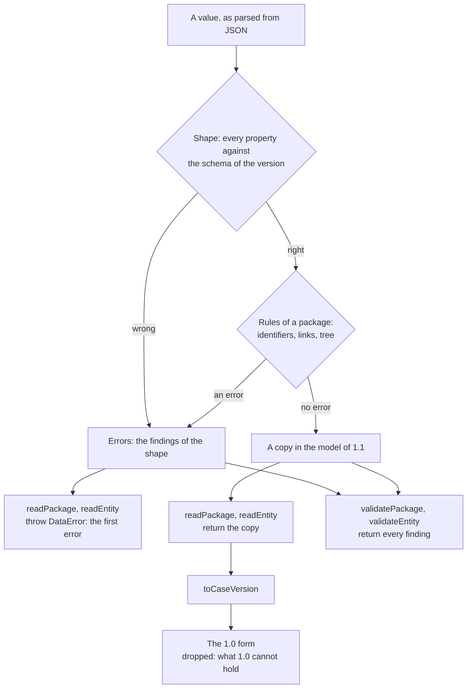

# The CASE model and its readers

`@interopkit/competency-frameworks` holds the model of a CASE competency framework package and of every entity that CASE
exchanges, in the form of CASE 1.1. Its readers take JSON that was parsed from anywhere, check every property against the JSON
schemas of 1EdTech and the rules of a package, and return a copy that shares nothing with the input. Its validators judge the
same value and return every finding as data. CASE 1.0 is the same model without what 1.1 adds, so a package of either version is
read into one model, and `toCaseVersion` takes a package or an entity back to the form of 1.0.



| Module    | Holds                                                                                                                                                                                                 |
| --------- | ----------------------------------------------------------------------------------------------------------------------------------------------------------------------------------------------------- |
| `model`   | The types of the classes and sets, `CaseIssue`, `ASSOCIATION_TYPES`, `ENTITY_KINDS`, `CaseVersion`, `CASE_VERSIONS`, the query types `CaseQuery`, `CaseFilter` and `CaseCondition`, `OpenApiDocument` |
| `read`    | `readPackage`, `readEntity`, `validatePackage`, `validateEntity`, `ReadOptions`                                                                                                                       |
| `version` | `toCaseVersion`, `VersionedValue`, `Converted`                                                                                                                                                        |

All of them come from `@interopkit/competency-frameworks`. The package depends on `@interopkit/core` for the errors, the
formats, the copy of JSON and the findings, and on `valibot` for the schemas. Its test suite reads the schemas of 1EdTech with
`@cfworker/json-schema`, derives its generators from them, and compares every verdict.

## Quick start

```ts
import { readEntity, validateEntity } from "@interopkit/competency-frameworks";

const item = {
  CFDocumentURI: {
    title: "Mathematics",
    identifier: "8f3e2a14-4c1b-4d77-9a3e-1b2c3d4e5f60",
    uri: "https://standards.example.org/ims/case/v1p1/CFDocuments/8f3e2a14-4c1b-4d77-9a3e-1b2c3d4e5f60",
  },
  identifier: "2b6d1c9e-7a53-4e08-b1f4-5c8a9d0e3f21",
  uri: "https://standards.example.org/ims/case/v1p1/CFItems/2b6d1c9e-7a53-4e08-b1f4-5c8a9d0e3f21",
  fullStatement: "Understand fractions as numbers.",
  humanCodingScheme: "NF.1",
  lastChangeDateTime: "2024-06-13T18:46:03+00:00",
  extensions: { sourceItemIdentifier: "NF.1" },
};
const entity = readEntity("CFItem", item);
entity === item; // => false
entity.humanCodingScheme; // => "NF.1"

const asOld = validateEntity("CFItem", item, { version: "1.0" });
asOld.map((finding) => `${finding.path}: ${finding.rule}`); // => ["extensions: unknown-property"]
asOld.map((finding) => finding.message); // => ["unexpected property \"extensions\"."]
```

## The classes

An entity is a plain object whose properties are those of the Information Model, with the names that the specification gives
them. A property that is absent is the same as one that the specification marks optional and the sender left out. Inputs are
never changed, and a result never shares an object with its input.

| Class                                                                                | Where                                                                             | In the model                                                                      |
| ------------------------------------------------------------------------------------ | --------------------------------------------------------------------------------- | --------------------------------------------------------------------------------- |
| `CasePackage`                                                                        | The answer for a package                                                          | `CFDocument`, `CFItems`, `CFAssociations`, `CFDefinitions`, `CFRubrics`           |
| `CFPckgDocument`, `CFPckgItem`, `CFPckgAssociation`                                  | Inside a package                                                                  | The three classes whose form differs by context                                   |
| `CFDocument`, `CFItem`, `CFAssociation`                                              | Outside a package: the answer for one object                                      | The same, and a link to the package or document: `CFPackageURI`, `CFDocumentURI`  |
| `CFDefinition`                                                                       | Inside a package                                                                  | `CFConcepts`, `CFSubjects`, `CFLicenses`, `CFItemTypes`, `CFAssociationGroupings` |
| `CFConcept`, `CFSubject`, `CFLicense`, `CFItemType`, `CFAssociationGrouping`         | Inside `CFDefinitions`, and outside a package                                     | One form                                                                          |
| `CFRubric`, `CFRubricCriterion`, `CFRubricCriterionLevel`                            | Inside `CFRubrics`, and `CFRubric` outside a package                              | One form, nested                                                                  |
| `CFDocumentSet`, `CFAssociationSet`, `CFConceptSet`, `CFSubjectSet`, `CFItemTypeSet` | The answer for a list, an item's associations, a concept, a subject, an item type | At least one member                                                               |
| `LinkURI`, `LinkGenURI`                                                              | Every link                                                                        | `LinkGenURI` has `targetType`, which is `CASE` when absent                        |
| `ImsxStatusInfo`                                                                     | The body of an answer that is not a success                                       | `imsx_codeMajor`, `imsx_severity`, `imsx_description`, `imsx_codeMinor`           |

`CaseEntityKind` names the 15 entities, sets and statuses that `readEntity` reads outside a package, and `ENTITY_KINDS` lists them.
`CFAssociation.associationType` is one of the ten terms of `ASSOCIATION_TYPES` or a term that starts with `ext:`.

The text of `fullStatement`, `description`, `notes` and of a few other properties may hold Markdown or LaTeX in 1.1. The
package carries the text and never renders it. A consumer that shows it renders it through a sanitizing renderer and never
inserts it into a page as HTML.

## Reading and validating

`readPackage(value, options)` reads a package and `readEntity(kind, value, options)` reads an entity of a kind, whose result has
the class of that kind (`readEntity("CFItem", value)` is a `CFItem`). Both return a copy
in the model, and throw a `DataError` when the value has an error. `validatePackage(value, options)` and
`validateEntity(kind, value, options)` judge the same value and return the findings as data, at most `maxFindings` of them. The validators take what the readers
take: parsed text, or a value that is already in the model.

| Option    | Meaning                                                                                                                                             | Default |
| --------- | --------------------------------------------------------------------------------------------------------------------------------------------------- | ------- |
| `version` | The version of CASE that the value is in: `"1.0"` refuses what only 1.1 has and holds identifiers and URIs to the forms of the 1.0 schemas, `"1.1"` | `"1.1"` |
| `maxFindings` | The most findings that a validator lists, or that a reader counts errors up to. The check stops at the first one beyond the limit and ends the list with a finding of the rule `findings-stopped`, so that a value that is wrong in a million places costs the memory of the limit. A reader counts errors and not warnings | 1,000 |

| Function                            | Result                                                                                                                       |
| ----------------------------------- | ---------------------------------------------------------------------------------------------------------------------------- |
| `readPackage`, `readEntity`         | The copy, when the value has no error. A warning is not reported. Otherwise a `DataError`: see Errors                        |
| `validatePackage`, `validateEntity` | A list of `CaseIssue`, the errors and the warnings, in the order of the package. An empty list means that the value is sound |

A finding is a `CaseIssue`: its `path` as code writes it (`CFItems[3].humanCodingScheme`; the empty string is the value as a
whole), its `rule`, a `message` that is a sentence that reads after the path and does not repeat it, and its `severity`. An
error means that the data breaks the specification or cannot be used without a guess. A warning means that it is usable and
departs from what the specification or its guide asks for. Where a user can act, the message says what to do.

| Rule                          | Severity | When                                                                                                                              |
| ----------------------------- | -------- | --------------------------------------------------------------------------------------------------------------------------------- |
| `missing-property`            | error    | A property that the Information Model requires is absent                                                                          |
| `unknown-property`            | error    | An object has a property that the class does not have in this version. One is reported for each object                            |
| `wrong-type`                  | error    | A value is not of the JSON type of the property: a string, a number, an integer, an array or an object                            |
| `invalid-format`              | error    | A string is not an identifier, a date, a date and time or a URI, in the form of the version                                       |
| `invalid-value`               | error    | A value is not in the vocabulary of its property, or an `extensions` holds what JSON cannot or nests too deep                     |
| `too-few-entries`             | error    | A set has no member                                                                                                               |
| `duplicate-identifier`        | error    | Two entities of a package, or of a set or a rubric, have the same identifier, compared as UUIDs                                   |
| `child-of-cycle`              | error    | The `isChildOf` associations loop. The association that closes the loop is named, and the message names five nodes of the loop at most |
| `identifier-form`             | warning  | An identifier is not lower case, of version 1 to 5 and of variant 8 to b, which the Information Model gives                       |
| `unresolved-reference`        | warning  | A link to a definition, a grouping or a criterion's item points to nothing in the package                                         |
| `reference-mismatch`          | warning  | A link, or a node of an association, names an entity of the package with another URI; a criterion or a level names another parent |
| `association-outside-package` | warning  | Neither node of an association is the package's document or one of its items                                                      |
| `item-outside-tree`           | warning  | An item has no chain of `isChildOf` associations to the document, which its items are components of                               |

The rules of a package look at the package as a whole, so they run only when its shape is right. `isChildOf` is followed only
between nodes of the package whose `targetType` is `CASE`, and a node with another `targetType` is outside the package,
whatever its identifier. A node outside the package, in another framework, is not a finding: an association may point out of
the package, but it is a finding when neither of its nodes is in the package.

An entity read by `readEntity` has no package to resolve links in, so only its identifiers are checked: duplicates among the
members of a set and among the parts of a rubric, and their form.

## Versions

CASE 1.0 is read by the model of 1.1 with these differences, which `version: "1.0"` enforces and `toCaseVersion` removes.

| Class or property                            | In 1.1                                          | In 1.0                                     |
| -------------------------------------------- | ----------------------------------------------- | ------------------------------------------ |
| `frameworkType`, `caseVersion` of a document | Optional; `caseVersion` is `"1.1"` when present | Refused                                    |
| `subject`, `subjectURI` of an item           | Optional                                        | Refused                                    |
| `notes` of an association                    | Optional                                        | Refused                                    |
| `targetType` of a node                       | `CASE` or an `ext:` term                        | Refused: every node is a node of CASE      |
| `isTranslationOf`, `ext:` association types  | Allowed                                         | Refused: nine association types            |
| `extensions`                                 | An object of JSON on 13 classes                 | Refused                                    |
| Identifiers                                  | 8-4-4-4-12 hexadecimal digits of either case    | Lower case, version 1 to 5, variant 8 to b |
| `uri`, `officialSourceURL`                   | Any string                                      | A URI with a scheme                        |

A package without `caseVersion` is read as it is: the Information Model makes it optional, and a package of 1.0 has none.

### Extensions

`extensions` is an object whose members the specification does not define, and a consumer ignores what it does not know. In
the level of a rubric criterion it is a list of objects, as the schema has it. The reader copies the value, and the value must
be JSON: a function, `undefined`, a number that JSON cannot write or an object that is not plain (a `Date`, a `Map`) is an
`invalid-value`. A member named `__proto__` stays a member of the copy and never changes its prototype.

### Converting to 1.0

`toCaseVersion(value, "1.0")` takes a package or an entity of 1.1 and returns `{ value, dropped }`: the value in the form of
1.0, which shares nothing with the input, and a warning for each thing that 1.0 cannot hold and was left out.

| What 1.0 cannot hold                              | What the conversion does                                                      | `rule` of the report          |
| ------------------------------------------------- | ----------------------------------------------------------------------------- | ----------------------------- |
| A property of 1.1, and every `extensions`         | Leaves it out                                                                 | `property-not-in-1.0`         |
| `targetType: "CASE"`                              | Leaves it out and reports nothing: it is the default of 1.0                   |                               |
| An association type that 1.0 lacks                | Leaves the association out                                                    | `association-type-not-in-1.0` |
| A node that is not of CASE                        | Leaves the association out, because 1.0 would read the node as a node of CASE | `target-type-not-in-1.0`      |
| A set of associations left with none              | Gives `value: undefined`                                                      | `association-set-empty`       |
| An identifier or a URI of a form that 1.0 refuses | Keeps it as it is and reports it                                              | `form-not-in-1.0`             |

The value is `undefined` for an association that has no form in 1.0 and for the set of an item's associations when none of
them has one: a provider answers that it has no such object. The type `Converted` says so.

```ts
import { toCaseVersion } from "@interopkit/competency-frameworks";

const association = {
  identifier: "6a1f0c2e-9d84-4b37-8e5a-3c7b1d9f0a42",
  associationType: "isTranslationOf",
  uri: "https://standards.example.org/ims/case/v1p1/CFAssociations/6a1f0c2e-9d84-4b37-8e5a-3c7b1d9f0a42",
  originNodeURI: { title: "Fractions", identifier: "2b6d1c9e-7a53-4e08-b1f4-5c8a9d0e3f21", uri: "https://standards.example.org/items/1" },
  destinationNodeURI: { title: "Fractions in Spanish", identifier: "b7d2f6a0-3c4e-4f1a-9e8d-0a1b2c3d4e5f", uri: "https://estandares.example.org/items/1" },
  lastChangeDateTime: "2024-06-13T18:46:03+00:00",
};
const converted = toCaseVersion(association, "1.0");
converted.value; // => undefined
converted.dropped.map((finding) => finding.rule); // => ["association-type-not-in-1.0"]
```

1.0 holds an identifier to the form of the Information Model (lower case, version 1 to 5) and a `uri` to a URI with a scheme, where
1.1 reads any UUID and any string. A value of 1.1 that has such a form, such as an identifier of version 7, gives a value that 1.0
refuses at that path, and `dropped` holds a `form-not-in-1.0` for it: the result is valid in 1.0 when `dropped` holds none.

The conversion reads the structure of the value as far as it converts it: the lists and objects that hold other entities, to
64 levels. It does not check the other properties that it copies, which `readPackage` and `readEntity` check.

## Limits

| Limit                                       | Value | Refused with                        |
| ------------------------------------------- | ----- | ----------------------------------- |
| Levels that the value of an extension nests | 64    | `invalid-value` at the `extensions` |
| Levels that `toCaseVersion` reads           | 64    | `DataError`                         |

The size of what is read is the caller's: the readers take a value that was already parsed, so the caller limits the bytes
and the depth of the text that it parses. The walk over `isChildOf` keeps its own stack, so a chain of any length does not
exhaust the stack of the host.

## Errors

| Case                                                                                                                                                                | Result                                                                                                                                                                                                            |
| ------------------------------------------------------------------------------------------------------------------------------------------------------------------- | ----------------------------------------------------------------------------------------------------------------------------------------------------------------------------------------------------------------- |
| `readPackage` or `readEntity` is given a value that has an error                                                                                                    | `DataError`: `The package is invalid at CFDocument.title: missing the property "title". 2 more errors: validatePackage lists every finding.` Fix the data, or read it as the other version with `options.version` |
| `readPackage` or `readEntity` counted `maxFindings` errors and stopped                                                                                              | `DataError`: `The package is invalid at <path>: <sentence>. At least 2 more errors: the check stopped at its limit, ...`. Call `validatePackage` with a higher `maxFindings` |
| `options` is not an object, has a property other than `version` and `maxFindings`, or `version` is not `"1.0"` or `"1.1"`, or `maxFindings` is not a positive integer                                                             | `DataError`: `The read options is invalid at version: expected "1.0" or "1.1", found "2.0".`                                                                                                                      |
| The kind of `readEntity` or `validateEntity` is not one of `ENTITY_KINDS`                                                                                           | `DataError` that lists the kinds                                                                                                                                                                                  |
| `validatePackage` or `validateEntity` is given a value that is not a package or an entity                                                                           | The findings. It does not throw                                                                                                                                                                                   |
| `toCaseVersion` is given a version other than `"1.0"`, a value that is not an object, a list or object of the wrong type, or a value that nests more than 64 levels | `DataError` that names the path and what was expected: `CFItems must be an array, found an object.`                                                                                                               |
| `toCaseVersion` meets a property that JSON cannot hold                                                                                                              | `DataError` that names the property                                                                                                                                                                               |

## Not included

| Not included                                                    | Why                                                                                          |
| --------------------------------------------------------------- | -------------------------------------------------------------------------------------------- |
| Rendering Markdown and LaTeX                                    | The consumer's interface renders it, through a sanitizing renderer that the consumer chooses |
| Writing a package: building items, associations and identifiers | The host knows its own framework; the model types and `validatePackage` check what it builds |
| The JSON-LD form of CASE 1.0 (`@context`, `type`)               | A document form of 1.0 that 1.1 does not have and the REST binding does not serve            |
| Reading a package that is wrong, to recover what is right in it | A package with an error is not returned; `validatePackage` says where to look                |
| Serving a framework                                             | Not part of the model                                                                        |

## Differences from the references

The reference is the set of JSON schemas that 1EdTech publishes for each version, which the tests read at pinned hashes and
compare with the readers for every class, on generated packages and on packages with one change. The readers give the verdict
of the schemas, except in the cases below, each of which a test pins.

| Case                                                                   | The JSON schemas, as a validator reads them                                                                                    | The readers                                                                                              |
| ---------------------------------------------------------------------- | ------------------------------------------------------------------------------------------------------------------------------ | -------------------------------------------------------------------------------------------------------- |
| Several properties that a class does not have                          | A validator reports every one                                                                                                  | One is reported for each object; the verdict is the same                                                 |
| An identifier of 1.0                                                   | `pattern` without anchors accepts text around a UUID                                                                           | Anchored                                                                                                 |
| An identifier of 1.1 with the prefix `urn:uuid:`                       | The validator that the tests use accepts it                                                                                    | Refused: the form is 8-4-4-4-12 digits                                                                   |
| A date and time with a space or an offset without a colon              | The validator accepts `2024-06-13 18:46:03Z` and `+0000`                                                                       | Refused: RFC 3339 has `T` and an offset of `hh:mm`                                                       |
| A term of `ext:`                                                       | `pattern` without anchors, and a class of characters that holds `\|` and no hyphen: it accepts `ext:a\|b` and refuses `ext:-a` | Anchored, with letters, digits, `.`, `-` and `_`                                                         |
| `invalid_filter_field` in a status                                     | Not in the enumeration                                                                                                         | Accepted: the REST binding answers with it                                                               |
| The codes `unauthorised_request` and `invalid_uuid` of a status of 1.0 | The 1.0 schema spells them `unauthorisedrequest` and `invaliduuid`                                                             | The spelling of the Information Model, as in 1.1                                                         |
| A URI with a scheme in 1.0                                             | The grammar of RFC 3986, strictly: it refuses `foo:`, `x:`, `a:é` and `https://x.org/%zz`, and accepts `https://`              | A scheme, no white space, and a text that `URL` parses: it accepts the first four and refuses `https://` |
