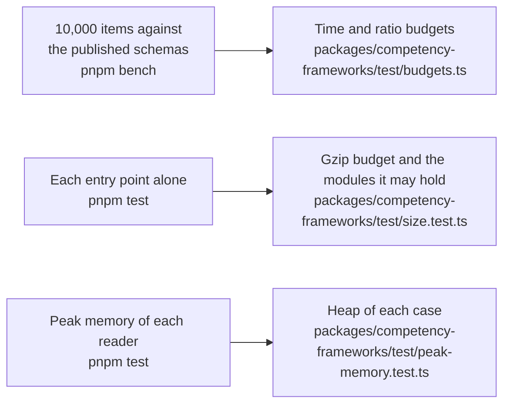

# Performance of competency-frameworks

What the hot paths of `@interopkit/competency-frameworks` cost, how much each entry point adds to a bundle, and the heap that each reader of untrusted input needs on its worst input. A budget holds each number and fails a gate of CI: `pnpm bench` for the time, `pnpm test` for the size and the heap. That the package does what it says is in [evidence](evidence.md).

## Speed

`pnpm bench` times the build that ships on a framework of 10,000 items, 10,200 associations and 10.6 MB of JSON that
`packages/competency-frameworks/test/bank.ts` makes from the number alone. A benchmark takes at least 10 samples after a
warm-up, and the gate is the fastest sample.

| Benchmark            | What it times                             | Fastest on the runner | Budget | Holds on                                |
| -------------------- | ----------------------------------------- | --------------------: | -----: | --------------------------------------- |
| `readPackage`        | Reading and checking the parsed framework |          71.7–94.2 ms | 400 ms | A machine of the class of the CI runner |
| `validatePackage`    | The findings of the framework             |          71.2–92.5 ms | 400 ms | A machine of the class of the CI runner |
| `buildFrameworkTree` | The tree of 10,000 items                  |          54.2–62.9 ms | 300 ms | A machine of the class of the CI runner |
| `queryEntities`      | A filter and a sort over 10,000 documents |            5.3–8.5 ms |  30 ms | A machine of the class of the CI runner |

The range of the fastest sample is that of the eight latest green runs of the `bench` job on main.

The other benchmarks are ratios to a reference in the same run, so they hold on any machine. The table gives the range of the
ratios of the eight latest green runs of the runner of CI and of two runs on a laptop, and the fastest samples of a reference on
the runner; the published schemas are applied by `@cfworker/json-schema`.

| Benchmark                                      | Reference                                  |     Ratio | Budget |
| ---------------------------------------------- | ------------------------------------------ | --------: | -----: |
| `readPackage` of the framework                 | the package schema of CASE 1.1, 234–315 ms | 0.24–0.33 |      1 |
| `readEntity` of each item alone                | the item schema of CASE 1.1, 124–172 ms    | 0.33–0.49 |      1 |
| `readPackage` of the framework                 | `JSON.parse` of its text, 21.0–26.5 ms     | 3.40–4.11 |     30 |
| `buildFrameworkTree`                           | the same                                   | 2.17–2.73 |     20 |
| `convertCaseVersion` to 1.0                    | the same                                   | 2.38–3.24 |     20 |
| `diffPackages` of the framework and an edition | the same                                   | 1.85–3.00 |     20 |
| `crosswalk` to the framework it matches        | the same                                   | 0.72–0.99 |      5 |
| `listAssociations` an item                     | the same                                   | 0.69–0.90 |      5 |
| `handleCaseRequest` for the package in 1.1     | `JSON.stringify` of the package            | 0.96–1.05 |      6 |
| `handleCaseRequest` for the package in 1.0     | the same                                   | 3.96–8.85 |     50 |
| `package` of a client                          | `JSON.parse` of the answer                 | 5.49–7.87 |     40 |

A ratio to a published schema is parity or better; another is five times the highest ratio measured on the runner of CI and on a laptop, rounded up to one significant digit, and a time five times the fastest sample of the runner of CI (`ubuntu-latest`, Node.js 22) over the eight latest green runs of the
`bench` job, rounded up to one significant digit; the fastest samples of one benchmark differ by up to 1.6 times from run to run. A budget changes only with the
reason in the commit that changes it. No other library reads CASE packages, so the references are the schemas and the JSON.

`convertCaseVersion` copies a string, a number, a list of them and a node of plain values without the deep copy, and writes the path of
a member only for a warning or an error, so it takes 0.74 to 0.83 of the time of the build before, alternated in one process, and
the 1.0 answer of a provider 0.76; the checks of a package write a path only for a finding, about 0.95. It refuses a member named
`__proto__`, `constructor` or `prototype` in each object that it walks by `findPrototypeName` of `core`, three lookups, and
parses an object with the schema that writes the refusal only when it has one: the schema over every object took 14 percent of
the conversion, and 3.53 to 3.91 times `JSON.parse` where it takes 2.59 to 2.96. The six real frameworks,
each with an edited copy, read and convert to the same values and findings. `listAssociations` checks the whole package at each
call, as every function of the graph checks its argument, so a host that asks for the associations of each item walks
`CFAssociations` once instead.

## Size

`size.test.ts` bundles each entry point alone with `scripts/entry-size.ts`: esbuild, minified, with every dependency inside. It
fails above the budget after gzip, or when an entry point holds a module that its budget does not list.

Gzip is measured on Node.js 22; other versions of Node.js differ by up to 1 percent.

| Entry point                                  |  Bytes |   Gzip | Budget | Holds, besides `@interopkit/core`, `model` and valibot |
| -------------------------------------------- | -----: | -----: | -----: | ------------------------------------------------------ |
| `@interopkit/competency-frameworks`          | 37,509 | 12,297 | 15,000 | `read`, `version`                                      |
| `@interopkit/competency-frameworks/client`   | 47,464 | 15,701 | 19,000 | `read`                                                 |
| `@interopkit/competency-frameworks/graph`    | 22,140 |  7,732 |  9,500 | nothing else                                           |
| `@interopkit/competency-frameworks/provider` | 45,776 | 15,012 | 18,000 | `read`, `version`                                      |

## Memory

Each reader of untrusted input runs on its worst input within its limits in a Node.js process of its own whose heap is
bounded (`test/peak-memory.test.ts`, with the readings in `test/peak-memory-readings.ts`): what the reading keeps alive at once
must fit, whenever V8 collects, so a regression fails and the load of a machine cannot. The heap of a case is twice the least in
which the reading ends on Node.js 22 and 24, rounded up to 16 MiB; `node scripts/peak-memory.ts competency-frameworks` prints the least, in steps
of 8 MiB.

| Reader                | Worst input                                                                         | Least heap | Heap of the test |
| --------------------- | ----------------------------------------------------------------------------------- | ---------: | ---------------: |
| `readPackage`         | A package whose `CFItems` are a million wrong values                                |     16 MiB |           32 MiB |
| `validatePackage`     | The same                                                                            |     16 MiB |           32 MiB |
| `readEntity`          | The associations of an item, a million wrong ones                                   |     16 MiB |           32 MiB |
| `package` of a client | The largest framework of the bank that the 16 MiB of an answer hold, 15,000 items   |     64 MiB |          128 MiB |
| `package` of a client | Extensions of 499,000 distinct keys, the most that 2,000,000 tokens hold, in 16 MiB |    144 MiB |          288 MiB |
| `handleCaseRequest`   | A request for the list with a `fields` list of 10 MiB                               |     32 MiB |           64 MiB |

Without its limit of 2,048 characters, as a filter has, a `fields` list of 10 MiB needs a heap of 192 MiB and raises the peak by 629 MiB; the rest is the URL
that the host gave. An object of distinct keys is the costliest answer for its tokens, about 15 times its bytes: lower `maxBytes`
and `maxTokens` for a provider that you do not trust.
