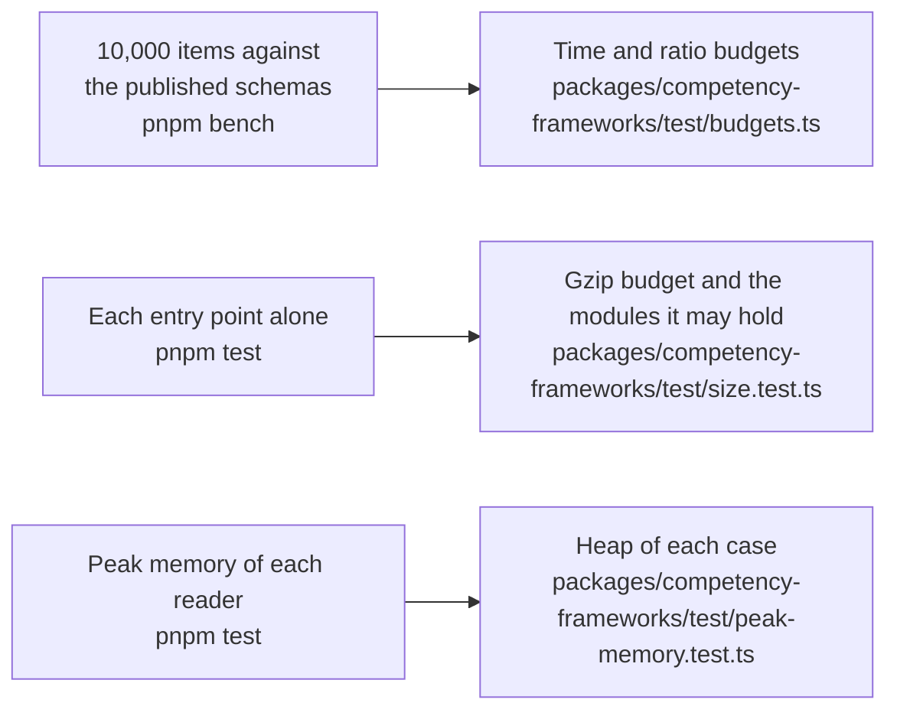

# Performance of competency-frameworks

What the benchmarks of `@interopkit/competency-frameworks` time and hold to a budget in CI (`pnpm bench`), the size of each
entry point, and the heap of each reader of untrusted input at its worst input (`pnpm test`). The docs publish no measured
time: it differs on every machine.

## Speed

`pnpm bench` times the build that ships on a framework of 10,000 items, 10,200 associations and 10.6 MB of JSON that
`packages/competency-frameworks/test/bank.ts` makes from the number alone. A benchmark takes at least 10 samples after a
warm-up, and the gate is the fastest sample.

| Benchmark            | What it times                             |
| -------------------- | ----------------------------------------- |
| `readPackage`        | Reading and checking the parsed framework |
| `validatePackage`    | The findings of the framework             |
| `buildFrameworkTree` | The tree of 10,000 items                  |
| `queryEntities`      | A filter and a sort over 10,000 documents |

The other benchmarks are ratios to a reference in the same run, so they hold on any machine; the published schemas are applied
by `@cfworker/json-schema`.

| Benchmark                                      | Reference                       |
| ---------------------------------------------- | ------------------------------- |
| `readPackage` of the framework                 | the package schema of CASE 1.1  |
| `readEntity` of each item alone                | the item schema of CASE 1.1     |
| `readPackage` of the framework                 | `JSON.parse` of its text        |
| `buildFrameworkTree`                           | the same                        |
| `convertCaseVersion` to 1.0                    | the same                        |
| `diffPackages` of the framework and an edition | the same                        |
| `crosswalk` to the framework it matches        | the same                        |
| `listAssociations` an item                     | the same                        |
| `handleCaseRequest` for the package in 1.1     | `JSON.stringify` of the package |
| `handleCaseRequest` for the package in 1.0     | the same                        |
| `package` of a client                          | `JSON.parse` of the answer      |

A ratio is twice the highest ratio measured on the runner of CI, rounded up to one significant digit, whether the reference is a published schema or the JSON, and a time five times the fastest sample of the runner of CI (`ubuntu-latest`, Node.js 22) over the eight latest green runs of the
`bench` job, rounded up to one significant digit. A budget changes only with the
reason in the commit that changes it. No other library reads CASE packages, so the references are the schemas and the JSON.

| Choice                                                                                                                                                                                                                               | Against a build without it, alternated in one process         |
| ------------------------------------------------------------------------------------------------------------------------------------------------------------------------------------------------------------------------------------ | ------------------------------------------------------------- |
| `convertCaseVersion` copies a string, a number, a list of them and a node of plain values without the deep copy, and writes the path of a member only for a warning or an error                                                      | About 0.8 of the time                                         |
| The checks of a package write a path only for a finding                                                                                                                                                                              | About 0.95                                                    |
| `convertCaseVersion` refuses `__proto__`, `constructor` and `prototype` in each object it walks with `findPrototypeName` of `core`, three lookups, and parses an object with the schema that writes the refusal only when it has one | A schema over every object takes 14 percent of the conversion |

The six real frameworks, each with an edited copy, read and convert to the same values and findings either way.
`listAssociations` checks the whole package at each call, as every function of the graph checks its argument, so a host that
asks for the associations of each item walks `CFAssociations` once instead.

## Size

`size.test.ts` bundles each entry point alone with `scripts/entry-size.ts`: esbuild, minified, with every dependency inside. It
fails above the budget after gzip, or when an entry point holds a module that its budget does not list. Gzip is measured on
Node.js 22; other versions differ by up to 1 percent.

| Entry point                                  |  Bytes |   Gzip | Budget | Holds, besides `@interopkit/core`, `model` and valibot |
| -------------------------------------------- | -----: | -----: | -----: | ------------------------------------------------------ |
| `@interopkit/competency-frameworks`          | 37,509 | 12,298 | 15,500 | `read`, `version`                                      |
| `@interopkit/competency-frameworks/client`   | 47,464 | 15,701 | 20,000 | `read`                                                 |
| `@interopkit/competency-frameworks/graph`    | 22,140 |  7,732 | 10,000 | nothing else                                           |
| `@interopkit/competency-frameworks/provider` | 45,776 | 15,012 | 19,000 | `read`, `version`                                      |

## Memory

Each reader of untrusted input runs on its worst input within its limits in a Node.js process of its own whose heap is
bounded (`test/peak-memory.test.ts`, with the readings in `test/peak-memory-readings.ts`): what the reading keeps alive at once
must fit, whenever V8 collects, so a regression fails and the load of a machine cannot. The heap of a case is twice the least in
which the reading ends on Node.js 22 and 24, rounded up to 16 MiB; `node scripts/peak-memory.ts competency-frameworks` prints the least, in steps
of 8 MiB.

| Reader                | Worst input                                                                         | Least heap | Heap of the test |
| --------------------- | ----------------------------------------------------------------------------------- | ---------: | ---------------: |
| `readPackage`         | A package whose `CFItems` are a million wrong values                                |     16 MiB |           32 MiB |
| `validatePackage`     | The same                                                                            |     16 MiB |           32 MiB |
| `readEntity`          | The associations of an item, a million wrong ones                                   |     16 MiB |           32 MiB |
| `package` of a client | The largest framework of the bank that the 16 MiB of an answer hold, 15,000 items   |     64 MiB |          128 MiB |
| `package` of a client | Extensions of 499,000 distinct keys, the most that 2,000,000 tokens hold, in 16 MiB |    144 MiB |          288 MiB |
| `handleCaseRequest`   | A request for the list with a `fields` list of 10 MiB                               |     32 MiB |           64 MiB |

Without its limit of 2,048 characters, a `fields` list of 10 MiB would need a heap of 192 MiB and raise the peak by 629 MiB; the
rest of the case is the URL that the host gave. An object of distinct keys is the costliest answer for its tokens, about 15 times its bytes: lower `maxBytes`
and `maxTokens` for a provider that you do not trust.
