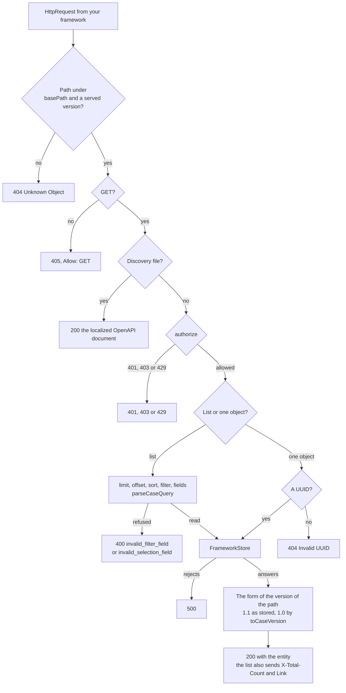
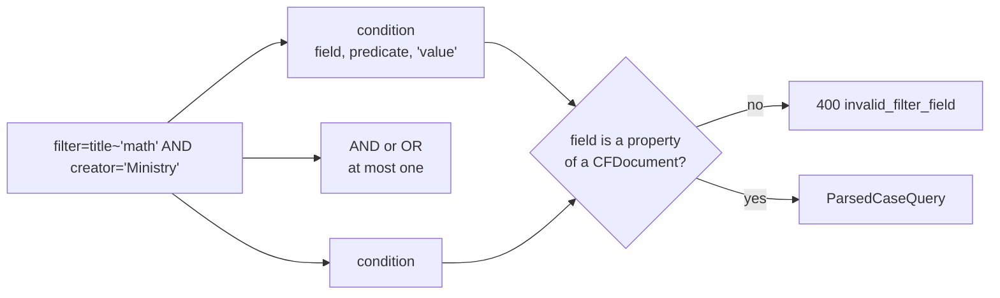
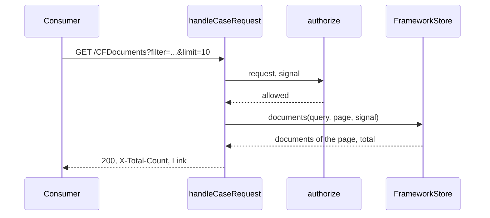

# The CASE provider

`@interopkit/competency-frameworks/provider` serves a store of competency frameworks over the CASE REST binding. The handler takes
a plain request and answers a plain response, so it runs under any web framework, in a worker or in a test. The host brings the
store, and optionally the check of who may ask. A consumer of CASE 1.1 or CASE 1.0 reads what it serves.



| Part                                                | Holds                                                                                    |
| --------------------------------------------------- | ---------------------------------------------------------------------------------------- |
| `handleCaseRequest`, `CaseProviderOptions`          | The router and the twelve endpoints of the binding, over a store                         |
| `FrameworkStore`, `DocumentPage`                    | What the provider needs from the host: one object by identifier, and a page of documents |
| `parseCaseQuery`, `ParsedCaseQuery`, `QueryRefusal` | The query grammar of the list of documents, for a host that writes its own handler       |
| `queryEntities`, `QueryEntitiesOptions`             | The filter and the sort in memory, for a store that holds its documents in a list        |
| `localizeOpenApi`, `LocalizeOpenApiOptions`         | The OpenAPI file of 1EdTech made into the localized file that the provider serves        |

The query types `CaseQuery`, `CaseFilter`, `CaseCondition` and `OpenApiDocument` are in the root of the package, because the
client shares them. The package imports `@interopkit/core` for the request, the response and the checks, and keeps nothing between
requests. `@interopkit/core/http` holds what the providers of the 1EdTech services share: `AccessDecision`, what `authorize`
answers (allowed, or refused with 401, 403 or 429), the page that the store receives (`OffsetPage`: `limit` and `offset`), the
`Link` header and the `imsx_StatusInfo` of a failure.

## Quick start

```ts
import { handleCaseRequest, localizeOpenApi, queryEntities } from "@interopkit/competency-frameworks/provider";

const documents = [
  {
    identifier: "8f3e2a14-4c1b-4d77-9a3e-1b2c3d4e5f60",
    uri: "https://case.example.org/ims/case/v1p1/CFDocuments/8f3e2a14-4c1b-4d77-9a3e-1b2c3d4e5f60",
    CFPackageURI: {
      title: "Mathematics",
      identifier: "8f3e2a14-4c1b-4d77-9a3e-1b2c3d4e5f60",
      uri: "https://case.example.org/ims/case/v1p1/CFPackages/8f3e2a14-4c1b-4d77-9a3e-1b2c3d4e5f60",
    },
    creator: "Ministry of Education",
    title: "Mathematics",
    lastChangeDateTime: "2024-06-13T18:46:03+00:00",
  },
  {
    identifier: "c1a0f7d2-5e3b-4a96-8d14-7b2e9f60a3c5",
    uri: "https://case.example.org/ims/case/v1p1/CFDocuments/c1a0f7d2-5e3b-4a96-8d14-7b2e9f60a3c5",
    CFPackageURI: {
      title: "Biology",
      identifier: "c1a0f7d2-5e3b-4a96-8d14-7b2e9f60a3c5",
      uri: "https://case.example.org/ims/case/v1p1/CFPackages/c1a0f7d2-5e3b-4a96-8d14-7b2e9f60a3c5",
    },
    creator: "Ministry of Education",
    title: "Biology",
    lastChangeDateTime: "2023-01-09T08:00:00+00:00",
  },
];
const none = async () => undefined;
const discovery = localizeOpenApi(
  { openapi: "3.0.0", info: { title: "CASE", version: "1.1" }, paths: {} },
  { serverUrl: "https://case.example.org/ims/case/v1p1" },
);

const response = await handleCaseRequest(
  {
    method: "GET",
    url: "https://case.example.org/ims/case/v1p1/CFDocuments?filter=title~%27bio%27&fields=identifier,title",
    headers: {},
    body: new Uint8Array(),
  },
  {
    discovery,
    store: {
      documents: async (query, page) => ({
        documents: queryEntities(documents, query).slice(page.offset, page.offset + page.limit),
        total: queryEntities(documents, query).length,
      }),
      document: async (id) => documents.find((each) => each.identifier === id),
      package: none,
      item: none,
      itemAssociations: none,
      association: none,
      associationGrouping: none,
      concept: none,
      subject: none,
      license: none,
      itemType: none,
      rubric: none,
    },
  },
);
response.status; // => 200
response.headers["x-total-count"]; // => "1"
JSON.parse(String(response.body)); // => { CFDocuments: [{ identifier: "c1a0f7d2-5e3b-4a96-8d14-7b2e9f60a3c5", title: "Biology" }] }
```

Mount the handler on one route for everything below `basePath`, build an `HttpRequest` from the request of your framework with
the public address of the request, and send the `HttpResponse` that it returns.

## The endpoints

All twelve endpoints of the binding (2.1) answer GET, under `{basePath}/ims/case/v1p1` and, when asked for, `{basePath}/ims/case/v1p0`.

| Endpoint                                    | Store method          | Answer (200)                                 |
| ------------------------------------------- | --------------------- | -------------------------------------------- |
| `/CFDocuments`                              | `documents`           | `CFDocumentSet` of a page                    |
| `/CFDocuments/{id}`                         | `document`            | `CFDocument`                                 |
| `/CFPackages/{id}`                          | `package`             | `CFPackage`                                  |
| `/CFItems/{id}`                             | `item`                | `CFItem`                                     |
| `/CFItemAssociations/{id}`                  | `itemAssociations`    | `CFAssociationSet`                           |
| `/CFAssociations/{id}`                      | `association`         | `CFAssociation`                              |
| `/CFAssociationGroupings/{id}`              | `associationGrouping` | `CFAssociationGrouping`                      |
| `/CFConcepts/{id}`                          | `concept`             | `CFConceptSet`: the concept and its children |
| `/CFSubjects/{id}`                          | `subject`             | `CFSubjectSet`                               |
| `/CFLicenses/{id}`                          | `license`             | `CFLicense`                                  |
| `/CFItemTypes/{id}`                         | `itemType`            | `CFItemTypeSet`                              |
| `/CFRubrics/{id}`                           | `rubric`              | `CFRubric`                                   |
| `/discovery/imscasev1p1_openapi3_v1p0.json` | none                  | The `discovery` document, with 1.1           |

Only `/CFDocuments` takes query parameters; the others ignore them. A path with other segments, a trailing slash or another case
is 404.

## Options

| Option        | Meaning                                                                                                                      | Default               |
| ------------- | ---------------------------------------------------------------------------------------------------------------------------- | --------------------- |
| `store`       | The `FrameworkStore`. Required                                                                                               | none                  |
| `discovery`   | The localized OpenAPI 3 document, from `localizeOpenApi`. Required                                                           | none                  |
| `basePath`    | The path the provider is mounted at, before `/ims/case/v1p1`: `""`, or a path that starts with `/` and does not end with one | `""`                  |
| `versions`    | The versions to serve, each at its own path                                                                                  | `["1.1"]`             |
| `authorize`   | Decides from the request whether it may be served, and refuses one over the host's limit of rate; not asked for the discovery file | every request allowed |
| `pageSize`    | Documents in a page when the request has no `limit`; lowered to `maxPageSize` when above it                                  | 100                   |
| `maxPageSize` | The most documents in a page; a larger `limit` is lowered to it                                                              | 1,000                 |
| `collation`   | The locale of the Unicode collation for `sort` and `filter`, a BCP 47 tag; the store receives it in the query                | `"und"`               |
| `signal`      | An `AbortSignal` that ends the wait for the store and `authorize`                                                            | none                  |

The URL of the request is the one the consumer used, and the `Link` header is built from it: behind a proxy, build the request
from the public address. The store receives an identifier as the consumer wrote it, in either case: compare UUIDs without
regard to case, as the readers do.

## The query of the list

`/CFDocuments` reads six parameters (binding 3).

| Parameter | Form                                                                       | Meaning                                                                        |
| --------- | -------------------------------------------------------------------------- | ------------------------------------------------------------------------------ |
| `limit`   | A whole number of at least 1                                               | Documents in the page, at most `maxPageSize`; `pageSize` when absent           |
| `offset`  | A whole number of at least 0                                               | Documents to skip; 0 when absent                                               |
| `sort`    | A property of a CFDocument                                                 | Sort by it; the order of the store for a name that is not a property           |
| `orderBy` | `asc` or `desc`                                                            | The direction of the sort; ascending when absent or not one of the two         |
| `filter`  | `field<predicate>'value'`, optionally `AND` or `OR` and a second condition | The documents to keep                                                          |
| `fields`  | Names with commas between                                                  | The properties to return and no others; every property when none is a property |



| Predicate            | Text              | A document passes when                                                                                                                                              |
| -------------------- | ----------------- | ------------------------------------------------------------------------------------------------------------------------------------------------------------------- |
| `=`                  | `=`               | its value equals the text, without regard to case and with regard to accents; a list equals the comma-separated texts as a set                                      |
| `!=`                 | `!=`              | `=` does not hold; a document with no value passes                                                                                                                  |
| `>`, `>=`, `<`, `<=` | `>` `>=` `<` `<=` | one value is after, not before, before, not after the text, in the collation of the locale; dates and times compare by the instant they name and numbers as numbers |
| `~`                  | `~`               | the text, or for a list any of its comma-separated texts, is part of the value without regard to case                                                               |

A value is in single quotes, and a quote inside a value is written twice: `title='It''s'`. A single quote that neither ends the
filter nor comes before `AND` or `OR` is read as an apostrophe. `AND` and `OR` may be in either case and need white space on both
sides. A path with dots reaches into nested objects (`licenseURI.title`, `extensions.source`); only its first name is checked
against the properties of a CFDocument. The filter is URL encoded, and holds at most 2,048 characters after decoding.

`parseCaseQuery` reads these parameters for the names of a CFDocument of CASE 1.1 and returns the `ParsedCaseQuery` or a
`QueryRefusal` with its code and a sentence. On the path of 1.0 the handler holds the names to those of 1.0, which lack
`frameworkType`, `caseVersion` and `extensions`.

```ts
import { parseCaseQuery } from "@interopkit/competency-frameworks/provider";

parseCaseQuery(new Map([["filter", "title~'math' AND creator='Ministry'"], ["sort", "title"], ["orderBy", "desc"]])); // => { filter: { and: [{ field: "title", predicate: "~", value: "math" }, { field: "creator", predicate: "=", value: "Ministry" }] }, sort: "title", orderBy: "desc" }
parseCaseQuery(new Map([["filter", "nonsense='x'"]])); // => { refused: "invalid_filter_field", detail: "The filter names the field \"nonsense\", which a CFDocument of CASE 1.1 does not have." }
```

## The store



`documents(query, page)` returns the page and the number of documents that match, whatever the page. The store applies
`query.filter` and `query.sort` before it takes the page, in the collation that `query.collation` names; `queryEntities` does it
for documents in memory. `query.fields` is for a store that can read less; the provider selects the fields itself. A lookup
returns the object or `undefined`. The twelve methods are read-only and may be called again.

| What the port does                                                                                                                                               | The provider answers                                                                |
| ---------------------------------------------------------------------------------------------------------------------------------------------------------------- | ----------------------------------------------------------------------------------- |
| A lookup answers `undefined`                                                                                                                                     | 404 `Unknown Object`                                                                |
| A method rejects or throws                                                                                                                                       | 500, with nothing of the failure in the answer                                      |
| The `signal` aborts                                                                                                                                              | The request rejects with the reason of the signal, at once, whatever the store does |
| A lookup answers something that is not an object or `undefined`, `documents` answers a shape other than `{ documents, total }`, or more documents than the limit | `DataError`: a broken port contract is a bug of the host                            |
| `authorize` answers `{ allowed: false, status: 401 }` or `403`                                                                                                   | 401 with `WWW-Authenticate: Bearer`, or 403, and the store is not asked             |
| `authorize` answers `{ allowed: false, status: 429 }`, with `retryAfterSeconds` or without | 429 `server_busy`, with `Retry-After` when the seconds are given, and the store is not asked |
| `authorize` rejects or throws                                                                                                                                    | 500                                                                                 |
| `authorize` answers another shape                                                                                                                                | `DataError`                                                                         |

The binding does not say how a consumer is authenticated beyond TLS and the 1EdTech Security Framework (4). `authorize` gets the
whole request, so the host can check a bearer token, a client certificate or a network. It is not asked for the discovery file,
which a consumer reads to learn how to authenticate.

## Answers

| Status | When                                                                                                                                                                                       | `imsx_codeMinor`                                              |
| ------ | ------------------------------------------------------------------------------------------------------------------------------------------------------------------------------------------ | ------------------------------------------------------------- |
| 200    | The object, or the set of a page, in the form of the version of the path                                                                                                                   |                                                               |
| 400    | A `filter` that cannot be read or names an unknown property; a `fields` with a blank name; a `limit` or `offset` that is not a whole number in range; a parameter that occurs twice        | `invalid_filter_field`, `invalid_selection_field`, none, none |
| 401    | `authorize` refuses: the request is not authenticated                                                                                                                                      | `unauthorised_request`                                        |
| 403    | `authorize` refuses: the request is not allowed                                                                                                                                            | `forbidden`                                                   |
| 429    | `authorize` refuses: the consumer asks too often, with `Retry-After` when `retryAfterSeconds` gives it | `server_busy` |
| 404    | An identifier the store does not hold (`Unknown Object`), one that is not a UUID (`Invalid UUID`), a path that is no endpoint of a served version, or on 1.0 an object that 1.0 cannot say | `unknownobject`, `invalid_uuid`                               |
| 405    | A method other than GET, with `Allow: GET`                                                                                                                                                 | none                                                          |
| 500    | The store or `authorize` rejects                                                                                                                                                           | `internal_server_error`                                       |

Every failure is an `imsx_StatusInfo` with `failure` and `error`; a detail is `TargetEndSystem` and the code. The host keeps
the count of a limit of rate, and `authorize` refuses the request over it with 429.

The list sends `X-Total-Count` always, and `Link` with `first`, `last`, and `prev` and `next` when there are such pages, each with
the same `limit` and the other parameters of the request. A page past the end, or a list with no match, is `{ "CFDocuments": [] }`
with a total.

## Versions

The path chooses the form of the answer. `/ims/case/v1p1` serves what the store holds. `/ims/case/v1p0` serves the same objects
through `toCaseVersion`: no `extensions`, `frameworkType`, `caseVersion`, item `subject`, association `notes` or `targetType`;
an association whose type or node 1.0 cannot say is 404, and the associations of an item that 1.0 cannot say are left out of its
set, or the set is 404 when none remains. Identifiers and URIs that 1.0 would refuse stay as the store holds them
(`form-not-in-1.0` of `toCaseVersion`): a host that serves 1.0 consumers keeps identifiers of the form of the Information Model.

## Service discovery

`localizeOpenApi(document, { serverUrl })` takes the OpenAPI 3 file that 1EdTech publishes
(`https://purl.imsglobal.org/spec/case/v1p1/schema/openapi/imscasev1p1_openapi3_v1p0.json`) and returns a copy whose `servers` is
the one address of the provider, which must end with `/ims/case/v1p1`. The handler serves it at
`{basePath}/ims/case/v1p1/discovery/imscasev1p1_openapi3_v1p0.json` (binding 2.5) when 1.1 is served. The provider has no file
for 1.0, because the document describes 1.1.

## Limits

| Limit                               | Value | Refused with                       |
| ----------------------------------- | ----- | ---------------------------------- |
| Characters of a `filter`            | 2,048 | 400 `invalid_filter_field`         |
| Logical operators in a `filter`     | 1     | 400 `invalid_filter_field`         |
| Documents in a page (`maxPageSize`) | 1,000 | Lowered to the limit               |
| Levels the discovery document nests | 64    | `DataError` from `localizeOpenApi` |

The handler reads no body and the URL is the host's to limit. A request has a query only; the filter is parsed once and
evaluated by the store.

## Errors

| Case                                                                                                                          | Result                                                                                                                    |
| ----------------------------------------------------------------------------------------------------------------------------- | ------------------------------------------------------------------------------------------------------------------------- |
| The request is not an `HttpRequest`                                                                                           | `DataError` from `checkHttpRequest`                                                                                       |
| An option is missing, of the wrong type, or unknown                                                                           | `DataError`: `The provider options is invalid at pageSize: expected a value of at least 1, found 0.` Fix the option       |
| `collation` is not a BCP 47 tag, or `basePath` does not start with `/` or ends with one                                       | `DataError` that says the form                                                                                            |
| The store breaks its contract                                                                                                 | `DataError`: `The answer of FrameworkStore.documents has 5 documents for a limit of 2: it must return at most the limit.` |
| `authorize` answers a shape other than `AccessDecision`                                                                       | `DataError`: `The decision of authorize is invalid: ...`                                                                  |
| The `signal` aborts                                                                                                           | The request rejects with the reason of the signal                                                                         |
| `parseCaseQuery` is given something other than a map of strings                                                               | `DataError`                                                                                                               |
| `queryEntities` is given entities that are not objects, a query of another shape, or a collation that is not a tag            | `DataError` that names the path and what was expected                                                                     |
| `localizeOpenApi` is given a document that is not OpenAPI 3 or JSON, or an address that does not end with the root of the API | `DataError`: `The options is invalid at serverUrl: expected an http or https address that ends with /ims/case/v1p1, ...`  |

## Not included

| Not included                                         | Why                                                                               |
| ---------------------------------------------------- | --------------------------------------------------------------------------------- |
| A store: a database, an import, an editor            | The host holds its frameworks; the port is the contract                           |
| Writing, updating or deleting a framework            | The binding has no write endpoint                                                 |
| Authentication: tokens, clients, scopes              | The Security Framework is an authorization server; `authorize` takes its decision |
| CORS, caching headers, compression, HEAD and OPTIONS | The host's framework answers them                                                 |
| A discovery file for 1.0                             | The document of the provider describes 1.1                                        |
| Search that uses a collation for `~`                 | JavaScript has no such search; `~` compares lower-cased text                      |

## Differences from the references

The references are the REST binding and the OpenAPI 3 file of 1EdTech for 1.1, whose response schemas the tests validate every
answer against, and the JSON schemas of 1.0. The provider follows them except where they disagree or are silent; the choices are
in [spec-gaps](spec-gaps.md), each pinned by a test.

| Case                                      | The references                                                       | The provider                                                                          |
| ----------------------------------------- | -------------------------------------------------------------------- | ------------------------------------------------------------------------------------- |
| An empty page                             | The schema of `CFDocumentSet` requires one document                  | `{ "CFDocuments": [] }`, so that a consumer can page to the end                       |
| `invalid_filter_field`                    | The binding answers with it; the schema of a status does not list it | Answers with it                                                                       |
| A sort by a property that does not exist  | The binding returns the order of the provider                        | The same, and the same for a direction that is not `asc` or `desc`                    |
| A name in `fields` that is not a property | The binding returns all the data                                     | The name is left out, and all the properties are returned when none is a property     |
| A list in a filter                        | `=` has AND semantics and `~` has OR semantics, shown in one example | `=` compares as sets, `~` looks for any term, the order predicates ask for one member |
| The last link of a page                   | The example of the binding changes the limit of the last link        | The last link keeps the limit                                                         |
