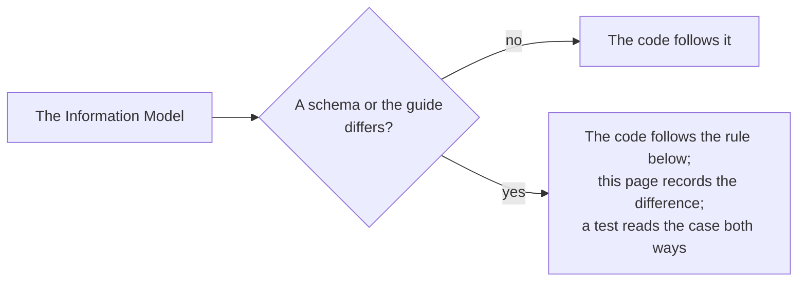

# Gaps in the specifications

Where the Information Model, the JSON schemas and the Implementation Guide disagree, or say nothing, the package follows the
rule below and a test pins the choice. The schemas are those that `pnpm schemas` downloads at pinned hashes.

| Where                                                          | What the specifications say                                                                                                                                                                                                                                                                                                                                                                                                                                                                                                 | What the package does                                                                                                                                                                                                                                                                                          |
| -------------------------------------------------------------- | --------------------------------------------------------------------------------------------------------------------------------------------------------------------------------------------------------------------------------------------------------------------------------------------------------------------------------------------------------------------------------------------------------------------------------------------------------------------------------------------------------------------------- | -------------------------------------------------------------------------------------------------------------------------------------------------------------------------------------------------------------------------------------------------------------------------------------------------------------- |
| A member named `__proto__`, `constructor` or `prototype`       | The schemas take any name for a member of `extensions`                                                                                                                                                                                                                                                                                                                                                                                                                                                                      | Refuses it with `invalid-value`, at any depth, as every reader of the family does: a schema library would drop it, and an assignment would set a prototype. The generator of the corpus tests makes no such member, and a test pins the refusal                                                                |
| `caseVersion` of a document                                    | The Information Model has it optional. The Implementation Guide 3.3.5 makes it required in 1.1 and forbids it in 1.0                                                                                                                                                                                                                                                                                                                                                                                                        | Reads a document without it, as a package of 1.0 has none. `convertCaseVersion` leaves it out for 1.0                                                                                                                                                                                                          |
| The form of an identifier                                      | The Information Model 7.2.3 gives lower case, version 1 to 5 and variant 8 to b. The 1.1 schemas ask for `format: uuid`. The 1.0 schemas have the pattern without anchors                                                                                                                                                                                                                                                                                                                                                   | 1.1 reads any 8-4-4-4-12 form and warns with `identifier-form`; 1.0 holds to the pattern, anchored                                                                                                                                                                                                             |
| `CFItems` and `CFAssociations` of a package                    | The Implementation Guide 3.1 says that a package must include both. The Information Model has `[0..unbounded]` and the schemas require only `CFDocument`                                                                                                                                                                                                                                                                                                                                                                    | Reads a package without them and does not add them. Absent and empty mean the same                                                                                                                                                                                                                             |
| `extensions` of a rubric criterion level                       | A list of objects in the schema and the Information Model, and one object in every other class                                                                                                                                                                                                                                                                                                                                                                                                                              | Follows the schema                                                                                                                                                                                                                                                                                             |
| `invalid_filter_field`                                         | The REST binding answers a filter that it cannot read with it. The enumeration of the Information Model and the schema stop at `invalid_selection_field`                                                                                                                                                                                                                                                                                                                                                                    | Accepts it in a status. The provider answers with it, and a test pins that the schema refuses that one code                                                                                                                                                                                                    |
| The codes of a status of 1.0                                   | The Information Model has `unauthorised_request` and `invalid_uuid`; the 1.0 schema spells them `unauthorisedrequest` and `invaliduuid`                                                                                                                                                                                                                                                                                                                                                                                     | Reads the spelling of the Information Model in both versions. The provider writes it on both paths, and a test pins the two codes in which its answer of 1.0 differs from the schema of 1.0                                                                                                                    |
| The vocabulary of `ext:`                                       | The pattern of the schema is not anchored and its class of characters holds `\|` and has no hyphen; the Information Model says that the term must start with `ext:`                                                                                                                                                                                                                                                                                                                                                         | Anchors it, with letters, digits, `.`, `-` and `_`                                                                                                                                                                                                                                                             |
| `uri`                                                          | `AnyURI` in the Information Model, a plain string in the 1.1 schemas, `format: uri` in the 1.0 schemas, which a validator reads with the strict grammar of RFC 3986                                                                                                                                                                                                                                                                                                                                                         | 1.1 reads any string; 1.0 needs a scheme, no white space, and a text that `URL` parses, which differs from the validator for `foo:`, `x:` and `https://`                                                                                                                                                       |
| Dates                                                          | ISO 8601 in the Information Model, `format: date-time` and `date` in the schemas                                                                                                                                                                                                                                                                                                                                                                                                                                            | RFC 3339 with an offset: `T`, and `hh:mm` for an offset                                                                                                                                                                                                                                                        |
| A node of an association that is not of CASE                   | 1.0 has no `targetType`, so every node is read as a node of CASE                                                                                                                                                                                                                                                                                                                                                                                                                                                            | `convertCaseVersion` leaves such an association out of the 1.0 form and reports it                                                                                                                                                                                                                             |
| An association type that 1.0 lacks                             | `isTranslationOf` and `ext:` terms are new in 1.1; the 1.0 schemas list nine types                                                                                                                                                                                                                                                                                                                                                                                                                                          | `convertCaseVersion` leaves the association out and reports it                                                                                                                                                                                                                                                 |
| The associations of a package                                  | Information Model 3.3 says that a package holds the associations of its own document and items, and not what they point to                                                                                                                                                                                                                                                                                                                                                                                                  | A node outside the package is allowed; an association with both nodes outside it is a warning                                                                                                                                                                                                                  |
| A link to the document or the package in the form of a package | The schemas and the Information Model have no `CFDocumentURI` in an item or an association of a package, nor `CFPackageURI` in its document, and the standalone `CFItem` and `CFDocument` require them. South Carolina's provider writes them in its packages, and OpenSALT in the associations of `/CFItemAssociations`, so the published schemas refuse what two real providers publish. Readers of the family read a known deviation of a real provider when its meaning is plain, as the LTI tool reads a Canvas launch | The readers read such a link as the class outside a package has it, leave it out of the result, and warn with `package-form-link`, once for each list that has them; a link that names another document than the package's is a `reference-mismatch` warning. A link of another shape is an error, as anywhere |
| Items that are not under the document                          | The 1.0 schema says that the items are the components, direct or indirect, of the document; nothing makes a package refuse an item with no `isChildOf` path to it                                                                                                                                                                                                                                                                                                                                                           | `item-outside-tree` is a warning                                                                                                                                                                                                                                                                               |
| The rubric example of the Implementation Guide 3.3.3           | The example has an identifier that is not a UUID, no `uri` or `creator`, a time without an offset, and its items inside the document                                                                                                                                                                                                                                                                                                                                                                                        | It is not a package: a test reads it and pins the findings                                                                                                                                                                                                                                                     |
| The course codes example of the Implementation Guide 4.5.1     | The example has no `creator`, `title` or `lastChangeDateTime`, a `subject` that is a string, a `HumanCodingScheme` that CASE spells `humanCodingScheme`, and `CFItemTypes` at the top of the package                                                                                                                                                                                                                                                                                                                        | It is not a package: a test reads it and pins the findings                                                                                                                                                                                                                                                     |
| The examples of the REST binding                               | They are templates with `..String..` where a value goes, so that none can be read                                                                                                                                                                                                                                                                                                                                                                                                                                           | None is read; the schemas stand for them                                                                                                                                                                                                                                                                       |
| Identifiers and URIs that 1.0 refuses                          | 1.0 holds an identifier to the pattern of the Information Model and a `uri` to a URI; 1.1 reads any UUID and any string, and a provider may hold both in one store                                                                                                                                                                                                                                                                                                                                                          | `convertCaseVersion` keeps the value and reports it as `form-not-in-1.0`                                                                                                                                                                                                                                       |
| An empty page of the list of documents                         | `CFDocumentSet` requires at least one document (Information Model 7.1.13, `minItems` 1). Binding 3.1 has pages and totals, and says nothing of a page that has no document                                                                                                                                                                                                                                                                                                                                                  | The provider answers `{ "CFDocuments": [] }` with `X-Total-Count`, so that a consumer can page to the end and a filter can match nothing; a test pins that the schema refuses it                                                                                                                               |
| The OpenAPI file of CASE 1.1                                   | Its schemas hold the identifier to the pattern of 1.0 (lower case, version 1 to 5) and `uri` to `format: uri`, where the JSON schemas of 1.1 take any UUID and any string                                                                                                                                                                                                                                                                                                                                                   | The tests generate answers from the file, so that they use those forms; the provider serves what the store holds                                                                                                                                                                                               |
| A sort by a property that does not exist                       | Binding 3.2 returns the provider's order; it says nothing of a direction that is not `asc` or `desc`                                                                                                                                                                                                                                                                                                                                                                                                                        | The provider's order, and the same for a direction that is not one of the two                                                                                                                                                                                                                                  |
| A name in `fields` that is not a property                      | Binding 3.4 returns all data for a non-existent field and refuses a blank one with `invalid_selection_field`                                                                                                                                                                                                                                                                                                                                                                                                                | A name that is not a property is left out, all properties are returned when none is one, and a blank name is refused                                                                                                                                                                                           |
| The filter grammar                                             | Binding 3.3 gives `field<predicate>'value'` with one `AND` or `OR`, values in single quotes, and shows two examples; it says nothing of a quote in a value or of nested paths                                                                                                                                                                                                                                                                                                                                               | A quote in a value is written twice and a single quote that ends neither the filter nor an `AND` or `OR` is an apostrophe; only the first name of a path is checked                                                                                                                                            |
| A filter on a list                                             | Binding 3.3: `=` has AND semantics and `~` has OR semantics, shown by one record with three subjects and six filters                                                                                                                                                                                                                                                                                                                                                                                                        | `=` and `!=` compare the list with the texts as sets, `~` looks for any text in any member, an order predicate asks for one member. A test reads the six cases                                                                                                                                                 |
| Text in a filter                                               | Binding 3.3 asks for case-insensitive values and the Unicode Collation Algorithm                                                                                                                                                                                                                                                                                                                                                                                                                                            | Equality and order by the collation of the locale at the accent level; `~` compares text lower-cased for the locale, because JavaScript has no search by collation                                                                                                                                             |
| A comparison of numbers and dates                              | Binding 3.3 types metadata loosely and says nothing of dates                                                                                                                                                                                                                                                                                                                                                                                                                                                                | A number compares as a number against a value that reads as one, a date and time of RFC 3339 by its instant, anything else as text                                                                                                                                                                             |
| The `Link` header                                              | Binding 3.1 recommends it; its example changes the `limit` of the last link                                                                                                                                                                                                                                                                                                                                                                                                                                                 | The last link keeps the `limit`; first and last are always sent, previous and next when there is such a page                                                                                                                                                                                                   |
| Parameters on the endpoints of one object                      | Binding 2.3 gives them none, and the table of 2.4 lists 400 `invalid_selection_field` for each                                                                                                                                                                                                                                                                                                                                                                                                                              | The parameters are ignored and the endpoints never answer 400                                                                                                                                                                                                                                                  |
| The discovery file of 1.0                                      | Binding 2.5 of 1.1 names the file of 1.1                                                                                                                                                                                                                                                                                                                                                                                                                                                                                    | The provider serves the file at the path of 1.1 only; the document it is given describes 1.1                                                                                                                                                                                                                   |
| Methods other than GET                                         | The binding lists GET for every endpoint                                                                                                                                                                                                                                                                                                                                                                                                                                                                                    | 405 with `Allow: GET`, for HEAD too                                                                                                                                                                                                                                                                            |
| The challenge of a 401                                         | The binding names the Security Framework, which uses bearer tokens                                                                                                                                                                                                                                                                                                                                                                                                                                                          | `WWW-Authenticate: Bearer`                                                                                                                                                                                                                                                                                     |
| An item in more than one place of the tree                     | The Implementation Guide 4.4 says that each item belongs in one place and gives aliasing for reuse; no rule forbids a package from placing an item under two parents                                                                                                                                                                                                                                                                                                                                                        | `buildFrameworkTree` places the item once, under the first parent that a walk from the document reaches level by level                                                                                                                                                                                         |
| An association type outside the vocabulary                     | The Implementation Guide 4.7 asks a consumer to treat an unknown `ext:` type as `isRelatedTo` if it has no other information                                                                                                                                                                                                                                                                                                                                                                                                | `crosswalk` lists the types it is asked for and `ext:` terms among them; none is added on its own                                                                                                                                                                                                              |
| The adoption status                                            | The specification fixes no vocabulary. The Implementation Guide 4.2 recommends four terms and reads `Adopted` and `Deprecated` of 1.0 as `Implemented` and `Retired`                                                                                                                                                                                                                                                                                                                                                        | `readAdoptionStatus` reads those six terms, ignoring case, and gives nothing for another                                                                                                                                                                                                                       |
| A single quote in a value of a filter, written by the client   | The REST binding 3.3 requires values in single quotes and gives no way to write a quote inside one                                                                                                                                                                                                                                                                                                                                                                                                                          | The client writes a quote twice, as the provider of this package reads it; another provider may read it otherwise, and the caller then cuts the value at the quote and filters with `~`                                                                                                                        |
| The discovery file of 1.0, asked by the client                 | The REST binding of 1.1 (2.5) defines the file; the binding of 1.0 has no such section                                                                                                                                                                                                                                                                                                                                                                                                                                      | A client of 1.0 refuses `discovery`                                                                                                                                                                                                                                                                            |
| `X-Total-Count` and `Link`, read by the client                 | The binding 3.1 recommends both and requires neither                                                                                                                                                                                                                                                                                                                                                                                                                                                                        | The iteration of the documents uses the count, else the `Link` header, else the size of a page, and never requests an address from `Link`                                                                                                                                                                      |
| 404 for an unknown object, read by the client                  | The binding 2.4 answers 404 with `unknownobject` or `invalid_uuid`, both with an `imsx_StatusInfo`                                                                                                                                                                                                                                                                                                                                                                                                                          | A call for one entity gives `undefined` for any 404                                                                                                                                                                                                                                                            |
| `Retry-After`                                                  | The binding says "Retry at a later time" for 429 and names no header                                                                                                                                                                                                                                                                                                                                                                                                                                                        | `readStatusInfo` reads `Retry-After` as seconds when the provider sends it                                                                                                                                                                                                                                     |
| The date in the example of a filter                            | The binding 3.3 encodes `2016-12-12` as `2016%3D12%3D12`                                                                                                                                                                                                                                                                                                                                                                                                                                                                    | A slip: the dashes are not encoded. The first example of the binding, `version%3D%271.0%27`, is the reference of the encoding                                                                                                                                                                                  |
