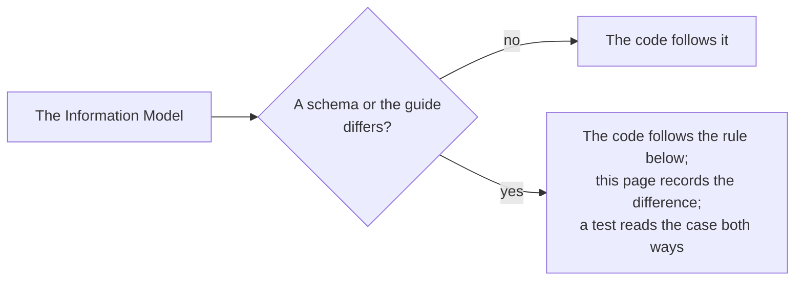

# Gaps in the specifications

Where the Information Model, the JSON schemas and the Implementation Guide disagree, or say nothing, the package follows the
rule below and a test pins the choice. The schemas are those that `pnpm schemas` downloads at pinned hashes.

| Where                                                      | What the specifications say                                                                                                                                                                          | What the package does                                                                                                                                    |
| ---------------------------------------------------------- | ---------------------------------------------------------------------------------------------------------------------------------------------------------------------------------------------------- | -------------------------------------------------------------------------------------------------------------------------------------------------------- |
| `caseVersion` of a document                                | The Information Model has it optional. The Implementation Guide 3.3.5 makes it required in 1.1 and forbids it in 1.0                                                                                 | Reads a document without it, as a package of 1.0 has none. `toCaseVersion` leaves it out for 1.0                                                         |
| The form of an identifier                                  | The Information Model 7.2.3 gives lower case, version 1 to 5 and variant 8 to b. The 1.1 schemas ask for `format: uuid`. The 1.0 schemas have the pattern without anchors                            | 1.1 reads any 8-4-4-4-12 form and warns with `identifier-form`; 1.0 holds to the pattern, anchored                                                       |
| `CFItems` and `CFAssociations` of a package                | The Implementation Guide 3.1 says that a package must include both. The Information Model has `[0..unbounded]` and the schemas require only `CFDocument`                                             | Reads a package without them and does not add them. Absent and empty mean the same                                                                       |
| `extensions` of a rubric criterion level                   | A list of objects in the schema and the Information Model, and one object in every other class                                                                                                       | Follows the schema                                                                                                                                       |
| `invalid_filter_field`                                     | The REST binding answers a filter that it cannot read with it. The enumeration of the Information Model and the schema stop at `invalid_selection_field`                                             | Accepts it in a status                                                                                                                                   |
| The codes of a status of 1.0                               | The Information Model has `unauthorised_request` and `invalid_uuid`; the 1.0 schema spells them `unauthorisedrequest` and `invaliduuid`                                                              | Reads the spelling of the Information Model in both versions                                                                                             |
| The vocabulary of `ext:`                                   | The pattern of the schema is not anchored and its class of characters holds `\|` and has no hyphen; the Information Model says that the term must start with `ext:`                                  | Anchors it, with letters, digits, `.`, `-` and `_`                                                                                                       |
| `uri`                                                      | `AnyURI` in the Information Model, a plain string in the 1.1 schemas, `format: uri` in the 1.0 schemas, which a validator reads with the strict grammar of RFC 3986                                  | 1.1 reads any string; 1.0 needs a scheme, no white space, and a text that `URL` parses, which differs from the validator for `foo:`, `x:` and `https://` |
| Dates                                                      | ISO 8601 in the Information Model, `format: date-time` and `date` in the schemas                                                                                                                     | RFC 3339 with an offset: `T`, and `hh:mm` for an offset                                                                                                  |
| A node of an association that is not of CASE               | 1.0 has no `targetType`, so every node is read as a node of CASE                                                                                                                                     | `toCaseVersion` leaves such an association out of the 1.0 form and reports it                                                                            |
| An association type that 1.0 lacks                         | `isTranslationOf` and `ext:` terms are new in 1.1; the 1.0 schemas list nine types                                                                                                                   | `toCaseVersion` leaves the association out and reports it                                                                                                |
| The associations of a package                              | Information Model 3.3 says that a package holds the associations of its own document and items, and not what they point to                                                                           | A node outside the package is allowed; an association with both nodes outside it is a warning                                                            |
| A package with no `CFDocumentURI` on its items             | The schema of a package has no such property and refuses it; the standalone `CFItem` requires it                                                                                                     | The package form refuses it; `CFItem` requires it                                                                                                        |
| Items that are not under the document                      | The 1.0 schema says that the items are the components, direct or indirect, of the document; nothing makes a package refuse an item with no `isChildOf` path to it                                    | `item-outside-tree` is a warning                                                                                                                         |
| The rubric example of the Implementation Guide 3.3.3       | The example has an identifier that is not a UUID, no `uri` or `creator`, a time without an offset, and its items inside the document                                                                 | It is not a package: a test reads it and pins the findings                                                                                               |
| The course codes example of the Implementation Guide 4.5.1 | The example has no `creator`, `title` or `lastChangeDateTime`, a `subject` that is a string, a `HumanCodingScheme` that CASE spells `humanCodingScheme`, and `CFItemTypes` at the top of the package | It is not a package: a test reads it and pins the findings                                                                                               |
| The examples of the REST binding                           | They are templates with `..String..` where a value goes, so that none can be read                                                                                                                    | None is read; the schemas stand for them                                                                                                                 |
| Identifiers and URIs that 1.0 refuses                      | 1.0 holds an identifier to the pattern of the Information Model and a `uri` to a URI; 1.1 reads any UUID and any string, and a provider may hold both in one store                                   | `toCaseVersion` keeps the value and reports it as `form-not-in-1.0`                                                                                      |
