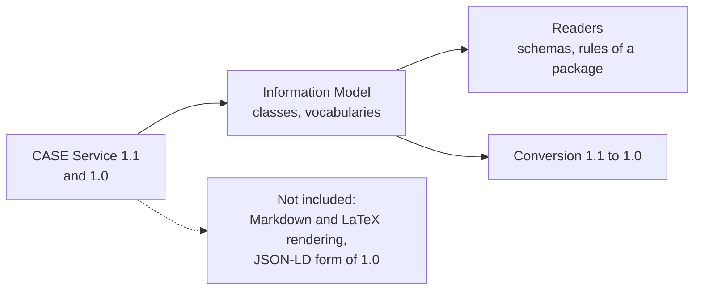

# Supported

What `@interopkit/competency-frameworks` implements of CASE. The package implements these specifications and is not certified
by 1EdTech. It claims no conformance of a provider or a consumer.

| Area                                 | Specification                      | Included                                                                                                                                                                      |
| ------------------------------------ | ---------------------------------- | ----------------------------------------------------------------------------------------------------------------------------------------------------------------------------- |
| The package                          | Information Model 7.1.21           | `CasePackage`: one document, items, associations, definitions, rubrics, `extensions`                                                                                          |
| The document, items and associations | Information Model 7.1.1 to 7.1.25  | In a package (`CFPckg*`) and outside it (`CFDocument`, `CFItem`, `CFAssociation`)                                                                                             |
| The definitions                      | Information Model 7.1.6 to 7.1.19  | `CFConcept`, `CFSubject`, `CFLicense`, `CFItemType`, `CFAssociationGrouping`, `CFDefinition`                                                                                  |
| Rubrics                              | Information Model 7.1.26 to 7.1.31 | `CFRubric`, `CFRubricCriterion`, `CFRubricCriterionLevel`                                                                                                                     |
| The sets                             | Information Model 7.1.5 to 7.1.34  | `CFDocumentSet`, `CFAssociationSet`, `CFConceptSet`, `CFSubjectSet`, `CFItemTypeSet`                                                                                          |
| Links                                | Information Model 7.1.35, 7.1.36   | `LinkURI`, `LinkGenURI` with `targetType`                                                                                                                                     |
| Status                               | Information Model 7.1.37 to 7.1.39 | `ImsxStatusInfo`, read as the kind `imsx_StatusInfo`, the codes of 7.4.4 to 7.4.6 and `invalid_filter_field` of the REST binding                                              |
| Vocabularies                         | Information Model 7.3, 7.4         | Ten association types, `ext:` terms, `TargetType`, `caseVersion`                                                                                                              |
| 1.1 additions                        | Information Model 1.3              | `frameworkType`, `caseVersion`, item `subject` and `subjectURI`, association `notes`, `targetType`, `isTranslationOf`, `extensions` on 13 classes, Markdown and LaTeX as text |
| Package integrity                    | Information Model 3.3, Guide 3.1   | One document, unique identifiers, links that resolve, `isChildOf` without loops, nodes that agree in URI, items in the tree                                                   |
| CASE 1.0 consumers                   | Information Model 1.3              | Reading 1.0, `toCaseVersion` for a package, an entity and a set, and the forms that 1.0 refuses reported                                                                      |
| JSON schemas                         | The schemas of 1EdTech             | Every class of both versions, compared in the tests with the published files at pinned hashes                                                                                 |

## Not included

| Not included                                    | Why                                                             |
| ----------------------------------------------- | --------------------------------------------------------------- |
| Rendering Markdown and LaTeX                    | The consumer's interface does it, through a sanitizing renderer |
| The JSON-LD form of CASE 1.0                    | A document form of 1.0 that 1.1 does not have                   |
| Writing identifiers and URIs for a framework    | The host's identifiers are its own; the readers check them      |
| Service endpoints, paging, filtering, discovery | Not part of the model                                           |
